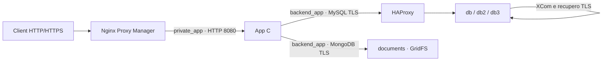

# punto — Commesse e ore di lavoro in C

Web app in italiano con server HTTP in C e interfaccia responsive in HTML, CSS e JavaScript, senza pacchetti npm. Gestisce utenti, gruppi gerarchici, ruoli sulle commesse, fornitori, contratti e PDF originali, registrazioni delle ore e storico delle modifiche.

Sono disponibili due modalità indipendenti: **Docker con MySQL** per i dati strutturati e **MongoDB GridFS** per i PDF, oppure **avvio nativo con SQLite** e archivio documentale locale. Le due modalità non condividono dati e non eseguono importazioni automatiche.

## Avvio con Docker e cluster MySQL

Servono **Docker Engine 28 o successivo**, **Docker Compose 2.36.0 o successivo**, Python 3 e OpenSSL. La versione del daemon deve supportare il gateway bridge `isolated`; Compose deve supportare `gw_priority` e `interface_name`. Su macOS queste funzionalità sono fornite dal daemon Linux di Docker Desktop. La configurazione locale usa **tre istanze MySQL 8.4 con Group Replication multi-primary**, un proxy TCP HAProxy 3.2, MongoDB 8.0 e l’app C. Dalla cartella del progetto:

```sh
cp .env.docker.example .env.docker
```

Apri `.env.docker`, scegli l’email del primo gestore e compila `PUNTO_PASSWORD`, `MYSQL_PASSWORD` e `MYSQL_ROOT_PASSWORD` con password diverse. Imposta anche `NPM_ADMIN_EMAIL` e una password distinta in `NPM_ADMIN_PASSWORD` per il pannello del reverse proxy. Puoi lasciare vuote `CLUSTER_REPLICATION_PASSWORD`, `CLUSTER_MONITOR_PASSWORD`, `DOC_DB_PASSWORD` e `DOC_DB_ROOT_PASSWORD`: `init` genera e salva nel file quattro password interne distinte di 32 caratteri ASCII. Se scegli manualmente la password di replica, il limite è **32 byte**. Non riutilizzare la password del gestore. Il file contiene credenziali e viene escluso dal versionamento.

Il primo avvio, compreso il passaggio dal precedente database MySQL singolo, va eseguito con:

```sh
python3 scripts/configure_network.py --env-file .env.docker prepare
python3 scripts/manage_cluster.py --env-file .env.docker init
python3 scripts/manage_cluster.py --env-file .env.docker status
```

`prepare` prepara la CA privata locale e i certificati interni in `data/network-tls/`, oppure verifica il bundle già presente. Per aggiungere MongoDB a un’installazione precedente genera soltanto il certificato documentale mancante, firmato dalla CA esistente: non ruota la CA o i certificati MySQL. La directory sull’host ha permessi `0700`; la chiave privata della CA ha permessi `0600` e **non viene montata in alcun container**. App e monitor ricevono soltanto `ca.crt`, montato in sola lettura su `/etc/punto/tls/ca.crt`; ciascun nodo MySQL riceve il proprio certificato, la propria chiave server e la CA pubblica in mount separati. Le chiavi server hanno permessi `0444` per consentire la lettura all’UID MySQL attraverso il bind mount, mentre la directory host `0700` ne limita l’accesso locale. Nessun nodo riceve le chiavi degli altri membri. MongoDB riceve soltanto la CA pubblica e il proprio bundle `documents.pem`, anch’esso in sola lettura e protetto dalla directory host `0700`. I materiali locali non vengono inclusi nel repository o nelle immagini. Prima di avviare i servizi deve essere disponibile il materiale TLS atteso dai mount Compose.

La CA locale dura dieci anni e i certificati server un anno. **Il rinnovo è manuale**: conservare una copia protetta del bundle e pianificare la sostituzione dei certificati prima della scadenza. `prepare` verifica corrispondenza chiave/certificato, CA, nomi e IP; se un certificato è incompleto, non valido o scade entro un giorno si ferma senza sovrascrivere le chiavi. Non eliminare il bundle per ottenere un rinnovo, perché ciò creerebbe una nuova CA e richiederebbe l’aggiornamento coordinato della fiducia in tutti i servizi.

Lo script ferma l’app durante la preparazione, esegue un backup dei dati del primo nodo, inizializza i nuovi nodi vuoti con una copia coerente, crea il gruppo e avvia gli altri servizi. Il primo nodo conserva il volume `mysql_data` già usato dal progetto: non occorre eliminare il database per aggiungere le repliche. Il file locale `data/cluster-state.json` conserva i marcatori dei nodi già preparati, così il seed non viene ripetuto sui dati esistenti. Gli account interni vengono creati su ciascun nodo e il seed viene importato localmente, senza registrare le password nell’output del controller. Su macOS il comando usa per impostazione predefinita il contesto Docker `desktop-linux`; `--docker-context` permette di sceglierne un altro.

Per aggiornare un’installazione esistente con fornitori, contratti e MongoDB, **esegui prima un backup SQL con la configurazione precedente**, conserva `.env.docker` e i volumi, poi aggiorna il codice. Aggiungi le nuove variabili documentali dal modello senza sovrascrivere le credenziali esistenti ed esegui `prepare` e `init` come sopra. Se `data/cluster-state.json` indica un cluster già inizializzato, `init` genera le sole password mancanti e richiama il recupero: non ripete il seed. L’app applica le migrazioni fino alla versione 3, conservando utenti, commesse, registrazioni e abilitazioni; Compose avvia MongoDB come dipendenza dell’app. L’aggiornamento da versione 2 aggiunge gruppi e ruoli: ogni abilitazione precedente diventa Collaboratore, senza ampliare gli utenti autorizzati.

Per applicare la segmentazione e il TLS a un **cluster già inizializzato**, usa invece:

```sh
python3 scripts/configure_network.py --env-file .env.docker apply
```

Il comando prepara i certificati, crea un backup, ricrea i container con le reti aggiornate, recupera il gruppo e ricompila l’app e il proxy. Conserva i volumi MySQL e i dati NPM. L’operazione comporta una breve interruzione dell’app; non sostituire questa procedura con un nuovo seed o con la cancellazione dei volumi.

La migrazione iniziale supporta il precedente database singolo con GTID disattivati e storico `@@gtid_executed` vuoto. Se la sorgente ha già transazioni GTID, `init` si ferma esplicitamente: occorre un clone o un seed con il corretto checkpoint GTID per evitare transazioni duplicate. L’immagine MySQL ufficiale può generare GTID durante l’inizializzazione dei nuovi nodi; il controller li azzera prima dell’importazione soltanto se il nodo è `OFFLINE`, il database applicativo è vuoto, non esistono altre tabelle di dati utente e tutti i GTID appartengono al suo UUID locale. Un nodo che non soddisfa questi controlli non viene sovrascritto.

In `docker/mysql/cluster.cnf` le opzioni del plugin hanno il prefisso `loose-group_replication_`: consente la fase `mysqld --initialize`, durante la quale il plugin non è ancora caricato. Dopo l’avvio il controller verifica le variabili effettive del server prima di inizializzare o recuperare il gruppo.

Apri [http://localhost](http://localhost) tramite Nginx Proxy Manager e accedi con `PUNTO_EMAIL` e `PUNTO_PASSWORD` impostati nel file. Su una nuova installazione configura anche gli inoltri NPM come descritto nella sezione del reverse proxy. `NPM_HTTP_PORT` cambia la porta HTTP pubblicata. L’app non pubblica una porta diretta sull’host: il precedente accesso su `8082` è rimosso. Lo schema e il primo gestore vengono creati quando necessario. Il container applicativo legge e scrive in MySQL e non utilizza `data/punto.db`.

### Servizi, dati e disponibilità

| Servizio | Funzione | Persistenza |
| --- | --- | --- |
| `db` | Primo membro MySQL, scrivibile | Volume esistente `mysql_data` |
| `db2` | Secondo membro MySQL, scrivibile | Volume `mysql_data_2` |
| `db3` | Terzo membro MySQL, scrivibile | Volume `mysql_data_3` |
| `db-proxy` | HAProxy: connessioni TCP distribuite sui membri disponibili, porta interna `3306` | Configurazione del progetto |
| `documents` | MongoDB 8.0: PDF originali in GridFS, porta interna `27017` | Volumi `documents_data` e `documents_config` |
| `app` | Server C, con `DB_HOST=db-proxy` e `DOC_DB_HOST=documents` | Dati strutturati nel cluster; PDF in MongoDB |
| `nginx-proxy-manager` | Reverse proxy HTTP/HTTPS e pannello amministrativo | Directory locali NPM |

Ogni membro MySQL conserva una copia completa di utenti, gruppi, appartenenze, ruoli, fornitori, contratti, metadati documentali, commesse, abilitazioni, ore e storico. Tutti e tre possono ricevere scritture; HAProxy sceglie un nodo per ciascuna nuova connessione, mantenendo su quel nodo l’intera transazione. Il monitor ammette nel bilanciamento soltanto membri `ONLINE`, con ruolo `PRIMARY`, scrivibili e con almeno due membri disponibili. MySQL e HAProxy non pubblicano porte database sull’host; il loro traffico rimane sulla rete Compose `backend_app`.

Il **quorum è 2 su 3**: il gruppo può continuare a lavorare se un membro si arresta. Con due membri indisponibili le scritture vengono bloccate per proteggere la consistenza. Group Replication e le sue limitazioni sono descritte nel [manuale Oracle MySQL 8.4](https://dev.mysql.com/doc/refman/8.4/en/group-replication-multi-primary-mode.html).

Questa configurazione protegge dal guasto di una singola istanza MySQL. I tre container sullo stesso computer condividono ancora il guasto dell’host; l’app C, il singolo HAProxy e la singola istanza MongoDB restano punti di guasto. MongoDB non è configurato come replica set e non offre HA. Se MongoDB diventa indisponibile mentre l’app è già avviata, le operazioni SQL su fornitori e contratti restano utilizzabili, mentre caricamenti e download PDF falliscono esplicitamente. All’avvio Compose attende invece che MongoDB sia sano prima di avviare l’app. Per proteggere l’intero servizio servono anche host distinti e ridondanza dei componenti applicativi e di rete.

Il cluster usa isolamento `READ COMMITTED` e consistenza `BEFORE_AND_AFTER`. La tabella interna `cluster_write_guard` viene aggiornata nella stessa transazione delle modifiche applicative: crea un conflitto rilevabile tra scritture concorrenti e protegge controlli quali il limite delle ore giornaliere e l’ultimo gestore attivo. Questa scelta riduce la concorrenza delle scritture; i conflitti di certificazione, incluso l’errore MySQL `3101`, annullano la transazione e vengono trattati come errori temporanei. Il driver ristabilisce le connessioni fuori dalle transazioni e **non ripete un commit con esito incerto**.

MySQL impone `require_secure_transport=ON`: le connessioni TCP devono usare TLS, mentre l’amministrazione locale può usare il socket Unix. L’app usa `DB_TLS_MODE=verify_identity` e `DB_SSL_CA=/etc/punto/tls/ca.crt`; anche il monitor verifica il certificato server rispetto alla CA privata locale e al nome della destinazione. HAProxy inoltra il protocollo MySQL senza terminare TLS; i SAN dei certificati comprendono `db-proxy`, il nome del rispettivo nodo (`db`, `db2` o `db3`) e soltanto il suo IP statico. XCom usa `VERIFY_IDENTITY`; il recupero usa TLS con verifica del certificato del donatore. Gli account interni `punto_recovery` e `punto_monitor` richiedono SSL. Il TLS del database è separato dal certificato HTTPS gestito da NPM. [TLS MySQL](https://dev.mysql.com/doc/refman/8.4/en/using-encrypted-connections.html), [TLS Group Replication](https://dev.mysql.com/doc/refman/8.4/en/group-replication-secure-socket-layer-support-ssl.html), [TLS del recupero](https://dev.mysql.com/doc/refman/8.4/en/group-replication-configuring-ssl-for-recovery.html)

### Segmentazione e sicurezza di rete



| Rete e interfaccia nel container | Subnet | Membri | Accesso esterno |
| --- | --- | --- | --- |
| `public` | `172.30.10.0/24` | Solo `nginx-proxy-manager` | Bridge normale; porte host HTTP/HTTPS e pannello locale |
| `private_app` | `172.30.20.0/24` | `nginx-proxy-manager`, `app` | `internal: true`, gateway bridge `isolated` |
| `backend_app` | `172.30.30.0/24` | `app`, `db-proxy`, `db`, `db2`, `db3`, `documents` | `internal: true`, gateway bridge `isolated` |

NPM ha la connettività esterna necessaria per ricevere richieste e gestire i certificati HTTPS. App e componenti database sono collegati soltanto a reti interne: non dispongono di una normale uscita verso Internet. La modalità `isolated` elimina anche l’indirizzo gateway del bridge; `internal: true` da solo non elimina tale indirizzo. [Reti Compose](https://docs.docker.com/reference/compose-file/networks/#internal), [gateway Docker](https://docs.docker.com/engine/network/port-publishing/#gateway-modes)

L’app ascolta su **`172.30.20.10:8080`**, soltanto sull’indirizzo `private_app`; il controllo di salute interno usa lo stesso indirizzo. Il suo indirizzo `backend_app` **`172.30.30.10`** non espone HTTP. NPM usa **`172.30.10.2`** su `public` e **`172.30.20.2`** su `private_app`; HAProxy usa **`172.30.30.20`**. MongoDB ascolta soltanto sul proprio loopback e su **`172.30.30.30:27017`**, senza porte pubblicate sull’host. I membri MySQL usano gli indirizzi **`172.30.30.21`**, **`.22`** e **`.23`**; l’allowlist XCom accetta soltanto questi tre peer. X Protocol è disattivato, quindi non viene aperta la porta MySQL `33060`. Le interfacce IPv4 dentro i container hanno i nomi delle rispettive reti. Le subnet definite in Compose devono essere libere e non sovrapposte alle reti dell’ambiente; una modifica degli indirizzi richiede l’aggiornamento coordinato di bind, allowlist e SAN dei certificati.

MongoDB impone `requireTLS`, disabilita TLS 1.0/1.1 e richiede autenticazione. L’app verifica CA e nome `documents` senza consentire certificati o hostname non validi, e usa un account `SCRAM-SHA-256` con ruolo `readWrite` limitato a `DOC_DB_NAME`; non riceve le credenziali root MongoDB. NPM non è collegato alla rete documentale. Come per MySQL, i membri della rete backend condivisa possono raggiungere la porta TCP: TLS e autorizzazioni restano necessari.

Il forwarding IP dei container è disattivato. I servizi non ricevono `NET_ADMIN` o `NET_RAW`, non sono privilegiati, non montano il socket Docker e usano il blocco dell’acquisizione di nuovi privilegi. Questi controlli impediscono ai processi ordinari di trasformare i container in router o modificare le interfacce di rete.

La segmentazione limita i collegamenti tra reti, ma **non applica ACL per porta tra i membri di `backend_app`**: l’app condivide la rete dei server MySQL e potrebbe aprire connessioni dirette alle loro porte SQL. Autenticazione, TLS e permessi MySQL restano necessari. L’allowlist XCom restringe il protocollo di comunicazione del gruppo ai tre DB e non costituisce un firewall generale sulla rete backend. Per una matrice di flussi più restrittiva occorrono regole firewall del daemon/host o un sistema di network policy.

L’immagine NPM derivata limita invece i listener amministrativi: l’API interna sulla porta `3000` ascolta soltanto sul loopback del container, il pannello sulla porta `81` soltanto su loopback e sull’indirizzo `public` `172.30.10.2`. Il pannello non ascolta su `172.30.20.2`, quindi l’app non dispone di accesso amministrativo tramite `private_app`. L’host pubblica `81` soltanto su `127.0.0.1`; la rete `public` contiene soltanto NPM.

Su Docker Desktop le reti bridge risiedono nella VM Linux, quindi non costituiscono interfacce direttamente instradabili dal Mac. Chi amministra Docker o l’host può comunque collegare container alle reti o accedere ai volumi: questa configurazione non separa il servizio dall’amministratore dell’infrastruttura. Il collegamento HTTP NPM → app resta sulla rete privata; il TLS del database non lo trasforma in HTTPS. [Networking Docker Desktop](https://docs.docker.com/desktop/features/networking/networking-how-tos/#known-limitations)

### Backup congiunto dei dati e dei PDF

Il dump MySQL contiene `contract_documents`, ma **non contiene i PDF**. `scripts/backup_documents.py` usa `mongodump` sul database documentale e crea in `backups/` un archivio `documents-*.archive.gz` con permessi `0600`, senza stampare credenziali. La compressione gzip non cifra il contenuto. Conserva insieme il dump SQL, l’archivio MongoDB e i materiali di ripristino protetti.

I due database non condividono una transazione o uno snapshot coordinato. Per una coppia coerente sospendi tutte le scritture; nello stack locale, senza altri client che scrivano direttamente, puoi fermare l’app durante entrambi i backup:

```sh
docker compose --env-file .env.docker stop app
python3 scripts/manage_cluster.py --env-file .env.docker backup
python3 scripts/backup_documents.py --env-file .env.docker
docker compose --env-file .env.docker up -d app
```

Lo script documentale non ferma automaticamente l’app e non orchestra il backup SQL. Mantieni la finestra senza scritture fino al completamento di entrambi e ripristina insieme metadati e documenti. Un commit SQL dall’esito incerto conserva il nuovo blob per evitare riferimenti a byte rimossi; un guasto può lasciare un oggetto non referenziato da riconciliare successivamente. Non è implementata una riconciliazione automatica o una transazione distribuita MySQL/MongoDB.

### Stato, backup e riavvii

```sh
python3 scripts/manage_cluster.py --env-file .env.docker status
python3 scripts/manage_cluster.py --env-file .env.docker backup
docker compose --env-file .env.docker ps
curl --fail http://localhost/healthz
docker compose --env-file .env.docker logs --tail=100 app db-proxy db db2 db3
```

`status` permette di controllare la composizione del gruppo. `backup` crea una copia dei dati senza svuotare il database e la salva in `backups/` con permessi `0600`; la directory è esclusa dal versionamento. Anche `data/cluster-state.json` è locale ed escluso dal versionamento: va conservato insieme ai volumi per gestire il cluster esistente. `/healthz` è accessibile senza login, verifica la connessione SQL al backend ed è usato anche dal controllo di salute dell’app: restituisce HTTP 200 con `{"ok":true,"database":"mysql"}` quando il controllo riesce, oppure HTTP 503 quando fallisce. Il controllo del singolo processo MySQL non sostituisce quello di appartenenza al gruppo eseguito dal monitor. `/healthz` non certifica la disponibilità dell’archivio PDF: MongoDB ha un controllo di salute separato con TLS e account applicativo.

Quando il gruppo è ancora attivo, un membro riavviato può rientrare e recuperare le transazioni mancanti. Per avviare o ricreare i container di un cluster già inizializzato:

```sh
docker compose --env-file .env.docker up --build -d
```

Se **tutti e tre i membri si arrestano**, per esempio dopo `docker compose down` o un riavvio del computer, occorre ricostituire il gruppo:

```sh
python3 scripts/manage_cluster.py --env-file .env.docker recover
python3 scripts/manage_cluster.py --env-file .env.docker status
```

`recover` avvia i tre server SQL e attende che siano raggiungibili. Se esiste già un gruppo con membri `ONLINE`, fa rientrare quelli offline senza creare un nuovo gruppo. Soltanto quando nessun membro è `ONLINE` esegue il bootstrap: confronta le transazioni eseguite e quelle certificate, quindi sceglie come fondatore un membro che contiene il set di tutti gli altri. Non sceglie sempre `db` e non forza il quorum su un membro isolato. Se non trova un candidato sicuro si ferma senza creare un secondo gruppo. La scelta segue la [procedura Oracle per il riavvio completo](https://dev.mysql.com/doc/refman/8.4/en/group-replication-restarting-group.html).

Per fermare e rimuovere i container conservando i dati:

```sh
docker compose --env-file .env.docker down
```

I tre volumi MySQL e i due volumi MongoDB conservano i dati tra riavvii e ricostruzioni. Non aggiungere `--volumes` o `-v` se vuoi mantenerli: queste opzioni eliminano i volumi. La replica non sostituisce un backup, perché anche una modifica errata viene propagata agli altri membri.

`PUNTO_EMAIL` e `PUNTO_PASSWORD` creano soltanto il primo gestore su un database privo di utenti; cambiare i valori dopo l’inizializzazione non modifica gli account salvati. Anche le variabili `MYSQL_*` di inizializzazione non cambiano automaticamente le password dei volumi MySQL già esistenti. Lo stesso vale per gli account MongoDB: lo script iniziale crea gli utenti soltanto su un volume documentale vuoto. Non cambiare le password interne nel solo file `.env.docker` senza aggiornare anche gli account database corrispondenti.

| Variabile in `.env.docker` | Funzione |
| --- | --- |
| `NPM_HTTP_PORT` | Porta HTTP pubblicata dal reverse proxy, predefinita `80`; allinea anche `PUBLIC_PORT` dell’app |
| `PUNTO_EMAIL`, `PUNTO_PASSWORD` | Credenziali iniziali del gestore |
| `PUBLIC_ORIGINS` | Origini HTTP/HTTPS autorizzate, separate da virgole |
| `MYSQL_DATABASE` | Nome del database, predefinito `punto` |
| `MYSQL_USER`, `MYSQL_PASSWORD` | Utente applicativo e relativa password |
| `MYSQL_ROOT_PASSWORD` | Password dell’amministratore MySQL, non usata dall’app |
| `CLUSTER_REPLICATION_PASSWORD` | Password dell’account interno `punto_recovery`, generata da `init` se vuota; massimo 32 byte |
| `CLUSTER_MONITOR_PASSWORD` | Password dell’account interno `punto_monitor`, generata da `init` se vuota |
| `DOC_DB_NAME`, `DOC_DB_USER` | Database e account MongoDB documentale, predefiniti `punto_documents` |
| `DOC_DB_PASSWORD`, `DOC_DB_ROOT_PASSWORD` | Password distinte dell’account documentale e root MongoDB; `init` le genera se mancanti |

Il file SQLite nativo resta separato e viene conservato: il passaggio a Docker non importa automaticamente utenti o registrazioni da SQLite.

## Reverse proxy con Nginx Proxy Manager

Il servizio `nginx-proxy-manager` viene compilato da `docker/nginx-proxy-manager/Dockerfile`, basato sull’immagine **`jc21/nginx-proxy-manager:2.16.0`**. La derivazione limita l’API interna alla porta `3000` di loopback e il pannello `81` a loopback e interfaccia `public`, evitando l’ascolto amministrativo su `private_app`. La build si ferma se non trova l’entrypoint API previsto dalla versione fissata. NPM riceve il traffico applicativo sulle porte **80 HTTP** e **443 HTTPS**; il pannello di amministrazione è pubblicato su [http://127.0.0.1:81](http://127.0.0.1:81), soltanto sul loopback dell’host. Il servizio usa il controllo di salute `/usr/bin/check-health` documentato da [Nginx Proxy Manager](https://nginxproxymanager.com/advanced-config/#docker-healthcheck).

L’app e NPM condividono la rete Compose `private_app`, quindi la destinazione del proxy è **`http://app:8080`**. App, HAProxy, i tre membri MySQL e MongoDB condividono la rete `backend_app`; NPM non è collegato a questa rete. Soltanto NPM appartiene alla rete `public` e pubblica porte sull’host. L’utilizzo del nome del servizio come destinazione sulla rete Docker segue la [configurazione ufficiale NPM](https://nginxproxymanager.com/advanced-config/#best-practice-use-a-docker-network).

### Configurazione del dominio

In `.env.docker`, autorizza gli indirizzi attraverso cui verrà aperta l’app:

```dotenv
PUBLIC_ORIGINS=http://localhost,http://127.0.0.1,http://progetti.tuaazienda.it,https://progetti.tuaazienda.it
```

Le origini devono essere complete e separate da virgole, senza percorsi, credenziali o wildcard. Le porte diverse da quelle predefinite vanno incluse, per esempio `http://localhost:8083`. Il server verifica `Host` e, per le operazioni di modifica, `Origin`. Non considera attendibili gli header `X-Forwarded-*` per autorizzare un dominio. Dopo una modifica delle origini, ricrea il container app:

```sh
docker compose --env-file .env.docker up --build -d
```

Il comando di configurazione del proxy legge `.env.docker`:

```sh
python3 scripts/configure_proxy.py --env-file .env.docker
```

Le credenziali amministrative `NPM_ADMIN_EMAIL` e `NPM_ADMIN_PASSWORD` appartengono al pannello NPM e sono diverse da quelle dell’app. Lo script le usa per inizializzare un’installazione NPM vuota; non vengono passate come variabili al container. Su un’installazione già configurata usa un account amministrativo esistente. I nomi da inoltrare sono ricavati da `PUBLIC_ORIGINS`: con l’esempio indicato sopra crea un Proxy Host per `progetti.tuaazienda.it` e uno per `localhost` e `127.0.0.1`, entrambi diretti al servizio `app` sulla porta `8080`. Lo script crea gli inoltri mancanti e rifiuta eventuali configurazioni incompatibili già presenti, senza sovrascriverle. È possibile eseguirlo nuovamente senza duplicare utenti o inoltri.

Per configurare lo stesso inoltro dal pannello NPM, crea due **Proxy Host** con questi valori:

| Campo | Valore |
| --- | --- |
| Domain Names | Primo host: `progetti.tuaazienda.it`; secondo host: `localhost`, `127.0.0.1` |
| Scheme | `http` |
| Forward Hostname / IP | `app` |
| Forward Port | `8080` |
| Advanced | Vuoto |

Per raggiungere il dominio da un browser, il relativo DNS deve puntare all’indirizzo del server. In locale puoi verificare l’inoltro senza cambiare il DNS:

```sh
curl --fail --resolve progetti.tuaazienda.it:80:127.0.0.1 http://progetti.tuaazienda.it/healthz
```

La porta 443 è pubblicata, ma **HTTPS diventa operativo dopo aver configurato un certificato valido** nella scheda SSL del Proxy Host. Per richiedere un certificato Let's Encrypt, il dominio e la relativa convalida devono essere raggiungibili correttamente. Richiedi il certificato per il solo dominio pubblico `progetti.tuaazienda.it`: `localhost` e `127.0.0.1` servono per l’accesso HTTP locale e hanno un Proxy Host separato. Le sessioni dell’app usano cookie `Secure` quando l’origine pubblica autorizzata è HTTPS. Configura il certificato prima di attivare **Force SSL** sul dominio pubblico.

### Persistenza e impostazioni del proxy

NPM conserva la propria configurazione in un database SQLite separato, `nginx-proxy-manager/data/database.sqlite`, e i certificati in `nginx-proxy-manager/letsencrypt/`. Queste directory sono montate nei percorsi `/data` e `/etc/letsencrypt` previsti dal [setup ufficiale](https://nginxproxymanager.com/setup/); sono escluse sia dal versionamento sia dal contesto di build dell’app. Le commesse, i contratti e i metadati documentali vengono salvati in MySQL; i PDF originali in MongoDB.

| Variabile in `.env.docker` | Funzione |
| --- | --- |
| `NPM_HTTP_PORT` | Porta HTTP pubblica, predefinita `80` |
| `NPM_HTTPS_PORT` | Porta HTTPS pubblica, predefinita `443` |
| `NPM_ADMIN_PORT` | Porta locale del pannello, predefinita `81` |
| `NPM_TZ` | Fuso orario NPM, predefinito `Australia/Brisbane` come nel modello richiesto; puoi impostare `Europe/Rome` |
| `NPM_ADMIN_EMAIL`, `NPM_ADMIN_PASSWORD` | Credenziali lette dallo script di configurazione, non dall’app |

Per spostare una porta pubblicata, modifica il valore in `.env.docker` e ricrea il servizio. Cambiare `NPM_HTTP_PORT` o `NPM_HTTPS_PORT` non modifica automaticamente le origini autorizzate o il DNS. `docker compose down` conserva i volumi MySQL/MongoDB e le directory persistenti NPM; al successivo avvio completo usa il comando `recover` per ricostituire il gruppo.

## Avvio nativo con SQLite

La compilazione nativa usa SQLite per impostazione predefinita. Su macOS servono i Command Line Tools di Xcode. Su Linux servono compilatore C, Make e gli header di OpenSSL e SQLite, ad esempio `libssl-dev` e `libsqlite3-dev`.

```sh
make run
```

Apri [http://127.0.0.1:8080](http://127.0.0.1:8080). Su un database vuoto l’account demo è:

- **Email:** `demo@punto.local`
- **Password:** `Punto2026!`

`Ctrl+C` ferma il server. I dati rimangono in `data/punto.db`; i PDF nella directory `documents` accanto al database, quindi normalmente `data/documents/`. `DOC_FILES_DIR` permette di scegliere un’altra directory documentale. L’archivio usa directory `0700`, file `0600`, identificativi generati dal server e pubblicazione atomica senza sovrascritture; rifiuta link simbolici e file con proprietario o permessi inattesi. Conserva database e directory PDF insieme nei backup nativi. La modalità SQLite non richiede MongoDB; `make clean` rimuove soltanto gli eseguibili compilati.

Le variabili sono lette dall’ambiente. `.env.example` documenta i valori, ma il server non carica automaticamente file `.env`:

```sh
PUNTO_EMAIL='nome@azienda.it' PUNTO_PASSWORD='UnaPasswordPersonale2026!' PORT=8081 make run
```

`PUNTO_EMAIL` e `PUNTO_PASSWORD` vengono usati solo quando non esistono utenti. Il pulsante demo della pagina di login compila sempre l’account demo predefinito.

### Compilazione nativa con MySQL

È possibile usare un server MySQL anche senza Docker. Servono gli header e le librerie MariaDB Connector/C e MongoDB C Driver (`libmongoc-1.0`), con `pkg-config`, oltre alle dipendenze crittografiche della piattaforma: CommonCrypto/Security su macOS, OpenSSL su Linux. Su Debian i pacchetti di compilazione includono `build-essential`, `pkg-config`, `libmariadb-dev`, `libmongoc-dev` e `libssl-dev`.

```sh
make clean
make DB_BACKEND=mysql
```

Esporta `DB_HOST`, `DB_PORT`, `DB_NAME`, `DB_USER` e `DB_PASSWORD` con i dati di connessione a un database esistente e imposta `DB_SSL_CA` al percorso assoluto del certificato della CA TLS, quindi avvia `./build/punto`. Il driver accetta soltanto `DB_TLS_MODE=verify_identity`, che è anche il valore predefinito: la CA è obbligatoria e il certificato server deve corrispondere a `DB_HOST`. Configura anche le variabili `DOC_DB_*` per un MongoDB con TLS e account applicativo. Il cluster Compose non pubblica endpoint database sull’host: questa modalità richiede server raggiungibili separatamente. `DB_PATH` è usato soltanto dal backend SQLite. Per tornare alla compilazione SQLite, esegui `make clean` e `make`.

| Variabile del server | Funzione |
| --- | --- |
| `PORT` | Porta HTTP, predefinita `8080` |
| `PUBLIC_PORT` | Porta pubblica HTTP, predefinita uguale a `PORT`; Compose la allinea a `NPM_HTTP_PORT` per verificare Host e Origin |
| `PUBLIC_ORIGINS` | Elenco esatto delle origini HTTP/HTTPS autorizzate; necessario per usare un dominio attraverso il proxy |
| `BIND_HOST` | Indirizzo IPv4 di ascolto, predefinito `127.0.0.1`; Compose usa soltanto l’indirizzo `private_app` `172.30.20.10` |
| `PUBLIC_DIR` | Cartella degli asset, predefinita `public` |
| `DB_PATH` | File del backend SQLite, predefinito `data/punto.db` |
| `DB_HOST`, `DB_PORT` | Host e porta del backend MySQL |
| `DB_NAME`, `DB_USER`, `DB_PASSWORD` | Database e credenziali applicative MySQL |
| `DB_TLS_MODE` | Modalità TLS MySQL, unico valore ammesso e predefinito `verify_identity` |
| `DB_SSL_CA` | Percorso assoluto leggibile del certificato della CA MySQL, obbligatorio per il backend MySQL |
| `DOC_DB_HOST`, `DOC_DB_PORT` | Destinazione MongoDB, predefiniti `documents` e `27017`, usati nella build MySQL |
| `DOC_DB_NAME`, `DOC_DB_USER`, `DOC_DB_PASSWORD` | Database MongoDB e credenziali dell’account documentale |
| `DOC_DB_SSL_CA` | Percorso assoluto leggibile della CA MongoDB; TLS e verifica dell’identità sono obbligatori |
| `DOC_FILES_DIR` | Directory PDF della modalità SQLite; predefinita `documents` accanto a `DB_PATH` |
| `PUNTO_EMAIL`, `PUNTO_PASSWORD` | Credenziali per creare il primo gestore |
| `TZ` | Fuso orario delle abilitazioni; in assenza di un valore viene usato `Europe/Rome` |

## Utenti e permessi

L’account iniziale è un **Gestore**. Dalla scheda **Utenti** può creare account con nome, email, password e ruolo, oppure modificarne nome, ruolo e stato attivo.

| Operazione | Gestore | Operatore |
| --- | --- | --- |
| Consultare commesse e stati | Tutte le commesse | Solo commesse attualmente abilitate |
| Creare e modificare commesse | Sì | No |
| Censire e modificare fornitori e contratti | Sì | No |
| Caricare, elencare e scaricare i PDF contrattuali | Sì | No |
| Abilitare utenti o gruppi alle commesse | Sì | No |
| Aggiungere ore e descrivere il lavoro svolto | Sì | Solo con un ruolo che permette di registrare ore |
| Consultare le proprie registrazioni, anche dopo una revoca | Sì | Sì |
| Modificare o eliminare le proprie registrazioni | Sì | No |
| Gestire utenti e ruoli | Sì | No |
| Gestire gruppi, sottogruppi e appartenenze | Sì | No |
| Consultare lo storico delle modifiche | Sì | No |

I permessi sono verificati dal server a ogni richiesta, anche se l’utente tenta di inviare direttamente una chiamata API. Un cambio di ruolo vale per le sessioni già aperte; disattivare un account ne revoca le sessioni, che non vengono ripristinate riattivandolo. Il sistema impedisce di disattivare o declassare l’ultimo gestore attivo. L’email non è modificabile dall’interfaccia o dall’API.

Le password vengono salvate come derivazioni PBKDF2-HMAC-SHA256 con sale casuale. Le sessioni usano token casuali e cookie HttpOnly/SameSite, durano 8 ore oppure 30 giorni con “Ricordami” e terminano al riavvio del server. Per le origini HTTPS autorizzate il cookie include anche `Secure`; il certificato TLS viene gestito da Nginx Proxy Manager.

## Gruppi e ruoli sulle commesse

La scheda **Gruppi e ruoli**, riservata ai gestori, mostra un albero di gruppi con i rispettivi membri. Un gruppo ha un nome e un eventuale gruppo padre; un utente può appartenere a più gruppi. Sono ammessi fino a 200 gruppi e 16 livelli, contando la radice come primo livello. Il server rifiuta cicli e spostamenti che superano la profondità massima. Un gruppo può essere eliminato soltanto quando non ha membri, sottogruppi o abilitazioni a commesse.

I profili globali **Gestore** e **Operatore** continuano a determinare le funzioni amministrative. Separatamente, ogni abilitazione a una commessa assegna un ruolo operativo:

| Ruolo predefinito | Codice | Consulta la commessa | Registra ore |
| --- | --- | --- | --- |
| Lettore | `reader` | Sì | No |
| Collaboratore | `contributor` | Sì | Sì |

I ruoli predefiniti non sono modificabili. Il gestore può creare fino a 100 ruoli complessivi con codice, nome e scelta della possibilità di registrare ore; tutti consentono la consultazione. Il codice, massimo 40 caratteri, inizia con una lettera minuscola e accetta lettere minuscole, numeri, trattini e underscore. Questi ruoli non attribuiscono privilegi amministrativi o accesso a contratti, PDF, utenti e storico.

Dal comando **Abilitazioni** della commessa si assegnano utenti o gruppi, scegliendo ruolo ed eventuali date inclusive. Un’abilitazione a un gruppo si applica anche ai membri dei suoi sottogruppi: un accesso assegnato a “Sviluppo” include gli utenti di “Sviluppo / Backend”, mentre il percorso inverso non concede accesso. Più abilitazioni si sommano; un ruolo Lettore non annulla un altro accesso da Collaboratore. Per revocare completamente l’accesso occorre rimuovere tutte le abilitazioni applicabili.

Le modifiche ad appartenenze, parentela, ruoli e abilitazioni hanno effetto dalla richiesta successiva, anche con una sessione già aperta. Non esiste una cache persistente dei permessi. La consultazione richiede un’abilitazione valida oggi; per registrare ore **una stessa abilitazione** deve permettere l’operazione e coprire sia oggi sia la giornata lavorata. Due intervalli distinti non possono essere combinati per aggirare questo controllo. Le registrazioni già effettuate restano consultabili dal loro autore dopo una revoca.

## Fornitori, contratti e documenti

Le sezioni **Fornitori** e **Contratti** sono riservate ai gestori, con i permessi di sessione `manage_suppliers` e `manage_contracts`. La relazione è **fornitore → contratti → commesse**: ogni contratto ha un fornitore obbligatorio; una commessa può avere un contratto facoltativo e un contratto può definire più commesse. L’operatore continua a vedere le commesse abilitate e a registrare ore, senza accedere all’archivio contrattuale.

Un fornitore ha codice univoco, ragione sociale/nome, partita IVA, email, telefono, indirizzo, note e stato attivo. La disattivazione conserva i contratti già collegati; per un nuovo collegamento si scelgono solo fornitori attivi.

Un contratto ha codice univoco, titolo, fornitore, note, date iniziale/finale facoltative e valore facoltativo. Le date sono ISO `YYYY-MM-DD`, con fine non precedente all’inizio; non cambiano automaticamente lo stato. La sola valuta supportata è **EUR** e `value_cents` è un intero da `0` a `999999999999`: l’interfaccia converte esattamente gli importi con uno o due decimali, senza calcoli in virgola mobile.

| Stato contratto | Valore API |
| --- | --- |
| Bozza | `draft` |
| Attivo | `active` |
| Scaduto | `expired` |
| Chiuso | `closed` |
| Annullato | `cancelled` |

Nella commessa scegli un contratto censito dall’elenco. Un nuovo collegamento non può usare un contratto chiuso o annullato; un collegamento esistente può essere conservato quando il contratto cambia stato. Il campo vuoto rimuove il collegamento, mentre l’omissione in una modifica API lo conserva.

Dal pulsante **PDF** di un contratto puoi aggiungere documenti originali fino a **10 MiB ciascuno** e scaricarli con la sessione autenticata. Ogni caricamento aggiunge un documento distinto, anche se il nome è già presente; non sostituisce versioni precedenti. L’API non permette modifica o eliminazione dei documenti. I metadati SQL sono protetti da trigger contro aggiornamenti ed eliminazioni; ciò non costituisce storage WORM contro un amministratore dell’infrastruttura.

Il server verifica nome `.pdf` (massimo 180 byte), dimensione e firma `%PDF-`; salva un SHA-256 e ricontrolla dimensione e hash prima del download, servito come allegato senza preview inline. Non esegue OCR, antivirus o validazione profonda della struttura PDF. TLS protegge il trasporto: **non sono implementati cifratura dei singoli campi/PDF, vault delle chiavi o calcoli su dati cifrati**. I normali permessi applicativi e database autorizzano l’accesso ai dati in chiaro durante l’elaborazione.

## Commesse e abilitazioni

Il gestore crea una commessa con codice univoco, nome, cliente, descrizione e contratto facoltativo, e ne modifica dettagli e stato:

| Stato | Valore API |
| --- | --- |
| Da avviare | `planned` |
| In corso | `active` |
| In pausa | `paused` |
| Completata | `completed` |
| Annullata | `cancelled` |

Ricerca e filtro per stato aiutano a ritrovare le commesse. Le ore mostrate per commessa sono quelle registrate dall’utente autenticato, su tutte le date.

Dal comando **Abilitazioni** il gestore sceglie utenti o gruppi, ruolo e date facoltative. Le date sono inclusive; un campo vuoto non pone un limite su quel lato dell’intervallo. Le commesse in sola lettura compaiono nell’elenco dell’operatore, senza l’azione di registrazione ore.

Per un operatore, l’abilitazione alla registrazione deve essere valida sia **oggi** sia **nella data del lavoro registrato**. Un accesso futuro, scaduto o revocato non abilita nuove ore. Le registrazioni precedenti restano consultabili. I gestori possono utilizzare tutte le commesse senza assegnazione; lo stato della commessa, da solo, non blocca la registrazione delle ore.

Gli utenti non vengono abilitati automaticamente a tutte le commesse quando si aggiorna un database esistente: il gestore assegna esplicitamente gli accessi.

## Registro ore

Seleziona una giornata e registra il tempo su una commessa disponibile, con una nota facoltativa. Le ore decimali vengono convertite in minuti interi: **1,5 ore = 1 ora e 30 minuti**. Puoi usare anche il formato `1:30`. Il gestore può correggere o eliminare le proprie registrazioni; l’operatore può soltanto aggiungerle.

Il registro mostra il totale giornaliero. Il server impedisce valori nulli o negativi, date inesistenti e un totale superiore a 24 ore nella stessa giornata. Sono ammesse più registrazioni sulla stessa commessa e date passate o future, rispettando le eventuali abilitazioni.

Ogni registrazione appartiene all’**identificativo stabile dell’utente** (`user_id`), attribuito dal server. L’email memorizzata insieme alle ore è un dato storico; non determina i permessi di lettura o modifica. Il modulo e l’API non consentono di attribuire ore a un altro utente.

## Storico delle modifiche e aggiornamenti dei dati

La scheda **Storico** è riservata ai gestori. Mostra creazioni e modifiche di utenti, gruppi, ruoli, fornitori, contratti e commesse, cambiamenti delle appartenenze, caricamenti PDF, aggiunte e correzioni delle ore, eliminazioni delle registrazioni e modifiche alle abilitazioni dirette o per gruppo. Ogni evento conserva data UTC, autore e valori precedenti e successivi; non contiene password, hash o sali. I filtri per tipo e la paginazione consentono di consultare anche uno storico esteso.

Una modifica applicativa e il suo evento di audit vengono salvati nella stessa transazione. Se lo storico non può essere scritto, viene annullata anche la modifica. Le richieste rifiutate non producono eventi di modifica.

Gli aggiornamenti dello schema sono versionati. Per un precedente database SQLite, la migrazione conserva i dati e associa le ore agli utenti attraverso l’email, senza distinguere maiuscole e minuscole. Le righe senza un account corrispondente restano conservate ma non vengono esposte ad altri utenti; la creazione successiva dell’account corrispondente può associarle al suo `user_id`. Un database con versione futura non supportata viene rifiutato senza modificarlo.

La base attuale gestisce fino a 200 utenti, 200 gruppi, 100 ruoli sulle commesse, 1000 commesse, 1000 fornitori, 1000 contratti, 1000 documenti per contratto e 1000 registrazioni per utente nella stessa giornata. Un superamento restituisce un errore esplicito senza troncare gli elenchi.

## Tabelle del database

Nel backend MySQL il database applicativo, predefinito `punto`, contiene quattordici tabelle InnoDB; lo schema corrente è la **versione 3**. Ogni tabella ha una chiave primaria; le relazioni usano chiavi esterne senza operazioni `CASCADE`.

| Tabella | Dati principali e struttura |
| --- | --- |
| `users` | ID utente `BIGINT`, email univoca, nome, ruolo e stato attivo; derivazione della password `BINARY(32)` e sale `BINARY(16)` |
| `suppliers` | ID `BIGINT`, codice univoco `VARCHAR(40)`, nome `VARCHAR(120)`, partita IVA, email, telefono, indirizzo, note e stato `TINYINT` |
| `contracts` | ID `BIGINT`, codice univoco, titolo, `supplier_id` obbligatorio, stato, date `CHAR(10)` nullable, `value_cents BIGINT` nullable, valuta `EUR` e note |
| `contract_documents` | ID `BIGINT`, `contract_id`, chiave archivio univoca `CHAR(64)`, nome `VARCHAR(180)`, dimensione `INT`, SHA-256 `CHAR(64)`, autore `uploaded_by` e data UTC; nessun byte PDF |
| `jobs` | ID commessa `BIGINT`, codice univoco, nome, cliente, descrizione, stato e `contract_id BIGINT` nullable |
| `job_assignments` | Chiave composta `(job_id,user_id)`, riferimenti a commessa, utente e `role_id`, date di validità facoltative |
| `organization_groups` | ID, nome e `parent_id` nullable verso la stessa tabella; albero senza cicli |
| `group_members` | Chiave composta `(group_id,user_id)`; appartenenze multiple degli utenti |
| `job_roles` | ID, codice univoco, nome, `can_log_time` e `builtin`; Lettore e Collaboratore predefiniti |
| `job_group_grants` | Chiave composta `(job_id,group_id)`, riferimento al ruolo e date di validità facoltative |
| `time_entries` | ID registrazione `BIGINT`, riferimenti a commessa e utente, copia storica dell’email, giornata, minuti e nota |
| `audit_events` | ID evento `BIGINT`, autore, data UTC, azione, tipo e ID dell’elemento, JSON precedenti e successivi |
| `schema_metadata` | Versione dello schema, conservata in una singola riga |
| `cluster_write_guard` | Riga interna modificata dalle transazioni applicative per rilevare conflitti tra scritture sui membri del cluster |

I testi usano `utf8mb4`; email e codici sono univoci senza distinzione tra maiuscole e minuscole. Le giornate e gli intervalli sono stringhe ISO `YYYY-MM-DD`, le durate sono minuti interi e i JSON dello storico sono testo. I trigger proteggono lo storico da aggiornamenti ed eliminazioni e impediscono di cambiare l’utente già associato a una registrazione. La definizione completa si trova in `src/mysql_schema.c`.

SQLite conserva le stesse tabelle funzionali della modalità nativa e usa `PRAGMA user_version=3` per la versione dello schema. `cluster_write_guard` appartiene alla modalità MySQL; il database SQLite di NPM contiene soltanto la configurazione del reverse proxy e non è una replica dei dati applicativi.

Il database MongoDB, predefinito **`punto_documents`**, contiene i PDF nel bucket GridFS `contract_pdfs`:

| Collezione | Struttura |
| --- | --- |
| `contract_pdfs.files` | Metadati GridFS: `_id` uguale alla chiave archivio SQL, nome originale, lunghezza, dimensione chunk, upload e metadata con SHA-256/content type |
| `contract_pdfs.chunks` | Blocchi binari BSON del documento con `files_id` e indice `n`; chunk da 255 KiB |
| `contract_pdf_keys` | Prenotazioni univoche `_id` per evitare collisioni tra caricamenti concorrenti; **non contiene chiavi crittografiche** |

MySQL mantiene le relazioni e l’audit; MongoDB conserva i byte originali. Le credenziali MongoDB sono separate da quelle MySQL e il database SQLite interno di NPM resta indipendente.

## API

Le risposte sono JSON. Gli endpoint applicativi richiedono una sessione. I POST dei moduli usano `application/x-www-form-urlencoded`; il caricamento PDF usa un corpo binario `application/pdf`, senza multipart. Il download restituisce un allegato PDF, non JSON.

| Metodo e percorso | Funzione |
| --- | --- |
| `GET /healthz` | Controllo di salute senza login |
| `GET /api/session` | Identità, ruolo e permessi dell’utente autenticato |
| `GET /api/jobs` | Commesse visibili con totale minuti dell’utente e `can_log_time`; conteggi delle abilitazioni per i gestori |
| `POST /api/jobs` | Gestore: crea con `code`, `name`, `client`, `description`, `status`, `contract_id` facoltativo |
| `POST /api/jobs/<id>` | Gestore: modifica gli stessi campi |
| `GET /api/jobs/<id>/assignments` | Gestore: elenco utenti abilitati e relativi intervalli |
| `POST /api/jobs/<id>/assignments` | Gestore: crea o aggiorna abilitazione con `user_id`, `role_id`, `starts_on`, `ends_on` |
| `DELETE /api/jobs/<id>/assignments/<user_id>` | Gestore: revoca un’abilitazione, senza corpo della richiesta |
| `GET /api/jobs/<id>/group-grants` | Gestore: elenco gruppi abilitati con ruolo e intervallo |
| `POST /api/jobs/<id>/group-grants` | Gestore: assegna/aggiorna `group_id`, `role_id`, `starts_on`, `ends_on` |
| `DELETE /api/jobs/<id>/group-grants/<group_id>` | Gestore: revoca l’abilitazione del gruppo |
| `GET /api/groups`, `POST /api/groups` | Gestore: elenco/creazione gruppi con `name` e `parent_id` facoltativo |
| `POST /api/groups/<id>`, `DELETE /api/groups/<id>` | Gestore: aggiorna nome/parentela oppure elimina un gruppo vuoto |
| `GET /api/groups/<id>/members`, `POST /api/groups/<id>/members` | Gestore: elenco membri oppure aggiunta con `user_id` |
| `DELETE /api/groups/<id>/members/<user_id>` | Gestore: rimuove l’appartenenza al gruppo |
| `GET /api/job-roles`, `POST /api/job-roles` | Gestore: elenco/creazione ruoli con `code`, `name`, `can_log_time` (`0`/`1`) |
| `POST /api/job-roles/<id>` | Gestore: modifica un ruolo personalizzato; vietato per quelli predefiniti |
| `GET /api/time-entries?date=YYYY-MM-DD` | Registro giornaliero dell’utente e totale minuti |
| `POST /api/time-entries` | Registra tempo con `job_id`, `date`, `minutes`, `note` |
| `POST /api/time-entries/<id>` | Gestore: modifica una propria registrazione |
| `DELETE /api/time-entries/<id>` | Gestore: elimina una propria registrazione |
| `GET /api/suppliers` | Gestore: elenco completo dei fornitori |
| `POST /api/suppliers`, `POST /api/suppliers/<id>` | Gestore: crea/modifica `code`, `name`, `vat_number`, `email`, `phone`, `address`, `notes`, `active` |
| `GET /api/contracts` | Gestore: elenco contratti con fornitore e `documents_count` |
| `POST /api/contracts`, `POST /api/contracts/<id>` | Gestore: crea/modifica `code`, `title`, `supplier_id`, `status`, `starts_on`, `ends_on`, `value_cents`, `currency`, `notes` |
| `GET /api/contracts/<id>/documents` | Gestore: metadati dei documenti del contratto |
| `POST /api/contracts/<id>/documents?filename=<nome-percent-encoded>` | Gestore: aggiunge il PDF binario originale, massimo 10 MiB |
| `GET /api/contract-documents/<id>/download` | Gestore: download autenticato con controllo SHA-256 |
| `GET /api/users` | Gestore: elenco utenti senza credenziali |
| `POST /api/users` | Gestore: crea con `name`, `email`, `password`, `role` |
| `POST /api/users/<id>` | Gestore: aggiorna `name`, `role`, `active` (`1` oppure `0`) |
| `GET /api/audit?limit=30&before_id=123&entity_type=job` | Gestore: storico con filtri facoltativi |

`client`, `description` e `note` sono facoltativi. `starts_on` e `ends_on` accettano date `YYYY-MM-DD`, valori vuoti o campi omessi. L’utente abilitato deve esistere ed essere attivo. Omettere `role_id` in una nuova abilitazione diretta sceglie Collaboratore; ometterlo in modifica conserva il ruolo precedente. L’audit accetta `limit` da 1 a 100, un `before_id` positivo e `entity_type` tra `job`, `time_entry`, `assignment`, `user`, `group`, `group_member`, `job_role`, `group_grant`, `supplier`, `contract`, `contract_document` e `system`; restituisce `next_before_id` per la pagina successiva.

Gli elenchi fornitori e contratti rispondono con `{suppliers:[...]}` e `{contracts:[...]}`; i documenti con `{documents:[...]}`. Le date e il valore del contratto possono essere vuoti/nulli; `currency` accetta soltanto `EUR`. In modifica i campi facoltativi omessi conservano il valore precedente.

I profili globali sono `manager` e `worker`; i ruoli sulle commesse appartengono al catalogo `job_roles`. La sessione espone anche i permessi amministrativi `manage_groups` e `manage_job_roles`. Le operazioni non autorizzate restituiscono HTTP 403. I dati delle ore sono sempre limitati all’utente autenticato, anche per un gestore.

## Verifica

La suite locale richiede Python 3 e avvia server SQLite su porte libere con database temporanei:

```sh
make test
```

Verifica autenticazione, sessioni, ruoli, fornitori, contratti, upload/download e integrità PDF, storage locale, commesse, abilitazioni, intervalli di date, isolamento tramite `user_id`, audit, rollback delle transazioni, migrazioni e persistenza. Il test MySQL viene saltato quando non è impostato `PUNTO_MYSQL_TEST_URL`.

Per verificare un’app MySQL già avviata, esporta le credenziali di un gestore esistente nelle variabili `PUNTO_MYSQL_TEST_EMAIL` e `PUNTO_MYSQL_TEST_PASSWORD`, quindi:

```sh
PUNTO_MYSQL_TEST_URL=http://localhost python3 tests/test_mysql.py -v
```

In alternativa il test legge `PUNTO_EMAIL` e `PUNTO_PASSWORD` dall’ambiente. Non assume credenziali demo e non carica automaticamente `.env.docker`. Crea dati di prova univoci con prefisso `codex-test-`, registra ore e verifica permessi, Unicode, aggiornamenti, audit e revoca senza perdita dello storico. Non svuota tabelle o elimina account esistenti; le fixture restano nel database. `PUNTO_MYSQL_TEST_MANIFEST` può indicare un file in cui salvare gli identificativi, senza password, per verifiche separate dopo un riavvio.

Per verificare fornitori, contratti e **GridFS reale** sullo stack MySQL/MongoDB già avviato, usa le stesse variabili delle credenziali e abilita la suite separata:

```sh
PUNTO_PROCUREMENT_TEST_URL=http://localhost python3 tests/test_procurement_mysql.py -v
```

La suite non legge `.env.docker`: le credenziali provengono da `PUNTO_MYSQL_TEST_EMAIL`/`PUNTO_MYSQL_TEST_PASSWORD`, con fallback su `PUNTO_EMAIL`/`PUNTO_PASSWORD`. Crea fixture `codex-test-*` e PDF, compreso un documento composto da più chunk; verifica relazioni, ruoli, rifiuti, audit e download esatto. Conserva le fixture e disattiva l’operatore creato durante la pulizia. `PUNTO_PROCUREMENT_TEST_MANIFEST` salva ID e hash senza password per successive verifiche di persistenza.

Per verificare ereditarietà, sola lettura e revoca dei permessi sul deployment MySQL:

```sh
PUNTO_GROUPS_TEST_URL=http://localhost python3 tests/test_groups_mysql.py -v
```

Usa le stesse variabili di credenziali, senza caricare file `.env`. Crea fixture univoche e disattiva l’operatore nel blocco finale di pulizia. La suite SQLite `test_groups.py` verifica anche cicli, profondità, intervalli, autorizzazioni, rollback dell’audit e migrazione dalla versione 2.

### Verifica della disponibilità del cluster

Sul cluster locale sono stati verificati tre membri `ONLINE` e `PRIMARY`, nove nuove connessioni attraverso HAProxy distribuite in misura `3/3/3` e il superamento della suite applicativa MySQL completa. Sono passate anche tutte e tre le prove HA:

- Scritture dirette sui tre nodi con identificativi distinti e rollback di una transazione concorrente in conflitto, senza duplicazioni.
- Arresto di un nodo con scritture applicative sui due superstiti e recupero automatico al rientro. Durante la pausa di due nodi, il membro isolato passa in sola lettura e l’app restituisce HTTP `503`; dopo il ripristino le scritture riprendono.
- Arresto completo dei tre nodi e recupero tramite confronto dei GTID, con conteggi applicativi invariati e login funzionante.

Al termine delle prove i tre membri e tutti i servizi sono stati ripristinati.

La suite dedicata è esclusa dalle esecuzioni ordinarie. Per abilitarla esplicitamente, dopo un backup e soltanto su un cluster di sviluppo:

```sh
PUNTO_CLUSTER_HA_TEST=1 python3 tests/test_cluster_ha.py -v
```

Il test legge `.env.docker`, arresta, mette in pausa e riavvia i membri per verificare il comportamento con guasti e perdita di quorum, poi ripristina i servizi nel blocco finale di pulizia. Durante le prove l’app può essere temporaneamente indisponibile. `PUNTO_CLUSTER_ENV_FILE` permette di scegliere un altro file di configurazione.

Per una verifica manuale, controlla inizialmente che `status` mostri tre membri `ONLINE` e `PRIMARY`. Verifica poi che una scrittura su ciascun membro compaia sugli altri, con identificativi distinti e uno storico coerente.

Arrestando un solo membro con `docker compose --env-file .env.docker stop db2`, l’app deve continuare a leggere e scrivere sui due membri rimasti. Dopo `docker compose --env-file .env.docker start db2`, attendi il rientro del nodo e ricontrolla lo stato. Se vengono arrestati due membri, il proxy deve escludere il membro rimasto e le scritture devono fallire senza modifiche parziali. Ripristina entrambi e verifica la convergenza. Dopo un arresto completo usa `recover`, quindi ripeti il controllo dello storico e dei dati.

Questi sono criteri di verifica operativa; `make test` da solo non simula guasti dei container o il recupero di un cluster completo.

### Verifica della sicurezza di rete

La suite dedicata è esclusa dalle esecuzioni ordinarie. Per verificarla sullo stack Docker locale già avviato:

```sh
PUNTO_NETWORK_TEST=1 python3 tests/test_network_security.py -v
```

Le verifiche riguardano la matrice delle reti e delle porte pubblicate, i nomi e MAC delle interfacce Docker, il normale accesso all’app tramite NPM, i tentativi verso i database da reti non autorizzate anche tramite IP diretto, l’assenza dell’accesso HTTP sull’interfaccia backend dell’app, il blocco dell’uscita esterna dai servizi interni e il rifiuto delle connessioni MySQL prive di TLS. Il controllo MongoDB verifica rete backend esclusiva, connessione con CA verificata e autenticazione applicativa, e rifiuto delle connessioni senza TLS. Controllano inoltre i cipher delle sessioni applicative effettive, l’isolamento del pannello amministrativo NPM e i parametri di sicurezza dei container. Un controllo della sola risoluzione DNS non dimostra l’isolamento IP; un healthcheck positivo non dimostra che i flussi vietati siano bloccati.

La suite va eseguita dopo `configure_network.py apply` e ripetuta quando cambiano reti, porte o certificati. I risultati delle precedenti prove HA non attestano automaticamente questi controlli di rete.

Il driver dispone anche di una regressione separata, senza database reale o credenziali di ambiente. Richiede compilatore C, `pkg-config` e gli header MariaDB Connector/C:

```sh
PUNTO_MYSQL_TLS_TEST=1 python3 tests/test_mysql_tls.py -v
```

Verifica otto casi di rifiuto: modalità diverse da `verify_identity`, CA mancante/relativa/inesistente/vuota e un server simulato che non offre SSL. In quest’ultimo caso il server deve ricevere zero byte di autenticazione; un client di controllo con credenziali fittizie dimostra che l’handshake simulato è valido. L’harness può essere compilato ed eseguito anche in un container con `--network none`, usando soltanto il proprio loopback.

Il 10 ottobre 2026, dopo l’aggiunta di fornitori, contratti e GridFS, la suite nativa ha completato 114 controlli: **101 superati e 13 opzionali saltati**. Sono passati **7/7 test di rete**, la suite MySQL esistente e la suite contratti/MySQL/MongoDB attraverso NPM. I sette servizi risultano sani; i tre nodi SQL hanno schema versione 2 e conteggi documentali concordi. Nel browser sono stati verificati modulo fornitore, elenco contratti, archivio con due PDF e selettore contratto nella commessa, senza errori JavaScript. Il backup MongoDB popolato ha superato la verifica gzip e dei permessi `0600`.

Durante la precedente migrazione delle reti erano passati anche gli otto casi negativi TLS in un container isolato; prima delle fixture, le impronte delle cinque tabelle applicative preesistenti erano identiche al baseline su tutti i nodi. I backup sono conservati in `backups/`.

Dopo l’aggiunta di gruppi e ruoli, sempre il 10 ottobre 2026, la suite locale ha completato **128 controlli: 114 superati e 14 opzionali saltati**, inclusi 13 nuovi test dell’organizzazione. Sono passate le tre suite live su MySQL per commesse/ore, contratti/GridFS e gruppi/ruoli. Prima di creare le nuove fixture, le impronte delle sette tabelle preesistenti erano invariate su tutti e tre i nodi dopo la migrazione allo schema 3. I sette servizi risultano sani e i conteggi delle nuove tabelle concordano. Nel browser sono stati verificati albero, membri, catalogo ruoli e moduli di abilitazione per utenti e gruppi, senza errori JavaScript.

## Struttura

```text
src/server.c           HTTP, sessioni e health check
src/accounts.c         Utenti, password e ruoli
src/workspace.c        Commesse, abilitazioni e ore
src/organization.c     Albero dei gruppi, membri, ruoli e valutazione degli accessi
src/storage.c          Migrazioni e audit
src/procurement.c      Fornitori, contratti e metadati documentali
src/documents.c        PDF: GridFS con TLS o archivio locale nativo
src/db.h               Interfaccia comune SQLite/MySQL
src/db_mysql.c         Driver MySQL tramite MariaDB Connector/C
src/mysql_schema.c     Schema MySQL e protezione delle scritture concorrenti
public/               Login e area di lavoro
Makefile               Compilazione nativa e test
Dockerfile             Compilazione e runtime dell’app MySQL
compose.yaml           App, tre MySQL, HAProxy, MongoDB, NPM e reti dedicate
.env.docker.example    Modello delle impostazioni Docker
scripts/configure_proxy.py  Configurazione iniziale del reverse proxy
scripts/configure_network.py  Preparazione TLS e applicazione della segmentazione di rete
scripts/manage_cluster.py   Inizializzazione, stato, backup e recupero del cluster
scripts/backup_documents.py Backup protetto del database MongoDB documentale
tests/                 Test HTTP e migrazioni
tests/test_cluster_ha.py  Prove opzionali di guasto dei membri MySQL
tests/test_network_security.py  Prove opzionali di isolamento e TLS
tests/test_mysql_tls.py  Regressione opzionale del driver contro downgrade TLS
tests/test_procurement_mysql.py  Integrazione opzionale contratti e GridFS reali
docker/mongodb/        Inizializzazione account e health check documentale
docker/nginx-proxy-manager/  Immagine derivata NPM e listener amministrativi limitati
data/punto.db          Database SQLite nativo, escluso dal versionamento
data/documents/        PDF della modalità nativa, esclusi dal versionamento
data/cluster-state.json  Marcatori locali di inizializzazione e seed, esclusi dal versionamento
data/network-tls/      CA privata locale e certificati, esclusi dal versionamento
backups/               Dump MySQL e archivi MongoDB con permessi 0600, esclusi da Git
nginx-proxy-manager/   Configurazione, SQLite e certificati NPM persistenti
```

L’integrazione con **Google Calendar** e le altre funzioni del piano — attività, Kanban, pianificazione, budget, approvazioni e area cliente — sono sviluppi successivi e non sono ancora implementati.

L’integrazione Google Calendar richiederà un’uscita HTTPS controllata verso i servizi Google: l’app attualmente non dispone di uscita Internet. Tale accesso dovrà essere previsto esplicitamente conservando la segmentazione richiesta.
