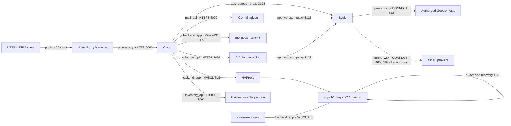

# punto — Projects and time tracking in C

[Improved operational workflows (schema 14)](docs/en/prod/flussi-operativi.md)

**English** | [Italiano](README.it.md)

Web app in Italian, English, Simplified Chinese, Spanish, French and German, with an HTTP server in C and a responsive HTML, CSS and JavaScript interface, without npm packages. It manages users, hierarchical groups, project roles, suppliers, contracts and original PDFs, tasks and subtasks, a Kanban board, a blocker register, time entries, daily alerts and change history.

Two independent modes are available: **Docker with MySQL** for structured data and **MongoDB GridFS** for PDFs, or **native startup with SQLite** and a local document store. The two modes do not share data or perform automatic imports.

**[Punto Ticket](ticket-app/README.md)** is also available: a standalone C app for managing tickets, assignments, priorities, deadlines, comments and history, with dedicated accounts and database. Its verified connection to Punto allows linking projects and assets, filtering tickets by reference and opening them from both modules, respecting project access grants. Build: `make tickets`; verification: `make test-tickets`. The guide covers native startup, standalone Docker and running alongside the stack through Nginx Proxy Manager.

## Interface languages

The **Language** selector in the header is available both at sign-in and in the workspace of Punto and Punto Ticket. Italian, English, Simplified Chinese, Spanish, French and German are supported. The first visit follows a supported browser language, falling back to Italian; subsequent choices are saved in the browser. The `?lang=it|en|zh|es|fr|de` parameter opens a link in a specific language and is retained in links between the two apps. The preference applies to this browser, not to the server account.

Changing language reloads the page and requires confirmation when a visible form contains unsaved changes. Interface text, accessible labels, validation, recognized application errors and system notices are translated; names, notes, descriptions and other user-entered content remain original. Dates and amounts follow the selected language; the currency remains EUR, and rules using Europe/Rome retain that time zone. Already generated emails, CSV, APIs and the SSO provider's page retain their own formats and content.

Catalogs are in `public/locales/`. After changing catalogs or the shared runtime, run `python3 scripts/sync_locales.py` to update Ticket's standalone copy; `--check` verifies that the copies match. Tests in `tests/test_i18n.py` check coverage, placeholders and synchronization. Optional browser testing uses two temporary databases and can be enabled with `PUNTO_I18N_BROWSER_TEST=1`, specifying Node, the Playwright module and, if necessary, Chrome through `PUNTO_NODE_BINARY`, `PUNTO_PLAYWRIGHT_MODULE` and `PUNTO_CHROME_BINARY`. If a catalog is unreachable, sign-in remains available in Italian with an explicit fallback message.

## Detailed documentation

The [documentation index](docs/en/README.md) collects guides organized by audience:

**Italian documentation:** [Documentation index](docs/README.md).

- **[Technical documentation](docs/en/tehnical/README.md):** architecture, installation, configuration, networks, security, data model, APIs, addons, backup, restore, development and testing.
- **[Product documentation](docs/en/prod/README.md):** available features, guides for operators and managers, processes, rules, glossary and roadmap.

Further details are available on [server internals](docs/en/tehnical/interni-server-c.md), the [frontend](docs/en/tehnical/frontend-e-interfaccia.md), the [alert engine](docs/en/tehnical/motore-alert.md) and [integration flows](docs/en/tehnical/flussi-integrazioni.md), along with [access scenarios](docs/en/prod/scenari-accessi.md), [financial examples](docs/en/prod/esempi-analisi-e-costi.md) and an [acceptance test plan](docs/en/prod/collaudo-accettazione.md).

The [Tasks, Kanban and blockers guide](docs/en/prod/attivita-kanban-e-blocchi.md) describes the new module; the [technical reference](docs/en/tehnical/attivita-kanban-e-blocchi.md) documents its data and APIs. The [11 October report](docs/en/tehnical/verifica-attivita-2026-10-11.md) records tests, screenshots and testing limitations; the candidate image is ready, while the existing deployment has not been updated.

The documents describe code present in the workspace on 11 October 2026; future plans and historical test evidence are explicitly marked. This README remains the general startup guide.

## Startup with Docker and a MySQL cluster

**Docker Engine 28 or later**, **Docker Compose 2.36.0 or later**, Python 3 and OpenSSL are required. The daemon version must support the `isolated` bridge gateway; Compose must support `gw_priority` and `interface_name`. On macOS, Docker Desktop's Linux daemon provides these features. The local configuration uses **three MySQL 8.4 instances with multi-primary Group Replication**, an HAProxy 3.2 TCP proxy, MongoDB 8.0, Nginx Proxy Manager, Squid for filtered egress, the C app, three C addons for email, Google Calendar and asset inventory, and a Python controller for safe cluster recovery. From the project directory:

```sh
cp .env.docker.example .env.docker
```

Open `.env.docker`, choose the first manager's email and fill in `PUNTO_PASSWORD`, `MYSQL_PASSWORD` and `MYSQL_ROOT_PASSWORD` with different passwords. Also set `NPM_ADMIN_EMAIL` and a distinct password in `NPM_ADMIN_PASSWORD` for the reverse proxy panel. You can leave `CLUSTER_REPLICATION_PASSWORD`, `CLUSTER_MONITOR_PASSWORD`, `DOC_DB_PASSWORD` and `DOC_DB_ROOT_PASSWORD` empty: `init` generates and saves four distinct internal passwords of 32 ASCII characters in the file. If you choose the replication password manually, the limit is **32 bytes**. Do not reuse the manager's password. The file contains credentials and is excluded from version control.

The first startup, including migration from the previous single MySQL database, must use:

```sh
python3 scripts/configure_network.py --env-file .env.docker prepare
python3 scripts/manage_cluster.py --env-file .env.docker init
python3 scripts/manage_cluster.py --env-file .env.docker status
```

`prepare` prepares the local private CA and internal certificates in `data/network-tls/`, or verifies the existing bundle. To add MongoDB to an older installation, it generates only the missing document certificate, signed by the existing CA: it does not rotate the CA or MySQL certificates. The host directory has `0700` permissions; the CA's private key has `0600` permissions and **is not mounted in any container**. The app and monitor receive only `ca.crt`, mounted read-only at `/etc/punto/tls/ca.crt`; each MySQL node receives its own certificate, server key and the public CA in separate mounts. Server keys have `0444` permissions so the MySQL UID can read them through the bind mount, while the host directory's `0700` permissions restrict local access. No node receives other members' keys. MongoDB receives only the public CA and its own `documents.pem` bundle, also read-only and protected by the host directory's `0700` permissions. Local materials are not included in the repository or images. The TLS materials expected by Compose mounts must be available before starting services.

The local CA lasts ten years and server certificates one year. **Renewal is manual**: retain a protected copy of the bundle and plan certificate replacement before expiration. `prepare` checks key/certificate correspondence, CA, names and IPs; if a certificate is incomplete, invalid or expires within one day, it stops without overwriting keys. Do not delete the bundle to obtain renewal, because that would create a new CA and require coordinated trust updates across all services.

The script stops the app during preparation, backs up the first node's data, initializes new empty nodes with a consistent copy, creates the group and starts the other services. The first node retains the `mysql_data` volume already used by the project: there is no need to delete the database to add replicas. The local `data/cluster-state.json` file retains markers for already prepared nodes, so seeding is not repeated on existing data. Internal accounts are created on each node and the seed is imported locally, without recording passwords in controller output. On macOS, the command uses the `desktop-linux` Docker context by default; `--docker-context` selects another.

To update an existing installation with suppliers, contracts and MongoDB, **first run an SQL backup using the previous configuration**, retain `.env.docker` and volumes, then update the code. Add the new document variables from the template without overwriting existing credentials, and run `prepare` and `init` as above. If `data/cluster-state.json` indicates an already initialized cluster, `init` generates only missing passwords and invokes recovery: it does not repeat seeding. The app applies migrations through version 14, preserving users, projects, entries and access grants; Compose starts MongoDB as an app dependency. Upgrading from version 2 adds groups and roles: every previous access grant becomes Contributor without expanding the set of authorized users.

To apply segmentation and TLS to an **already initialized cluster**, use instead:

```sh
python3 scripts/configure_network.py --env-file .env.docker apply
```

The command prepares certificates, creates a backup, recreates containers with updated networks, recovers the group and rebuilds the app and proxy. It preserves MySQL volumes and NPM data. The operation causes a brief app interruption; do not replace this procedure with new seeding or volume deletion.

Initial migration supports the previous single database with GTIDs disabled and an empty `@@gtid_executed` history. If the source already has GTID transactions, `init` explicitly stops: a clone or seed with the correct GTID checkpoint is needed to avoid duplicate transactions. The official MySQL image may generate GTIDs while initializing new nodes; the controller clears them before import only if the node is `OFFLINE`, the application database is empty, no other user-data tables exist and all GTIDs belong to its local UUID. A node failing these checks is not overwritten.

In `docker/mysql/cluster.cnf`, plugin options have the `loose-group_replication_` prefix: this permits the `mysqld --initialize` phase, during which the plugin is not yet loaded. After startup, the controller checks the server's effective variables before initializing or recovering the group.

Open [http://localhost](http://localhost) through Nginx Proxy Manager and sign in with `PUNTO_EMAIL` and `PUNTO_PASSWORD` set in the file. On a new installation, also configure NPM forwarding as described in the reverse proxy section. `NPM_HTTP_PORT` changes the published HTTP port. The app does not publish a direct host port: the previous access on `8082` has been removed. The schema and first manager are created when needed. The application container reads and writes MySQL and does not use `data/punto.db`.

### Shared company sign-in with Keycloak

Punto and Ticket support the same Keycloak realm through OpenID Connect, with separate clients and SSO access. The `compose.keycloak.yaml` overlay adds Keycloak and its dedicated database; `compose.tickets-keycloak.yaml` also connects Ticket. The [Keycloak guide](docs/en/tehnical/keycloak.md) covers secret preparation, HTTPS configuration, linking existing users and startup commands.

`AUTH_MODE=local` retains current access; `hybrid` adds the **Sign in with your company account** button; `oidc` disables local sign-in even through the API. The overlay uses `KEYCLOAK_*` variables to choose both apps' modes without conflicts between env files. Identity is explicitly linked through the Keycloak subject to the local account's email: IDs, assignments, history and roles remain those of the app. Passwords are not imported and roles are not granted from provider claims.

The flow uses Authorization Code with PKCE, single-use state and nonce, and cryptographic token verification. Tokens remain on the server; the browser receives only its app's cookie. The local SSO session expires within the token's validity, at most 8 hours. **Sign out** closes the individual app's session: the central Keycloak session may allow subsequent access without requesting the password again. Central identity configuration and backups are described in the dedicated guide.

### Services, data and availability

The stack includes **12 services**, or **13** with the optional Ticket overlay. Project-built images use `punto/<servizio>:${PUNTO_IMAGE_TAG:-local}`; MySQL and MongoDB retain official images. The [Docker naming guide](docs/en/tehnical/nomi-servizi-e-immagini.md) contains the complete table, internal aliases and the transition procedure for an existing installation. Renaming Compose files alone does not migrate previously created containers.

| Service | Function | Persistence |
| --- | --- | --- |
| `mysql-1` | First MySQL member, writable | Existing `mysql_data` volume |
| `mysql-2` | Second MySQL member, writable | `mysql_data_2` volume |
| `mysql-3` | Third MySQL member, writable | `mysql_data_3` volume |
| `proxy-db` | HAProxy: TCP connections distributed across available members, internal port `3306` | Project configuration |
| `cluster-recovery` | Checks MySQL membership and coordinates safe recovery after restarts | `cluster_recovery_data` volume; local identity configuration and file-backed secret |
| `mongodb` | MongoDB 8.0: original PDFs in GridFS, internal port `27017` | `documents_data` and `documents_config` volumes |
| `app` | C server, with `DB_HOST=db-proxy` and `DOC_DB_HOST=documents` | Structured data in the cluster; PDFs in MongoDB |
| `proxy-web` | HTTP/HTTPS reverse proxy and administration panel | Local NPM directories |
| `proxy-egress` | Explicit egress proxy, internal port `3128`, authorized Google destinations | Project configuration and allowlist; no cache |
| `mail` | C service for SMTP sending through private HTTPS API `8090`; provider to configure | `mail_addon_data` volume, persistent delivery ledger |
| `calendar` | C service for Google synchronization through private HTTPS API `8091`; OAuth to configure | `calendar_addon_data` volume, encrypted credentials and events |
| `inventory` | C service for asset inventory through private HTTPS API `8092` | `inventory_addon_data` volume, SQLite records and history |

Each MySQL member retains a complete copy of users, groups, memberships, roles, suppliers, contracts, document metadata, projects, access grants, hours and history. All three can receive writes; HAProxy chooses a node for each new connection, keeping the entire transaction on that node. The monitor admits only `ONLINE` members with the `PRIMARY` role, writable and with at least two members available, into balancing. MySQL and HAProxy publish no database ports on the host; their traffic remains on the `backend_app` Compose network.

**Quorum is 2 out of 3**: the group can continue operating if one member stops. With two members unavailable, writes are blocked to protect consistency. Group Replication and its limitations are described in the [Oracle MySQL 8.4 manual](https://dev.mysql.com/doc/refman/8.4/en/group-replication-multi-primary-mode.html).

This configuration protects against failure of a single MySQL instance. The three containers on the same computer still share host failure; the C app, single HAProxy and single MongoDB instance remain failure points. MongoDB is not configured as a replica set and provides no HA. If MongoDB becomes unavailable while the app is already running, SQL operations on suppliers and contracts remain usable, while PDF uploads and downloads fail explicitly. At startup, however, Compose waits for MongoDB to be healthy before starting the app. Protecting the entire service also requires separate hosts and redundancy for application and network components.

The cluster uses `READ COMMITTED` isolation and `BEFORE_AND_AFTER` consistency. The internal `cluster_write_guard` table is updated in the same transaction as application changes: it creates a detectable conflict between concurrent writes and protects checks such as the daily hours limit and the last active manager. This choice reduces write concurrency; certification conflicts, including MySQL error `3101`, roll back the transaction and are treated as temporary errors. The driver reestablishes connections outside transactions and **does not repeat a commit with an uncertain outcome**.

MySQL enforces `require_secure_transport=ON`: TCP connections must use TLS, while local administration can use the Unix socket. The app uses `DB_TLS_MODE=verify_identity` and `DB_SSL_CA=/etc/punto/tls/ca.crt`; the monitor also verifies the server certificate against the local private CA and destination name. HAProxy forwards the MySQL protocol without terminating TLS; certificate SANs include `db-proxy`, the respective node's name (`db`, `db2` or `db3`) and only its static IP. XCom uses `VERIFY_IDENTITY`; recovery uses TLS with verification of the donor's certificate. Internal accounts `punto_recovery`, `punto_monitor` and `punto_autorecovery` require SSL. Database TLS is separate from the HTTPS certificate managed by NPM. [MySQL TLS](https://dev.mysql.com/doc/refman/8.4/en/using-encrypted-connections.html), [Group Replication TLS](https://dev.mysql.com/doc/refman/8.4/en/group-replication-secure-socket-layer-support-ssl.html), [recovery TLS](https://dev.mysql.com/doc/refman/8.4/en/group-replication-configuring-ssl-for-recovery.html)

### Network segmentation and security



| Network and container interface | Subnet | Members | External access |
| --- | --- | --- | --- |
| `public` | `172.30.10.0/24` | Only `proxy-web` | Normal bridge; HTTP/HTTPS host ports and local panel |
| `private_app` | `172.30.20.0/24` | `proxy-web`, `app` | `internal: true`, `isolated` bridge gateway |
| `backend_app` | `172.30.30.0/24` | `app`, `proxy-db`, `cluster-recovery`, `mysql-1`, `mysql-2`, `mysql-3`, `mongodb` | `internal: true`, `isolated` bridge gateway |
| `app_egress` | `172.30.40.0/24` | `app`, `mail`, `calendar`, `proxy-egress` | `internal: true`, `isolated` bridge gateway |
| `proxy_wan` | `172.30.50.0/24` | Only `proxy-egress` | Normal bridge for proxy egress; no host port |
| `mail_api` | `172.30.60.0/24` | `app`, `mail` | `internal: true`, `isolated` bridge gateway |
| `calendar_api` | `172.30.70.0/24` | `app`, `calendar` | `internal: true`, `isolated` bridge gateway |
| `inventory_api` | `172.30.80.0/24` | `app`, `inventory` | `internal: true`, `isolated` bridge gateway |

NPM has the external connectivity needed to receive requests and manage HTTPS certificates. Squid has its own separate egress network, `proxy_wan`; `public` remains exclusive to NPM. The app, addons and database components connect only to internal networks: they have no normal direct Internet egress. The app reaches authorized destinations through Squid on `app_egress` and calls addons on the dedicated `mail_api`, `calendar_api` and `inventory_api` interfaces, for a total of six interfaces. `isolated` mode also removes the bridge gateway address; `internal: true` alone does not remove that address. [Compose networks](https://docs.docker.com/reference/compose-file/networks/#internal), [Docker gateways](https://docs.docker.com/engine/network/port-publishing/#gateway-modes)

The app listens on **`172.30.20.10:8080`**, only on the `private_app` address; its internal healthcheck uses the same address. Its `backend_app` address, **`172.30.30.10`**, exposes no HTTP. NPM uses **`172.30.10.2`** on `public` and **`172.30.20.2`** on `private_app`; HAProxy uses **`172.30.30.20`**. MongoDB listens only on its own loopback and on **`172.30.30.30:27017`**, with no ports published on the host. The recovery controller uses **`172.30.30.24`**, only on `backend_app`, with no published ports or Internet network. MySQL members use **`172.30.30.21`**, **`.22`** and **`.23`**; the XCom allowlist accepts only these three peers. X Protocol is disabled, so MySQL port `33060` is not opened. IPv4 interfaces inside containers have the names of their respective networks. Subnets defined in Compose must be free and must not overlap the environment's networks; address changes require coordinated updates to binds, allowlists and certificate SANs.

MongoDB enforces `requireTLS`, disables TLS 1.0/1.1 and requires authentication. The app verifies the CA and `documents` name without allowing invalid certificates or hostnames, and uses a `SCRAM-SHA-256` account with the `readWrite` role restricted to `DOC_DB_NAME`; it does not receive MongoDB root credentials. NPM is not connected to the document network. As with MySQL, members of the shared backend network can reach the TCP port: TLS and authorization remain necessary.

Container IP forwarding is disabled. Services receive neither `NET_ADMIN` nor `NET_RAW`, are not privileged, do not mount the Docker socket and block acquisition of new privileges. These controls prevent ordinary processes from turning containers into routers or modifying network interfaces.

Segmentation restricts connections between networks but **does not apply per-port ACLs between `backend_app` members**: the app shares the MySQL servers' network and could open direct connections to their SQL ports. MySQL authentication, TLS and permissions remain necessary. The XCom allowlist restricts the group's communication protocol to the three DBs and is not a general firewall on the backend network. A more restrictive flow matrix requires daemon/host firewall rules or a network policy system.

The derived NPM image, however, restricts administrative listeners: the internal API on port `3000` listens only on container loopback, and the panel on port `81` only on loopback and the `public` address `172.30.10.2`. The panel does not listen on `172.30.20.2`, so the app has no administrative access through `private_app`. The host publishes `81` only on `127.0.0.1`; the `public` network contains only NPM.

On Docker Desktop, bridge networks reside in the Linux VM, so they are not directly routable interfaces from the Mac. Docker or host administrators can still connect containers to networks or access volumes: this configuration does not separate the service from the infrastructure administrator. The NPM → app HTTP link remains on the private network; database TLS does not turn it into HTTPS. [Docker Desktop networking](https://docs.docker.com/desktop/features/networking/networking-how-tos/#known-limitations)

### Filtered egress with Squid

Squid listens only on **`172.30.40.2:3128`**, accepts the app **`172.30.40.10`**, email addon **`172.30.40.11`** and Calendar addon **`172.30.40.12`** with source-specific policies, and opens external connections from **`172.30.50.2`** on `proxy_wan`. It publishes no host ports, belongs to neither `private_app` nor `backend_app`, and does not route packets for other containers. The process uses unprivileged user `10002`, a read-only filesystem, temporary `/tmp`, `cap_drop: ALL` and `no-new-privileges`. Cache, ICP, HTCP and pinger are disabled.

The allowlist in `docker/squid/allowed-domains.txt` contains the three exact hosts needed for future Google Calendar/OAuth integration:

```text
accounts.google.com
oauth2.googleapis.com
www.googleapis.com
```

For the app and Calendar addon, only **`CONNECT` tunnels on port `443`** to these names are allowed. The email addon may use only `CONNECT` on ports **465/587**, to the exact hosts in `docker/squid/allowed-smtp-domains.txt`: the file currently contains only the reserved placeholder `smtp-not-configured.invalid`, so no real SMTP provider is authorized. The app and Calendar do not inherit SMTP destinations, and the email addon does not inherit Google destinations. Other requests are denied, including plain HTTP, alternative ports, literal IPs and private or reserved destinations resulting from DNS resolution. Names have no leading dot, wildcard, scheme, path or port: `www.googleapis.com.example.org` does not match the authorized entry. The `-n` ACL option prevents authorizing an IP through reverse DNS lookup. [Squid ACLs](https://www.squid-cache.org/Doc/config/acl/)

The proxy **does not decrypt TLS**: it checks the host and port declared in the `CONNECT` request, without being able to filter HTTPS paths, content or OAuth scopes. In particular, `www.googleapis.com` also hosts other Google APIs; the addon therefore restricts paths and scopes to Calendar operations. The REST endpoint is `https://www.googleapis.com/calendar/v3`, while OAuth authorization uses `accounts.google.com` and token exchange/renewal uses `oauth2.googleapis.com`. Real use requires OAuth credentials and user consent. [Squid HTTPS tunnels](https://wiki.squid-cache.org/Features/HTTPS), [Calendar reference](https://developers.google.com/workspace/calendar/api/v3/reference), [Google OAuth for web applications](https://developers.google.com/identity/protocols/oauth2/web-server)

Compose sets `HTTP_PROXY`, `HTTPS_PROXY` and their lowercase variants in the app to `http://squid:3128`. `NO_PROXY` and `no_proxy` exclude loopback and internal services; the `/healthz` check also uses `curl --noproxy '*'`. Future HTTP libraries in the C server must respect these variables or explicitly configure the proxy. They are not a firewall: internal networks block direct egress. The email API client explicitly disables the proxy for its private connection; the addon, however, enforces Squid for SMTP even in the presence of `NO_PROXY`.

To add Squid and addons to an already running stack with the current `private_app` and `backend_app` networks, first run an SQL backup, then prepare certificates and secrets and update only affected services:

```sh
python3 scripts/configure_network.py prepare --env-file .env.docker
docker compose --env-file .env.docker build proxy-egress mail calendar inventory app proxy-web
docker compose --env-file .env.docker up -d --no-deps --force-recreate --wait proxy-egress mail calendar inventory app proxy-web
```

Compose creates missing networks and volumes, starts Squid and addons, and recreates the app and NPM. The service may be briefly unavailable; the app applies missing SQL migrations through version 14, preserving data. The Calendar addon requires no other MySQL migrations. This update does not require `configure_network.py apply`, new seeding or database recreation. Squid's healthcheck verifies a local `403` response without requiring Internet: it does not by itself demonstrate Google reachability. If Squid stops, new external requests fail; database work remains independent of the proxy while the app is already running. At a new startup, however, Compose waits for Squid and addons to be healthy.

To update the allowlist, edit `docker/squid/allowed-domains.txt`, keeping one exact host per line. Files are mounted read-only in the container. Before reloading, check the content actually mounted and the syntax:

```sh
docker compose --env-file .env.docker exec -T proxy-egress cat /etc/squid/allowed-domains.txt
docker compose --env-file .env.docker exec -T proxy-egress squid -k parse -f /etc/squid/squid.conf
```

**Only if verification exits with code zero** and the mounted file contains the changes, reload:

```sh
docker compose --env-file .env.docker exec -T proxy-egress squid -k reconfigure -f /etc/squid/squid.conf
```

An editor that replaces the file rather than editing it in place may leave the bind mount on the previous content. In that case, first run `docker compose --env-file .env.docker build proxy-egress`: the build checks syntax of updated files. If it succeeds, recreate only Squid with `docker compose --env-file .env.docker up -d --no-deps --force-recreate --wait proxy-egress`, then recheck mounted content and repeat network tests. Access logs record source, domain, method and outcome, without headers, paths or queries; inspect them with `docker compose --env-file .env.docker logs --tail=100 proxy-egress`. Docker limits logs to three files of 10 MB each. [Squid verification and reload](https://wiki.squid-cache.org/SquidFaq/InstallingSquid), [Docker log rotation](https://docs.docker.com/engine/logging/drivers/json-file/)

### Joint data and PDF backup

The MySQL dump contains `contract_documents`, but **does not contain PDFs**. `scripts/backup_documents.py` uses `mongodump` on the document database and creates a `documents-*.archive.gz` archive in `backups/` with `0600` permissions, without printing credentials. Gzip compression does not encrypt content. Retain the SQL dump, MongoDB archive and protected recovery materials together.

The two databases share neither a transaction nor a coordinated snapshot. For a consistent pair, suspend all writes; in the local stack, without other clients writing directly, you can stop the app during both backups:

```sh
docker compose --env-file .env.docker stop app
python3 scripts/manage_cluster.py --env-file .env.docker backup
python3 scripts/backup_documents.py --env-file .env.docker
docker compose --env-file .env.docker up -d app
```

The document script does not automatically stop the app or orchestrate the SQL backup. Keep the no-write window until both complete, and restore metadata and documents together. An SQL commit with an uncertain outcome retains the new blob to avoid references to removed bytes; a failure may leave an unreferenced object to reconcile later. Neither automatic reconciliation nor a distributed MySQL/MongoDB transaction is implemented.

### Status, backup and restarts

```sh
python3 scripts/manage_cluster.py --env-file .env.docker status
python3 scripts/manage_cluster.py --env-file .env.docker backup
docker compose --env-file .env.docker ps
curl --fail http://localhost/healthz
docker compose --env-file .env.docker logs --tail=100 cluster-recovery app proxy-db mysql-1 mysql-2 mysql-3
```

`status` checks group membership. `backup` creates a data copy without emptying the database and saves it in `backups/` with `0600` permissions; the directory is excluded from version control. `data/cluster-state.json` is also local and excluded from version control: retain it with the volumes to manage the existing cluster. `/healthz` is accessible without sign-in, checks the SQL connection to the backend and is also used by the app's healthcheck: it returns HTTP 200 with `{"ok":true,"database":"mysql"}` when the check succeeds, or HTTP 503 when it fails. The healthcheck of an individual MySQL process does not replace the monitor's group-membership check. `/healthz` does not certify PDF store availability: MongoDB has a separate healthcheck with TLS and the application account.

`init` provisions and starts `cluster-recovery` automatically. For an **existing healthy deployment**, enable the controller once after updating the code:

```sh
python3 scripts/manage_cluster.py --env-file .env.docker enable-autorecovery
python3 scripts/manage_cluster.py --env-file .env.docker status
```

This command first creates an SQL backup, then creates the dedicated recovery account and local files, persists `group_replication_start_on_boot=OFF` on each member, and starts only the new service. Before reporting success, it runs a read-only probe inside the controller to verify the actual account credentials, TLS and group identities from its backend address while retaining the maintenance lock. It does not stop the running replication group, rebuild the app, recreate other containers, reseed nodes or delete volumes. Preserve the deployment's overlay options on controller commands: add `--tickets`, `--keycloak` and, when enabled, `--keycloak-groups`; retain any `--tickets-env-file`, `--keycloak-env-file` and `--docker-context` selections. For example, a deployment using all three overlays runs:

```sh
python3 scripts/manage_cluster.py --env-file .env.docker --tickets --keycloak --keycloak-groups enable-autorecovery
```

The controller polls every five seconds; this is a check interval, **not a recovery deadline**. With Docker running, `restart: unless-stopped` brings existing containers back after a Docker or host restart, except services explicitly stopped by the operator. Docker Desktop must itself be running. `docker compose down` removes containers, so starting Docker alone cannot recreate them: use `manage_cluster.py ... start`, with the same overlay options, to start an initialized deployment. HAProxy admits writable members only when quorum is restored, and the app's healthcheck continues to report database unavailability during recovery.

The background service connects directly to the three MySQL members over verified TLS as `punto_autorecovery`, restricted to `172.30.30.24` with only the privileges needed to inspect and manage Group Replication. It has no Docker socket or MySQL root password. Provisioning uses administrator credentials through the host script; these credentials are not passed to the service. Its generated password is stored in `data/cluster-recovery/password` and mounted as a file-backed secret; expected group and node identities are stored in the read-only `data/cluster-recovery/cluster.json`. Do not put that password in `.env.docker` or edit the expected UUIDs to bypass a recovery refusal. Keep these local files protected alongside `data/cluster-state.json` and the `cluster_recovery_data` volume. **Do not delete the journal volume**: it also retains markers of an interrupted bootstrap, needed to prevent an inconsistent second initialization.

For a complete outage, automatic bootstrap waits until **all three expected server UUIDs** are reachable and their configuration, executed GTIDs and certified transactions can be checked. It requires stable observations and a candidate containing every member's transaction set. It bootstraps one candidate, switches bootstrap mode off, and rejoins the remaining nodes. The journal records recovery progress. The host `flock` on `data/cluster-host.lock` serializes host commands. The separate `data/cluster-controller.lock` coordinates the controller and maintenance helper inside Docker’s Linux environment; separate files also avoid the host blocking its own helper on Linux. To exclude the automatic controller inside Docker’s Linux environment, when a controller container exists, maintenance commands also start a temporary helper that holds the Linux `flock` on the controller’s actual lock mount until maintenance ends, including controller recreation. The helper runs as UID `10001` with `network=none`, mounts only the lock, and receives no credentials or Docker socket. Bootstrap mode is never persisted as enabled. The transaction comparison follows the [Oracle MySQL 8.4 restart procedure](https://dev.mysql.com/doc/refman/8.4/en/group-replication-restarting-group.html).

An isolated node, an unreachable expected member, a still-running group without quorum, mismatched identities or divergent transaction sets **blocks automatic bootstrap**. The controller does not force membership, discard transactions or reset the database. Inspect `cluster-recovery` logs and `status`; restore missing members or resolve the underlying configuration/data issue. The manual recovery command remains available and performs its own safety checks:

```sh
python3 scripts/manage_cluster.py --env-file .env.docker recover
python3 scripts/manage_cluster.py --env-file .env.docker status
```

`recover` starts the SQL servers, rejoins offline members when a healthy group exists, or selects a safe founder after checking all transaction sets. It does not always choose `db` and does not force quorum on an isolated member. Use the same overlay options as the deployment. If another controller holds the lock, wait for it to finish and inspect its logs before retrying; do not remove the lock file to bypass it.

For planned maintenance using **direct SQL** to stop Group Replication on every member, first stop the automatic controller so it does not interpret the maintenance as an outage:

```sh
docker compose --env-file .env.docker stop cluster-recovery
```

After maintenance, start it again with `docker compose --env-file .env.docker start cluster-recovery` and check the group status and controller logs. Keep the deployment's Compose files, env files and Docker context when issuing these commands. The `manage_cluster.py` maintenance commands and `configure_network.py apply` already acquire both maintenance locks, so they do not require this separate stop. Do not remove the lock or recovery journal to make a competing operation proceed.

To stop and remove containers while retaining data:

```sh
docker compose --env-file .env.docker down
```

The three MySQL volumes and two MongoDB volumes retain data across restarts and rebuilds. Do not add `--volumes` or `-v` if you want to retain them: these options delete volumes. Replication does not replace backup, because an incorrect change is also propagated to other members.

`PUNTO_EMAIL` and `PUNTO_PASSWORD` create only the first manager in a database without users; changing values after initialization does not change saved accounts. Likewise, `MYSQL_*` initialization variables do not automatically change passwords in existing MySQL volumes. The same applies to MongoDB accounts: the initial script creates users only on an empty document volume. Do not change internal passwords only in `.env.docker` without also updating corresponding database accounts.

| Variable in `.env.docker` | Function |
| --- | --- |
| `NPM_HTTP_PORT` | HTTP port published by the reverse proxy, default `80`; also aligns the app's `PUBLIC_PORT` |
| `PUNTO_EMAIL`, `PUNTO_PASSWORD` | Initial manager credentials |
| `PUBLIC_ORIGINS` | Authorized HTTP/HTTPS origins, comma-separated |
| `MYSQL_DATABASE` | Database name, default `punto` |
| `MYSQL_USER`, `MYSQL_PASSWORD` | Application user and password |
| `MYSQL_ROOT_PASSWORD` | MySQL administrator password, not used by the app |
| `CLUSTER_REPLICATION_PASSWORD` | Internal `punto_recovery` account password, generated by `init` if empty; maximum 32 bytes |
| `CLUSTER_MONITOR_PASSWORD` | Internal `punto_monitor` account password, generated by `init` if empty |
| `DOC_DB_NAME`, `DOC_DB_USER` | Document MongoDB database and account, both defaulting to `punto_documents` |
| `DOC_DB_PASSWORD`, `DOC_DB_ROOT_PASSWORD` | Distinct document-account and MongoDB root passwords; `init` generates them if missing |

The native SQLite file remains separate and is retained: switching to Docker does not automatically import users or entries from SQLite.

## Reverse proxy with Nginx Proxy Manager

The `proxy-web` service is built from `docker/nginx-proxy-manager/Dockerfile`, based on the **`jc21/nginx-proxy-manager:2.16.0`** image. The derived image restricts the internal API to loopback port `3000` and the `81` panel to loopback and the `public` interface, preventing administrative listeners on `private_app`. The build stops if it cannot find the API entrypoint expected by the pinned version. NPM receives application traffic on ports **80 HTTP** and **443 HTTPS**; the administration panel is published at [http://127.0.0.1:81](http://127.0.0.1:81), only on the host's loopback interface. The service uses the `/usr/bin/check-health` health check documented by [Nginx Proxy Manager](https://nginxproxymanager.com/advanced-config/#docker-healthcheck).

The app and NPM share the Compose `private_app` network, so the proxy destination is **`http://app:8080`**. The app, HAProxy, the three MySQL members, and MongoDB share the `backend_app` network; NPM is not connected to this network. Only NPM belongs to the `public` network and publishes ports on the host. Using the service name as the destination on the Docker network follows the [official NPM configuration](https://nginxproxymanager.com/advanced-config/#best-practice-use-a-docker-network).

### Domain configuration

In `.env.docker`, authorize the addresses through which the app will be accessed:

```dotenv
PUBLIC_ORIGINS=http://localhost,http://127.0.0.1,http://progetti.tuaazienda.it,https://progetti.tuaazienda.it
```

Origins must be complete and separated by commas, without paths, credentials, or wildcards. Ports other than the defaults must be included, for example `http://localhost:8083`. The server checks `Host` and, for operations that change data, `Origin`. It does not trust `X-Forwarded-*` headers to authorize a domain. After changing the origins, recreate the app container:

```sh
docker compose --env-file .env.docker up --build -d
```

The proxy configuration command reads `.env.docker`:

```sh
python3 scripts/configure_proxy.py --env-file .env.docker
```

The `NPM_ADMIN_EMAIL` and `NPM_ADMIN_PASSWORD` administrative credentials belong to the NPM panel and differ from the app credentials. The script uses them to initialize an empty NPM installation; they are not passed to the container as variables. On an installation that is already configured, use an existing administrative account. The names to forward are derived from `PUBLIC_ORIGINS`: with the example above, it creates one Proxy Host for `progetti.tuaazienda.it` and one for `localhost` and `127.0.0.1`, both directed to the `app` service on port `8080`. The script creates missing forwarding rules and rejects any incompatible configurations already present, without overwriting them. It can be run again without duplicating users or forwarding rules.

To configure the same forwarding from the NPM panel, create two **Proxy Host** entries with these values:

| Field | Value |
| --- | --- |
| Domain Names | First host: `progetti.tuaazienda.it`; second host: `localhost`, `127.0.0.1` |
| Scheme | `http` |
| Forward Hostname / IP | `app` |
| Forward Port | `8080` |
| Advanced | Empty |

To reach the domain from a browser, its DNS must point to the server's address. Locally, you can check forwarding without changing DNS:

```sh
curl --fail --resolve progetti.tuaazienda.it:80:127.0.0.1 http://progetti.tuaazienda.it/healthz
```

Port 443 is published, but **HTTPS becomes operational after a valid certificate has been configured** in the Proxy Host's SSL tab. To request a Let's Encrypt certificate, the domain and its validation must be reachable correctly. Request the certificate only for the public domain `progetti.tuaazienda.it`: `localhost` and `127.0.0.1` are used for local HTTP access and have a separate Proxy Host. App sessions use `Secure` cookies when the authorized public origin is HTTPS. Configure the certificate before enabling **Force SSL** on the public domain.

### Proxy persistence and settings

NPM stores its configuration in a separate SQLite database, `nginx-proxy-manager/data/database.sqlite`, and its certificates in `nginx-proxy-manager/letsencrypt/`. These directories are mounted at `/data` and `/etc/letsencrypt`, as required by the [official setup](https://nginxproxymanager.com/setup/); they are excluded from both version control and the app's build context. Projects, contracts, and document metadata are saved in MySQL; original PDFs are saved in MongoDB.

| Variable in `.env.docker` | Purpose |
| --- | --- |
| `NPM_HTTP_PORT` | Public HTTP port, default `80` |
| `NPM_HTTPS_PORT` | Public HTTPS port, default `443` |
| `NPM_ADMIN_PORT` | Local panel port, default `81` |
| `NPM_TZ` | NPM time zone, default `Australia/Brisbane` as in the requested template; you can set `Europe/Rome` |
| `NPM_ADMIN_EMAIL`, `NPM_ADMIN_PASSWORD` | Credentials read by the configuration script, not by the app |

To move a published port, change its value in `.env.docker` and recreate the service. Changing `NPM_HTTP_PORT` or `NPM_HTTPS_PORT` does not automatically change the authorized origins or DNS. `docker compose down` preserves the MySQL/MongoDB volumes and NPM's persistent directories; recreate the containers with `manage_cluster.py ... start` and the existing overlay options. Once provisioned, `cluster-recovery` coordinates safe group recovery; `recover` remains the manual alternative.

## Native startup with SQLite

The native build uses SQLite by default. macOS requires the Xcode Command Line Tools. Linux requires a C compiler, Make, and the OpenSSL and SQLite headers, for example `libssl-dev` and `libsqlite3-dev`.

```sh
make run
```

Open [http://127.0.0.1:8080](http://127.0.0.1:8080). On an empty database, the demo account is:

- **Email:** `demo@punto.local`
- **Password:** `Punto2026!`

`Ctrl+C` stops the server. Data remains in `data/punto.db`; PDFs remain in the `documents` directory beside the database, normally `data/documents/`. `DOC_FILES_DIR` lets you choose a different document directory. The archive uses `0700` directories, `0600` files, server-generated identifiers, and atomic publication without overwriting; it rejects symbolic links and files with unexpected ownership or permissions. Keep the database and PDF directory together in native backups. SQLite mode does not require MongoDB; `make clean` removes only the compiled executables.

Variables are read from the environment. `.env.example` documents their values, but the server does not automatically load `.env` files:

```sh
PUNTO_EMAIL='nome@azienda.it' PUNTO_PASSWORD='UnaPasswordPersonale2026!' PORT=8081 make run
```

`PUNTO_EMAIL` and `PUNTO_PASSWORD` are used only when no users exist. The demo button on the login page always fills in the default demo account.

### Native build with MySQL

A MySQL server can also be used without Docker. The MariaDB Connector/C and MongoDB C Driver (`libmongoc-1.0`) headers and libraries are required, along with `pkg-config` and the platform's cryptographic dependencies: CommonCrypto/Security on macOS, OpenSSL on Linux. On Debian, the build packages include `build-essential`, `pkg-config`, `libmariadb-dev`, `libmongoc-dev`, and `libssl-dev`.

```sh
make clean
make DB_BACKEND=mysql
```

Export `DB_HOST`, `DB_PORT`, `DB_NAME`, `DB_USER`, and `DB_PASSWORD` with the connection details for an existing database and set `DB_SSL_CA` to the absolute path of the TLS CA certificate, then start `./build/punto`. The driver accepts only `DB_TLS_MODE=verify_identity`, which is also the default: the CA is mandatory and the server certificate must match `DB_HOST`. Also configure the `DOC_DB_*` variables for a MongoDB server with TLS and an application account. The Compose cluster does not publish database endpoints on the host: this mode requires servers that are reachable separately. `DB_PATH` is used only by the SQLite backend. To return to the SQLite build, run `make clean` and `make`.

| Server variable | Purpose |
| --- | --- |
| `PORT` | HTTP port, default `8080` |
| `PUBLIC_PORT` | Public HTTP port, defaults to `PORT`; Compose aligns it with `NPM_HTTP_PORT` to check Host and Origin |
| `PUBLIC_ORIGINS` | Exact list of authorized HTTP/HTTPS origins; required to use a domain through the proxy |
| `BIND_HOST` | IPv4 listening address, default `127.0.0.1`; Compose uses only the `private_app` address `172.30.20.10` |
| `PUBLIC_DIR` | Asset directory, default `public` |
| `DB_PATH` | SQLite backend file, default `data/punto.db` |
| `DB_HOST`, `DB_PORT` | MySQL backend host and port |
| `DB_NAME`, `DB_USER`, `DB_PASSWORD` | MySQL database and application credentials |
| `DB_TLS_MODE` | MySQL TLS mode; the only permitted value and the default is `verify_identity` |
| `DB_SSL_CA` | Readable absolute path of the MySQL CA certificate, mandatory for the MySQL backend |
| `DOC_DB_HOST`, `DOC_DB_PORT` | MongoDB destination, defaults to `documents` and `27017`, used in the MySQL build |
| `DOC_DB_NAME`, `DOC_DB_USER`, `DOC_DB_PASSWORD` | MongoDB database and document account credentials |
| `DOC_DB_SSL_CA` | Readable absolute path of the MongoDB CA; TLS and identity verification are mandatory |
| `DOC_FILES_DIR` | PDF directory in SQLite mode; defaults to `documents` beside `DB_PATH` |
| `PUNTO_EMAIL`, `PUNTO_PASSWORD` | Credentials for creating the first manager |
| `TZ` | Time zone for permissions; `Europe/Rome` is used when no value is set |

## Users and permissions

The initial account is a **Manager**. From the **Users** tab, it can create accounts with a name, email, password, and role, or change their name, role, and active status.

| Operation | Manager | Operator |
| --- | --- | --- |
| View projects and statuses | All projects | Only projects with currently valid permissions |
| Create and edit projects | Yes | No |
| Register and edit suppliers and contracts | Yes | No |
| Upload, list, and download contract PDFs | Yes | No |
| Grant users or groups access to projects | Yes | No |
| Read tasks and blockers | All projects | Shared projects or projects with currently valid permissions, including read-only access |
| Create, organize, and delete tasks | Yes | No |
| Update task status | All tasks | Only tasks assigned to themselves, with Contributor access |
| Report and edit blockers | All; can change the owner and delete | Can create them and edit those they authored or own, with Contributor access |
| Add hours and describe the work performed | Yes | Only with a role that allows time logging |
| View their own entries, including after access is revoked | Yes | Yes |
| Edit or delete their own entries | Yes | No |
| Manage users and roles | Yes | No |
| Manage groups, subgroups, and memberships | Yes | No |
| View change history | Yes | No |

The server checks permissions on every request, including when a user attempts to send an API call directly. A role change applies to sessions that are already open; disabling an account revokes its sessions, which are not restored when it is re-enabled. The system prevents disabling or demoting the last active manager. The email address cannot be changed through the interface or API.

Passwords are stored as PBKDF2-HMAC-SHA256 derivations with a random salt. Sessions use random tokens and HttpOnly/SameSite cookies, last 8 hours or 30 days with “Remember me,” and end when the server restarts. For authorized HTTPS origins, the cookie also includes `Secure`; the TLS certificate is managed by Nginx Proxy Manager.

Local login allows eight failed attempts per normalized email in a fixed 60-second window (twenty in Ticket). Further attempts return `429` before password verification and do not extend the window; failures on another account do not consume that allowance. Punto retains at most four sessions per user, replacing only that user's oldest session. Each Punto session can retain two Ticket grants; logout, expiry or replacement revokes its grants. Anonymous SSO starts use encrypted browser cookies rather than shared pending slots, while verified callbacks retain replay protection until the five-minute transaction expires.

Punto and Ticket receive and send HTTP through a bounded, nonblocking connection loop. Absolute request and response deadlines are five seconds in Punto and ten seconds in Ticket. Route-specific payload limits are checked as soon as headers arrive, and new incomplete connections cannot evict responses already being sent.

## Groups and project roles

The **Groups and roles** tab, reserved for managers, displays a group tree with the members of each group. A group has a name and an optional parent group; a user can belong to several groups. Up to 200 groups and 16 levels are allowed, counting the root as the first level. The server rejects cycles and moves that exceed the maximum depth. A group can be deleted only when it has no members, subgroups, or project permissions.

The global **Manager** and **Operator** profiles continue to determine administrative functions. Separately, each project permission grants an operational role:

| Default role | Code | View the project | Log hours |
| --- | --- | --- | --- |
| Viewer | `reader` | Yes | No |
| Contributor | `contributor` | Yes | Yes |

The ability to log hours also enables board collaboration: updating the status of assigned tasks and managing blockers they authored or own. Viewers can view tasks and blockers. Assigning work does not grant new access.

Default roles cannot be changed. A manager can create up to 100 roles in total, with a code, name, and a choice of whether time logging is allowed; all roles allow viewing. The code, up to 40 characters, starts with a lowercase letter and accepts lowercase letters, numbers, hyphens, and underscores. These roles do not grant administrative privileges or access to contracts, PDFs, users, or history.

The project's **Permissions** command assigns users or groups, with a selected role and optional inclusive dates. A permission granted to a group also applies to members of its subgroups: access granted to “Sviluppo” includes users in “Sviluppo / Backend,” while the reverse path does not grant access. Multiple permissions are additive; a Viewer role does not cancel another Contributor permission. To revoke access completely, all applicable permissions must be removed.

Changes to memberships, parent relationships, roles, and permissions take effect on the next request, even within an existing session. There is no persistent permission cache. Viewing requires a permission valid today; to log hours, **the same permission** must allow the operation and cover both today and the day worked. Two separate intervals cannot be combined to bypass this check. Existing entries remain viewable by their author after access is revoked.

## Suppliers, contracts, and documents

The **Suppliers** and **Contracts** sections are reserved for managers, with the `manage_suppliers` and `manage_contracts` session permissions. The relationship is **supplier → contracts → projects**: each contract must have a supplier; a project can have an optional contract, and a contract can define several projects. Operators continue to see projects they are authorized to access and log hours, without access to the contract archive.

A supplier has a unique code, legal name/name, VAT number, email, phone number, address, notes, and active status. Disabling a supplier preserves existing linked contracts; only active suppliers can be selected for a new link.

A contract has a unique code, title, supplier, notes, optional start/end dates, and an optional value. Dates use ISO `YYYY-MM-DD`, with the end no earlier than the start; they do not automatically change the status. The only supported currency is **EUR**, and `value_cents` is an integer from `0` to `999999999999`: the interface converts amounts with one or two decimal places exactly, without floating-point calculations.

| Contract status | API value |
| --- | --- |
| Draft | `draft` |
| Active | `active` |
| Expired | `expired` |
| Closed | `closed` |
| Canceled | `cancelled` |

In the project, choose a registered contract from the list. A new link cannot use a closed or canceled contract; an existing link can be retained when the contract changes status. An empty field removes the link, while omitting it in an API update preserves it.

A contract's **PDF** button lets you add original documents of up to **10 MiB each** and download them through an authenticated session. Each upload adds a distinct document, even if the name already exists; it does not replace previous versions. The API does not allow documents to be edited or deleted. SQL metadata is protected by triggers against updates and deletions; this does not constitute WORM storage against an infrastructure administrator.

The server checks the `.pdf` filename (maximum 180 bytes), size, and `%PDF-` signature; it saves a SHA-256 hash and checks the size and hash again before download, serving the file as an attachment without an inline preview. It does not perform OCR, antivirus scanning, or deep validation of the PDF structure. TLS protects transport: **individual field/PDF encryption, key vaults, and computations on encrypted data are not implemented**. Normal application and database permissions authorize access to plaintext data during processing.

## Projects and permissions

The manager creates a project with a unique code, name, client, description, and optional contract, and edits its details and status:

| Status | API value |
| --- | --- |
| Not started | `planned` |
| In progress | `active` |
| Paused | `paused` |
| Completed | `completed` |
| Cancelled | `cancelled` |

Search and status filters help find projects. The hours shown for each project are those logged by the authenticated user, across all dates.

Using **Permissions**, the manager chooses users or groups, a role, and optional dates. Dates are inclusive; an empty field imposes no limit on that side of the interval. Read-only projects appear in the operator's list without the action for logging hours.

For an operator, permission to log time must be valid both **today** and **on the date of the recorded work**. Future, expired, or revoked access does not allow new hours to be logged. Previous entries remain viewable. Managers can use all projects without an assignment; the project's status alone does not prevent time logging.

The **Shared project** checkbox, available to managers, lets all active accounts, including those created later, view that individual project and log their own hours against it. It is suitable for General, Training, Meetings, and Internal activities. Other projects continue to require explicit permissions; the update does not make existing projects shared.

The manager can **permanently delete a project** from the edit window, after a dedicated confirmation. The operation removes tasks, subtasks, blockers, all hours logged by all users against that project, and its direct and group permissions in a single transaction. It preserves users, groups, roles, contracts, and history events; it records a deletion event with a summary of the data removed. There is no trash: recovering the data requires a backup.

## Tasks, Kanban, and blocker log

The **Tasks and blockers** section selects an authorized project and displays tasks with a title, description, owner, priority, and due date. The **Kanban board** and **List and subtasks** views share search and status/priority filters. There are five statuses: **To do**, **In progress**, **Blocked**, **To review**, and **Completed**. Status is changed using a selector and the **Apply** button, including from the keyboard.

The manager creates and organizes tasks; operators with Contributor access update only the status of tasks assigned to them. An optional parent must belong to the same project; the hierarchy supports **8 levels** and rejects cycles. The task's project cannot be changed. Parent and child statuses remain independent.

The blocker log stores the title, description, impact, owner, next action, due date, and **Open / Being handled / Resolved** status. A blocker can concern the whole project or one of its tasks. Operators with Contributor access can create it and update it if they authored or own it; only managers can change its owner or delete it. Reporting or resolving a blocker does not automatically move the Kanban card.

Up to **500 tasks and 500 blockers per project** are allowed, including completed and resolved items. Every update or deletion checks a revision; a conflict requires reloading the current version. A task with children cannot be deleted until they have been moved or removed; linked blockers remain in the project and are unlinked from the task. Every change is recorded in History within the same transaction.

Hours remain associated with the project; separate checklists, dependencies, Gantt charts, workload, future risks, and due-date notifications are later developments. Details: [module guide](docs/en/prod/attivita-kanban-e-blocchi.md).

## Alerts and triggers

The **Alerts and triggers** section, reserved for managers, offers two checks: rejected attempts to log hours against a nonexistent project (including a deleted one), and working days with fewer than **480 minutes** logged. Hours against nonexistent projects remain blocked: the alert reports the attempt without creating an invalid entry.

Each manager creates their own rules and chooses a name, the daily time in **HH:MM in the Europe/Rome time zone**, the active status, and the recipients: app users and email addresses. Rules run automatically only once per local day, with state that persists after a restart. **Run now** starts a manual check, which is also useful for a disabled rule; the same anomalies do not generate duplicate notifications.

The hours check considers **Monday–Friday** working days, after **48 actual hours from the end of the day**. For example, Monday ends on Tuesday at 00:00 and becomes eligible for checking on Thursday at 00:00, then at the next configured time. Monitoring starts when the rule is created; users added later are included from the first check, without reports for dates before their monitoring began. There is no calendar for public holidays, leave, or part-time contracts yet: the current threshold is 8 hours for each Mon–Fri day.

The **Notifications** section displays only the current account's alerts, with read/unread status. A manager recipient can receive anomalies for monitored users; an operator receives and views only those concerning themselves. Rules whose owner is disabled or loses the Manager role do not run automatically.

The **email channel is implemented, but SMTP is not yet configured**: addresses are validated, and alerts remain queued with `pending_configuration` status. Transport is delegated to the new C addon; no alert is presented as a sent email until the SMTP server accepts it.

### Email addon in C

The **`mail`** Compose service exposes `GET /healthz`, `GET /v1/status`, and `POST /v1/emails` over HTTPS at **`https://mail-api:8090`**. It is an internal API: it listens only on `172.30.60.2`, accepts the app at `172.30.60.10`, and requires a Bearer token for `/v1/*` endpoints. It does not publish ports on the host and does not receive database credentials. The `mail-api` name belongs only to the dedicated network, avoiding ambiguity with the shared egress interface.

`configure_network.py prepare` creates the addon's certificate and files in `data/addon-secrets/`, without changing the CA, existing certificates, or tokens already generated. The API token is mounted only in the app and addon; the SMTP password only in the addon. The local directory has `0700` permissions; the read-only files are readable by the distinct unprivileged users of the two containers. These materials are excluded from Git and the images. The addon process uses UID `10003`, a read-only filesystem, and the `mail_addon_data` volume for its result ledger.

The POST receives form-encoded `idempotency_key`, `to`, `subject`, and `body`. The app rechecks the rule's owner and recipient, then calls the API outside the SQL transaction. A stable key identifies each queue item: repeated attempts retrieve the result already recorded. The SQLite ledger stores only the key, content hash, status, and timestamps; the recipient and text remain in the SQL outbox. An uncertain SMTP response, including a crash during sending, requires manual verification and does not trigger an automatic resend. `sent` confirms SMTP acceptance, not delivery to the inbox.

Queue states are `pending_configuration`, `retrying`, `sent`, `delivery_unknown`, and `delivery_failed`. Migration 7 updates the state constraint, preserving rows and identifiers; it does not add application tables. Before enabling a real provider, configure the sender, host, TLS mode, credentials, and exact hostname in Squid's SMTP allowlist. **SMTP remains disabled until this configuration is complete.**

The [addon manual](addon/README.md) describes the API format, errors, future configuration, and recovery. The MySQL backup does not include the ledger: the outbox, ledger, and `MAIL_API_NAMESPACE` must be backed up and restored together to preserve deduplication.

## Google Calendar addon

**`calendar`** is a second C microservice, independent of the email addon. It exposes a private HTTPS API at **`https://calendar-api:8091`** and synchronizes Google events with its own local store. The app retains responsibility for authentication and authorization: it always derives the user from the session, while the addon receives a dedicated service token. Managers and operators can use their own connection; the Manager role does not grant access to other users' calendars.

The OAuth flow uses temporary single-use state, PKCE, and association with the application session. The scopes are `calendar.events` and `calendar.calendarlist.readonly`. The addon refreshes tokens and maintains a persistent queue of changes; the periodic check uses `CALENDAR_SYNC_INTERVAL`, which defaults to 300 seconds. Changes to an existing event use ETag to detect conflicts. Creations have deterministic identifiers to avoid duplicates when the network outcome is uncertain. Incoming synchronization uses pagination and `syncToken`, rebuilding the local copy if Google invalidates the token. [Google incremental synchronization](https://developers.google.com/workspace/calendar/api/guides/sync), [conditional changes with ETag](https://developers.google.com/workspace/calendar/api/guides/version-resources)

The addon has only the internal `calendar_api` and `app_egress` networks; it listens on `172.30.70.2:8091`, accepts the app at `172.30.70.10`, and uses Squid at `172.30.40.12` for only the authorized Google hosts on port 443. It has no MySQL/MongoDB credentials, cannot reach the databases, and does not publish ports on the host. The process uses UID `10004`, a read-only filesystem, removed Linux capabilities, and the `calendar_addon_data` volume.

OAuth tokens, event contents, and queued changes are encrypted in the addon's SQLite database with AES-256-GCM. The separate local key is `data/addon-secrets/calendar-token-key`, mounted only in the addon; it is not stored in its volume. User/calendar/event identifiers, ETag, cursors, and operational states remain in plaintext; the Google identifier may contain the email address. The addon decrypts content during processing and returns it to the authorized user: this protection does not provide computations on data that is always encrypted. The MySQL backup does not include the calendar store; the volume and key require a joint protected backup. A lost key makes the archive's contents unreadable.

The `/api/calendar/oauth/callback` callback inherits the NPM Proxy Host's access restrictions and excludes its own accesses and errors from the logs to avoid recording OAuth codes there. Other paths retain normal diagnostic logs with URLs without query strings. The image updates both existing Proxy Hosts and those regenerated from the panel, backing up the previous files; incompatible custom configurations require review and are rejected.

**Google OAuth remains unconfigured in the local stack.** Enabling it requires the Calendar API to be enabled in your Google Cloud project, a Web OAuth client, `GOOGLE_CLIENT_ID`, `GOOGLE_REDIRECT_URI`, and the client secret in the local `data/addon-secrets/google-client-secret` file. The redirect URI must exactly match the one registered in Google Cloud and end with `/api/calendar/oauth/callback`; use HTTPS in production. Do not put the client secret in `.env.docker`, source code, or messages. Each user must then grant consent. [Google OAuth configuration](https://developers.google.com/identity/protocols/oauth2/web-server), [Calendar scopes](https://developers.google.com/workspace/calendar/api/auth)

The **Calendar** screen in Punto lets each user connect Google, select a writable calendar, request synchronization and inspect events and queued operations. The separate **Ticket** app provides a weekly intervention agenda with project and asset filters; ticket interventions can be explicitly synchronized to the connected user’s Google calendar. Calendar access requires a separate session delegation consent, while the standard catalog delegation remains read-only. Changes in Google are checked against the linked event and its ETag rather than silently overwriting ticket scheduling. It does not automatically create work entries from appointments. See the [Ticket calendar workflow](ticket-app/README.md#agenda-projects-and-google-calendar). The [Calendar manual](calendar-addon/README.md) describes the API contract, queue states, limits, and provider activation.

### Asset inventory

The module manages IT devices, network equipment, physical assets, software, and licenses with manual relationships. It includes filtered CSV export, import with a preview and atomic confirmation, configurable deadline alerts, and automatic backups. Alerts require application schema 10; the separate inventory database migrates to version 6. The `inventory_return` rules report overdue returns, and `inventory_verification` reports assets never verified or due for re-verification, with `verification_days` defaulting to 90 days (1–365).

**`inventory`** is a separate C application, with asset records, statuses, assignment, purchase, warranty, and persistent history. The app's **Asset inventory** tab lets all authenticated users view the catalog and revisions; Managers can create and edit records. The asset tag is unique, and changes use a version to prevent concurrent overwrites. Use the Retired status to retire an asset; deletion is not available.

The **People** and **Identity** registries distinguish real individuals from system accounts, independently of Punto login accounts. Links are many-to-many and support shared accounts. People and identities can be linked directly to assets, with a role, notes, history, and filters shared with the dashboard and export. **View assets** and `person_id`/`identity_id` filters use only these direct links, separately from operational assignments, checkouts, and license allocations. The [operational guide](docs/en/prod/asset-inventory.md#people-and-identities) describes the workflow.

Operational assignment and checkout support registered people without a Punto account, alongside legacy Punto users. Licenses support person or identity recipients for `per_user`, `concurrent`, and `site`; the latter two also accept devices, while `per_device` requires a device. Legacy text assignees remain supported. The server stores recipient snapshots, and shared identities consume only the allocation quantity, without multiplying by their members. Inventory schema 6 migrates earlier versions while preserving IDs, legacy assignments, and history; it creates no implicit login mapping, person–identity membership, or direct asset links. Rollback requires a backup compatible with the earlier image; changing `PRAGMA user_version` is insufficient.

The service listens on `https://inventory-api:8092` (`172.30.80.2`) and accepts only the app at `172.30.80.10`, with a dedicated token and TLS verification. Its sole `inventory_api` network provides no access to the Internet, Squid, or the app's databases. The `inventory_addon_data` volume contains an independent SQLite database, which must be backed up separately from the MySQL backup. Compose keeps verified automatic copies every 24 hours in the separate `inventory_addon_backups` volume, retaining the last 14. It does not perform autodiscovery or network scans.

To add it to an already configured stack:

```sh
python3 scripts/configure_network.py --env-file .env.docker prepare
docker compose --env-file .env.docker build inventory app
docker compose --env-file .env.docker up -d inventory app
```

`prepare` creates only missing certificates and tokens, preserving the originals. In native mode, the module is optional; if configured, it requires `INVENTORY_API_URL`, `INVENTORY_API_CA_FILE`, and `INVENTORY_API_TOKEN_FILE` together, always with verified HTTPS. The [product guide](docs/en/prod/asset-inventory.md), [technical guide](docs/en/tehnical/asset-inventory.md), and [service manual](inventory-addon/README.md) describe permissions, APIs, limits, and backups.

## Time log

Select a day and log time against an available project, with an optional note. Decimal hours are converted to whole minutes: **1.5 hours = 1 hour and 30 minutes**. You can also use the `1:30` format. Managers can correct or delete their own entries; operators can only add them.

The log shows the daily total. The server prevents zero or negative values, nonexistent dates, and a total exceeding 24 hours on the same day. Multiple entries against the same project and past or future dates are allowed, subject to any applicable permissions.

Each entry belongs to the **user's stable identifier** (`user_id`), assigned by the server. The email stored alongside the hours is historical data; it does not determine read or edit permissions. The form and API do not allow hours to be attributed to another user.

## Analysis by period, project, user, and contracts

The **Analysis** section contains five views with shared **From**, **To**, **Project**, and, for managers, **User** filters. For a single date, set the same day in both fields; the endpoints are inclusive, and the maximum interval is 366 days. The Today, This week, and This month commands use the server's date. Views and filters are included in the URL so the selection can be reopened or shared; the link does not grant access.

- **By period:** hours and entries grouped by day.
- **By project:** logged time, number of entries, and people involved per project.
- **By user:** hours and projects per person, including disabled accounts in the managers' historical data.
- **Contract value:** contracts linked to hours in the period, with known contract value, undefined values, and hours without a contract. Reserved for managers.
- **Cost of hours:** estimated labor cost per person and project, using the hourly rates valid on the date of each entry. Includes rate management and is reserved for managers.

Managers can view aggregates for all users. Operators view only their own entries, including historical entries for projects whose access was later revoked; the server enforces this limit on every request. Analysis views do not expose task notes or credentials.

The contracts view shows **the full value of contracts currently linked to projects**, counted only once even when a contract is linked to several projects. The period selects the logged work; it does not allocate the contract value over time or across users and projects. An undefined value remains distinct from zero. Changing a project's contract also updates this analysis of historical work.

Rates for the cost of hours are expressed in **EUR cents per hour**, from 0 to 99,999,999 cents, with a mandatory start date and an optional end date. The endpoints are inclusive, and two rates for the same user cannot overlap; a zero rate is an explicit value. Cost is rounded to the nearest cent, with halves rounded up, for each entry before summing the results. Hours without a rate remain marked as unpriced: an incomplete sum is a partial estimate rather than a zero cost.

These reports are management estimates based on the current rates applicable to the dates worked. Changing a rate recalculates historical estimates; accounting or billable amounts are not frozen. Rate changes have atomic auditing. Actual expenses, payments, revenue, multiple currencies, and a full financial module remain to be implemented. Schema 4 adds only `labor_rates`, without automatically pricing existing hours.

## Change history and data updates

The **History** tab is reserved for managers. It shows creations and changes to users, groups, roles, suppliers, contracts, projects, tasks, blockers, and hourly rates, membership changes, PDF uploads, additions and corrections to hours, entry deletions, and changes to direct or group permissions. Each event retains the UTC date, actor, and previous and subsequent values; it does not contain passwords, hashes, or salts. Type filters and pagination allow even an extensive history to be viewed.

An application change and its audit event are saved in the same transaction. If history cannot be written, the change is also rolled back. Rejected requests do not produce change events.

Schema updates are versioned. For an older SQLite database, migration preserves data and associates hours with users by email, without distinguishing uppercase and lowercase. Rows without a matching account remain stored but are not exposed to other users; later creation of the matching account can associate them with its `user_id`. A database with an unsupported future version is rejected without being changed.

The current base supports up to 200 users, 200 groups, 100 project roles, 1000 projects, 500 tasks and 500 blockers per project, 1000 suppliers, 1000 contracts, 1000 hourly rates, 1000 documents per contract, and 1000 entries per user on the same day. Analysis returns up to 1000 result groups, always calculating all filtered entries. Exceeding a limit returns an explicit error without truncating lists.

## Database tables

In the MySQL backend, the application database, which defaults to `punto`, uses current schema **14**. Steps 9 and 10 extend inventory alerts; step 11 adds managed company groups; step 12 introduces corrections, schedules, operational notifications, templates and project lifecycle; step 13 introduces `access_groups` and `access_group_members` for explicit Sales and Finance profiles. Migrations do not automatically assign these profiles to managers. Every table has a primary key and foreign-key relationships; new resources declare their own deletion behavior. The [current API catalog](docs/en/tehnical/api-app.md) describes the enforced policy.

| Table | Main data and structure |
| --- | --- |
| `users` | `BIGINT` user ID, unique email, name, role and active status; `BINARY(32)` password derivation and `BINARY(16)` salt |
| `oidc_identities` | Composite `(issuer,subject)` key with binary comparisons, respectively `VARBINARY(1023)` and `VARBINARY(255)`; unique `user_id BIGINT` and foreign key to `users`, without passwords or tokens |
| `suppliers` | `BIGINT` ID, unique `VARCHAR(40)` code, `VARCHAR(120)` name, VAT number, email, phone, address, notes and `TINYINT` status |
| `contracts` | `BIGINT` ID, unique code, title, required `supplier_id`, status, nullable `CHAR(10)` dates, nullable `value_cents BIGINT`, `EUR` currency and notes |
| `contract_documents` | `BIGINT` ID, `contract_id`, unique `CHAR(64)` storage key, `VARCHAR(180)` name, `INT` size, `CHAR(64)` SHA-256, `uploaded_by` author and UTC date; no PDF bytes |
| `jobs` | `BIGINT` project ID, unique code, name, client, description, status, nullable `contract_id BIGINT` and `is_common TINYINT` (0/1, default 0) |
| `job_tasks` | `BIGINT` ID, required project, nullable parent and assignee, `VARCHAR(160)` title, `VARCHAR(2000)` description, status, priority, nullable `CHAR(10)` due date, revision and UTC timestamps |
| `job_blockers` | `BIGINT` ID, required project, nullable task and owner, title, description, impact, status, `VARCHAR(1000)` next action, due date, author, revision and UTC timestamps |
| `job_assignments` | Composite `(job_id,user_id)` key, references to project, user and `role_id`, optional validity dates |
| `organization_groups` | ID, name and nullable `parent_id` referencing the same table; tree without cycles |
| `group_members` | Composite `(group_id,user_id)` key; multiple group memberships for users |
| `job_roles` | ID, unique code, name, `can_log_time` and `builtin`; predefined Viewer and Contributor roles |
| `job_group_grants` | Composite `(job_id,group_id)` key, role reference and optional validity dates |
| `time_entries` | `BIGINT` entry ID, references to project and user, historical email copy, day, minutes and note |
| `access_groups`, `access_group_members` | Predefined functional profiles and explicit Sales/Finance membership, separate from organizational groups |
| `oidc_groups` | Links managed company groups to the local organization tree |
| `time_entry_batches`, `time_corrections` | Idempotency receipts and corrections with original, proposal and decision |
| `user_work_schedules`, `user_work_exceptions`, `business_holidays` | Effective-dated schedules, personal exceptions and holidays |
| `job_templates`, `work_notifications` | Setup templates and personal operational feed |
| `labor_rates` | `BIGINT` ID, immutable `user_id` user reference, `hourly_cents BIGINT` rate, `EUR` currency, validity dates; unique `(user_id,starts_on)` |
| `alert_rules` | Rule, owning manager, type, local time, enabled state and persistent last check |
| `alert_rule_users`, `alert_rule_emails` | Recipients for each rule, with composite keys and unique email addresses |
| `alert_subjects` | Monitored users, start date and last day checked per rule |
| `alert_events` | Rejected attempts involving nonexistent projects: user, project ID, day, minutes and UTC date; no activity note |
| `alert_notifications` | Internal alerts, recipient, affected user, deduplication key and read status |
| `alert_email_outbox` | Email queue with recipient, content and status: `pending_configuration`, `retrying`, `sent`, `delivery_unknown`, `delivery_failed` |
| `audit_events` | `BIGINT` event ID, author, UTC date, action, item type and ID, before and after JSON |
| `schema_metadata` | Schema version, retained in a single row |
| `cluster_write_guard` | Internal row modified by application transactions to detect conflicts between writes on cluster members |

Text uses `utf8mb4`; emails and codes are unique without case sensitivity. Days and intervals are ISO `YYYY-MM-DD` strings, durations are whole minutes and history JSON is text. Triggers protect history from updates and deletions and prevent changing the user already associated with an entry. The complete definition is in `src/mysql_schema.c`.

SQLite retains application tables, plus the internal `sqlite_sequence` table, and uses `PRAGMA user_version=14` for the schema version. `schema_metadata` and `cluster_write_guard` belong to MySQL mode; NPM's SQLite database contains only reverse proxy configuration and is not a replica of application data. The email addon uses a separate SQLite database with a single `deliveries` table in its own volume, dedicated to outcomes and deduplication.

The MongoDB database, which defaults to **`punto_documents`**, contains PDFs in the `contract_pdfs` GridFS bucket:

| Collection | Structure |
| --- | --- |
| `contract_pdfs.files` | GridFS metadata: `_id` equal to the SQL storage key, original name, length, chunk size, upload and metadata with SHA-256/content type |
| `contract_pdfs.chunks` | BSON binary document blocks with `files_id` and index `n`; 255 KiB chunks |
| `contract_pdf_keys` | Unique `_id` reservations to prevent collisions between concurrent uploads; **does not contain cryptographic keys** |

MySQL maintains relationships and auditing; MongoDB retains the original bytes. MongoDB credentials are separate from MySQL credentials, and NPM's internal SQLite database remains independent.

## API

Responses are JSON. Application endpoints require a session. Form POSTs use `application/x-www-form-urlencoded`; PDF uploads use a binary `application/pdf` body, without multipart. Downloads return a PDF attachment, not JSON.

| Method and path | Function |
| --- | --- |
| `GET /healthz` | Health check without login |
| `GET /api/session` | Authenticated user's identity, role and permissions |
| `GET /api/calendar/status` | Provider configuration and status of the user's own connection |
| `POST /api/calendar/oauth/start` | Generates the Google consent URL associated with the current session |
| `GET /api/calendar/oauth/callback` | Google callback, state check and redirect to the app without codes in the response |
| `GET /api/calendar/calendars` | Connected account's Google calendars, paginated with `page_token` |
| `POST /api/calendar/selection` | Selects `calendar_id` from calendars the user can write to |
| `GET /api/calendar/events` | Events from the local copy, with filters and pagination |
| `POST /api/calendar/events/create` | Queues an event with `idempotency_key` and `event` JSON |
| `POST /api/calendar/events/update` | Queues a change with `idempotency_key`, `event_id`, `etag` and `event` JSON |
| `POST /api/calendar/events/delete` | Queues a deletion with `idempotency_key`, `event_id` and `etag` |
| `POST /api/calendar/sync` | Requests synchronization of the user's own calendar |
| `GET /api/calendar/changes` | Status of the latest queued changes, including conflicts and errors |
| `POST /api/calendar/disconnect` | Disconnects the user's own Google account |
| `GET /api/alert-rules`, `POST /api/alert-rules` | Manager: views/creates their own rules with name, type, time, status and recipients |
| `POST /api/alert-rules/<id>` | Owning manager: updates the rule |
| `POST /api/alert-rules/<id>/run` | Owning manager: runs a manual check |
| `GET /api/notifications` | Alerts for the current user, within their authorized scope |
| `POST /api/notifications/<id>/read` | Marks one of the user's own authorized alerts as read |
| `GET /api/work-board?job_id=<id>` | Tasks, blockers, available assignees and permissions for a visible project |
| `POST /api/tasks` | Manager: creates a task with `job_id`, `title` and optional details |
| `POST /api/tasks/<id>` | Updates with `revision`: Manager updates details; assigned Contributor updates only `status` |
| `POST /api/tasks/<id>/delete` | Manager: deletes a childless task with `revision`; preserves blockers by detaching them |
| `POST /api/blockers` | Manager or Contributor: reports a blocker; for operators, the initial owner is derived from the session |
| `POST /api/blockers/<id>` | Updates with `revision`: Manager or author/owner who is still a Contributor; reassignment only by a Manager |
| `POST /api/blockers/<id>/delete` | Manager: deletes a blocker with `revision` |
| `GET /api/jobs` | Visible projects with `is_common`, the user's total minutes and `can_log_time`; access-grant counts for managers |
| `POST /api/jobs` | Manager: creates with `code`, `name` and `status`; optional `client`, `description`, `contract_id` and `is_common` (`0`/`1`) |
| `POST /api/jobs/<id>` | Manager: edits the same fields |
| `DELETE /api/jobs/<id>` | Manager: permanently deletes the project, tasks, blockers, all users' hours and access grants, without a request body |
| `GET /api/jobs/<id>/assignments` | Manager: lists authorized users and their intervals |
| `POST /api/jobs/<id>/assignments` | Manager: creates or updates an access grant with `user_id`, `role_id`, `starts_on`, `ends_on` |
| `DELETE /api/jobs/<id>/assignments/<user_id>` | Manager: revokes an access grant, without a request body |
| `GET /api/jobs/<id>/group-grants` | Manager: lists authorized groups with role and interval |
| `POST /api/jobs/<id>/group-grants` | Manager: assigns/updates `group_id`, `role_id`, `starts_on`, `ends_on` |
| `DELETE /api/jobs/<id>/group-grants/<group_id>` | Manager: revokes the group's access grant |
| `GET /api/groups`, `POST /api/groups` | Manager: lists/creates groups with `name` and optional `parent_id` |
| `POST /api/groups/<id>`, `DELETE /api/groups/<id>` | Manager: updates name/parent relationship or deletes an empty group |
| `GET /api/groups/<id>/members`, `POST /api/groups/<id>/members` | Manager: lists members or adds one with `user_id` |
| `DELETE /api/groups/<id>/members/<user_id>` | Manager: removes group membership |
| `GET /api/job-roles`, `POST /api/job-roles` | Manager: lists/creates roles with `code`, `name`, `can_log_time` (`0`/`1`) |
| `POST /api/job-roles/<id>` | Manager: edits a custom role; forbidden for predefined roles |
| `GET /api/time-entries?date=YYYY-MM-DD` | User's daily log and total minutes |
| `GET /api/reports?view=date&from=YYYY-MM-DD&to=YYYY-MM-DD` | Aggregate analysis: `view` accepts `date`, `job`, `user`, `cost`, `labor_cost`; optional `job_id` and `user_id` filters |
| `GET /api/labor-rates` | Manager: hourly rates by user and interval |
| `POST /api/labor-rates`, `POST /api/labor-rates/<id>` | Manager: creates/edits a rate with `user_id`, `hourly_cents`, `currency=EUR`, `starts_on`, optional `ends_on`; user immutable when editing |
| `POST /api/time-entries` | Records time with `job_id`, `date`, `minutes`, `note` |
| `POST /api/time-entries/<id>` | Manager: edits one of their own entries |
| `DELETE /api/time-entries/<id>` | Manager: deletes one of their own entries |
| `GET /api/suppliers` | Manager: complete supplier list |
| `POST /api/suppliers`, `POST /api/suppliers/<id>` | Manager: creates/edits `code`, `name`, `vat_number`, `email`, `phone`, `address`, `notes`, `active` |
| `GET /api/contracts` | Manager: lists contracts with supplier and `documents_count` |
| `POST /api/contracts`, `POST /api/contracts/<id>` | Manager: creates/edits `code`, `title`, `supplier_id`, `status`, `starts_on`, `ends_on`, `value_cents`, `currency`, `notes` |
| `GET /api/contracts/<id>/documents` | Manager: contract document metadata |
| `POST /api/contracts/<id>/documents?filename=<nome-percent-encoded>` | Manager: adds the original binary PDF, at most 10 MiB |
| `GET /api/contract-documents/<id>/download` | Manager: authenticated download with SHA-256 check |
| `GET /api/users` | Manager: lists users without credentials |
| `POST /api/users` | Manager: creates with `name`, `email`, `password`, `role` |
| `POST /api/users/<id>` | Manager: updates `name`, `role`, `active` (`1` or `0`) |
| `GET /api/audit?limit=30&before_id=123&entity_type=job` | Manager: history with optional filters |

`client`, `description` and `note` are optional. In access grants, `starts_on` and `ends_on` accept `YYYY-MM-DD` dates, empty values or omitted fields. The authorized user must exist and be active. Omitting `role_id` in a new direct access grant selects Contributor; omitting it when editing retains the previous role. Auditing accepts `limit` from 1 to 100, a positive `before_id` and `entity_type` among `job`, `task`, `blocker`, `time_entry`, `assignment`, `user`, `group`, `group_member`, `job_role`, `group_grant`, `supplier`, `contract`, `contract_document`, `labor_rate`, `alert_rule` and `system`; it returns `next_before_id` for the next page.

For tasks and blockers, optional fields omitted when editing retain their current values; empty strings remove optional references and dates. The `job_id` field applies only during creation. `revision` is required for updates and deletions, and a stale version returns HTTP 409. The [module catalog](docs/en/tehnical/attivita-kanban-e-blocchi.md) describes fields, limits, responses and errors.

Supplier and contract lists respond with `{suppliers:[...]}` and `{contracts:[...]}`; documents with `{documents:[...]}`. Contract dates and value may be empty/null; `currency` accepts only `EUR`. When editing, omitted optional fields retain their previous values.

Global profiles are `manager` and `worker`; project roles belong to the `job_roles` catalog. The session also exposes the `manage_groups` and `manage_job_roles` administrative permissions. Unauthorized operations return HTTP 403. The daily log and hour editing are always restricted to the authenticated user, including for a manager. The new analysis endpoint allows managers to read everyone's aggregates without editing other users' entries; for operators it remains personal, and the `cost`, `labor_cost` views and rates return 403.

## Verification

The local suite requires Python 3, a C compiler, `pkg-config`, SQLite, libcurl, json-c and OpenSSL, and starts servers on free ports with temporary databases. Email and Calendar tests use local TLS servers and test proxies, without sending messages or modifying real calendars:

```sh
make test
```

It checks authentication, sessions, roles, suppliers, contracts, PDF uploads/downloads and integrity, local storage, projects, access grants, date intervals, isolation through `user_id`, auditing, transaction rollback, migrations and persistence. The MySQL test is skipped when `PUNTO_MYSQL_TEST_URL` is not set.

To check an already-running MySQL app, export an existing manager's credentials in the `PUNTO_MYSQL_TEST_EMAIL` and `PUNTO_MYSQL_TEST_PASSWORD` variables, then:

```sh
PUNTO_MYSQL_TEST_URL=http://localhost python3 tests/test_mysql.py -v
```

Alternatively, the test reads `PUNTO_EMAIL` and `PUNTO_PASSWORD` from the environment. It does not assume demo credentials or automatically load `.env.docker`. It creates unique test data prefixed `codex-test-`, records hours and checks permissions, Unicode, updates, auditing and revocation without losing history. It does not empty tables or delete existing accounts; fixtures remain in the database. `PUNTO_MYSQL_TEST_MANIFEST` can specify a file for saving identifiers, without passwords, for separate checks after a restart.

To check suppliers, contracts and **real GridFS** on an already-running MySQL/MongoDB stack, use the same credential variables and enable the separate suite:

```sh
PUNTO_PROCUREMENT_TEST_URL=http://localhost python3 tests/test_procurement_mysql.py -v
```

The suite does not read `.env.docker`: credentials come from `PUNTO_MYSQL_TEST_EMAIL`/`PUNTO_MYSQL_TEST_PASSWORD`, falling back to `PUNTO_EMAIL`/`PUNTO_PASSWORD`. It creates `codex-test-*` fixtures and PDFs, including a multi-chunk document; it checks relationships, roles, rejections, auditing and exact downloads. It retains fixtures and disables the operator created during cleanup. `PUNTO_PROCUREMENT_TEST_MANIFEST` saves IDs and hashes without passwords for later persistence checks.

To check inheritance, read-only access and permission revocation on the MySQL deployment:

```sh
PUNTO_GROUPS_TEST_URL=http://localhost python3 tests/test_groups_mysql.py -v
```

It uses the same credential variables without loading `.env` files. It creates unique fixtures and disables the operator in the final cleanup block. The `test_groups.py` SQLite suite also checks cycles, depth, intervals, authorization, audit rollback and migration from version 2.

### Cluster availability verification

The local cluster was verified with three `ONLINE` and `PRIMARY` members, nine new connections through HAProxy distributed `3/3/3`, and the complete MySQL application suite passing. All three HA tests also passed:

- Direct writes to all three nodes with distinct identifiers and rollback of a conflicting concurrent transaction, without duplicates.
- One node stopped, with application writes on the two survivors and automatic recovery when it rejoins. While two nodes are paused, the isolated member becomes read-only and the app returns HTTP `503`; writes resume after recovery.
- All three nodes stopped and recovered by comparing GTIDs, with unchanged application counts and working login.

At the end of the tests, all three members and all services were restored.

The dedicated suite is excluded from ordinary runs. To enable it explicitly, after a backup and only on a development cluster:

```sh
PUNTO_CLUSTER_HA_TEST=1 python3 tests/test_cluster_ha.py -v
```

The test reads `.env.docker`, stops, pauses and restarts members to check behavior under failures and quorum loss, then restores services in the final cleanup block. The app may be temporarily unavailable during testing. `PUNTO_CLUSTER_ENV_FILE` allows another configuration file to be selected.

For a manual check, first ensure that `status` shows three `ONLINE` and `PRIMARY` members. Then check that a write on each member appears on the others, with distinct identifiers and consistent history.

After stopping a single member with `docker compose --env-file .env.docker stop mysql-2`, the app must continue reading and writing on the two remaining members. After `docker compose --env-file .env.docker start mysql-2`, wait for the node to rejoin and recheck status. If two members are stopped, the proxy must exclude the remaining member, and writes must fail without partial changes. Restore both and check convergence. After a complete shutdown, check automatic recovery and group convergence, then repeat the history and data checks; use `recover` for manual intervention when required.

These are operational verification criteria; `make test` alone does not simulate container failures or recovery of an entire cluster.

### Network security verification

The dedicated suite is excluded from ordinary runs. To run it on the already-running local Docker stack:

```sh
PUNTO_NETWORK_TEST=1 python3 tests/test_network_security.py -v
```

Checks cover the matrix of eight networks and published ports, Docker interface names and MAC addresses, normal app access through NPM, attempts to reach databases from unauthorized networks including through direct IPs, the absence of HTTP access on the app's backend, egress, mail, calendar and inventory interfaces, blocking direct external egress from internal services, and rejecting MySQL connections without TLS. The MongoDB check verifies the exclusive backend network, connection with a verified CA and application authentication, and rejection of connections without TLS. They also check the ciphers of actual application sessions, isolation of the NPM administration panel and container security parameters. Squid tests check proxy variables, the private listener, rejection of plain HTTP, unauthorized hosts, literal IPs, private destinations and alternative ports; they also complete an authorized HTTPS request with certificate verification and reject unauthorized sources. Addon checks verify TLS, tokens, certificate names, absence of database access, credential separation and an SMTP policy separate from Google. DNS checks verify internal Docker names and the absence of external resolution from the app and addons. Checking DNS resolution alone does not prove IP isolation; a positive healthcheck does not prove that forbidden flows are blocked.

Run the suite after `configure_network.py apply` or targeted addition of Squid, and repeat it when networks, allowlists, ports or certificates change. Previous HA test results do not automatically attest to these network checks.

To also verify rejection of an authorized host resolving to loopback, first build the Squid image and run:

```sh
PUNTO_SQUID_POLICY_TEST=1 python3 tests/test_squid_policy.py -v
```

The test uses the image's ACLs in a temporary `--network none` container, with a read-only filesystem and no host mounts or credentials. It adapts listener/client addresses to loopback and inserts a local response for `accounts.google.com`; a `451` code reserved for the fixture proves that rejection comes specifically from the private-destination ACL. Production policy returns `403`. It does not modify the running stack.

OAuth log protection has Node tests and an Nginx test in a temporary container, without modifying the stack:

```sh
PUNTO_DOCKER_TESTS=1 python3 tests/test_proxy_privacy.py -v
```

Node must be available in `PATH` or specified by `PUNTO_NODE_BINARY`. The test checks the built NPM image, Proxy Host migration and the absence of OAuth codes in logs even when the upstream does not respond or an ACL denies the request.

The driver also has a separate regression test, without a real database or environment credentials. It requires a C compiler, `pkg-config` and MariaDB Connector/C headers:

```sh
PUNTO_MYSQL_TLS_TEST=1 python3 tests/test_mysql_tls.py -v
```

It checks eight rejection cases: modes other than `verify_identity`, a missing/relative/nonexistent/empty CA, and a simulated server that does not offer SSL. In the latter case, the server must receive zero authentication bytes; a control client with dummy credentials proves that the simulated handshake is valid. The harness can also be built and run in a `--network none` container, using only its own loopback.

### Historical testing

The following results refer to successive development stages. They are not a new run performed while writing the documentation; the current reference state is described in the [technical guides](docs/en/tehnical/README.md).

On 10 October 2026, after adding suppliers, contracts and GridFS, the native suite completed 114 checks: **101 passed and 13 optional tests skipped**. **7/7 network tests**, the existing MySQL suite and the contracts/MySQL/MongoDB suite through NPM passed. The seven services are healthy; the three SQL nodes have schema version 2 and matching document counts. In the browser, the supplier form, contract list, archive with two PDFs and project contract selector were verified without JavaScript errors. The populated MongoDB backup passed gzip and `0600` permission checks.

During the previous network migration, the eight negative TLS cases in an isolated container had also passed; before fixtures were created, fingerprints of the five preexisting application tables were identical to the baseline on all nodes. Backups are retained in `backups/`.

After adding groups and roles, also on 10 October 2026, the local suite completed **128 checks: 114 passed and 14 optional tests skipped**, including 13 new organization tests. The three live MySQL suites for projects/hours, contracts/GridFS and groups/roles passed. Before new fixtures were created, fingerprints of the seven preexisting tables were unchanged on all three nodes after migration to schema 3. The seven services are healthy, and counts for the new tables match. In the browser, the tree, members, role catalog and user/group access-grant forms were verified without JavaScript errors.

With analysis and rates, the local suite includes **150 tests: 136 passed and 14 optional tests skipped**, including 22 new cases covering reports, permissions, costs, rounding, auditing, concurrency and migration. Browser testing with synthetic data covers filters, navigation, rates, the operator profile and layouts down to 320 px. The MySQL image was built and deployed on the local stack after backup; the three nodes are on schema 4 with a single migration and no prefilled rates. All five views were also read through Nginx/MySQL without changing application data. The seven services are healthy. Synthetic evidence: [project view](docs/analisi/per-commessa.jpg), [rate on a phone](docs/analisi/tariffa-mobile.jpg).

With shared projects and alerts, the local suite includes **179 tests: 165 passed and 14 optional tests skipped**. Checks cover deletion of linked hours, permissions, recipients, the daily threshold, grace period, daylight-saving changes and scheduler restart. Browser testing with synthetic data covers rule creation, manual execution, reading alerts, the operator profile and layout at 320 px. After backup, the 25 previous projects were deleted together with the 11 linked entries; four shared projects and no hours remain. The local stack uses schema 6: all services are healthy, and the three MySQL members are `ONLINE` and `PRIMARY`, with the eight protected tables unchanged. The seven new tables were also checked with a MySQL transaction that was then rolled back. No real rules were preconfigured; email delivery still awaits SMTP configuration. Evidence: [default projects](docs/commesse/predefinite.jpg), [alert catalog on the deployment](docs/alert/catalogo.jpg), [synthetic test notification](docs/alert/notifica-test.jpg).

After adding Squid, **12/12 live network checks** and **8/8 reverse proxy regression tests** passed. From the app, all three authorized Google hosts complete `CONNECT 200` and TLS verification; application responses without credentials (`302`, `404`, `401`) are expected. Negative tests cover direct egress, external DNS, plain HTTP, IPv4/IPv6 IPs, false suffixes, alternative ports and clients other than the app. The eight services are healthy, and the three SQL members remain `ONLINE` and `PRIMARY`. The update recreated only the app and new proxy, without SQL migrations; a MySQL backup was saved before the operation.

The isolated destination check also passed: a hostname present in the allowlist but resolved to loopback receives `CONNECT 403`, confirming that private addresses are blocked after resolution.

With the C email addon, the suite includes **222 tests: 198 passed and 24 optional tests skipped**. It includes 16 SMTP/API cases and 17 client/outbox cases: STARTTLS and SMTPS through the proxy, TLS verification, authentication, Italian content, persistent deduplication, uncertain outcomes, revocations and SQLite migration 6→7 with identifier preservation. **16/16 live network checks** and the isolated Squid test verifying the specific destination ACL also passed. On the deployment, all nine services are healthy, and all MySQL nodes are `ONLINE` and `PRIMARY`, on schema 7 with a single migration event. Fingerprints of the eight protected tables are unchanged on all three nodes. Login and alert APIs through NPM work; the private send call correctly returns `503 pending_configuration`. SMTP still needs configuring, and no real email was sent. Backup before migration: `backups/mysql-20261010T175353Z-d20e2c.sql`.

With Calendar, the complete suite ran **270 tests: 241 passed and 29 optional tests skipped**. After the latest fixes, **23 addon tests** and **15 application bridge tests** passed, including user isolation, encrypted tokens, OAuth, conflicts, recovery of lost responses and synchronization concurrent with reconnection. **8 NPM privacy tests**, the isolated Squid test and **20/20 live network checks** also passed. The ten services are healthy; login, Calendar APIs and the synthetic callback were verified through NPM. The three SQL nodes remain `ONLINE/PRIMARY`, on schema 7, with the eight protected tables unchanged, four projects and no recorded hours. The addon requires no MySQL migrations. Google OAuth still needs configuring; functional tests use a simulated provider and do not modify real calendars. Backup before deployment: `backups/mysql-20261010T181957Z-2e076f.sql`.

## Structure

```text
src/server.c           HTTP, sessions and health checks
src/accounts.c         Users, passwords and roles
src/workspace.c        Projects, access grants and hours
src/work_board.c       Tasks, subtasks, blockers, revisions and permissions
src/alerts.c           Daily rules, scheduler, notifications and email queue
src/mail_client.c      Authenticated HTTPS client for the email addon
src/calendar_client.c  HTTPS client and Calendar API validation
src/organization.c     Group tree, members, roles and access evaluation
src/storage.c          Migrations and auditing
src/procurement.c      Suppliers, contracts and document metadata
src/documents.c        PDFs: GridFS with TLS or native local storage
src/db.h               Common SQLite/MySQL interface
src/db_mysql.c         MySQL driver through MariaDB Connector/C
src/mysql_schema.c     MySQL schema and concurrent-write protection
public/               Login and workspace; work-board.css for the board
Makefile               Native build and tests
Dockerfile             MySQL app build and runtime
README.md              Main project guide in English
README.it.md           Italian version of the main guide
compose.yaml           App, three addons, three MySQL nodes, HAProxy, MongoDB, NPM, Squid and eight networks
addon/                 C email microservice, Makefile, Dockerfile and API manual
calendar-addon/        C Google Calendar synchronization and separate encrypted store
inventory-addon/       C asset inventory, independent SQLite store and history
docs/README.md         Italian documentation index
docs/en/README.md      English documentation index
docs/en/tehnical/      Technical documentation in English
docs/en/prod/          Product documentation in English
docs/tehnical/         Architecture, data, APIs, security and operations
docs/prod/             User and manager guides, rules and development plans
.env.docker.example    Docker settings template
scripts/configure_proxy.py  Initial reverse proxy configuration
scripts/configure_network.py  TLS preparation and network segmentation application
scripts/manage_cluster.py   Cluster initialization, status, backup and recovery provisioning
scripts/backup_documents.py Protected backup of the MongoDB document database
tests/                 HTTP and migration tests
tests/test_work_board.py Tasks, blockers, permissions, revisions and migration 7→8
tests/test_cluster_ha.py  Optional MySQL member failure tests
tests/test_network_security.py  Optional isolation and TLS tests
tests/test_squid_policy.py  Optional isolated test of private DNS responses
tests/test_mail_addon.py    Isolated SMTP TLS, CONNECT proxy, authentication and ledger
tests/test_mail_client.py   Client TLS, outbox outcomes, revocations and queue migration
tests/test_calendar_addon.py OAuth, bidirectional sync and simulated Google provider
tests/test_calendar_client.py Sessions, TLS and Calendar API isolation
tests/test_mysql_tls.py  Optional driver regression test against TLS downgrades
tests/test_procurement_mysql.py  Optional integration with real contracts and GridFS
docker/mongodb/        Account initialization and document health check
docker/nginx-proxy-manager/  Derived NPM image and restricted administration listeners
docker/squid/          Egress proxy, separate Google/SMTP allowlists, IP blocks and health check
data/punto.db          Native SQLite database, excluded from version control
data/documents/        Native-mode PDFs, excluded from version control
data/cluster-state.json  Local initialization and seed markers, excluded from version control
data/cluster-recovery/   Expected cluster identities and recovery secret, excluded from Git
data/cluster-host.lock  Mutex shared by host maintenance commands
data/cluster-controller.lock  Linux lock shared by controller and maintenance helper
data/network-tls/      Local private CA and certificates, excluded from version control
data/addon-secrets/    API tokens, Calendar key and provider credentials, excluded from Git
backups/               MySQL dumps and MongoDB archives with 0600 permissions, excluded from Git
nginx-proxy-manager/   Persistent NPM configuration, SQLite and certificates
```

Tasks, subtasks, Kanban, blockers, task-linked hours, work estimates, capacity, scoped delegations, sensitive-profile approvals, budget forecasts and immutable economic periods are implemented. Calendar and Ticket references can prepare personal time proposals requiring explicit confirmation. Google OAuth and SMTP still require provider configuration. Dependencies, a client portal, invoicing, multiple companies and currencies remain future developments. See the [twenty workflow improvements](docs/en/prod/flussi-operativi.md) for the delivered paths and their limits.

The roadmap for 20 additional features is described in the [20-feature implementation plan](docs/en/prod/roadmap-20-funzionalita.md), with release sequence, dependencies, planned schema and acceptance criteria. The [updated feature status](docs/en/prod/roadmap.md) distinguishes available features from releases still to be implemented.

The [Financial module plan](docs/en/prod/piano-modulo-finanziario.md) adds financial project management, multiple companies and countries, multiple currencies, customer/supplier invoices, receipts and payments in the very first financial release. Later phases include procurement, planning, bank reconciliation and group consolidation. This is a roadmap: the financial module and company separation are not yet implemented.
