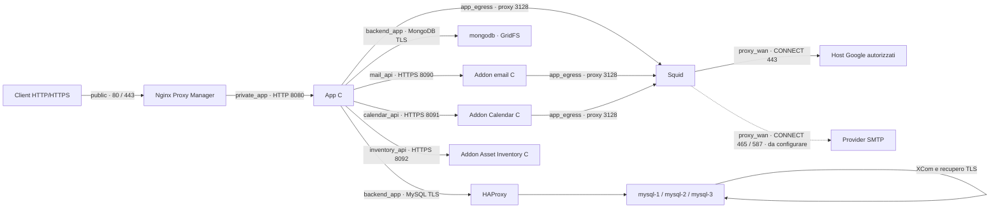

# punto — Commesse e ore di lavoro in C

Web app in italiano, inglese, cinese semplificato, spagnolo, francese e tedesco con server HTTP in C e interfaccia responsive in HTML, CSS e JavaScript, senza pacchetti npm. Gestisce utenti, gruppi gerarchici, ruoli sulle commesse, fornitori, contratti e PDF originali, attività e sottoattività, bacheca Kanban, registro dei blocchi, registrazioni delle ore, alert giornalieri e storico delle modifiche.

Sono disponibili due modalità indipendenti: **Docker con MySQL** per i dati strutturati e **MongoDB GridFS** per i PDF, oppure **avvio nativo con SQLite** e archivio documentale locale. Le due modalità non condividono dati e non eseguono importazioni automatiche.

È disponibile anche **[Punto Ticket](ticket-app/README.md)**, un'app C autonoma per gestire ticket, assegnazioni, priorità, scadenze, commenti e storico, con account e database dedicati. Il collegamento verificato a Punto permette di associare commesse e asset, filtrare i ticket per riferimento e aprirli dai due moduli, rispettando le abilitazioni alle commesse. Compilazione: `make tickets`; verifica: `make test-tickets`. La guida include l'avvio nativo, Docker indipendente e l'affiancamento allo stack tramite Nginx Proxy Manager.

## Lingue dell’interfaccia

Il selettore **Lingua** nell’intestazione è disponibile sia all’accesso sia nell’area di lavoro di Punto e Punto Ticket. Sono supportati italiano, inglese, cinese semplificato, spagnolo, francese e tedesco. La prima apertura segue una lingua supportata del browser, con ripiego sull’italiano; le scelte successive vengono salvate nel browser. Il parametro `?lang=it|en|zh|es|fr|de` permette di aprire un collegamento in una lingua specifica e viene mantenuto nei collegamenti tra le due app. La preferenza riguarda questo browser, non l’account sul server.

Il cambio lingua ricarica la pagina e richiede conferma quando un modulo visibile contiene modifiche non salvate. Sono tradotti testi dell’interfaccia, etichette accessibili, validazioni, errori applicativi riconosciuti e avvisi di sistema; nomi, note, descrizioni e altri contenuti inseriti dagli utenti restano originali. Date e importi seguono la lingua selezionata; la valuta resta EUR e le regole che usano Europe/Rome conservano quel fuso. Email già generate, CSV, API e pagina del provider SSO mantengono i propri formati e contenuti.

I cataloghi sono in `public/locales/`. Dopo una modifica ai cataloghi o al runtime condiviso eseguire `python3 scripts/sync_locales.py` per aggiornare la copia autonoma di Ticket; `--check` verifica che le copie coincidano. I test in `tests/test_i18n.py` controllano copertura, placeholder e sincronizzazione. Il collaudo browser facoltativo usa due database temporanei ed è attivabile con `PUNTO_I18N_BROWSER_TEST=1`, indicando Node, il modulo Playwright e, se necessario, Chrome tramite `PUNTO_NODE_BINARY`, `PUNTO_PLAYWRIGHT_MODULE` e `PUNTO_CHROME_BINARY`. Se un catalogo non è raggiungibile, il login resta disponibile in italiano con un messaggio esplicito di ripiego.

## Documentazione di dettaglio

L’[indice della documentazione](docs/README.md) raccoglie le guide organizzate per destinatario:

**English documentation:** [Documentation index](docs/en/README.md).

- **[Documentazione tecnica](docs/tehnical/README.md):** architettura, installazione, configurazione, reti, sicurezza, modello dati, API, addon, backup, ripristino, sviluppo e test.
- **[Documentazione di prodotto](docs/prod/README.md):** funzionalità disponibili, guide per operatori e gestori, processi, regole, glossario e roadmap.

Sono disponibili anche approfondimenti sugli [interni del server](docs/tehnical/interni-server-c.md), sul [frontend](docs/tehnical/frontend-e-interfaccia.md), sul [motore alert](docs/tehnical/motore-alert.md) e sui [flussi delle integrazioni](docs/tehnical/flussi-integrazioni.md), insieme a [scenari di accesso](docs/prod/scenari-accessi.md), [esempi economici](docs/prod/esempi-analisi-e-costi.md) e un [piano di collaudo](docs/prod/collaudo-accettazione.md).

La [guida Attività, Kanban e blocchi](docs/prod/attivita-kanban-e-blocchi.md) descrive il nuovo modulo; il [riferimento tecnico](docs/tehnical/attivita-kanban-e-blocchi.md) ne documenta dati e API. Il [verbale dell'11 ottobre](docs/tehnical/verifica-attivita-2026-10-11.md) riporta test, schermate e limiti del collaudo; l'immagine candidata è pronta, mentre il deployment esistente non è stato aggiornato.

I documenti descrivono il codice presente nel workspace all’11 ottobre 2026; i piani futuri e le evidenze di collaudo storiche sono contrassegnati esplicitamente. Questo README resta la guida generale per l’avvio.

## Avvio con Docker e cluster MySQL

Servono **Docker Engine 28 o successivo**, **Docker Compose 2.36.0 o successivo**, Python 3 e OpenSSL. La versione del daemon deve supportare il gateway bridge `isolated`; Compose deve supportare `gw_priority` e `interface_name`. Su macOS queste funzionalità sono fornite dal daemon Linux di Docker Desktop. La configurazione locale usa **tre istanze MySQL 8.4 con Group Replication multi-primary**, un proxy TCP HAProxy 3.2, MongoDB 8.0, Nginx Proxy Manager, Squid per l’uscita filtrata, l’app C e tre addon C per email, Google Calendar e asset inventory. Dalla cartella del progetto:

```sh
cp .env.docker.example .env.docker
```

Apri `.env.docker`, scegli l’email del primo gestore e compila `PUNTO_PASSWORD`, `MYSQL_PASSWORD` e `MYSQL_ROOT_PASSWORD` con password diverse. Imposta anche `NPM_ADMIN_EMAIL` e una password distinta in `NPM_ADMIN_PASSWORD` per il pannello del reverse proxy. Puoi lasciare vuote `CLUSTER_REPLICATION_PASSWORD`, `CLUSTER_MONITOR_PASSWORD`, `DOC_DB_PASSWORD` e `DOC_DB_ROOT_PASSWORD`: `init` genera e salva nel file quattro password interne distinte di 32 caratteri ASCII. Se scegli manualmente la password di replica, il limite è **32 byte**. Non riutilizzare la password del gestore. Il file contiene credenziali e viene escluso dal versionamento.

Il primo avvio, compreso il passaggio dal precedente database MySQL singolo, va eseguito con:

```sh
python3 scripts/configure_network.py --env-file .env.docker prepare
python3 scripts/manage_cluster.py --env-file .env.docker init
python3 scripts/manage_cluster.py --env-file .env.docker status
```

`prepare` prepara la CA privata locale e i certificati interni in `data/network-tls/`, oppure verifica il bundle già presente. Per aggiungere MongoDB a un’installazione precedente genera soltanto il certificato documentale mancante, firmato dalla CA esistente: non ruota la CA o i certificati MySQL. La directory sull’host ha permessi `0700`; la chiave privata della CA ha permessi `0600` e **non viene montata in alcun container**. App e monitor ricevono soltanto `ca.crt`, montato in sola lettura su `/etc/punto/tls/ca.crt`; ciascun nodo MySQL riceve il proprio certificato, la propria chiave server e la CA pubblica in mount separati. Le chiavi server hanno permessi `0444` per consentire la lettura all’UID MySQL attraverso il bind mount, mentre la directory host `0700` ne limita l’accesso locale. Nessun nodo riceve le chiavi degli altri membri. MongoDB riceve soltanto la CA pubblica e il proprio bundle `documents.pem`, anch’esso in sola lettura e protetto dalla directory host `0700`. I materiali locali non vengono inclusi nel repository o nelle immagini. Prima di avviare i servizi deve essere disponibile il materiale TLS atteso dai mount Compose.

La CA locale dura dieci anni e i certificati server un anno. **Il rinnovo è manuale**: conservare una copia protetta del bundle e pianificare la sostituzione dei certificati prima della scadenza. `prepare` verifica corrispondenza chiave/certificato, CA, nomi e IP; se un certificato è incompleto, non valido o scade entro un giorno si ferma senza sovrascrivere le chiavi. Non eliminare il bundle per ottenere un rinnovo, perché ciò creerebbe una nuova CA e richiederebbe l’aggiornamento coordinato della fiducia in tutti i servizi.

Lo script ferma l’app durante la preparazione, esegue un backup dei dati del primo nodo, inizializza i nuovi nodi vuoti con una copia coerente, crea il gruppo e avvia gli altri servizi. Il primo nodo conserva il volume `mysql_data` già usato dal progetto: non occorre eliminare il database per aggiungere le repliche. Il file locale `data/cluster-state.json` conserva i marcatori dei nodi già preparati, così il seed non viene ripetuto sui dati esistenti. Gli account interni vengono creati su ciascun nodo e il seed viene importato localmente, senza registrare le password nell’output del controller. Su macOS il comando usa per impostazione predefinita il contesto Docker `desktop-linux`; `--docker-context` permette di sceglierne un altro.

Per aggiornare un’installazione esistente con fornitori, contratti e MongoDB, **esegui prima un backup SQL con la configurazione precedente**, conserva `.env.docker` e i volumi, poi aggiorna il codice. Aggiungi le nuove variabili documentali dal modello senza sovrascrivere le credenziali esistenti ed esegui `prepare` e `init` come sopra. Se `data/cluster-state.json` indica un cluster già inizializzato, `init` genera le sole password mancanti e richiama il recupero: non ripete il seed. L’app applica le migrazioni fino alla versione 10, conservando utenti, commesse, registrazioni e abilitazioni; Compose avvia MongoDB come dipendenza dell’app. L’aggiornamento da versione 2 aggiunge gruppi e ruoli: ogni abilitazione precedente diventa Collaboratore, senza ampliare gli utenti autorizzati.

Per applicare la segmentazione e il TLS a un **cluster già inizializzato**, usa invece:

```sh
python3 scripts/configure_network.py --env-file .env.docker apply
```

Il comando prepara i certificati, crea un backup, ricrea i container con le reti aggiornate, recupera il gruppo e ricompila l’app e il proxy. Conserva i volumi MySQL e i dati NPM. L’operazione comporta una breve interruzione dell’app; non sostituire questa procedura con un nuovo seed o con la cancellazione dei volumi.

La migrazione iniziale supporta il precedente database singolo con GTID disattivati e storico `@@gtid_executed` vuoto. Se la sorgente ha già transazioni GTID, `init` si ferma esplicitamente: occorre un clone o un seed con il corretto checkpoint GTID per evitare transazioni duplicate. L’immagine MySQL ufficiale può generare GTID durante l’inizializzazione dei nuovi nodi; il controller li azzera prima dell’importazione soltanto se il nodo è `OFFLINE`, il database applicativo è vuoto, non esistono altre tabelle di dati utente e tutti i GTID appartengono al suo UUID locale. Un nodo che non soddisfa questi controlli non viene sovrascritto.

In `docker/mysql/cluster.cnf` le opzioni del plugin hanno il prefisso `loose-group_replication_`: consente la fase `mysqld --initialize`, durante la quale il plugin non è ancora caricato. Dopo l’avvio il controller verifica le variabili effettive del server prima di inizializzare o recuperare il gruppo.

Apri [http://localhost](http://localhost) tramite Nginx Proxy Manager e accedi con `PUNTO_EMAIL` e `PUNTO_PASSWORD` impostati nel file. Su una nuova installazione configura anche gli inoltri NPM come descritto nella sezione del reverse proxy. `NPM_HTTP_PORT` cambia la porta HTTP pubblicata. L’app non pubblica una porta diretta sull’host: il precedente accesso su `8082` è rimosso. Lo schema e il primo gestore vengono creati quando necessario. Il container applicativo legge e scrive in MySQL e non utilizza `data/punto.db`.

### Accesso aziendale condiviso con Keycloak

Punto e Ticket supportano lo stesso realm Keycloak tramite OpenID Connect, con client separati e accesso SSO. L’overlay `compose.keycloak.yaml` aggiunge Keycloak e il suo database dedicato; `compose.tickets-keycloak.yaml` collega anche Ticket. La [guida Keycloak](docs/tehnical/keycloak.md) contiene preparazione dei segreti, configurazione HTTPS, collegamento degli utenti esistenti e comandi di avvio.

`AUTH_MODE=local` mantiene l’accesso attuale; `hybrid` aggiunge il pulsante **Accedi con l’account aziendale**; `oidc` disabilita il login locale anche via API. L’overlay usa variabili `KEYCLOAK_*` per scegliere la modalità delle due app senza conflitti tra i file env. L’identità viene collegata esplicitamente tramite subject Keycloak all’email dell’account locale: ID, assegnazioni, storico e ruoli restano quelli dell’app. Non vengono importate password né concessi ruoli a partire dai claim del provider.

Il flusso usa Authorization Code con PKCE, state e nonce monouso e verifica crittografica del token. I token restano sul server; il browser riceve soltanto il cookie della propria app. La sessione SSO locale scade entro la validità del token, al massimo 8 ore. **Esci** chiude la sessione della singola app: la sessione centrale Keycloak può consentire un successivo accesso senza richiedere nuovamente la password. Le configurazioni e i backup dell’identità centrale sono descritti nella guida dedicata.

### Servizi, dati e disponibilità

Lo stack comprende **11 servizi**, oppure **12** con l’overlay facoltativo Ticket. Le immagini costruite dal progetto usano `punto/<servizio>:${PUNTO_IMAGE_TAG:-local}`; MySQL e MongoDB mantengono le immagini ufficiali. La [guida ai nomi Docker](docs/tehnical/nomi-servizi-e-immagini.md) contiene la tabella completa, gli alias interni e la procedura di passaggio da un’installazione esistente. La rinomina dei file Compose non migra da sola i container già creati.

| Servizio | Funzione | Persistenza |
| --- | --- | --- |
| `mysql-1` | Primo membro MySQL, scrivibile | Volume esistente `mysql_data` |
| `mysql-2` | Secondo membro MySQL, scrivibile | Volume `mysql_data_2` |
| `mysql-3` | Terzo membro MySQL, scrivibile | Volume `mysql_data_3` |
| `proxy-db` | HAProxy: connessioni TCP distribuite sui membri disponibili, porta interna `3306` | Configurazione del progetto |
| `mongodb` | MongoDB 8.0: PDF originali in GridFS, porta interna `27017` | Volumi `documents_data` e `documents_config` |
| `app` | Server C, con `DB_HOST=db-proxy` e `DOC_DB_HOST=documents` | Dati strutturati nel cluster; PDF in MongoDB |
| `proxy-web` | Reverse proxy HTTP/HTTPS e pannello amministrativo | Directory locali NPM |
| `proxy-egress` | Proxy esplicito in uscita, porta interna `3128`, destinazioni Google autorizzate | Configurazione e allowlist del progetto; nessuna cache |
| `mail` | Servizio C per invio SMTP tramite API HTTPS privata `8090`; provider da configurare | Volume `mail_addon_data`, registro persistente degli invii |
| `calendar` | Servizio C per sincronizzazione Google tramite API HTTPS privata `8091`; OAuth da configurare | Volume `calendar_addon_data`, credenziali ed eventi cifrati |
| `inventory` | Servizio C per inventario beni tramite API HTTPS privata `8092` | Volume `inventory_addon_data`, schede e storico SQLite |

Ogni membro MySQL conserva una copia completa di utenti, gruppi, appartenenze, ruoli, fornitori, contratti, metadati documentali, commesse, abilitazioni, ore e storico. Tutti e tre possono ricevere scritture; HAProxy sceglie un nodo per ciascuna nuova connessione, mantenendo su quel nodo l’intera transazione. Il monitor ammette nel bilanciamento soltanto membri `ONLINE`, con ruolo `PRIMARY`, scrivibili e con almeno due membri disponibili. MySQL e HAProxy non pubblicano porte database sull’host; il loro traffico rimane sulla rete Compose `backend_app`.

Il **quorum è 2 su 3**: il gruppo può continuare a lavorare se un membro si arresta. Con due membri indisponibili le scritture vengono bloccate per proteggere la consistenza. Group Replication e le sue limitazioni sono descritte nel [manuale Oracle MySQL 8.4](https://dev.mysql.com/doc/refman/8.4/en/group-replication-multi-primary-mode.html).

Questa configurazione protegge dal guasto di una singola istanza MySQL. I tre container sullo stesso computer condividono ancora il guasto dell’host; l’app C, il singolo HAProxy e la singola istanza MongoDB restano punti di guasto. MongoDB non è configurato come replica set e non offre HA. Se MongoDB diventa indisponibile mentre l’app è già avviata, le operazioni SQL su fornitori e contratti restano utilizzabili, mentre caricamenti e download PDF falliscono esplicitamente. All’avvio Compose attende invece che MongoDB sia sano prima di avviare l’app. Per proteggere l’intero servizio servono anche host distinti e ridondanza dei componenti applicativi e di rete.

Il cluster usa isolamento `READ COMMITTED` e consistenza `BEFORE_AND_AFTER`. La tabella interna `cluster_write_guard` viene aggiornata nella stessa transazione delle modifiche applicative: crea un conflitto rilevabile tra scritture concorrenti e protegge controlli quali il limite delle ore giornaliere e l’ultimo gestore attivo. Questa scelta riduce la concorrenza delle scritture; i conflitti di certificazione, incluso l’errore MySQL `3101`, annullano la transazione e vengono trattati come errori temporanei. Il driver ristabilisce le connessioni fuori dalle transazioni e **non ripete un commit con esito incerto**.

MySQL impone `require_secure_transport=ON`: le connessioni TCP devono usare TLS, mentre l’amministrazione locale può usare il socket Unix. L’app usa `DB_TLS_MODE=verify_identity` e `DB_SSL_CA=/etc/punto/tls/ca.crt`; anche il monitor verifica il certificato server rispetto alla CA privata locale e al nome della destinazione. HAProxy inoltra il protocollo MySQL senza terminare TLS; i SAN dei certificati comprendono `db-proxy`, il nome del rispettivo nodo (`db`, `db2` o `db3`) e soltanto il suo IP statico. XCom usa `VERIFY_IDENTITY`; il recupero usa TLS con verifica del certificato del donatore. Gli account interni `punto_recovery` e `punto_monitor` richiedono SSL. Il TLS del database è separato dal certificato HTTPS gestito da NPM. [TLS MySQL](https://dev.mysql.com/doc/refman/8.4/en/using-encrypted-connections.html), [TLS Group Replication](https://dev.mysql.com/doc/refman/8.4/en/group-replication-secure-socket-layer-support-ssl.html), [TLS del recupero](https://dev.mysql.com/doc/refman/8.4/en/group-replication-configuring-ssl-for-recovery.html)

### Segmentazione e sicurezza di rete



| Rete e interfaccia nel container | Subnet | Membri | Accesso esterno |
| --- | --- | --- | --- |
| `public` | `172.30.10.0/24` | Solo `proxy-web` | Bridge normale; porte host HTTP/HTTPS e pannello locale |
| `private_app` | `172.30.20.0/24` | `proxy-web`, `app` | `internal: true`, gateway bridge `isolated` |
| `backend_app` | `172.30.30.0/24` | `app`, `proxy-db`, `mysql-1`, `mysql-2`, `mysql-3`, `mongodb` | `internal: true`, gateway bridge `isolated` |
| `app_egress` | `172.30.40.0/24` | `app`, `mail`, `calendar`, `proxy-egress` | `internal: true`, gateway bridge `isolated` |
| `proxy_wan` | `172.30.50.0/24` | Solo `proxy-egress` | Bridge normale per l’uscita del proxy; nessuna porta host |
| `mail_api` | `172.30.60.0/24` | `app`, `mail` | `internal: true`, gateway bridge `isolated` |
| `calendar_api` | `172.30.70.0/24` | `app`, `calendar` | `internal: true`, gateway bridge `isolated` |
| `inventory_api` | `172.30.80.0/24` | `app`, `inventory` | `internal: true`, gateway bridge `isolated` |

NPM ha la connettività esterna necessaria per ricevere richieste e gestire i certificati HTTPS. Squid dispone della propria rete di uscita separata `proxy_wan`; la rete `public` rimane esclusiva di NPM. App, addon e componenti database sono collegati soltanto a reti interne: non dispongono di una normale uscita diretta verso Internet. L’app raggiunge le destinazioni autorizzate attraverso Squid su `app_egress` e chiama gli addon sulle interfacce dedicate `mail_api`, `calendar_api` e `inventory_api`, per un totale di sei interfacce. La modalità `isolated` elimina anche l’indirizzo gateway del bridge; `internal: true` da solo non elimina tale indirizzo. [Reti Compose](https://docs.docker.com/reference/compose-file/networks/#internal), [gateway Docker](https://docs.docker.com/engine/network/port-publishing/#gateway-modes)

L’app ascolta su **`172.30.20.10:8080`**, soltanto sull’indirizzo `private_app`; il controllo di salute interno usa lo stesso indirizzo. Il suo indirizzo `backend_app` **`172.30.30.10`** non espone HTTP. NPM usa **`172.30.10.2`** su `public` e **`172.30.20.2`** su `private_app`; HAProxy usa **`172.30.30.20`**. MongoDB ascolta soltanto sul proprio loopback e su **`172.30.30.30:27017`**, senza porte pubblicate sull’host. I membri MySQL usano gli indirizzi **`172.30.30.21`**, **`.22`** e **`.23`**; l’allowlist XCom accetta soltanto questi tre peer. X Protocol è disattivato, quindi non viene aperta la porta MySQL `33060`. Le interfacce IPv4 dentro i container hanno i nomi delle rispettive reti. Le subnet definite in Compose devono essere libere e non sovrapposte alle reti dell’ambiente; una modifica degli indirizzi richiede l’aggiornamento coordinato di bind, allowlist e SAN dei certificati.

MongoDB impone `requireTLS`, disabilita TLS 1.0/1.1 e richiede autenticazione. L’app verifica CA e nome `documents` senza consentire certificati o hostname non validi, e usa un account `SCRAM-SHA-256` con ruolo `readWrite` limitato a `DOC_DB_NAME`; non riceve le credenziali root MongoDB. NPM non è collegato alla rete documentale. Come per MySQL, i membri della rete backend condivisa possono raggiungere la porta TCP: TLS e autorizzazioni restano necessari.

Il forwarding IP dei container è disattivato. I servizi non ricevono `NET_ADMIN` o `NET_RAW`, non sono privilegiati, non montano il socket Docker e usano il blocco dell’acquisizione di nuovi privilegi. Questi controlli impediscono ai processi ordinari di trasformare i container in router o modificare le interfacce di rete.

La segmentazione limita i collegamenti tra reti, ma **non applica ACL per porta tra i membri di `backend_app`**: l’app condivide la rete dei server MySQL e potrebbe aprire connessioni dirette alle loro porte SQL. Autenticazione, TLS e permessi MySQL restano necessari. L’allowlist XCom restringe il protocollo di comunicazione del gruppo ai tre DB e non costituisce un firewall generale sulla rete backend. Per una matrice di flussi più restrittiva occorrono regole firewall del daemon/host o un sistema di network policy.

L’immagine NPM derivata limita invece i listener amministrativi: l’API interna sulla porta `3000` ascolta soltanto sul loopback del container, il pannello sulla porta `81` soltanto su loopback e sull’indirizzo `public` `172.30.10.2`. Il pannello non ascolta su `172.30.20.2`, quindi l’app non dispone di accesso amministrativo tramite `private_app`. L’host pubblica `81` soltanto su `127.0.0.1`; la rete `public` contiene soltanto NPM.

Su Docker Desktop le reti bridge risiedono nella VM Linux, quindi non costituiscono interfacce direttamente instradabili dal Mac. Chi amministra Docker o l’host può comunque collegare container alle reti o accedere ai volumi: questa configurazione non separa il servizio dall’amministratore dell’infrastruttura. Il collegamento HTTP NPM → app resta sulla rete privata; il TLS del database non lo trasforma in HTTPS. [Networking Docker Desktop](https://docs.docker.com/desktop/features/networking/networking-how-tos/#known-limitations)

### Uscita filtrata con Squid

Squid ascolta soltanto su **`172.30.40.2:3128`**, accetta l’app **`172.30.40.10`**, l’addon email **`172.30.40.11`** e l’addon Calendar **`172.30.40.12`** con policy per sorgente e apre le connessioni esterne dall’indirizzo **`172.30.50.2`** di `proxy_wan`. Non pubblica porte sull’host, non appartiene a `private_app` o `backend_app` e non instrada pacchetti per gli altri container. Il processo usa l’utente non privilegiato `10002`, filesystem in sola lettura, `/tmp` temporaneo, `cap_drop: ALL` e `no-new-privileges`. Cache, ICP, HTCP e pinger sono disattivati.

La allowlist in `docker/squid/allowed-domains.txt` contiene i tre host esatti necessari alla futura integrazione Google Calendar/OAuth:

```text
accounts.google.com
oauth2.googleapis.com
www.googleapis.com
```

Per l’app e l’addon Calendar sono consentiti soltanto tunnel **`CONNECT` sulla porta `443`** verso questi nomi. L’addon email può usare soltanto `CONNECT` sulle porte **465/587**, verso gli host esatti in `docker/squid/allowed-smtp-domains.txt`: il file contiene ora soltanto il segnaposto riservato `smtp-not-configured.invalid`, quindi nessun provider SMTP reale è autorizzato. App e Calendar non ereditano le destinazioni SMTP e l’addon email non eredita quelle Google. Le altre richieste vengono negate, comprese HTTP semplice, porte alternative, IP letterali e destinazioni private o riservate risultanti dalla risoluzione DNS. I nomi sono senza punto iniziale, wildcard, schema, percorso o porta: `www.googleapis.com.example.org` non corrisponde alla voce autorizzata. L’opzione ACL `-n` impedisce di autorizzare un IP attraverso una ricerca DNS inversa. [ACL Squid](https://www.squid-cache.org/Doc/config/acl/)

Il proxy **non decifra TLS**: controlla host e porta dichiarati nella richiesta `CONNECT`, senza poter filtrare percorsi HTTPS, contenuto o scope OAuth. In particolare `www.googleapis.com` ospita anche altre API Google; l’addon vincola quindi percorsi e scope alle operazioni Calendar. L’endpoint REST è `https://www.googleapis.com/calendar/v3`, mentre l’autorizzazione OAuth usa `accounts.google.com` e lo scambio/rinnovo token usa `oauth2.googleapis.com`. L’uso reale richiede le credenziali OAuth e il consenso dell’utente. [Tunnel HTTPS Squid](https://wiki.squid-cache.org/Features/HTTPS), [riferimento Calendar](https://developers.google.com/workspace/calendar/api/v3/reference), [OAuth per applicazioni web Google](https://developers.google.com/identity/protocols/oauth2/web-server)

Compose imposta nell’app `HTTP_PROXY`, `HTTPS_PROXY` e le varianti minuscole a `http://squid:3128`. `NO_PROXY` e `no_proxy` escludono loopback e servizi interni; il controllo `/healthz` usa inoltre `curl --noproxy '*'`. Le future librerie HTTP del server C dovranno rispettare queste variabili o configurare esplicitamente il proxy. Non sono un firewall: il blocco dell’uscita diretta è fornito dalle reti interne. Il client dell’API email disabilita esplicitamente il proxy per il collegamento privato; l’addon impone invece Squid per SMTP anche in presenza di `NO_PROXY`.

Per aggiungere Squid e gli addon a uno stack già avviato con le reti `private_app` e `backend_app` correnti, esegui prima un backup SQL, quindi prepara certificati e segreti e aggiorna i soli servizi interessati:

```sh
python3 scripts/configure_network.py prepare --env-file .env.docker
docker compose --env-file .env.docker build proxy-egress mail calendar inventory app proxy-web
docker compose --env-file .env.docker up -d --no-deps --force-recreate --wait proxy-egress mail calendar inventory app proxy-web
```

Compose crea le reti e i volumi mancanti, avvia Squid e addon e ricrea app e NPM. Il servizio può essere brevemente indisponibile; l’app applica le migrazioni SQL mancanti fino alla versione 10 conservando i dati. L’addon Calendar non richiede altre migrazioni MySQL. Questo aggiornamento non richiede `configure_network.py apply`, un nuovo seed o la ricreazione dei database. Il controllo di salute di Squid verifica una risposta locale `403` senza richiedere Internet: non dimostra da solo che Google sia raggiungibile. Se Squid si arresta, le nuove richieste esterne falliscono; il lavoro sui database rimane indipendente dal proxy mentre l’app è già avviata. A un nuovo avvio Compose attende invece che Squid e addon siano sani.

Per aggiornare la allowlist, modifica `docker/squid/allowed-domains.txt` mantenendo un host esatto per riga. I file sono montati in sola lettura nel container. Prima di ricaricare, verifica il contenuto effettivamente montato e la sintassi:

```sh
docker compose --env-file .env.docker exec -T proxy-egress cat /etc/squid/allowed-domains.txt
docker compose --env-file .env.docker exec -T proxy-egress squid -k parse -f /etc/squid/squid.conf
```

**Soltanto se la verifica termina con esito zero** e il file montato contiene le modifiche, ricarica:

```sh
docker compose --env-file .env.docker exec -T proxy-egress squid -k reconfigure -f /etc/squid/squid.conf
```

Un editor che sostituisce il file anziché modificarlo sul posto può lasciare il bind mount sul contenuto precedente. In quel caso esegui prima `docker compose --env-file .env.docker build proxy-egress`: la build verifica la sintassi dei file aggiornati. Se riesce, ricrea soltanto Squid con `docker compose --env-file .env.docker up -d --no-deps --force-recreate --wait proxy-egress`, quindi ricontrolla il contenuto montato e ripeti i test di rete. Gli access log riportano sorgente, dominio, metodo ed esito, senza header, percorsi o query; sono consultabili con `docker compose --env-file .env.docker logs --tail=100 proxy-egress`. Docker limita i log a tre file da 10 MB ciascuno. [Verifica e ricaricamento Squid](https://wiki.squid-cache.org/SquidFaq/InstallingSquid), [rotazione dei log Docker](https://docs.docker.com/engine/logging/drivers/json-file/)

### Backup congiunto dei dati e dei PDF

Il dump MySQL contiene `contract_documents`, ma **non contiene i PDF**. `scripts/backup_documents.py` usa `mongodump` sul database documentale e crea in `backups/` un archivio `documents-*.archive.gz` con permessi `0600`, senza stampare credenziali. La compressione gzip non cifra il contenuto. Conserva insieme il dump SQL, l’archivio MongoDB e i materiali di ripristino protetti.

I due database non condividono una transazione o uno snapshot coordinato. Per una coppia coerente sospendi tutte le scritture; nello stack locale, senza altri client che scrivano direttamente, puoi fermare l’app durante entrambi i backup:

```sh
docker compose --env-file .env.docker stop app
python3 scripts/manage_cluster.py --env-file .env.docker backup
python3 scripts/backup_documents.py --env-file .env.docker
docker compose --env-file .env.docker up -d app
```

Lo script documentale non ferma automaticamente l’app e non orchestra il backup SQL. Mantieni la finestra senza scritture fino al completamento di entrambi e ripristina insieme metadati e documenti. Un commit SQL dall’esito incerto conserva il nuovo blob per evitare riferimenti a byte rimossi; un guasto può lasciare un oggetto non referenziato da riconciliare successivamente. Non è implementata una riconciliazione automatica o una transazione distribuita MySQL/MongoDB.

### Stato, backup e riavvii

```sh
python3 scripts/manage_cluster.py --env-file .env.docker status
python3 scripts/manage_cluster.py --env-file .env.docker backup
docker compose --env-file .env.docker ps
curl --fail http://localhost/healthz
docker compose --env-file .env.docker logs --tail=100 app proxy-db mysql-1 mysql-2 mysql-3
```

`status` permette di controllare la composizione del gruppo. `backup` crea una copia dei dati senza svuotare il database e la salva in `backups/` con permessi `0600`; la directory è esclusa dal versionamento. Anche `data/cluster-state.json` è locale ed escluso dal versionamento: va conservato insieme ai volumi per gestire il cluster esistente. `/healthz` è accessibile senza login, verifica la connessione SQL al backend ed è usato anche dal controllo di salute dell’app: restituisce HTTP 200 con `{"ok":true,"database":"mysql"}` quando il controllo riesce, oppure HTTP 503 quando fallisce. Il controllo del singolo processo MySQL non sostituisce quello di appartenenza al gruppo eseguito dal monitor. `/healthz` non certifica la disponibilità dell’archivio PDF: MongoDB ha un controllo di salute separato con TLS e account applicativo.

Quando il gruppo è ancora attivo, un membro riavviato può rientrare e recuperare le transazioni mancanti. Per avviare o ricreare i container di un cluster già inizializzato:

```sh
docker compose --env-file .env.docker up --build -d
```

Se **tutti e tre i membri si arrestano**, per esempio dopo `docker compose down` o un riavvio del computer, occorre ricostituire il gruppo:

```sh
python3 scripts/manage_cluster.py --env-file .env.docker recover
python3 scripts/manage_cluster.py --env-file .env.docker status
```

`recover` avvia i tre server SQL e attende che siano raggiungibili. Se esiste già un gruppo con membri `ONLINE`, fa rientrare quelli offline senza creare un nuovo gruppo. Soltanto quando nessun membro è `ONLINE` esegue il bootstrap: confronta le transazioni eseguite e quelle certificate, quindi sceglie come fondatore un membro che contiene il set di tutti gli altri. Non sceglie sempre `db` e non forza il quorum su un membro isolato. Se non trova un candidato sicuro si ferma senza creare un secondo gruppo. La scelta segue la [procedura Oracle per il riavvio completo](https://dev.mysql.com/doc/refman/8.4/en/group-replication-restarting-group.html).

Per fermare e rimuovere i container conservando i dati:

```sh
docker compose --env-file .env.docker down
```

I tre volumi MySQL e i due volumi MongoDB conservano i dati tra riavvii e ricostruzioni. Non aggiungere `--volumes` o `-v` se vuoi mantenerli: queste opzioni eliminano i volumi. La replica non sostituisce un backup, perché anche una modifica errata viene propagata agli altri membri.

`PUNTO_EMAIL` e `PUNTO_PASSWORD` creano soltanto il primo gestore su un database privo di utenti; cambiare i valori dopo l’inizializzazione non modifica gli account salvati. Anche le variabili `MYSQL_*` di inizializzazione non cambiano automaticamente le password dei volumi MySQL già esistenti. Lo stesso vale per gli account MongoDB: lo script iniziale crea gli utenti soltanto su un volume documentale vuoto. Non cambiare le password interne nel solo file `.env.docker` senza aggiornare anche gli account database corrispondenti.

| Variabile in `.env.docker` | Funzione |
| --- | --- |
| `NPM_HTTP_PORT` | Porta HTTP pubblicata dal reverse proxy, predefinita `80`; allinea anche `PUBLIC_PORT` dell’app |
| `PUNTO_EMAIL`, `PUNTO_PASSWORD` | Credenziali iniziali del gestore |
| `PUBLIC_ORIGINS` | Origini HTTP/HTTPS autorizzate, separate da virgole |
| `MYSQL_DATABASE` | Nome del database, predefinito `punto` |
| `MYSQL_USER`, `MYSQL_PASSWORD` | Utente applicativo e relativa password |
| `MYSQL_ROOT_PASSWORD` | Password dell’amministratore MySQL, non usata dall’app |
| `CLUSTER_REPLICATION_PASSWORD` | Password dell’account interno `punto_recovery`, generata da `init` se vuota; massimo 32 byte |
| `CLUSTER_MONITOR_PASSWORD` | Password dell’account interno `punto_monitor`, generata da `init` se vuota |
| `DOC_DB_NAME`, `DOC_DB_USER` | Database e account MongoDB documentale, predefiniti `punto_documents` |
| `DOC_DB_PASSWORD`, `DOC_DB_ROOT_PASSWORD` | Password distinte dell’account documentale e root MongoDB; `init` le genera se mancanti |

Il file SQLite nativo resta separato e viene conservato: il passaggio a Docker non importa automaticamente utenti o registrazioni da SQLite.

## Reverse proxy con Nginx Proxy Manager

Il servizio `proxy-web` viene compilato da `docker/nginx-proxy-manager/Dockerfile`, basato sull’immagine **`jc21/nginx-proxy-manager:2.16.0`**. La derivazione limita l’API interna alla porta `3000` di loopback e il pannello `81` a loopback e interfaccia `public`, evitando l’ascolto amministrativo su `private_app`. La build si ferma se non trova l’entrypoint API previsto dalla versione fissata. NPM riceve il traffico applicativo sulle porte **80 HTTP** e **443 HTTPS**; il pannello di amministrazione è pubblicato su [http://127.0.0.1:81](http://127.0.0.1:81), soltanto sul loopback dell’host. Il servizio usa il controllo di salute `/usr/bin/check-health` documentato da [Nginx Proxy Manager](https://nginxproxymanager.com/advanced-config/#docker-healthcheck).

L’app e NPM condividono la rete Compose `private_app`, quindi la destinazione del proxy è **`http://app:8080`**. App, HAProxy, i tre membri MySQL e MongoDB condividono la rete `backend_app`; NPM non è collegato a questa rete. Soltanto NPM appartiene alla rete `public` e pubblica porte sull’host. L’utilizzo del nome del servizio come destinazione sulla rete Docker segue la [configurazione ufficiale NPM](https://nginxproxymanager.com/advanced-config/#best-practice-use-a-docker-network).

### Configurazione del dominio

In `.env.docker`, autorizza gli indirizzi attraverso cui verrà aperta l’app:

```dotenv
PUBLIC_ORIGINS=http://localhost,http://127.0.0.1,http://progetti.tuaazienda.it,https://progetti.tuaazienda.it
```

Le origini devono essere complete e separate da virgole, senza percorsi, credenziali o wildcard. Le porte diverse da quelle predefinite vanno incluse, per esempio `http://localhost:8083`. Il server verifica `Host` e, per le operazioni di modifica, `Origin`. Non considera attendibili gli header `X-Forwarded-*` per autorizzare un dominio. Dopo una modifica delle origini, ricrea il container app:

```sh
docker compose --env-file .env.docker up --build -d
```

Il comando di configurazione del proxy legge `.env.docker`:

```sh
python3 scripts/configure_proxy.py --env-file .env.docker
```

Le credenziali amministrative `NPM_ADMIN_EMAIL` e `NPM_ADMIN_PASSWORD` appartengono al pannello NPM e sono diverse da quelle dell’app. Lo script le usa per inizializzare un’installazione NPM vuota; non vengono passate come variabili al container. Su un’installazione già configurata usa un account amministrativo esistente. I nomi da inoltrare sono ricavati da `PUBLIC_ORIGINS`: con l’esempio indicato sopra crea un Proxy Host per `progetti.tuaazienda.it` e uno per `localhost` e `127.0.0.1`, entrambi diretti al servizio `app` sulla porta `8080`. Lo script crea gli inoltri mancanti e rifiuta eventuali configurazioni incompatibili già presenti, senza sovrascriverle. È possibile eseguirlo nuovamente senza duplicare utenti o inoltri.

Per configurare lo stesso inoltro dal pannello NPM, crea due **Proxy Host** con questi valori:

| Campo | Valore |
| --- | --- |
| Domain Names | Primo host: `progetti.tuaazienda.it`; secondo host: `localhost`, `127.0.0.1` |
| Scheme | `http` |
| Forward Hostname / IP | `app` |
| Forward Port | `8080` |
| Advanced | Vuoto |

Per raggiungere il dominio da un browser, il relativo DNS deve puntare all’indirizzo del server. In locale puoi verificare l’inoltro senza cambiare il DNS:

```sh
curl --fail --resolve progetti.tuaazienda.it:80:127.0.0.1 http://progetti.tuaazienda.it/healthz
```

La porta 443 è pubblicata, ma **HTTPS diventa operativo dopo aver configurato un certificato valido** nella scheda SSL del Proxy Host. Per richiedere un certificato Let's Encrypt, il dominio e la relativa convalida devono essere raggiungibili correttamente. Richiedi il certificato per il solo dominio pubblico `progetti.tuaazienda.it`: `localhost` e `127.0.0.1` servono per l’accesso HTTP locale e hanno un Proxy Host separato. Le sessioni dell’app usano cookie `Secure` quando l’origine pubblica autorizzata è HTTPS. Configura il certificato prima di attivare **Force SSL** sul dominio pubblico.

### Persistenza e impostazioni del proxy

NPM conserva la propria configurazione in un database SQLite separato, `nginx-proxy-manager/data/database.sqlite`, e i certificati in `nginx-proxy-manager/letsencrypt/`. Queste directory sono montate nei percorsi `/data` e `/etc/letsencrypt` previsti dal [setup ufficiale](https://nginxproxymanager.com/setup/); sono escluse sia dal versionamento sia dal contesto di build dell’app. Le commesse, i contratti e i metadati documentali vengono salvati in MySQL; i PDF originali in MongoDB.

| Variabile in `.env.docker` | Funzione |
| --- | --- |
| `NPM_HTTP_PORT` | Porta HTTP pubblica, predefinita `80` |
| `NPM_HTTPS_PORT` | Porta HTTPS pubblica, predefinita `443` |
| `NPM_ADMIN_PORT` | Porta locale del pannello, predefinita `81` |
| `NPM_TZ` | Fuso orario NPM, predefinito `Australia/Brisbane` come nel modello richiesto; puoi impostare `Europe/Rome` |
| `NPM_ADMIN_EMAIL`, `NPM_ADMIN_PASSWORD` | Credenziali lette dallo script di configurazione, non dall’app |

Per spostare una porta pubblicata, modifica il valore in `.env.docker` e ricrea il servizio. Cambiare `NPM_HTTP_PORT` o `NPM_HTTPS_PORT` non modifica automaticamente le origini autorizzate o il DNS. `docker compose down` conserva i volumi MySQL/MongoDB e le directory persistenti NPM; al successivo avvio completo usa il comando `recover` per ricostituire il gruppo.

## Avvio nativo con SQLite

La compilazione nativa usa SQLite per impostazione predefinita. Su macOS servono i Command Line Tools di Xcode. Su Linux servono compilatore C, Make e gli header di OpenSSL e SQLite, ad esempio `libssl-dev` e `libsqlite3-dev`.

```sh
make run
```

Apri [http://127.0.0.1:8080](http://127.0.0.1:8080). Su un database vuoto l’account demo è:

- **Email:** `demo@punto.local`
- **Password:** `Punto2026!`

`Ctrl+C` ferma il server. I dati rimangono in `data/punto.db`; i PDF nella directory `documents` accanto al database, quindi normalmente `data/documents/`. `DOC_FILES_DIR` permette di scegliere un’altra directory documentale. L’archivio usa directory `0700`, file `0600`, identificativi generati dal server e pubblicazione atomica senza sovrascritture; rifiuta link simbolici e file con proprietario o permessi inattesi. Conserva database e directory PDF insieme nei backup nativi. La modalità SQLite non richiede MongoDB; `make clean` rimuove soltanto gli eseguibili compilati.

Le variabili sono lette dall’ambiente. `.env.example` documenta i valori, ma il server non carica automaticamente file `.env`:

```sh
PUNTO_EMAIL='nome@azienda.it' PUNTO_PASSWORD='UnaPasswordPersonale2026!' PORT=8081 make run
```

`PUNTO_EMAIL` e `PUNTO_PASSWORD` vengono usati solo quando non esistono utenti. Il pulsante demo della pagina di login compila sempre l’account demo predefinito.

### Compilazione nativa con MySQL

È possibile usare un server MySQL anche senza Docker. Servono gli header e le librerie MariaDB Connector/C e MongoDB C Driver (`libmongoc-1.0`), con `pkg-config`, oltre alle dipendenze crittografiche della piattaforma: CommonCrypto/Security su macOS, OpenSSL su Linux. Su Debian i pacchetti di compilazione includono `build-essential`, `pkg-config`, `libmariadb-dev`, `libmongoc-dev` e `libssl-dev`.

```sh
make clean
make DB_BACKEND=mysql
```

Esporta `DB_HOST`, `DB_PORT`, `DB_NAME`, `DB_USER` e `DB_PASSWORD` con i dati di connessione a un database esistente e imposta `DB_SSL_CA` al percorso assoluto del certificato della CA TLS, quindi avvia `./build/punto`. Il driver accetta soltanto `DB_TLS_MODE=verify_identity`, che è anche il valore predefinito: la CA è obbligatoria e il certificato server deve corrispondere a `DB_HOST`. Configura anche le variabili `DOC_DB_*` per un MongoDB con TLS e account applicativo. Il cluster Compose non pubblica endpoint database sull’host: questa modalità richiede server raggiungibili separatamente. `DB_PATH` è usato soltanto dal backend SQLite. Per tornare alla compilazione SQLite, esegui `make clean` e `make`.

| Variabile del server | Funzione |
| --- | --- |
| `PORT` | Porta HTTP, predefinita `8080` |
| `PUBLIC_PORT` | Porta pubblica HTTP, predefinita uguale a `PORT`; Compose la allinea a `NPM_HTTP_PORT` per verificare Host e Origin |
| `PUBLIC_ORIGINS` | Elenco esatto delle origini HTTP/HTTPS autorizzate; necessario per usare un dominio attraverso il proxy |
| `BIND_HOST` | Indirizzo IPv4 di ascolto, predefinito `127.0.0.1`; Compose usa soltanto l’indirizzo `private_app` `172.30.20.10` |
| `PUBLIC_DIR` | Cartella degli asset, predefinita `public` |
| `DB_PATH` | File del backend SQLite, predefinito `data/punto.db` |
| `DB_HOST`, `DB_PORT` | Host e porta del backend MySQL |
| `DB_NAME`, `DB_USER`, `DB_PASSWORD` | Database e credenziali applicative MySQL |
| `DB_TLS_MODE` | Modalità TLS MySQL, unico valore ammesso e predefinito `verify_identity` |
| `DB_SSL_CA` | Percorso assoluto leggibile del certificato della CA MySQL, obbligatorio per il backend MySQL |
| `DOC_DB_HOST`, `DOC_DB_PORT` | Destinazione MongoDB, predefiniti `documents` e `27017`, usati nella build MySQL |
| `DOC_DB_NAME`, `DOC_DB_USER`, `DOC_DB_PASSWORD` | Database MongoDB e credenziali dell’account documentale |
| `DOC_DB_SSL_CA` | Percorso assoluto leggibile della CA MongoDB; TLS e verifica dell’identità sono obbligatori |
| `DOC_FILES_DIR` | Directory PDF della modalità SQLite; predefinita `documents` accanto a `DB_PATH` |
| `PUNTO_EMAIL`, `PUNTO_PASSWORD` | Credenziali per creare il primo gestore |
| `TZ` | Fuso orario delle abilitazioni; in assenza di un valore viene usato `Europe/Rome` |

## Utenti e permessi

L’account iniziale è un **Gestore**. Dalla scheda **Utenti** può creare account con nome, email, password e ruolo, oppure modificarne nome, ruolo e stato attivo.

| Operazione | Gestore | Operatore |
| --- | --- | --- |
| Consultare commesse e stati | Tutte le commesse | Solo commesse attualmente abilitate |
| Creare e modificare commesse | Sì | No |
| Censire e modificare fornitori e contratti | Sì | No |
| Caricare, elencare e scaricare i PDF contrattuali | Sì | No |
| Abilitare utenti o gruppi alle commesse | Sì | No |
| Leggere attività e blocchi | Tutte le commesse | Commesse comuni o attualmente abilitate, anche in sola lettura |
| Creare, organizzare ed eliminare attività | Sì | No |
| Aggiornare lo stato delle attività | Tutte | Solo attività assegnate a sé e con accesso Collaboratore |
| Segnalare e modificare blocchi | Tutti; può cambiare responsabile ed eliminare | Può crearli e modificare quelli di cui è autore o responsabile, con accesso Collaboratore |
| Aggiungere ore e descrivere il lavoro svolto | Sì | Solo con un ruolo che permette di registrare ore |
| Consultare le proprie registrazioni, anche dopo una revoca | Sì | Sì |
| Modificare o eliminare le proprie registrazioni | Sì | No |
| Gestire utenti e ruoli | Sì | No |
| Gestire gruppi, sottogruppi e appartenenze | Sì | No |
| Consultare lo storico delle modifiche | Sì | No |

I permessi sono verificati dal server a ogni richiesta, anche se l’utente tenta di inviare direttamente una chiamata API. Un cambio di ruolo vale per le sessioni già aperte; disattivare un account ne revoca le sessioni, che non vengono ripristinate riattivandolo. Il sistema impedisce di disattivare o declassare l’ultimo gestore attivo. L’email non è modificabile dall’interfaccia o dall’API.

Le password vengono salvate come derivazioni PBKDF2-HMAC-SHA256 con sale casuale. Le sessioni usano token casuali e cookie HttpOnly/SameSite, durano 8 ore oppure 30 giorni con “Ricordami” e terminano al riavvio del server. Per le origini HTTPS autorizzate il cookie include anche `Secure`; il certificato TLS viene gestito da Nginx Proxy Manager.

## Gruppi e ruoli sulle commesse

La scheda **Gruppi e ruoli**, riservata ai gestori, mostra un albero di gruppi con i rispettivi membri. Un gruppo ha un nome e un eventuale gruppo padre; un utente può appartenere a più gruppi. Sono ammessi fino a 200 gruppi e 16 livelli, contando la radice come primo livello. Il server rifiuta cicli e spostamenti che superano la profondità massima. Un gruppo può essere eliminato soltanto quando non ha membri, sottogruppi o abilitazioni a commesse.

I profili globali **Gestore** e **Operatore** continuano a determinare le funzioni amministrative. Separatamente, ogni abilitazione a una commessa assegna un ruolo operativo:

| Ruolo predefinito | Codice | Consulta la commessa | Registra ore |
| --- | --- | --- | --- |
| Lettore | `reader` | Sì | No |
| Collaboratore | `contributor` | Sì | Sì |

La capacità di registrare ore abilita anche la collaborazione sulla bacheca: aggiornamento dello stato delle attività assegnate e gestione dei blocchi di cui si è autore o responsabile. I Lettori possono consultare attività e blocchi. L’assegnazione del lavoro non concede nuovi accessi.

I ruoli predefiniti non sono modificabili. Il gestore può creare fino a 100 ruoli complessivi con codice, nome e scelta della possibilità di registrare ore; tutti consentono la consultazione. Il codice, massimo 40 caratteri, inizia con una lettera minuscola e accetta lettere minuscole, numeri, trattini e underscore. Questi ruoli non attribuiscono privilegi amministrativi o accesso a contratti, PDF, utenti e storico.

Dal comando **Abilitazioni** della commessa si assegnano utenti o gruppi, scegliendo ruolo ed eventuali date inclusive. Un’abilitazione a un gruppo si applica anche ai membri dei suoi sottogruppi: un accesso assegnato a “Sviluppo” include gli utenti di “Sviluppo / Backend”, mentre il percorso inverso non concede accesso. Più abilitazioni si sommano; un ruolo Lettore non annulla un altro accesso da Collaboratore. Per revocare completamente l’accesso occorre rimuovere tutte le abilitazioni applicabili.

Le modifiche ad appartenenze, parentela, ruoli e abilitazioni hanno effetto dalla richiesta successiva, anche con una sessione già aperta. Non esiste una cache persistente dei permessi. La consultazione richiede un’abilitazione valida oggi; per registrare ore **una stessa abilitazione** deve permettere l’operazione e coprire sia oggi sia la giornata lavorata. Due intervalli distinti non possono essere combinati per aggirare questo controllo. Le registrazioni già effettuate restano consultabili dal loro autore dopo una revoca.

## Fornitori, contratti e documenti

Le sezioni **Fornitori** e **Contratti** sono riservate ai gestori, con i permessi di sessione `manage_suppliers` e `manage_contracts`. La relazione è **fornitore → contratti → commesse**: ogni contratto ha un fornitore obbligatorio; una commessa può avere un contratto facoltativo e un contratto può definire più commesse. L’operatore continua a vedere le commesse abilitate e a registrare ore, senza accedere all’archivio contrattuale.

Un fornitore ha codice univoco, ragione sociale/nome, partita IVA, email, telefono, indirizzo, note e stato attivo. La disattivazione conserva i contratti già collegati; per un nuovo collegamento si scelgono solo fornitori attivi.

Un contratto ha codice univoco, titolo, fornitore, note, date iniziale/finale facoltative e valore facoltativo. Le date sono ISO `YYYY-MM-DD`, con fine non precedente all’inizio; non cambiano automaticamente lo stato. La sola valuta supportata è **EUR** e `value_cents` è un intero da `0` a `999999999999`: l’interfaccia converte esattamente gli importi con uno o due decimali, senza calcoli in virgola mobile.

| Stato contratto | Valore API |
| --- | --- |
| Bozza | `draft` |
| Attivo | `active` |
| Scaduto | `expired` |
| Chiuso | `closed` |
| Annullato | `cancelled` |

Nella commessa scegli un contratto censito dall’elenco. Un nuovo collegamento non può usare un contratto chiuso o annullato; un collegamento esistente può essere conservato quando il contratto cambia stato. Il campo vuoto rimuove il collegamento, mentre l’omissione in una modifica API lo conserva.

Dal pulsante **PDF** di un contratto puoi aggiungere documenti originali fino a **10 MiB ciascuno** e scaricarli con la sessione autenticata. Ogni caricamento aggiunge un documento distinto, anche se il nome è già presente; non sostituisce versioni precedenti. L’API non permette modifica o eliminazione dei documenti. I metadati SQL sono protetti da trigger contro aggiornamenti ed eliminazioni; ciò non costituisce storage WORM contro un amministratore dell’infrastruttura.

Il server verifica nome `.pdf` (massimo 180 byte), dimensione e firma `%PDF-`; salva un SHA-256 e ricontrolla dimensione e hash prima del download, servito come allegato senza preview inline. Non esegue OCR, antivirus o validazione profonda della struttura PDF. TLS protegge il trasporto: **non sono implementati cifratura dei singoli campi/PDF, vault delle chiavi o calcoli su dati cifrati**. I normali permessi applicativi e database autorizzano l’accesso ai dati in chiaro durante l’elaborazione.

## Commesse e abilitazioni

Il gestore crea una commessa con codice univoco, nome, cliente, descrizione e contratto facoltativo, e ne modifica dettagli e stato:

| Stato | Valore API |
| --- | --- |
| Da avviare | `planned` |
| In corso | `active` |
| In pausa | `paused` |
| Completata | `completed` |
| Annullata | `cancelled` |

Ricerca e filtro per stato aiutano a ritrovare le commesse. Le ore mostrate per commessa sono quelle registrate dall’utente autenticato, su tutte le date.

Dal comando **Abilitazioni** il gestore sceglie utenti o gruppi, ruolo e date facoltative. Le date sono inclusive; un campo vuoto non pone un limite su quel lato dell’intervallo. Le commesse in sola lettura compaiono nell’elenco dell’operatore, senza l’azione di registrazione ore.

Per un operatore, l’abilitazione alla registrazione deve essere valida sia **oggi** sia **nella data del lavoro registrato**. Un accesso futuro, scaduto o revocato non abilita nuove ore. Le registrazioni precedenti restano consultabili. I gestori possono utilizzare tutte le commesse senza assegnazione; lo stato della commessa, da solo, non blocca la registrazione delle ore.

La casella **Commessa comune**, disponibile al gestore, rende quella singola commessa consultabile e utilizzabile per registrare le proprie ore da tutti gli account attivi, anche quelli creati in seguito. È adatta a Generale, Formazione, Riunioni e Attività interne. Le altre commesse continuano a richiedere abilitazioni esplicite; l'aggiornamento non rende comuni le commesse esistenti.

Il gestore può **eliminare definitivamente una commessa** dalla finestra di modifica, dopo una conferma dedicata. L'operazione rimuove in un'unica transazione attività, sottoattività, blocchi, tutte le ore di tutti gli utenti registrate su quella commessa e le sue abilitazioni dirette e per gruppo. Conserva utenti, gruppi, ruoli, contratti e gli eventi dello storico; registra un evento di eliminazione con il riepilogo dei dati rimossi. Non esiste un cestino: per recuperare i dati occorre un backup.

## Attività, Kanban e registro dei blocchi

La sezione **Attività e blocchi** seleziona una commessa autorizzata e mostra attività con titolo, descrizione, responsabile, priorità e scadenza. Le viste **Bacheca Kanban** ed **Elenco e sottoattività** condividono ricerca e filtri per stato/priorità. Sono previsti cinque stati: **Da fare**, **In corso**, **Bloccato**, **Da verificare**, **Completato**. Il cambio di stato usa selettore e pulsante **Applica**, anche da tastiera.

Il gestore crea e organizza le attività; gli operatori con accesso Collaboratore aggiornano solo lo stato di quelle assegnate a loro. Il genitore eventuale deve appartenere alla stessa commessa; la gerarchia arriva a **8 livelli** e rifiuta cicli. La commessa dell’attività non è modificabile. Stati di genitori e figli restano indipendenti.

Il registro dei blocchi conserva titolo, descrizione, impatto, responsabile, prossima azione, scadenza e stato **Aperto / In gestione / Risolto**. Il blocco può riguardare tutta la commessa o una sua attività. Gli operatori collaboratori possono crearlo e aggiornarlo se ne sono autori o responsabili; solo i gestori cambiano il responsabile o eliminano. Segnalare o risolvere un blocco non sposta automaticamente la scheda Kanban.

Sono ammessi **500 attività e 500 blocchi per commessa**, inclusi completati e risolti. Ogni modifica o eliminazione verifica una revisione; un conflitto richiede di ricaricare la versione corrente. Un’attività con figli non si elimina finché questi non vengono spostati o rimossi; i blocchi collegati restano nella commessa e vengono scollegati. Ogni modifica viene registrata nello Storico nella stessa transazione.

Le ore restano associate alla commessa; checklist separate, dipendenze, Gantt, carico di lavoro, rischi futuri e notifiche di scadenza sono sviluppi successivi. Dettagli: [guida del modulo](docs/prod/attivita-kanban-e-blocchi.md).

## Alert e trigger

La sezione **Alert e trigger**, riservata ai gestori, propone due controlli: tentativi respinti di registrare ore su una commessa inesistente (anche eliminata) e giornate lavorative con meno di **480 minuti** registrati. Le ore su commesse inesistenti rimangono bloccate: l’alert segnala il tentativo, senza creare una registrazione invalida.

Ogni gestore crea le proprie regole, sceglie un nome, l’orario giornaliero **HH:MM nel fuso Europe/Rome**, lo stato attivo e i destinatari: utenti dell’app e indirizzi email. Le regole sono eseguite automaticamente una sola volta per giornata locale, con stato persistente anche dopo un riavvio. **Esegui ora** avvia un controllo manuale, utile anche per una regola disattivata; le stesse anomalie non generano notifiche duplicate.

Il controllo delle ore considera le giornate **lunedì–venerdì**, dopo **48 ore effettive dalla fine della giornata**. Per esempio, il lunedì termina martedì alle 00:00 e diventa verificabile giovedì alle 00:00, quindi al successivo orario configurato. Il monitoraggio parte dalla creazione della regola; gli utenti aggiunti in seguito vengono inclusi dal primo controllo, senza segnalazioni anteriori all’inizio del loro monitoraggio. Non è ancora presente un calendario di festività, ferie o contratti a tempo parziale: la soglia attuale è di 8 ore per ogni giorno lun–ven.

La sezione **Notifiche** mostra soltanto gli avvisi del proprio account, con stato letto/non letto. Un gestore destinatario può ricevere anomalie degli utenti monitorati; un operatore riceve e consulta soltanto quelle che riguardano se stesso. Le regole il cui proprietario è disattivato o perde il ruolo Gestore non vengono eseguite automaticamente.

Il canale **email è implementato ma SMTP non è ancora configurato**: gli indirizzi vengono validati e gli avvisi restano in coda con stato `pending_configuration`. Il trasporto è delegato al nuovo addon C; nessun avviso viene presentato come email spedita finché il server SMTP non lo accetta.

### Addon email in C

Il servizio Compose **`mail`** espone `GET /healthz`, `GET /v1/status` e `POST /v1/emails` tramite HTTPS su **`https://mail-api:8090`**. È un’API interna: ascolta soltanto su `172.30.60.2`, accetta l’app `172.30.60.10` e richiede un token Bearer per gli endpoint `/v1/*`. Non pubblica porte sull’host e non riceve credenziali dei database. Il nome `mail-api` appartiene soltanto alla rete dedicata, evitando ambiguità con l’interfaccia egress condivisa.

`configure_network.py prepare` crea il certificato dell’addon e i file in `data/addon-secrets/`, senza cambiare CA, certificati esistenti o token già generati. Il token API è montato soltanto in app e addon; la password SMTP soltanto nell’addon. La directory locale ha permessi `0700`; i file readonly sono leggibili dai distinti utenti non privilegiati dei due container. I materiali sono esclusi da Git e dalle immagini. Il processo addon usa UID `10003`, filesystem in sola lettura e il volume `mail_addon_data` per il registro degli esiti.

Il POST riceve `idempotency_key`, `to`, `subject` e `body` codificati come form. L’app ricontrolla proprietario e destinatario della regola, poi chiama l’API fuori dalla transazione SQL. Una chiave stabile identifica ogni elemento della coda: i tentativi ripetuti recuperano l’esito già registrato. Il ledger SQLite conserva solo chiave, hash del contenuto, stato e orari; destinatario e testo restano nell’outbox SQL. Una risposta SMTP incerta, compreso un crash durante l’invio, richiede verifica manuale e non produce un reinvio automatico. `sent` conferma l’accettazione SMTP, non la consegna nella casella.

Gli stati della coda sono `pending_configuration`, `retrying`, `sent`, `delivery_unknown` e `delivery_failed`. La migrazione 7 aggiorna il vincolo degli stati, conservando righe e identificativi; non aggiunge tabelle applicative. Prima di attivare un provider reale occorre configurare mittente, host, modalità TLS, credenziali e hostname esatto nella allowlist SMTP di Squid. **SMTP rimane disabilitato finché questa configurazione non viene completata.**

Il [manuale dell’addon](addon/README.md) descrive formato API, errori, configurazione futura e ripristino. Il backup MySQL non include il ledger: outbox, ledger e `MAIL_API_NAMESPACE` devono essere salvati e ripristinati insieme per conservare la deduplicazione.

## Addon Google Calendar

**`calendar`** è un secondo microservizio C, indipendente dall’addon email. Espone un’API HTTPS privata su **`https://calendar-api:8091`** e sincronizza gli eventi Google con il proprio archivio locale. L’app conserva autenticazione e autorizzazione: ricava sempre l’utente dalla sessione, mentre l’addon riceve un token di servizio dedicato. Gestori e operatori possono usare il proprio collegamento; il ruolo Gestore non concede accesso ai calendari degli altri utenti.

Il flusso OAuth usa stato temporaneo monouso, PKCE e associazione alla sessione applicativa. Gli scope sono `calendar.events` e `calendar.calendarlist.readonly`. L’addon rinnova i token e mantiene una coda persistente delle modifiche; il controllo periodico usa `CALENDAR_SYNC_INTERVAL`, predefinito 300 secondi. Le modifiche di un evento esistente usano ETag per rilevare conflitti. Le creazioni hanno identificativi deterministici per evitare duplicati quando l’esito di rete è incerto. La sincronizzazione in ingresso usa paginazione e `syncToken`, con ricostruzione della copia locale se Google invalida il token. [Sincronizzazione incrementale Google](https://developers.google.com/workspace/calendar/api/guides/sync), [modifiche condizionali con ETag](https://developers.google.com/workspace/calendar/api/guides/version-resources)

L’addon ha soltanto le reti interne `calendar_api` e `app_egress`; ascolta su `172.30.70.2:8091`, accetta l’app `172.30.70.10` e usa Squid da `172.30.40.12` per i soli host Google autorizzati su porta 443. Non dispone di credenziali MySQL/MongoDB, non raggiunge i database e non pubblica porte sull’host. Il processo usa UID `10004`, filesystem readonly, capacità Linux rimosse e il volume `calendar_addon_data`.

Token OAuth, contenuti degli eventi e modifiche accodate vengono cifrati nel database SQLite dell’addon con AES-256-GCM. La chiave locale separata è `data/addon-secrets/calendar-token-key`, montata soltanto nell’addon; non è memorizzata nel suo volume. Gli identificativi utente/calendario/evento, ETag, cursori e stati operativi restano in chiaro; l’identificativo Google può contenere l’indirizzo email. L’addon decifra i contenuti durante l’elaborazione e li restituisce all’utente autorizzato: questa protezione non realizza calcoli su dati sempre cifrati. Il backup MySQL non include l’archivio calendari; volume e chiave richiedono un backup protetto congiunto. Una chiave persa rende il contenuto dell’archivio illeggibile.

La callback `/api/calendar/oauth/callback` eredita le restrizioni di accesso del Proxy Host NPM ed esclude i propri accessi ed errori dai log, per evitare di registrarvi codici OAuth. Gli altri percorsi conservano i normali log diagnostici con URL senza query. L’immagine aggiorna sia i Proxy Host esistenti sia quelli rigenerati dal pannello, con backup dei file precedenti; configurazioni personalizzate incompatibili richiedono revisione e vengono rifiutate.

**Google OAuth resta non configurato nello stack locale.** Per attivarlo occorrono Calendar API abilitata nel proprio progetto Google Cloud, client OAuth Web, `GOOGLE_CLIENT_ID`, `GOOGLE_REDIRECT_URI` e client secret nel file locale `data/addon-secrets/google-client-secret`. La redirect URI deve coincidere esattamente con quella registrata in Google Cloud e terminare con `/api/calendar/oauth/callback`; in produzione usare HTTPS. Non inserire il client secret in `.env.docker`, sorgenti o messaggi. Ogni utente deve poi concedere il consenso. [Configurazione OAuth Google](https://developers.google.com/identity/protocols/oauth2/web-server), [scope Calendar](https://developers.google.com/workspace/calendar/api/auth)

Questa integrazione espone API: la schermata Calendario e il collegamento evento → commessa/ore sono sviluppi successivi. Non crea automaticamente registrazioni di lavoro a partire dagli appuntamenti. Il [manuale Calendar](calendar-addon/README.md) descrive contratto API, stati della coda, limiti e attivazione del provider.

### Asset inventory

Il modulo gestisce dispositivi IT, rete, beni fisici, software e licenze con relazioni manuali. Include esportazione CSV filtrata, importazione con anteprima e conferma atomica, alert configurabili sulle scadenze e backup automatici. Gli alert richiedono lo schema applicativo 10; il database separato inventory migra alla versione 5. Le regole `inventory_return` segnalano restituzioni scadute e `inventory_verification` beni mai verificati o da verificare nuovamente, con `verification_days` predefinito a 90 giorni (1–365).

**`inventory`** è un'applicazione C separata, con schede dei beni, stati, assegnazione, acquisto, garanzia e storico persistente. La scheda **Asset inventory** dell'app permette a tutti gli utenti autenticati di consultare catalogo e revisioni; i Gestori possono creare e modificare le schede. L'etichetta è univoca e le modifiche usano una versione per impedire sovrascritture concorrenti. Per ritirare un bene si usa lo stato Dismesso; non è prevista la cancellazione.

Le anagrafiche **Persone** e **Identità** distinguono individui reali e utenze dei sistemi, indipendentemente dagli account di accesso a Punto. I collegamenti sono molti a molti e supportano utenze condivise. Persone e identità possono essere collegate direttamente ai beni, con ruolo, note, storico e filtri condivisi con cruscotto ed esportazione. Lo schema inventory 5 migra le versioni precedenti conservando i dati; la [guida operativa](docs/prod/asset-inventory.md#persone-e-identità) descrive il flusso.

Il servizio ascolta su `https://inventory-api:8092` (`172.30.80.2`) e accetta soltanto l'app `172.30.80.10`, con token dedicato e verifica TLS. La sola rete `inventory_api` non fornisce accesso a Internet, Squid o database dell'app. Il volume `inventory_addon_data` contiene un database SQLite indipendente, da salvare separatamente dal backup MySQL. Compose conserva copie automatiche verificate ogni 24 ore nel volume separato `inventory_addon_backups`, mantenendo le ultime 14. Non esegue autodiscovery o scansioni della rete.

Per aggiungerlo a uno stack già configurato:

```sh
python3 scripts/configure_network.py --env-file .env.docker prepare
docker compose --env-file .env.docker build inventory app
docker compose --env-file .env.docker up -d inventory app
```

`prepare` crea soltanto certificato e token mancanti, conservando gli originali. In modalità nativa il modulo è facoltativo; se configurato richiede insieme `INVENTORY_API_URL`, `INVENTORY_API_CA_FILE` e `INVENTORY_API_TOKEN_FILE`, sempre con HTTPS verificato. La [guida prodotto](docs/prod/asset-inventory.md), la [guida tecnica](docs/tehnical/asset-inventory.md) e il [manuale del servizio](inventory-addon/README.md) descrivono permessi, API, limiti e backup.

## Registro ore

Seleziona una giornata e registra il tempo su una commessa disponibile, con una nota facoltativa. Le ore decimali vengono convertite in minuti interi: **1,5 ore = 1 ora e 30 minuti**. Puoi usare anche il formato `1:30`. Il gestore può correggere o eliminare le proprie registrazioni; l’operatore può soltanto aggiungerle.

Il registro mostra il totale giornaliero. Il server impedisce valori nulli o negativi, date inesistenti e un totale superiore a 24 ore nella stessa giornata. Sono ammesse più registrazioni sulla stessa commessa e date passate o future, rispettando le eventuali abilitazioni.

Ogni registrazione appartiene all’**identificativo stabile dell’utente** (`user_id`), attribuito dal server. L’email memorizzata insieme alle ore è un dato storico; non determina i permessi di lettura o modifica. Il modulo e l’API non consentono di attribuire ore a un altro utente.

## Analisi per periodo, commessa, utente e contratti

La sezione **Analisi** raccoglie cinque viste con filtri condivisi **Dal**, **Al**, **Commessa** e, per i gestori, **Utente**. Per una data singola imposta lo stesso giorno nei due campi; gli estremi sono inclusi e l’intervallo massimo è di 366 giorni. I comandi Oggi, Questa settimana e Questo mese usano la data del server. Le viste e i filtri sono riportati nell’URL per poter riaprire o condividere la selezione; il collegamento non concede accessi.

- **Per periodo:** ore e registrazioni raggruppate per giornata.
- **Per commessa:** tempo registrato, numero di registrazioni e persone coinvolte per progetto.
- **Per utente:** ore e commesse per persona, includendo gli account disattivati nello storico dei gestori.
- **Valore contratti:** contratti collegati alle ore del periodo, con valore contrattuale noto, valori non definiti e ore senza contratto. Riservata ai gestori.
- **Costo delle ore:** stima del costo del lavoro per persona e commessa, usando le tariffe orarie valide alla data di ciascuna registrazione. Include la gestione delle tariffe ed è riservata ai gestori.

Il gestore può consultare gli aggregati di tutti gli utenti. L’operatore consulta soltanto le proprie registrazioni, comprese quelle storiche su commesse successivamente revocate; il server applica questo limite a ogni richiesta. Le analisi non espongono note delle attività o credenziali.

La vista contratti mostra **il valore intero dei contratti attualmente collegati alle commesse**, contato una sola volta anche quando un contratto è collegato a più commesse. Il periodo seleziona il lavoro registrato, non ripartisce il valore contrattuale nel tempo o tra utenti e commesse. Un valore non definito resta distinto da zero. Cambiare il contratto di una commessa aggiorna anche questa analisi del lavoro storico.

Le tariffe del costo delle ore sono espresse in **centesimi EUR per ora**, da 0 a 99.999.999 centesimi, con data iniziale obbligatoria e data finale facoltativa. Gli estremi sono inclusi e due tariffe dello stesso utente non possono sovrapporsi; la tariffa zero è un valore esplicito. Il costo viene arrotondato al centesimo, con metà arrotondata in alto, per ogni registrazione prima di sommare i risultati. Le ore senza tariffa restano indicate come non valorizzate: una somma incompleta è una stima parziale e non un costo zero.

Questi report sono stime gestionali basate sulle tariffe correnti applicabili alle date lavorate. Modificare una tariffa ricalcola le stime storiche; non vengono congelati importi contabili o fatturabili. Le modifiche delle tariffe hanno audit atomico. Spese consuntive, pagamenti, ricavi, multivaluta e modulo finanziario completo restano da implementare. Lo schema 4 aggiunge soltanto `labor_rates`, senza valorizzare automaticamente le ore esistenti.

## Storico delle modifiche e aggiornamenti dei dati

La scheda **Storico** è riservata ai gestori. Mostra creazioni e modifiche di utenti, gruppi, ruoli, fornitori, contratti, commesse, attività, blocchi e tariffe orarie, cambiamenti delle appartenenze, caricamenti PDF, aggiunte e correzioni delle ore, eliminazioni delle registrazioni e modifiche alle abilitazioni dirette o per gruppo. Ogni evento conserva data UTC, autore e valori precedenti e successivi; non contiene password, hash o sali. I filtri per tipo e la paginazione consentono di consultare anche uno storico esteso.

Una modifica applicativa e il suo evento di audit vengono salvati nella stessa transazione. Se lo storico non può essere scritto, viene annullata anche la modifica. Le richieste rifiutate non producono eventi di modifica.

Gli aggiornamenti dello schema sono versionati. Per un precedente database SQLite, la migrazione conserva i dati e associa le ore agli utenti attraverso l’email, senza distinguere maiuscole e minuscole. Le righe senza un account corrispondente restano conservate ma non vengono esposte ad altri utenti; la creazione successiva dell’account corrispondente può associarle al suo `user_id`. Un database con versione futura non supportata viene rifiutato senza modificarlo.

La base attuale gestisce fino a 200 utenti, 200 gruppi, 100 ruoli sulle commesse, 1000 commesse, 500 attività e 500 blocchi per commessa, 1000 fornitori, 1000 contratti, 1000 tariffe orarie, 1000 documenti per contratto e 1000 registrazioni per utente nella stessa giornata. Le analisi restituiscono fino a 1000 gruppi di risultati, calcolando sempre tutte le registrazioni filtrate. Un superamento restituisce un errore esplicito senza troncare gli elenchi.

## Tabelle del database

Nel backend MySQL il database applicativo, predefinito `punto`, contiene **25 tabelle InnoDB**; lo schema corrente è la **versione 10**. Il passo 9 aggiunge alle regole alert il tipo `inventory_due` e l’anticipo `days_before`; il passo 10 aggiunge `inventory_return`, `inventory_verification` e `verification_days` (1–365, predefinito 90), senza nuove tabelle applicative e conservando ID, FK e storico. L’inizializzazione include inoltre `oidc_identities`, che conserva il collegamento permanente fra identità del provider e utenti locali senza cambiare il numero di versione. Ogni tabella ha una chiave primaria; le relazioni usano chiavi esterne senza operazioni `CASCADE`.

| Tabella | Dati principali e struttura |
| --- | --- |
| `users` | ID utente `BIGINT`, email univoca, nome, ruolo e stato attivo; derivazione della password `BINARY(32)` e sale `BINARY(16)` |
| `oidc_identities` | Chiave composta `(issuer,subject)` con confronti binari, rispettivamente `VARBINARY(1023)` e `VARBINARY(255)`; `user_id BIGINT` univoco e FK verso `users`, senza password o token |
| `suppliers` | ID `BIGINT`, codice univoco `VARCHAR(40)`, nome `VARCHAR(120)`, partita IVA, email, telefono, indirizzo, note e stato `TINYINT` |
| `contracts` | ID `BIGINT`, codice univoco, titolo, `supplier_id` obbligatorio, stato, date `CHAR(10)` nullable, `value_cents BIGINT` nullable, valuta `EUR` e note |
| `contract_documents` | ID `BIGINT`, `contract_id`, chiave archivio univoca `CHAR(64)`, nome `VARCHAR(180)`, dimensione `INT`, SHA-256 `CHAR(64)`, autore `uploaded_by` e data UTC; nessun byte PDF |
| `jobs` | ID commessa `BIGINT`, codice univoco, nome, cliente, descrizione, stato, `contract_id BIGINT` nullable e `is_common TINYINT` (0/1, predefinito 0) |
| `job_tasks` | ID `BIGINT`, commessa obbligatoria, genitore e responsabile nullable, titolo `VARCHAR(160)`, descrizione `VARCHAR(2000)`, stato, priorità, scadenza `CHAR(10)` nullable, revisione e istanti UTC |
| `job_blockers` | ID `BIGINT`, commessa obbligatoria, attività e responsabile nullable, titolo, descrizione, impatto, stato, prossima azione `VARCHAR(1000)`, scadenza, autore, revisione e istanti UTC |
| `job_assignments` | Chiave composta `(job_id,user_id)`, riferimenti a commessa, utente e `role_id`, date di validità facoltative |
| `organization_groups` | ID, nome e `parent_id` nullable verso la stessa tabella; albero senza cicli |
| `group_members` | Chiave composta `(group_id,user_id)`; appartenenze multiple degli utenti |
| `job_roles` | ID, codice univoco, nome, `can_log_time` e `builtin`; Lettore e Collaboratore predefiniti |
| `job_group_grants` | Chiave composta `(job_id,group_id)`, riferimento al ruolo e date di validità facoltative |
| `time_entries` | ID registrazione `BIGINT`, riferimenti a commessa e utente, copia storica dell’email, giornata, minuti e nota |
| `labor_rates` | ID `BIGINT`, utente immutabile `user_id`, tariffa `hourly_cents BIGINT`, valuta `EUR`, date di validità; univocità `(user_id,starts_on)` |
| `alert_rules` | Regola, gestore proprietario, tipo, orario locale, attivazione e ultimo controllo persistente |
| `alert_rule_users`, `alert_rule_emails` | Destinatari di ogni regola, con chiavi composte e indirizzi email univoci |
| `alert_subjects` | Utenti monitorati, data iniziale e ultima giornata controllata per regola |
| `alert_events` | Tentativi respinti su commesse inesistenti: utente, ID commessa, giornata, minuti e data UTC; nessuna nota dell’attività |
| `alert_notifications` | Avvisi interni, destinatario, utente interessato, chiave di deduplicazione e stato di lettura |
| `alert_email_outbox` | Coda email con destinatario, contenuto e stato: `pending_configuration`, `retrying`, `sent`, `delivery_unknown`, `delivery_failed` |
| `audit_events` | ID evento `BIGINT`, autore, data UTC, azione, tipo e ID dell’elemento, JSON precedenti e successivi |
| `schema_metadata` | Versione dello schema, conservata in una singola riga |
| `cluster_write_guard` | Riga interna modificata dalle transazioni applicative per rilevare conflitti tra scritture sui membri del cluster |

I testi usano `utf8mb4`; email e codici sono univoci senza distinzione tra maiuscole e minuscole. Le giornate e gli intervalli sono stringhe ISO `YYYY-MM-DD`, le durate sono minuti interi e i JSON dello storico sono testo. I trigger proteggono lo storico da aggiornamenti ed eliminazioni e impediscono di cambiare l’utente già associato a una registrazione. La definizione completa si trova in `src/mysql_schema.c`.

SQLite conserva **23 tabelle applicative**, oltre alla tabella interna `sqlite_sequence`, e usa `PRAGMA user_version=10` per la versione dello schema. `schema_metadata` e `cluster_write_guard` appartengono alla modalità MySQL; il database SQLite di NPM contiene soltanto la configurazione del reverse proxy e non è una replica dei dati applicativi. L’addon email usa un database SQLite separato con una sola tabella `deliveries` nel proprio volume, dedicata agli esiti e alla deduplicazione.

Il database MongoDB, predefinito **`punto_documents`**, contiene i PDF nel bucket GridFS `contract_pdfs`:

| Collezione | Struttura |
| --- | --- |
| `contract_pdfs.files` | Metadati GridFS: `_id` uguale alla chiave archivio SQL, nome originale, lunghezza, dimensione chunk, upload e metadata con SHA-256/content type |
| `contract_pdfs.chunks` | Blocchi binari BSON del documento con `files_id` e indice `n`; chunk da 255 KiB |
| `contract_pdf_keys` | Prenotazioni univoche `_id` per evitare collisioni tra caricamenti concorrenti; **non contiene chiavi crittografiche** |

MySQL mantiene le relazioni e l’audit; MongoDB conserva i byte originali. Le credenziali MongoDB sono separate da quelle MySQL e il database SQLite interno di NPM resta indipendente.

## API

Le risposte sono JSON. Gli endpoint applicativi richiedono una sessione. I POST dei moduli usano `application/x-www-form-urlencoded`; il caricamento PDF usa un corpo binario `application/pdf`, senza multipart. Il download restituisce un allegato PDF, non JSON.

| Metodo e percorso | Funzione |
| --- | --- |
| `GET /healthz` | Controllo di salute senza login |
| `GET /api/session` | Identità, ruolo e permessi dell’utente autenticato |
| `GET /api/calendar/status` | Configurazione del provider e stato del proprio collegamento |
| `POST /api/calendar/oauth/start` | Genera l’URL di consenso Google associato alla sessione corrente |
| `GET /api/calendar/oauth/callback` | Callback Google, controllo dello stato e redirect all’app senza codici nella risposta |
| `GET /api/calendar/calendars` | Calendari Google dell’account collegato, paginati con `page_token` |
| `POST /api/calendar/selection` | Seleziona `calendar_id` fra i calendari su cui l’utente può scrivere |
| `GET /api/calendar/events` | Eventi della copia locale, con filtri e paginazione |
| `POST /api/calendar/events/create` | Accoda un evento con `idempotency_key` e `event` JSON |
| `POST /api/calendar/events/update` | Accoda una modifica con `idempotency_key`, `event_id`, `etag` ed `event` JSON |
| `POST /api/calendar/events/delete` | Accoda una cancellazione con `idempotency_key`, `event_id` ed `etag` |
| `POST /api/calendar/sync` | Richiede la sincronizzazione del proprio calendario |
| `GET /api/calendar/changes` | Stato delle ultime modifiche accodate, inclusi conflitti ed errori |
| `POST /api/calendar/disconnect` | Scollega il proprio account Google |
| `GET /api/alert-rules`, `POST /api/alert-rules` | Gestore: consulta/crea le proprie regole con nome, tipo, orario, stato e destinatari |
| `POST /api/alert-rules/<id>` | Gestore proprietario: aggiorna la regola |
| `POST /api/alert-rules/<id>/run` | Gestore proprietario: esegue un controllo manuale |
| `GET /api/notifications` | Avvisi destinati all’utente corrente, nel suo ambito autorizzato |
| `POST /api/notifications/<id>/read` | Segna come letto un proprio avviso autorizzato |
| `GET /api/work-board?job_id=<id>` | Attività, blocchi, responsabili disponibili e permessi per una commessa visibile |
| `POST /api/tasks` | Gestore: crea attività con `job_id`, `title` e dettagli facoltativi |
| `POST /api/tasks/<id>` | Modifica con `revision`: Gestore aggiorna i dettagli; Collaboratore assegnato aggiorna solo `status` |
| `POST /api/tasks/<id>/delete` | Gestore: elimina attività senza figli con `revision`; conserva i blocchi scollegandoli |
| `POST /api/blockers` | Gestore o Collaboratore: segnala un blocco; responsabile iniziale dell’operatore ricavato dalla sessione |
| `POST /api/blockers/<id>` | Modifica con `revision`: Gestore oppure autore/responsabile ancora Collaboratore; riassegnazione solo Gestore |
| `POST /api/blockers/<id>/delete` | Gestore: elimina un blocco con `revision` |
| `GET /api/jobs` | Commesse visibili con `is_common`, totale minuti dell’utente e `can_log_time`; conteggi delle abilitazioni per i gestori |
| `POST /api/jobs` | Gestore: crea con `code`, `name`, `client`, `description`, `status`, `contract_id` e `is_common` (`0`/`1`) facoltativi |
| `POST /api/jobs/<id>` | Gestore: modifica gli stessi campi |
| `DELETE /api/jobs/<id>` | Gestore: elimina definitivamente commessa, attività, blocchi, ore di tutti gli utenti e abilitazioni, senza corpo della richiesta |
| `GET /api/jobs/<id>/assignments` | Gestore: elenco utenti abilitati e relativi intervalli |
| `POST /api/jobs/<id>/assignments` | Gestore: crea o aggiorna abilitazione con `user_id`, `role_id`, `starts_on`, `ends_on` |
| `DELETE /api/jobs/<id>/assignments/<user_id>` | Gestore: revoca un’abilitazione, senza corpo della richiesta |
| `GET /api/jobs/<id>/group-grants` | Gestore: elenco gruppi abilitati con ruolo e intervallo |
| `POST /api/jobs/<id>/group-grants` | Gestore: assegna/aggiorna `group_id`, `role_id`, `starts_on`, `ends_on` |
| `DELETE /api/jobs/<id>/group-grants/<group_id>` | Gestore: revoca l’abilitazione del gruppo |
| `GET /api/groups`, `POST /api/groups` | Gestore: elenco/creazione gruppi con `name` e `parent_id` facoltativo |
| `POST /api/groups/<id>`, `DELETE /api/groups/<id>` | Gestore: aggiorna nome/parentela oppure elimina un gruppo vuoto |
| `GET /api/groups/<id>/members`, `POST /api/groups/<id>/members` | Gestore: elenco membri oppure aggiunta con `user_id` |
| `DELETE /api/groups/<id>/members/<user_id>` | Gestore: rimuove l’appartenenza al gruppo |
| `GET /api/job-roles`, `POST /api/job-roles` | Gestore: elenco/creazione ruoli con `code`, `name`, `can_log_time` (`0`/`1`) |
| `POST /api/job-roles/<id>` | Gestore: modifica un ruolo personalizzato; vietato per quelli predefiniti |
| `GET /api/time-entries?date=YYYY-MM-DD` | Registro giornaliero dell’utente e totale minuti |
| `GET /api/reports?view=date&from=YYYY-MM-DD&to=YYYY-MM-DD` | Analisi aggregate: `view` accetta `date`, `job`, `user`, `cost`, `labor_cost`; filtri facoltativi `job_id` e `user_id` |
| `GET /api/labor-rates` | Gestore: tariffe orarie per utente e intervallo |
| `POST /api/labor-rates`, `POST /api/labor-rates/<id>` | Gestore: crea/modifica tariffa con `user_id`, `hourly_cents`, `currency=EUR`, `starts_on`, `ends_on` facoltativo; utente immutabile in modifica |
| `POST /api/time-entries` | Registra tempo con `job_id`, `date`, `minutes`, `note` |
| `POST /api/time-entries/<id>` | Gestore: modifica una propria registrazione |
| `DELETE /api/time-entries/<id>` | Gestore: elimina una propria registrazione |
| `GET /api/suppliers` | Gestore: elenco completo dei fornitori |
| `POST /api/suppliers`, `POST /api/suppliers/<id>` | Gestore: crea/modifica `code`, `name`, `vat_number`, `email`, `phone`, `address`, `notes`, `active` |
| `GET /api/contracts` | Gestore: elenco contratti con fornitore e `documents_count` |
| `POST /api/contracts`, `POST /api/contracts/<id>` | Gestore: crea/modifica `code`, `title`, `supplier_id`, `status`, `starts_on`, `ends_on`, `value_cents`, `currency`, `notes` |
| `GET /api/contracts/<id>/documents` | Gestore: metadati dei documenti del contratto |
| `POST /api/contracts/<id>/documents?filename=<nome-percent-encoded>` | Gestore: aggiunge il PDF binario originale, massimo 10 MiB |
| `GET /api/contract-documents/<id>/download` | Gestore: download autenticato con controllo SHA-256 |
| `GET /api/users` | Gestore: elenco utenti senza credenziali |
| `POST /api/users` | Gestore: crea con `name`, `email`, `password`, `role` |
| `POST /api/users/<id>` | Gestore: aggiorna `name`, `role`, `active` (`1` oppure `0`) |
| `GET /api/audit?limit=30&before_id=123&entity_type=job` | Gestore: storico con filtri facoltativi |

`client`, `description` e `note` sono facoltativi. Nelle abilitazioni, `starts_on` e `ends_on` accettano date `YYYY-MM-DD`, valori vuoti o campi omessi. L’utente abilitato deve esistere ed essere attivo. Omettere `role_id` in una nuova abilitazione diretta sceglie Collaboratore; ometterlo in modifica conserva il ruolo precedente. L’audit accetta `limit` da 1 a 100, un `before_id` positivo e `entity_type` tra `job`, `task`, `blocker`, `time_entry`, `assignment`, `user`, `group`, `group_member`, `job_role`, `group_grant`, `supplier`, `contract`, `contract_document`, `labor_rate`, `alert_rule` e `system`; restituisce `next_before_id` per la pagina successiva.

Per attività e blocchi i campi facoltativi omessi in modifica conservano il valore corrente; stringhe vuote rimuovono i riferimenti e le date facoltativi. Il campo `job_id` vale solo in creazione. `revision` è obbligatorio per aggiornamento ed eliminazione e una versione superata restituisce HTTP 409. Il [catalogo del modulo](docs/tehnical/attivita-kanban-e-blocchi.md) descrive campi, limiti, risposte ed errori.

Gli elenchi fornitori e contratti rispondono con `{suppliers:[...]}` e `{contracts:[...]}`; i documenti con `{documents:[...]}`. Le date e il valore del contratto possono essere vuoti/nulli; `currency` accetta soltanto `EUR`. In modifica i campi facoltativi omessi conservano il valore precedente.

I profili globali sono `manager` e `worker`; i ruoli sulle commesse appartengono al catalogo `job_roles`. La sessione espone anche i permessi amministrativi `manage_groups` e `manage_job_roles`. Le operazioni non autorizzate restituiscono HTTP 403. Il registro giornaliero e la modifica delle ore sono sempre limitati all’utente autenticato, anche per un gestore. Il nuovo endpoint di analisi permette al gestore di leggere gli aggregati di tutti, senza modificare le registrazioni altrui; per l’operatore rimane personale e le viste `cost`, `labor_cost` e le tariffe restituiscono 403.

## Verifica

La suite locale richiede Python 3, compilatore C, `pkg-config`, SQLite, libcurl, json-c e OpenSSL e avvia server su porte libere con database temporanei. I test email e Calendar usano server TLS e proxy di collaudo locali, senza inviare messaggi o modificare calendari reali:

```sh
make test
```

Verifica autenticazione, sessioni, ruoli, fornitori, contratti, upload/download e integrità PDF, storage locale, commesse, abilitazioni, intervalli di date, isolamento tramite `user_id`, audit, rollback delle transazioni, migrazioni e persistenza. Il test MySQL viene saltato quando non è impostato `PUNTO_MYSQL_TEST_URL`.

Per verificare un’app MySQL già avviata, esporta le credenziali di un gestore esistente nelle variabili `PUNTO_MYSQL_TEST_EMAIL` e `PUNTO_MYSQL_TEST_PASSWORD`, quindi:

```sh
PUNTO_MYSQL_TEST_URL=http://localhost python3 tests/test_mysql.py -v
```

In alternativa il test legge `PUNTO_EMAIL` e `PUNTO_PASSWORD` dall’ambiente. Non assume credenziali demo e non carica automaticamente `.env.docker`. Crea dati di prova univoci con prefisso `codex-test-`, registra ore e verifica permessi, Unicode, aggiornamenti, audit e revoca senza perdita dello storico. Non svuota tabelle o elimina account esistenti; le fixture restano nel database. `PUNTO_MYSQL_TEST_MANIFEST` può indicare un file in cui salvare gli identificativi, senza password, per verifiche separate dopo un riavvio.

Per verificare fornitori, contratti e **GridFS reale** sullo stack MySQL/MongoDB già avviato, usa le stesse variabili delle credenziali e abilita la suite separata:

```sh
PUNTO_PROCUREMENT_TEST_URL=http://localhost python3 tests/test_procurement_mysql.py -v
```

La suite non legge `.env.docker`: le credenziali provengono da `PUNTO_MYSQL_TEST_EMAIL`/`PUNTO_MYSQL_TEST_PASSWORD`, con fallback su `PUNTO_EMAIL`/`PUNTO_PASSWORD`. Crea fixture `codex-test-*` e PDF, compreso un documento composto da più chunk; verifica relazioni, ruoli, rifiuti, audit e download esatto. Conserva le fixture e disattiva l’operatore creato durante la pulizia. `PUNTO_PROCUREMENT_TEST_MANIFEST` salva ID e hash senza password per successive verifiche di persistenza.

Per verificare ereditarietà, sola lettura e revoca dei permessi sul deployment MySQL:

```sh
PUNTO_GROUPS_TEST_URL=http://localhost python3 tests/test_groups_mysql.py -v
```

Usa le stesse variabili di credenziali, senza caricare file `.env`. Crea fixture univoche e disattiva l’operatore nel blocco finale di pulizia. La suite SQLite `test_groups.py` verifica anche cicli, profondità, intervalli, autorizzazioni, rollback dell’audit e migrazione dalla versione 2.

### Verifica della disponibilità del cluster

Sul cluster locale sono stati verificati tre membri `ONLINE` e `PRIMARY`, nove nuove connessioni attraverso HAProxy distribuite in misura `3/3/3` e il superamento della suite applicativa MySQL completa. Sono passate anche tutte e tre le prove HA:

- Scritture dirette sui tre nodi con identificativi distinti e rollback di una transazione concorrente in conflitto, senza duplicazioni.
- Arresto di un nodo con scritture applicative sui due superstiti e recupero automatico al rientro. Durante la pausa di due nodi, il membro isolato passa in sola lettura e l’app restituisce HTTP `503`; dopo il ripristino le scritture riprendono.
- Arresto completo dei tre nodi e recupero tramite confronto dei GTID, con conteggi applicativi invariati e login funzionante.

Al termine delle prove i tre membri e tutti i servizi sono stati ripristinati.

La suite dedicata è esclusa dalle esecuzioni ordinarie. Per abilitarla esplicitamente, dopo un backup e soltanto su un cluster di sviluppo:

```sh
PUNTO_CLUSTER_HA_TEST=1 python3 tests/test_cluster_ha.py -v
```

Il test legge `.env.docker`, arresta, mette in pausa e riavvia i membri per verificare il comportamento con guasti e perdita di quorum, poi ripristina i servizi nel blocco finale di pulizia. Durante le prove l’app può essere temporaneamente indisponibile. `PUNTO_CLUSTER_ENV_FILE` permette di scegliere un altro file di configurazione.

Per una verifica manuale, controlla inizialmente che `status` mostri tre membri `ONLINE` e `PRIMARY`. Verifica poi che una scrittura su ciascun membro compaia sugli altri, con identificativi distinti e uno storico coerente.

Arrestando un solo membro con `docker compose --env-file .env.docker stop mysql-2`, l’app deve continuare a leggere e scrivere sui due membri rimasti. Dopo `docker compose --env-file .env.docker start mysql-2`, attendi il rientro del nodo e ricontrolla lo stato. Se vengono arrestati due membri, il proxy deve escludere il membro rimasto e le scritture devono fallire senza modifiche parziali. Ripristina entrambi e verifica la convergenza. Dopo un arresto completo usa `recover`, quindi ripeti il controllo dello storico e dei dati.

Questi sono criteri di verifica operativa; `make test` da solo non simula guasti dei container o il recupero di un cluster completo.

### Verifica della sicurezza di rete

La suite dedicata è esclusa dalle esecuzioni ordinarie. Per verificarla sullo stack Docker locale già avviato:

```sh
PUNTO_NETWORK_TEST=1 python3 tests/test_network_security.py -v
```

Le verifiche riguardano la matrice delle otto reti e delle porte pubblicate, i nomi e MAC delle interfacce Docker, il normale accesso all’app tramite NPM, i tentativi verso i database da reti non autorizzate anche tramite IP diretto, l’assenza dell’accesso HTTP sulle interfacce backend, egress, mail, calendario e inventory dell’app, il blocco dell’uscita esterna diretta dai servizi interni e il rifiuto delle connessioni MySQL prive di TLS. Il controllo MongoDB verifica rete backend esclusiva, connessione con CA verificata e autenticazione applicativa, e rifiuto delle connessioni senza TLS. Controllano inoltre i cipher delle sessioni applicative effettive, l’isolamento del pannello amministrativo NPM e i parametri di sicurezza dei container. I test Squid verificano variabili proxy, listener privato, rifiuto di HTTP semplice, host non autorizzati, IP letterali, destinazioni private e porte alternative; completano anche una richiesta HTTPS autorizzata con verifica del certificato e rifiutano sorgenti non ammesse. I controlli degli addon verificano TLS, token, nome del certificato, assenza di accesso ai database, separazione delle credenziali e policy SMTP distinta da Google. Controlli DNS verificano i nomi Docker interni e la mancata risoluzione esterna da app e addon. Un controllo della sola risoluzione DNS non dimostra l’isolamento IP; un healthcheck positivo non dimostra che i flussi vietati siano bloccati.

La suite va eseguita dopo `configure_network.py apply` o l’aggiunta mirata di Squid e ripetuta quando cambiano reti, allowlist, porte o certificati. I risultati delle precedenti prove HA non attestano automaticamente questi controlli di rete.

Per verificare anche il rifiuto di un host autorizzato che risolve verso loopback, compila prima l’immagine Squid ed esegui:

```sh
PUNTO_SQUID_POLICY_TEST=1 python3 tests/test_squid_policy.py -v
```

Il test usa le ACL dell’immagine in un container temporaneo con `--network none`, filesystem in sola lettura, senza mount host o credenziali. Adatta gli indirizzi di ascolto/client al loopback e inserisce una risposta locale per `accounts.google.com`; un codice `451` riservato alla fixture dimostra che il rifiuto proviene proprio dalla ACL delle destinazioni private. La policy di produzione restituisce `403`. Non modifica lo stack avviato.

La protezione dei log OAuth ha test Node e una prova Nginx in un container temporaneo, senza modificare lo stack:

```sh
PUNTO_DOCKER_TESTS=1 python3 tests/test_proxy_privacy.py -v
```

Serve Node disponibile nel `PATH` oppure indicato da `PUNTO_NODE_BINARY`. La prova verifica l’immagine NPM compilata, la migrazione dei Proxy Host e l’assenza di codici OAuth nei log anche quando l’upstream non risponde o una ACL nega la richiesta.

Il driver dispone anche di una regressione separata, senza database reale o credenziali di ambiente. Richiede compilatore C, `pkg-config` e gli header MariaDB Connector/C:

```sh
PUNTO_MYSQL_TLS_TEST=1 python3 tests/test_mysql_tls.py -v
```

Verifica otto casi di rifiuto: modalità diverse da `verify_identity`, CA mancante/relativa/inesistente/vuota e un server simulato che non offre SSL. In quest’ultimo caso il server deve ricevere zero byte di autenticazione; un client di controllo con credenziali fittizie dimostra che l’handshake simulato è valido. L’harness può essere compilato ed eseguito anche in un container con `--network none`, usando soltanto il proprio loopback.

### Collaudi storici

I risultati seguenti si riferiscono a fasi successive dello sviluppo. Non sono una nuova esecuzione durante la stesura della documentazione; lo stato di riferimento corrente è descritto nelle [guide tecniche](docs/tehnical/README.md).

Il 10 ottobre 2026, dopo l’aggiunta di fornitori, contratti e GridFS, la suite nativa ha completato 114 controlli: **101 superati e 13 opzionali saltati**. Sono passati **7/7 test di rete**, la suite MySQL esistente e la suite contratti/MySQL/MongoDB attraverso NPM. I sette servizi risultano sani; i tre nodi SQL hanno schema versione 2 e conteggi documentali concordi. Nel browser sono stati verificati modulo fornitore, elenco contratti, archivio con due PDF e selettore contratto nella commessa, senza errori JavaScript. Il backup MongoDB popolato ha superato la verifica gzip e dei permessi `0600`.

Durante la precedente migrazione delle reti erano passati anche gli otto casi negativi TLS in un container isolato; prima delle fixture, le impronte delle cinque tabelle applicative preesistenti erano identiche al baseline su tutti i nodi. I backup sono conservati in `backups/`.

Dopo l’aggiunta di gruppi e ruoli, sempre il 10 ottobre 2026, la suite locale ha completato **128 controlli: 114 superati e 14 opzionali saltati**, inclusi 13 nuovi test dell’organizzazione. Sono passate le tre suite live su MySQL per commesse/ore, contratti/GridFS e gruppi/ruoli. Prima di creare le nuove fixture, le impronte delle sette tabelle preesistenti erano invariate su tutti e tre i nodi dopo la migrazione allo schema 3. I sette servizi risultano sani e i conteggi delle nuove tabelle concordano. Nel browser sono stati verificati albero, membri, catalogo ruoli e moduli di abilitazione per utenti e gruppi, senza errori JavaScript.

Con le analisi e le tariffe, la suite locale comprende **150 test: 136 superati e 14 facoltativi saltati**, inclusi 22 nuovi casi su report, permessi, costi, arrotondamenti, audit, concorrenza e migrazione. Il collaudo browser con dati sintetici copre filtri, navigazione, tariffe, profilo operatore e layout fino a 320 px. L’immagine MySQL è stata compilata e distribuita sullo stack locale dopo backup; i tre nodi sono allo schema 4 con una sola migrazione e nessuna tariffa precompilata. Le cinque viste sono state lette anche tramite Nginx/MySQL, senza modificare dati applicativi. I sette servizi risultano healthy. Evidenze sintetiche: [vista per commessa](docs/analisi/per-commessa.jpg), [tariffa su telefono](docs/analisi/tariffa-mobile.jpg).

Con le commesse comuni e gli alert, la suite locale comprende **179 test: 165 superati e 14 facoltativi saltati**. Sono verificati cancellazione delle ore collegate, permessi, destinatari, soglia giornaliera, tolleranza, cambio dell’ora e ripartenza del pianificatore. Il collaudo browser con dati sintetici copre creazione delle regole, esecuzione manuale, lettura degli avvisi, profilo operatore e layout a 320 px. Dopo backup sono state eliminate le 25 commesse precedenti con le 11 registrazioni collegate; restano quattro commesse comuni e nessuna ora. Lo stack locale usa lo schema 6: tutti i servizi sono sani e i tre membri MySQL sono `ONLINE` e `PRIMARY`, con le otto tabelle protette invariate. Le nuove sette tabelle sono state verificate anche con una transazione MySQL poi annullata. Non sono state preconfigurate regole reali; l’invio email rimane in attesa della configurazione SMTP. Evidenze: [commesse predefinite](docs/commesse/predefinite.jpg), [catalogo alert sul deployment](docs/alert/catalogo.jpg), [notifica sintetica di collaudo](docs/alert/notifica-test.jpg).

Dopo l’aggiunta di Squid sono passati **12/12 controlli live di rete** e **8/8 test di regressione del reverse proxy**. Dall’app, tutti e tre gli host Google autorizzati completano `CONNECT 200` e la verifica TLS; le risposte applicative senza credenziali (`302`, `404`, `401`) sono attese. Le prove negative comprendono uscita diretta, DNS esterno, HTTP semplice, IP IPv4/IPv6, suffissi falsi, porte alternative e client diversi dall’app. Gli otto servizi risultano sani e i tre membri SQL restano `ONLINE` e `PRIMARY`. L’aggiornamento ha ricreato soltanto app e nuovo proxy, senza migrazioni SQL; prima dell’operazione è stato salvato un backup MySQL.

È passato anche il controllo isolato della destinazione: un hostname presente nella allowlist ma risolto su loopback riceve `CONNECT 403`, confermando il blocco degli indirizzi privati dopo la risoluzione.

Con l’addon email C la suite comprende **222 test: 198 superati e 24 facoltativi saltati**. Sono inclusi 16 casi SMTP/API e 17 casi client/outbox: STARTTLS e SMTPS tramite proxy, verifica TLS, autenticazione, contenuti italiani, deduplicazione persistente, esiti incerti, revoche e migrazione SQLite 6→7 con conservazione degli identificativi. Sono passati anche **16/16 controlli live di rete** e la prova Squid isolata con verifica della specifica ACL di destinazione. Sul deployment i nove servizi sono sani e tutti i nodi MySQL sono `ONLINE` e `PRIMARY`, allo schema 7 con un solo evento di migrazione. Le impronte delle otto tabelle protette sono invariate sui tre nodi. Login e API alert tramite NPM funzionano; la chiamata privata di invio restituisce correttamente `503 pending_configuration`. SMTP resta da configurare e nessuna email reale è stata inviata. Backup precedente alla migrazione: `backups/mysql-20261010T175353Z-d20e2c.sql`.

Con Calendar la suite completa ha eseguito **270 test: 241 superati e 29 facoltativi saltati**. Dopo le ultime correzioni sono passati **23 test dell’addon** e **15 del bridge applicativo**, compresi isolamento fra utenti, token cifrati, OAuth, conflitti, recupero delle risposte perse e sincronizzazioni concorrenti con la riconnessione. Sono passati anche **8 test della privacy NPM**, la prova Squid isolata e **20/20 controlli live di rete**. I dieci servizi sono sani; login, API Calendar e callback sintetica sono stati verificati attraverso NPM. I tre nodi SQL restano `ONLINE/PRIMARY`, allo schema 7, con le otto tabelle protette invariate, quattro commesse e nessuna ora registrata. L’addon non richiede migrazioni MySQL. Google OAuth resta da configurare; i test funzionali usano un provider simulato e non modificano calendari reali. Backup precedente al deploy: `backups/mysql-20261010T181957Z-2e076f.sql`.

## Struttura

```text
src/server.c           HTTP, sessioni e health check
src/accounts.c         Utenti, password e ruoli
src/workspace.c        Commesse, abilitazioni e ore
src/work_board.c       Attività, sottoattività, blocchi, revisioni e permessi
src/alerts.c           Regole giornaliere, pianificatore, notifiche e coda email
src/mail_client.c      Client HTTPS autenticato dell’addon email
src/calendar_client.c  Client HTTPS e validazione delle API Calendar
src/organization.c     Albero dei gruppi, membri, ruoli e valutazione degli accessi
src/storage.c          Migrazioni e audit
src/procurement.c      Fornitori, contratti e metadati documentali
src/documents.c        PDF: GridFS con TLS o archivio locale nativo
src/db.h               Interfaccia comune SQLite/MySQL
src/db_mysql.c         Driver MySQL tramite MariaDB Connector/C
src/mysql_schema.c     Schema MySQL e protezione delle scritture concorrenti
public/               Login e area di lavoro; work-board.css per la bacheca
Makefile               Compilazione nativa e test
Dockerfile             Compilazione e runtime dell’app MySQL
compose.yaml           App, tre addon, tre MySQL, HAProxy, MongoDB, NPM, Squid e otto reti
addon/                 Microservizio email C, Makefile, Dockerfile e manuale API
calendar-addon/        Sincronizzazione Google Calendar C e archivio cifrato separato
inventory-addon/       Inventario asset C, archivio SQLite e storico indipendenti
docs/README.md         Indice della documentazione di dettaglio
docs/tehnical/         Architettura, dati, API, sicurezza e gestione operativa
docs/prod/             Guide utente e gestore, regole e piani di sviluppo
.env.docker.example    Modello delle impostazioni Docker
scripts/configure_proxy.py  Configurazione iniziale del reverse proxy
scripts/configure_network.py  Preparazione TLS e applicazione della segmentazione di rete
scripts/manage_cluster.py   Inizializzazione, stato, backup e recupero del cluster
scripts/backup_documents.py Backup protetto del database MongoDB documentale
tests/                 Test HTTP e migrazioni
tests/test_work_board.py Attività, blocchi, permessi, revisioni e migrazione 7→8
tests/test_cluster_ha.py  Prove opzionali di guasto dei membri MySQL
tests/test_network_security.py  Prove opzionali di isolamento e TLS
tests/test_squid_policy.py  Prova opzionale isolata delle risposte DNS private
tests/test_mail_addon.py    SMTP TLS, proxy CONNECT, autenticazione e ledger isolati
tests/test_mail_client.py   TLS client, esiti outbox, revoche e migrazione della coda
tests/test_calendar_addon.py OAuth, sync bidirezionale e provider Google simulato
tests/test_calendar_client.py Sessioni, TLS e isolamento delle API Calendar
tests/test_mysql_tls.py  Regressione opzionale del driver contro downgrade TLS
tests/test_procurement_mysql.py  Integrazione opzionale contratti e GridFS reali
docker/mongodb/        Inizializzazione account e health check documentale
docker/nginx-proxy-manager/  Immagine derivata NPM e listener amministrativi limitati
docker/squid/          Proxy in uscita, allowlist separate Google/SMTP, blocchi IP e health check
data/punto.db          Database SQLite nativo, escluso dal versionamento
data/documents/        PDF della modalità nativa, esclusi dal versionamento
data/cluster-state.json  Marcatori locali di inizializzazione e seed, esclusi dal versionamento
data/network-tls/      CA privata locale e certificati, esclusi dal versionamento
data/addon-secrets/    Token API, chiave Calendar e credenziali provider, esclusi da Git
backups/               Dump MySQL e archivi MongoDB con permessi 0600, esclusi da Git
nginx-proxy-manager/   Configurazione, SQLite e certificati NPM persistenti
```

Attività, sottoattività, Kanban e registro dei blocchi sono implementati. Pianificazione, dipendenze, carico del team, budget, approvazioni, area cliente e collegamento delle ore alle singole attività sono sviluppi successivi. L’addon Google Calendar e le API applicative sono implementati; l’attivazione reale richiede il progetto OAuth e il consenso degli utenti. Restano da sviluppare l’interfaccia Calendario e il collegamento degli eventi alle commesse e alle registrazioni ore.

La roadmap delle 20 ulteriori funzionalità è descritta in [Piano di implementazione delle 20 funzionalità](docs/prod/roadmap-20-funzionalita.md), con sequenza dei rilasci, dipendenze, schema previsto e criteri di accettazione. Lo [stato aggiornato delle funzionalità](docs/prod/roadmap.md) distingue ciò che è disponibile dai rilasci ancora da realizzare.

Il [Piano del modulo finanziario](docs/prod/piano-modulo-finanziario.md) aggiunge gestione economica delle commesse, più società e paesi, multivaluta, fatture clienti/fornitori, incassi e pagamenti già nel primo rilascio finanziario. Le fasi successive prevedono acquisti, pianificazione, riconciliazione bancaria e consolidamento di gruppo. È una roadmap: il modulo finanziario e la separazione societaria non sono ancora implementati.
