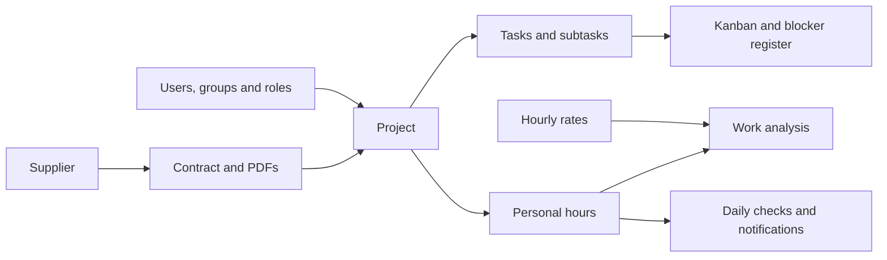

# Product overview

[Italiano](../../prod/panoramica.md) | **English**

Documented status: **11 October 2026**, application code with data schema **13**. This page describes existing features; the [roadmap](roadmap.md) distinguishes extensions still to be implemented.

## Purpose

**punto** organizes projects, people and working time in a single space. The manager defines which projects can be used and checks their team’s work. Sales manages suppliers and contracts; Finance views aggregate values and costs. The operator chooses an authorized project and logs the day's work, without having to create codes or master records.

The main path is:

Linking a project to a contract is optional. Internal work can be logged against shared projects without a contract. Contract value and estimated labor cost are separate management information.

## People and responsibilities

| Profile | Objective | Main features |
| --- | --- | --- |
| Operator | Perform and report authorized work | Projects, board, assigned task statuses, personal blockers, personal hours, analyses and notifications |
| Manager | Organize work and monitor progress | Projects; users and access; tasks and blockers; detailed hours and analysis for their own team; alerts and authorized history |
| Sales | Manage agreements and documents | Suppliers, contracts and PDFs, including viewing and editing |
| Finance | View financial information | Read-only suppliers, contracts and PDFs; project-level values and labor costs; reading hourly rates |
| Installation's technical contact | Keep the service available and configured | Containers, database, backups, networking and addon configuration, described in the technical documentation |

Every active account has implicit **Operator** access; **Manager** derives from the identity role. **Sales** and **Finance** are assigned separately in **Users → Profiles**, including to Keycloak accounts. No manager receives them automatically. Editing rates requires Manager + Finance; changing a project’s contract requires Manager + Sales. **Viewer**, **Contributor** and any custom roles are roles on an individual project. A Contributor can log their own hours, update assigned task statuses and manage blockers they created or own; this does not make them an administrator of users or contracts.

The current application has a single operational workspace. Separate companies and company-specific financial permissions belong to the [financial plan](piano-modulo-finanziario.md).

## Available modules

| Section or service | Status | What it offers today |
| --- | --- | --- |
| Sign-in | Implemented | Email/password login, personal session, “Remember me for 30 days” option, logout and revocation of deactivated accounts |
| Projects | Implemented | Data and contract, creation wizard and templates, access grants with explanation, overview, closure, archiving and permanent deletion |
| Shared projects | Implemented | A checkbox makes the project usable by all active users, including users created later |
| Tasks and blockers | Implemented | Tasks and subtasks, owner, priority, due date, five-state Kanban and hierarchical list; blockers with impact, next action and status |
| Time log | Implemented | Daily and weekly log, copying the previous week, atomic multiple insertions, optional task link and approved corrections |
| My day | Implemented | Assigned tasks, blockers and today’s hours with contextual navigation |
| Schedules and absences | Implemented | Individual schedules with effective dates, personal exceptions and holidays for expected-hours checks |
| Analysis | Implemented | By period, By project and By user views, with dates and filters; personal scope for operators and own-team scope for managers |
| Contract value | Implemented | EUR value of distinct contracts linked to filtered hours, missing values and hours without a contract |
| Labor cost | Implemented | Finance aggregates by project based on rates and dates, highlighting unpriced hours |
| Suppliers | Implemented | Master data and contacts: Sales editing, Sales or Finance viewing |
| Contracts and PDFs | Implemented | Contracts with a mandatory supplier, optional value and dates, upload and download of originals |
| Users | Implemented | Local or company identity, access status and separate functional profiles |
| Groups and roles | Implemented | Group tree, multiple memberships, inheritance and custom operational roles |
| Alerts and triggers | Implemented | Rules belonging to individual managers, daily time, recipients and two predefined checks |
| Notifications | Implemented | Personal alerts, counter and marking as read |
| History | Implemented | Change events with actor, date and before/after details, restricted to managers |
| Email delivery | Partial in operational use | Addon and queue implemented; SMTP still needs configuration, so no actual delivery |
| Google Calendar | Partial in operational use | C addon and bidirectional synchronization APIs implemented; OAuth needs configuration; calendar screen and linking to hours still to be developed |
| Full financial module | Planned | Multiple companies and currencies, budgets, invoices, receipts, payments, open items and financial reporting |

“Implemented” describes a feature present in the code and interface, where applicable. “Partial” means a technical component is available but the operational path still needs configuration or an interface. “Planned” indicates a plan, not an already usable feature.

## Operator experience

The operator’s sections include **My day**, **Projects**, **Tasks and blockers**, **Time log**, **Schedules and absences**, **Analysis** and **Notifications**. The hours selector contains projects where logging is permitted; read-only projects remain viewable in the list but cannot receive new hours from that user.

A revocation prevents new project entries, but preserves access to personal hours already saved. Hours always belong to the signed-in person: the entry form cannot attribute them to a colleague. The operator can add hours and request reasoned corrections; a manager other than the author decides the requests.

The board is visible to anyone who can view the project. With Contributor access, the operator updates the status of tasks assigned to them and can report obstacles. Assignment and authorization remain separate: an owner's name does not replace an access grant.

To begin: [user guide](guida-utente.md) and [Tasks, Kanban and blockers](attivita-kanban-e-blocchi.md).

## Manager experience

The manager has the same personal features plus **Alerts and triggers**, **Users**, **Groups and roles** and **History**. They administer all workspace projects. Other people’s personal hours are limited to their team: themselves, members of their organizational groups and their subgroups; without groups, or when company groups are unavailable, they see only themselves. Suppliers, Contracts and financial analyses depend on Sales and Finance profiles, rather than the Manager role alone.

The Time log starts with personal data and lets managers select a team member for detailed read-only viewing. Direct editing and deletion affect their own hours. History, alerts and the correction queue follow the same team scope and current revocations. A team manager other than the author decides correction requests, with revision checks and a decision history. Deleting a project is a separate operation and also removes tasks, subtasks, blockers and all linked hours for every user.

To set up the workspace: [manager guide](guida-gestore.md).

## Projects for shared work

The reference catalog for cross-functional work includes:

| Project | Suggested use |
| --- | --- |
| General | General work not attributed to a specific project |
| Training | Courses, study and professional development |
| Meetings | Internal meetings not charged to a specific project |
| Internal activities | Organization and other internal activities |

The mechanism is the **Shared project** checkbox. These names are not reserved by the software, and a new installation does not generate them automatically: the manager checks or creates the four records, chooses unique codes and makes them shared. Company rules must clarify when to use these containers and when to attribute work directly to a project.

## Current product boundaries

The five project status labels describe progress but do not form a workflow with approvals or automatic locks. A Completed or Cancelled project can receive hours from an authorized user until explicitly closed or archived. Closure and archiving block new hours for managers too while retaining data; reopening requires a reason. Contract dates do not automatically change its status.

Tasks and subtasks have independent statuses. Dependencies, Gantt, workload planning and separate checklists are not yet available. Hours can link a single task. Blockers describe current obstacles; a register of future risks remains to be developed. Assignments and deadlines generate a personal operational feed subject to access checks.

The missing-hours check applies configured individual schedules, holidays and absences after 48 hours have elapsed from the end of that day. Without configuration it uses 8 hours on weekdays. A notification documents the anomaly found; marking it as read does not modify hours.

Current financial reports use EUR only and are recalculated from current data. They do not generate invoices, tax documents, receipts or frozen accounting values. The project's Client field is descriptive text, not a complete billing master record.

The Calendar addon encrypts tokens and content in its own storage, while the application does not yet have a vault encrypting every field or contractual PDF. Authorized processing uses plaintext data in memory. Broader encryption requirements must not be considered already satisfied.

## Reference documents

- [Improved operational workflows](flussi-operativi.md): weekly logging, corrections, personal work, schedules, access and project lifecycle.
- [Processes and rules](processi-e-regole.md): permissions, limits, dates, deletions and report meanings.
- [Tasks, Kanban and blockers](attivita-kanban-e-blocchi.md): organization, permissions and obstacle management.
- [Roadmap](roadmap.md): status of operational improvements, the tasks module and the financial path.
- [Glossary](glossario.md): product terms.
- [Technical architecture](../tehnical/architettura.md): components and responsibilities.
- [UI verification of 10 October 2026](../tehnical/verifica-ui-2026-10-10.md): historical evidence for the version examined; it does not certify all later additions.
