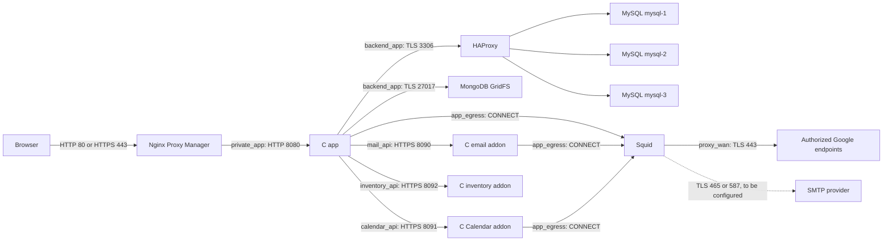

# Technical architecture

[Italiano](../../tehnical/architettura.md) | **English**

This guide describes the code and configuration present on **11 October 2026**. Features planned in roadmap documents do not become implemented simply because they are described. For the documentation entry point, see the [project README](../../../README.md).

## Components and responsibilities

Punto is an Italian web app with an HTTP server written in C11 and an HTML, CSS and JavaScript frontend without an npm build step. The central application manages authentication, authorization, projects, tasks/subtasks, Kanban, blockers, hours, organization, suppliers, contracts, reports, rates, alerts and auditing. Three independent C processes manage SMTP, Google Calendar and asset inventory through private APIs. Punto Ticket is an optional standalone app with its own accounts and storage.

There are two separate execution modes:

| Mode | Structured data | PDF documents | Integrations |
| --- | --- | --- | --- |
| Native | SQLite, normally `data/punto.db` | Local `documents` directory next to the database; configurable with `DOC_FILES_DIR` | Optional addon clients; absent when their variables are not set |
| Docker Compose | MySQL 8.4, three multi-primary Group Replication members | MongoDB 8.0 GridFS | Email, Calendar and inventory addons, with HTTPS APIs and independent SQLite stores |

The modes do not share data and do not perform automatic conversion or import. The app Dockerfile explicitly compiles the MySQL backend. The native mode's `DB_PATH` does not identify the Docker database.

The browser–NPM connection uses HTTPS only after the public certificate is configured. The NPM–app connection is HTTP on the private network. HAProxy forwards the MySQL protocol without terminating TLS: certificate verification takes place between the client and the SQL server.

## The eleven Compose services

The operational source is [compose.yaml](../../../compose.yaml). The [Ticket](../../../compose.tickets.yaml) overlay brings the total to twelve. [Docker naming](nomi-servizi-e-immagini.md) distinguishes Compose services, images and DNS aliases and describes name migration. Volume names in the table are logical Compose names; the actual daemon name may have the project prefix.

| Service | Implementation | Responsibility | Persistence |
| --- | --- | --- | --- |
| `app` | C11, Debian Bookworm image, UID/GID `10001` | HTTP, sessions, domain rules, alert scheduler, addon clients | SQL and GridFS outside the container; no local application volume |
| `mysql-1` | `mysql:8.4`, server ID `1` | Writable group member | `mysql_data` → `/var/lib/mysql` |
| `mysql-2` | `mysql:8.4`, server ID `2` | Writable group member | `mysql_data_2` → `/var/lib/mysql` |
| `mysql-3` | `mysql:8.4`, server ID `3` | Writable group member | `mysql_data_3` → `/var/lib/mysql` |
| `proxy-db` | HAProxy `3.2-alpine` and Python monitor | Distribution of new connections among usable SQL members | No data volume |
| `mongodb` | `mongo:8.0` | Original PDFs in GridFS | `documents_data` → `/data/db`; `documents_config` → `/data/configdb` |
| `proxy-web` | Derived from `jc21/nginx-proxy-manager:2.16.0` | HTTP/HTTPS ingress, public hosts, certificates, local panel | Bind mounts `nginx-proxy-manager/data` and `nginx-proxy-manager/letsencrypt` |
| `proxy-egress` | Squid on Debian Trixie, UID/GID `10002` | Explicit outbound proxy, per-source allowlists | Read-only configuration mount; caching disabled |
| `mail` | C, OpenSSL, libcurl, SQLite, UID/GID `10003` | TLS SMTP delivery and idempotency ledger | `mail_addon_data` → `/var/lib/punto-mailer` |
| `calendar` | C, OpenSSL, libcurl, SQLite, json-c, pthread, UID/GID `10004` | OAuth, event cache and Google change queue | `calendar_addon_data` → `/var/lib/punto-calendar` |
| `inventory` | C, OpenSSL, SQLite, UID/GID `10005` | Asset catalog and history over private HTTPS | `inventory_addon_data` → `/var/lib/punto-inventory` |

Compose waits for Squid before the addons; for Squid, addons, HAProxy and MongoDB before the app; and for the app before NPM. These dependencies govern startup. They are not a failover orchestrator and do not ensure that an already running dependent service stops when another becomes unavailable.

## Code structure

| Area | Main files | Task |
| --- | --- | --- |
| Transport and sessions | [server.c](../../../src/server.c) | HTTP listener, request parsing, Host/Origin checks, cookies, routing, static files and scheduler loop |
| Accounts | [accounts.c](../../../src/accounts.c) | Users, derived passwords, global profiles and active status |
| Projects and hours | [workspace.c](../../../src/workspace.c) | Projects, entries and analytics |
| Tasks and blockers | [work_board.c](../../../src/work_board.c) | Hierarchies, Kanban board, obstacles, revisions and project permissions |
| Persistence and auditing | [storage.c](../../../src/storage.c) | Migrations and application history |
| Organization | [organization.c](../../../src/organization.c) | Group tree, members, project roles and permissions |
| Contracts and suppliers | [procurement.c](../../../src/procurement.c) | Relational procurement data |
| PDFs | [documents.c](../../../src/documents.c) | GridFS or local filesystem, uploads and integrity checks |
| Alerts | [alerts.c](../../../src/alerts.c) | Rules, runs, notifications and email outbox |
| MySQL driver | [db_mysql.c](../../../src/db_mysql.c), [mysql_schema.c](../../../src/mysql_schema.c) | Query adaptation, TLS, MySQL schema and concurrency |
| Addon bridges | [mail_client.c](../../../src/mail_client.c), [calendar_client.c](../../../src/calendar_client.c), [inventory_client.c](../../../src/inventory_client.c) | Private HTTPS, service authentication and contract validation |
| Addons | [mailer.c](../../../addon/src/mailer.c), [calendar.c](../../../calendar-addon/src/calendar.c), [inventory.c](../../../inventory-addon/src/inventory.c) | Separate processes with their own persistence |
| Interface | [public](../../../public) | Pages and resources served by the C server |

The main server uses a `select`/`accept` loop and handles requests in the application process. There is no general HTTP worker pool. The alert scheduler is invoked by the loop roughly every 30 seconds. Sessions are kept in memory, with a limit of 64 sessions: restarting the app requires users to sign in again. Adding app replicas would also require a design for sessions and task coordination, rather than simply increasing the number of containers.

Seven app modules each own one SQL connection: workspace, accounts, storage, organization, tasks/blockers, alerts and procurement. There is no pool. Task and blocker mutations check a `revision` to reject changes based on an outdated version; see the [module implementation](attivita-kanban-e-blocchi.md) for details.

The Calendar worker, however, is a separate thread with its own SQLite connection. It makes Google calls outside write transactions; `/sync` queues a request and returns `202`, while status and health checks remain available.

## Persistence, consistency and transactions

The current application schema is **version 10**, with 24 MySQL tables or 22 functional SQLite tables, in addition to the internal `sqlite_sequence` table. Schema 9 extends alert rules with `inventory_due` and `days_before`; schema 10 adds `inventory_return`, `inventory_verification` and `verification_days` (1–365, default 90). Both preserve IDs, relationships and history without adding further application tables. The `job_tasks` and `job_blockers` tables, introduced in schema 8, use the same persistence as projects; they do not introduce a separate service or database. Migrations run at startup, and databases with unsupported versions are rejected. Calendar does not add tables to the MySQL schema: it keeps its data in its dedicated volume.

MySQL stores management data, PDF metadata and the alert outbox. GridFS stores PDF bytes. An upload spans both stores without a distributed transaction: a failure can leave an unreferenced blob, and there is no automatic reconciliation. Coordinated backups must preserve both SQL data and documents.

The email SQLite ledger stores the idempotency key, content fingerprint, status and timestamps. Recipient, subject and body remain in the MySQL outbox. The delivery key depends on `MAIL_API_NAMESPACE` and the outbox ID; restore must preserve the SQL database, email ledger and namespace together.

Calendar stores accounts, OAuth state, the event cache, pending operations and metadata. OAuth tokens and sensitive payloads are encrypted with AES-256-GCM; a key outside the volume is required to decrypt them. IDs, statuses and other operational metadata remain readable. Remote writes use idempotency, ETags and handling of uncertain outcomes; a backup cannot undo operations already completed at Google or an SMTP provider.

## SQL cluster availability

[cluster.cnf](../../../docker/mysql/cluster.cnf) configures Group Replication with three multi-primary members, GTID, ROW binlogs, `BEFORE_AND_AFTER` consistency, TLS verification and an auto-increment step of three. All members can receive writes; no single permanent writer is designated.

[HAProxy](../../../docker/db-proxy/haproxy.cfg) uses round-robin for new connections. Each connection and its transaction stay on the selected node. The [monitor](../../../docker/db-proxy/health.py) admits only a node that is `ONLINE`, `PRIMARY`, not read-only and has at least two online members. A simple `SELECT 1` on one node does not verify these requirements.

Quorum is **2 out of 3**. Losing one member allows the surviving group to continue after failure detection; losing two members blocks writes. Broken connections may require the app to retry, and failover without transient errors must not be promised.

All containers currently run on the same host. This topology protects against failure of an SQL process, but failure of the host, disk, Docker daemon or Docker Desktop VM affects the entire stack. The app, HAProxy, MongoDB, NPM, Squid and each addon are single instances. The SQL cluster does not make the entire application available across multiple hosts and does not replace verified external backups.

## Limitations and next steps

SMTP and Google OAuth are prepared, but provider configuration has been deferred. A healthy addon means the local API works; it does not prove access to a real provider. Calendar APIs are available, while the calendar GUI and event–project–hours link have not yet been implemented.

General encryption of SQL cells or PDFs, a per-field key vault and homomorphic processing are not implemented. Authorized processes read data in memory. Actual protection and its boundaries are described in [network and security](rete-sicurezza.md).

To start or update the stack, use [installation and configuration](installazione-configurazione.md). For backups, failures and restore, read [operations](operazioni-backup-ripristino.md). For building and testing, see [development and tests](sviluppo-test.md).
