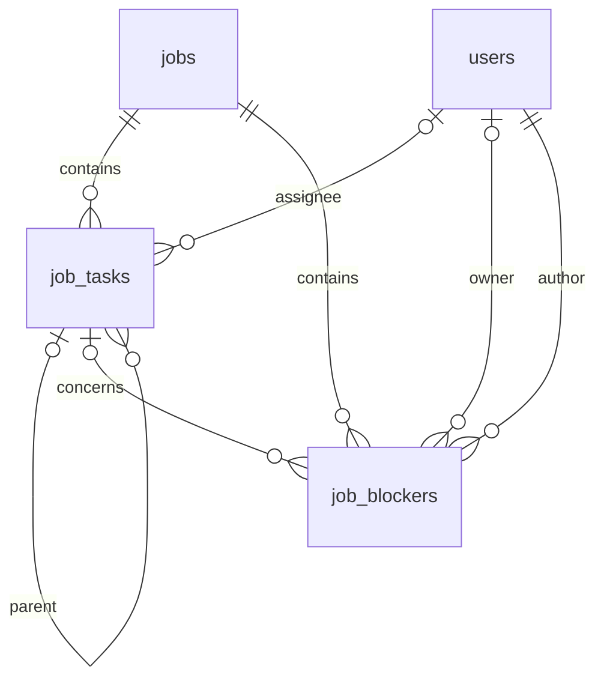

# Tasks, Kanban, and blockers: implementation

[Italiano](../../tehnical/attivita-kanban-e-blocchi.md) | **English**

Code reference: **11 October 2026**. The module introduces **application schema 8** and the `job_tasks` and `job_blockers` tables. Sources are [work_board.c](../../../src/work_board.c), [storage.c](../../../src/storage.c), [mysql_schema.c](../../../src/mysql_schema.c), [server.c](../../../src/server.c), [frontend](../../../public/app.js), and [tests](../../../tests/test_work_board.py). The [product guide](../prod/attivita-kanban-e-blocchi.md) describes the operational workflow.

## Relationships and migration

The composite foreign keys `(job_id,parent_id)` and `(job_id,task_id)` reference the unique `(job_id,id)` key in `job_tasks`. The database therefore prevents links across different projects. C code enforces absence of cycles and a maximum depth of 8, including when an entire subtree is moved.

SQLite migration 7→8 creates both tables and indexes in the migration transaction, adds a `system.migration` event with ID 8, and updates `PRAGMA user_version`. Previous data is neither transformed nor populated with demonstration tasks. MySQL prepares DDL during preflight and records version 8 in the application transaction following the existing model. MySQL DDL has implicit commits: this is not equivalent to a fully reversible DDL migration.

The MySQL database now contains 24 tables; SQLite contains 22 functional tables, plus its own `sqlite_sequence`. The two addon stores do not change version. Back up before upgrading and do not manually lower the version to start an older binary.

## Fields and limits

| Resource | Fields |
| --- | --- |
| Task | `id`, `job_id`, `parent_id`, `assigned_user_id`, `title`, `description`, `status`, `priority`, `due_date`, `revision`, `created_at`, `updated_at` |
| Blocker | `id`, `job_id`, `task_id`, `title`, `description`, `impact`, `owner_id`, `status`, `next_action`, `due_date`, `created_by`, `revision`, `created_at`, `updated_at` |

IDs and revisions use 64-bit integers. Title: 1–160 characters; description: at most 2000; next action: at most 1000. Optional dates are calendar-validated ISO `YYYY-MM-DD`; timestamps are UTC `YYYY-MM-DDTHH:MM:SSZ`. For nullable references and dates, an empty form field means `NULL`. In JSON, missing references and dates are `null`, not zero or an empty string.

Task states are `todo`, `in_progress`, `blocked`, `in_review`, `done`; priorities are `low`, `normal`, `high`, `urgent`. Blocker states are `open`, `in_progress`, `resolved`; impacts are `low`, `medium`, `high`, `critical`. Defaults are `todo`/`normal` for tasks and `open`/`medium` for blockers. There are no automatic transitions between a blocker's state, its parent task, and the project.

Each project can contain at most 500 tasks and 500 blockers. The limit is checked within the creation transaction; reads return the complete content within these limits.

## API

The APIs reuse the app's session, origin verification, and `application/x-www-form-urlencoded` forms. Query parameters are permitted only when reading the board. Collection and item/deletion `POST` routes accept forms up to 64 KiB, including Unicode text at its limit after percent encoding; other ordinary HTTP bodies retain the 32 KiB limit.

| Method and path | Input | Outcome |
| --- | --- | --- |
| `GET /api/work-board?job_id=N` | Required `job_id`, visible project | `tasks`, `blockers`, `assignees`, project permissions |
| `POST /api/tasks` | `job_id`, `title`; other business fields optional | Creates task, `201` with `id` and `revision=1` |
| `POST /api/tasks/{id}` | `revision` and changed fields | Updates and increments revision |
| `POST /api/tasks/{id}/delete` | Only `revision` | Deletes a childless task, preserving and detaching blockers |
| `POST /api/blockers` | `job_id`, `title`; other business fields optional | Creates blocker, `201` with `id` and `revision=1` |
| `POST /api/blockers/{id}` | `revision` and changed fields | Updates and increments revision |
| `POST /api/blockers/{id}/delete` | Only `revision` | Deletes blocker |

`job_id` is immutable. Updates are partial: omitted fields remain unchanged. The server rejects unknown or duplicate fields, invalid identifiers, and unauthorized parameters. `created_by` and timestamps are derived by the server and cannot be set through the form.

Reads add assignee names and `can_edit` / `can_update_status` flags for tasks and `can_edit` for blockers. `permissions.manage_tasks` is reserved for managers; `permissions.report_blockers` requires a current Manager or Contributor. The `assignees` list contains `id`/`name` pairs for active, eligible people and is returned to managers; it is always `[]` for operators. A name in a historical record does not mean that person still has access. An unchanged previous assignee can be retained after revocation, whereas a new assignment requires current eligibility.

## Authorization and concurrency

The module uses its own SQL connection and reuses `organization_job_access` for direct access, hierarchical groups, and shared projects. Permissions are reread on every request; task assignments do not create grants. The user must be authorized today, regardless of the task's due date.

A manager organizes tasks and can assign them to an active manager or a currently authorized contributor. An assigned contributor can change only their own task's status. A contributor can create blockers and edit those they authored or own; assignment to others and deletion are reserved for managers. A viewer can only view. Nonexistent and invisible resources produce the same `404` with a generic message, without revealing the item's existence.

Changes check `revision` inside the transaction and update data and audit together. A stale revision produces `409`. Protection uses `BEGIN IMMEDIATE` on SQLite and the MySQL driver's certification guard. Audit errors roll back the mutation. The current date and write timestamps are calculated after acquiring the guard, even if the wait crosses midnight. The frontend does not automatically retry a failed request.

Audit actions are `tasks.create`, `tasks.update`, `tasks.delete`, `blockers.create`, `blockers.update`, `blockers.delete`, and `blockers.task_detached`, with before/after snapshots on the mutation's connection.

Deleting a task with children produces a conflict. If it has no children, its blockers are detached, with revision updates to invalidate open editors, and the task is deleted in the same transaction. Project deletion first removes blockers and task relationships, then tasks, hours, and grants. The project audit also records `deleted_tasks` and `deleted_blockers`.

The new resources do not introduce field encryption: titles, descriptions, and audit snapshots follow the application storage's current protection. They do not constitute a homomorphic-processing solution or a key vault.

## Verification and boundaries

The dedicated suite uses temporary databases and checks permissions, revocations, hierarchies, conflicts, validation, audit, deletions, and migration. UI testing must include Manager, Contributor, and Viewer, concurrent editing, keyboard use, and mobile layout. Test counts and deployment results must be recorded in the release report, not inferred from the presence of tests.

Time entries remain linked to projects: this version does not add `task_id` to hours, derive progress from worked minutes, or implement dependencies, team capacity, assignment notifications, or risk probabilities yet.
