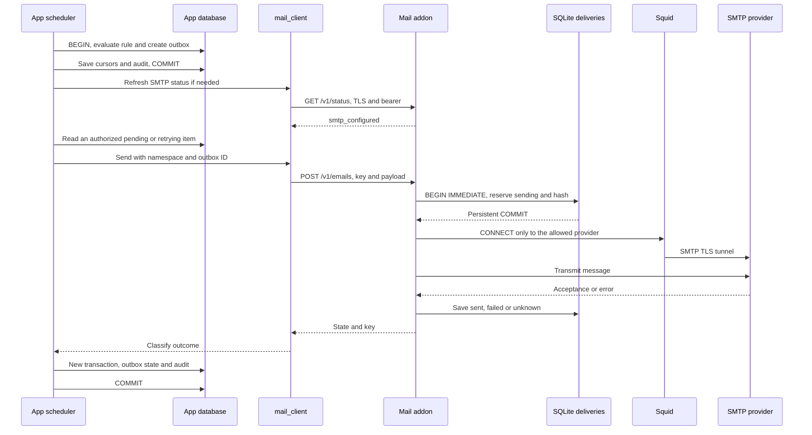
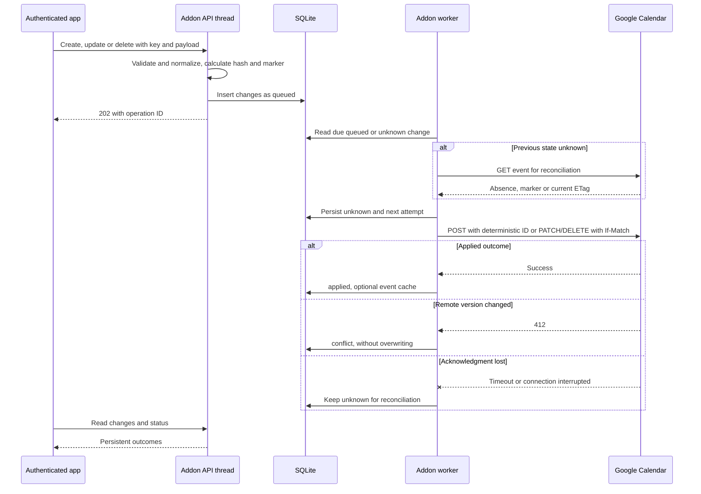
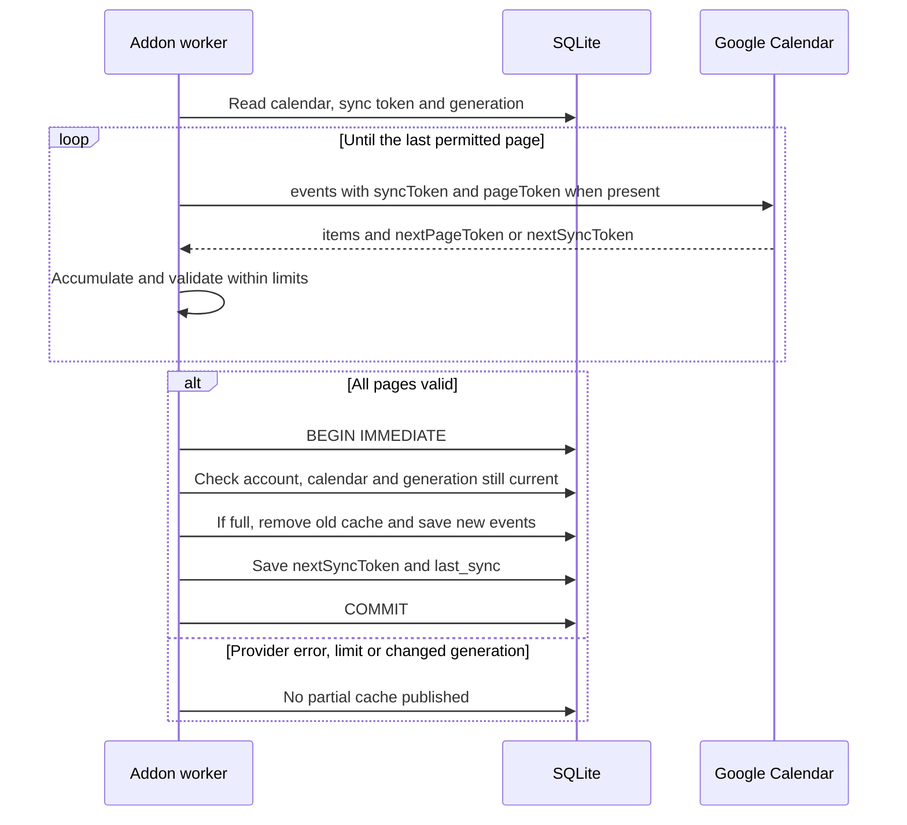
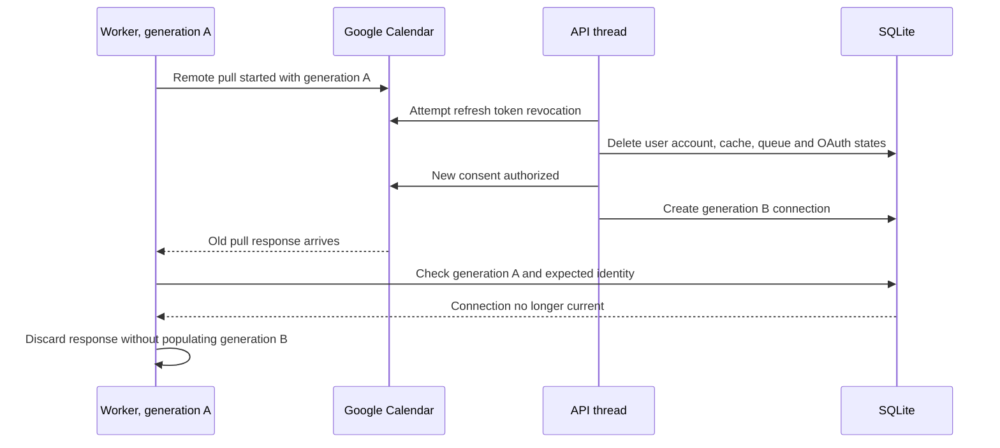

# Mail and Google Calendar integration flows

[Italiano](../../tehnical/flussi-integrazioni.md) | **English**

Verified against the code and fixtures on **10 October 2026**. The diagrams describe implemented flows; SMTP and the Google OAuth client still need configuration for real use. Persistence points and possible interruptions are illustrated without repeating the full catalog in [addon API](api-addon.md) and [app API](api-app.md).

Sources: [alerts.c](../../../src/alerts.c), [mail_client.c](../../../src/mail_client.c), [mailer.c](../../../addon/src/mailer.c), [server.c](../../../src/server.c), [calendar_client.c](../../../src/calendar_client.c), [calendar.c](../../../calendar-addon/src/calendar.c), [NPM privacy](../../../docker/nginx-proxy-manager/proxy-privacy.mjs). No new provider calls or runtime tests were made for this write-up.

## Two integrations, two persistent ledgers

| Aspect | Email | Calendar |
| --- | --- | --- |
| Intent origin | Execution of an alert rule | Authenticated user call through the app |
| First persistence | `alert_email_outbox` in the application database | `changes` in the addon's SQLite |
| Protection before external action | `deliveries` ledger, `sending` state | Change's `unknown` state |
| Attempt identity | `MAIL_API_NAMESPACE:outbox:ID` | User key + `idempotency_key` and normalized content |
| Uncertain remote outcome | Terminal `unknown`, manual check | `unknown`, remote event check before any retry |
| Remote data cache | No synchronized mailbox | Local copy of Google events with incremental token |
| Processing | App tick, synchronous mail call | Worker in the addon separate from the API thread |

No diagram implies a distributed transaction. Local commit, provider acceptance and response to the client are separate moments. Encryption and storage ownership are in the [data model](modello-dati.md); SQL criteria are in [migrations and consistency](migrazioni-e-consistenza.md).

## Email: alert generation and delivery

The following flow assumes SMTP is configured. Scheduling, the hours threshold and alert cursors are described in [alert engine](motore-alert.md).



The first commit makes the intent persistent before sending. The ledger makes `sending` persistent before SMTP can accept the message. The second SQL commit aligns application state, but is not required for the provider to have already received the email.

Network calls occur **outside the SQL guard**. The app extracts and copies item data, finalizes the statement, contacts the service and then updates state with `WHERE id=? AND status=?`. The `alert_emails.delivery` audit and new state are part of the same transaction: if audit fails, both are rolled back and a later attempt reuses the same key.

Outbox selection still requires an active owner manager and the address to be present among the rule's recipients. It does not check `alert_rules.enabled`: **disabling a rule stops automatic triggers, but does not cancel already queued emails**. Revoking the address or disabling/demoting the owner, by contrast, excludes the item from deliveries. An already running request remains a separate case.

### SMTP not configured and unreachable status

The client queries status approximately once a minute. Until it has a valid state with `smtp_configured=true`, the tick does not submit new emails to the addon and rows remain in SQL. The `smtp_configured=false` value exposed by the app may also indicate a failed check due to transport/TLS/invalid response, rather than only absent provider credentials.

If the service loses configuration after the status check, `POST /v1/emails` returns `smtp_not_configured` without consuming the key and the app retains `pending_configuration`. Enabling the provider later may therefore deliver previously generated messages; backlog is part of the activation operation.

### Email crashes, timeouts and replay

| Interruption point | Persistent state | Behavior on the next attempt |
| --- | --- | --- |
| Before outbox commit | No committed SQL intent | The rule can be rerun; audit/cursors have not been partially advanced. |
| After outbox, before ledger | Retryable SQL item | The same key and payload can be submitted to the service. |
| After `sending`, before recorded outcome | Ledger `sending` | Becomes `unknown` on restart; is not automatically resent. May require verification even if SMTP had not yet received the bytes. |
| SMTP accepts, response to app lost | Ledger `sent` if outcome was saved | Replay returns `sent` without sending again. |
| SMTP accepts, response to service lost | `unknown` | No delivery confirmation; manual provider check. |
| SQL state/audit not committed | Ledger retains outcome, SQL item still retryable | Replaying the same key reconstructs state without duplicating a known send. |
| Same key, different content | Ledger hash already present | `idempotency_conflict`; the previous send is not reused for a new message. |

Reservation protects against duplicates by sacrificing automatic retries in some uncertain cases. `sent` means SMTP acceptance, not reading or final delivery. There is no process that automatically queries the mailbox or provider log to resolve `unknown`.

The app waits at most 3 seconds for the addon response, while the default SMTP timeout is 20 seconds. The request may therefore continue in the addon after the app loses the response. Resending with a different key would bypass protection: retries must retain namespace, ID and content.

## Calendar OAuth: from user to encrypted tokens

The service does not use a single Google credential to read all the organization's calendars. The supported API path allows each app user to connect their own Google account through consent, using the Web OAuth client configured by the administrator. The diagram describes this API contract: the app's graphical screen for starting the connection and guiding the user to consent is still to be implemented.

```mermaid
sequenceDiagram
    actor U as User
    participant Browser as Browser
    participant App as C app
    participant Cal as Calendar addon
    participant Store as SQLite with encrypted payloads
    participant Google as Google OAuth and Calendar
    U->>Browser: Start connection
    Browser->>App: POST oauth/start with cookie and valid origin
    App->>App: Reread account and derive session_binding
    App->>Cal: Private POST, user ID and binding
    Cal->>Store: Save state hash, binding and encrypted PKCE, TTL 600 s
    Cal-->>App: Consent URL and expires_in
    App-->>Browser: Validated Google URL
    Browser->>Google: Consent with S256 challenge
    Google-->>Browser: Redirect to callback with code and state
    Browser->>App: GET callback with same session
    App->>Cal: Private callback with derived binding
    Cal->>Store: Check user, binding and expiration; consume state
    Cal->>Google: Exchange code and verifier through Squid/TLS
    Google-->>Cal: Tokens and expiration
    Cal->>Google: Read primary calendar identity
    Cal->>Store: Transaction with encrypted tokens and new generation
    Cal-->>App: Connection confirmed
    App-->>Browser: 303 /app?calendar=connected
```

The browser sends neither `user_id` nor the addon bearer. The session is reread from the app database; the binding is the hash of the current token. State is consumed **before** the remote exchange: a duplicate callback cannot reuse it. If exchange fails after consumption, start new consent rather than repeating the same code/state.

The addon stores the PKCE verifier and tokens with AES-256-GCM; the browser receives only the consent URL and final state. The app callback responds with a generic connected/error redirect without echoing code, state or tokens. NPM's callback location preserves app route restrictions/ACL and suppresses logs containing the sensitive query; no public addon endpoint is added.

Account identity is the primary calendar ID returned by the provider, not an email freely typed by the user in the app. New consent for the same account retains selection, cache and queue; a different account without disconnection produces `google_account_mismatch`.

### Token renewal

Before a Google call, the service decrypts the user's tokens. If the access token expires within 60 seconds, it uses the refresh token; if the provider responds `401`, it attempts renewal and a second request attempt. The old refresh token is retained if renewal does not issue a new one. A `400` renewal failure sets `reauth_required`; other errors are distinguished as renewal unavailability.

This authentication retry is specific Google client behavior, not general replay of SQL transactions. Mutations still require deterministic IDs, ETags and `unknown` state to handle ambiguous remote outcomes.

## Bidirectional writing: local intent and version checking



The diagram omits the branch where reconciliation proves the action was already applied: in that case, the worker saves `applied` without repeating the write. If remote content does not allow proceeding, it saves conflict/failure rather than forcing the operation.

Creates have a deterministic Google ID based on user and key, while `puntoMutation` also binds the requested content. Updates and deletions send the previously read ETag. This distinguishes an already applied operation of one's own from an event changed by another client. The normalized payload and key persist across restarts.

The same key and payload return the existing row with `replayed:true`; the same key and a different payload yield conflict. `202` confirms queueing, not remote application. `conflict` and `failed` require a caller decision; the current API exposes outcome inspection but no conflict-resolution wizard.

The worker considers a user due for polling or queue processing and handles at most 20 changes in the cycle, then performs a pull. Progressive delays from 30 to 3840 seconds define the next permitted attempt time. Work is serial in the worker: multiple slow users/providers can push actual execution beyond these thresholds.

## Full and incremental pull: atomic cache publication



The Google request uses `maxResults=250`, `showDeleted=true`, `singleEvents=false`. It does not add UI `from/to` filters to incremental download: those filters apply when browsing the cache. Recurring masters, exceptions and deletions must remain representable; this is not a cache of only occurrences visible in the period.

The service accumulates all pages before the update transaction. Limits protect memory and duration: 100 pages, 20,000 events, 64 KiB per event, 16 MiB overall; the API catalog also lists caller response limits. `nextSyncToken` must arrive at the end and is committed with events, never immediately after an intermediate page is received.

A `410` on incremental sync invalidates the token and starts a single full redownload path. The old cache remains until all full-download pages are ready; if the full download fails, it is not cleared preemptively. The `changes` queue is not deleted by this recovery.

Explicit selection of a different calendar is instead a new user operation: it changes generation, resets token/last sync and deletes the previous cache in one transaction. It rejects the change if `queued`/`unknown` operations exist. It sets the next poll to the normal interval; a `/sync` request may bring it forward.

## Disconnection, reconnection and late responses

The API thread and worker share the SQLite file but own separate connections. A simple user ID check is insufficient: after disconnection, a new account might be associated with the same user, or the same account might be reconnected while an old remote response arrives.



Every consent and selection generates a random connection identifier. The worker captures `expected_provider` and `expected_generation` in thread-local variables; token reads/saves, account errors, cache and work completion verify the expected connection. A refresh performed by the worker cannot reinsert a deleted account as though it were new authentication.

`disconnect` attempts remote revocation, then deletes local state and separately returns `disconnected` and `remote_revoked`. An unreachable provider may leave revocation unconfirmed even after local cleanup. New consent for the same account without disconnection preserves intents; explicit disconnection also deletes local idempotency history.

This protection defends the new cache from old responses; **it does not undo a call already accepted by the provider**. An already created event does not disappear because the connection was removed. For the same reason, stopping the container does not remotely cancel intents in progress.

The responsiveness test covers a slow worker pull while `/status` and `/healthz` remain available in the API thread. It does not mean multiple private API requests are handled concurrently: synchronous consent or selection may occupy the API thread.

## Network path and sensitive data

All app→addon steps use the dedicated API network, HTTPS with CA/hostname and bearer. All addon→provider steps use Squid's CONNECT tunnel with a source allowlist. Mail and Calendar have different destinations; the addon cannot choose to use the Internet directly merely because its API received a URL.

OAuth tokens and Calendar payloads are encrypted before persistence and decrypted when needed. Metadata, Google IDs and sync tokens are not all encrypted: see the [data model](modello-dati.md) for full classification. The email outbox retains text in SQL; the SMTP ledger does not copy it. A backup must preserve mappings and keys, not only separate individual files.

OAuth codes, tokens and credentials must not enter business audit, HTTP errors or diagnostic logs. Bridge tests reject addon responses containing sensitive fields, including nested ones; NPM tests check the callback on both success and upstream error. This defense does not automatically make a new logger added in the future safe.

## Correspondence with tests

The following names are cases present in the repository; the table does not claim a new execution during documentation.

| Scenario | Reference test |
| --- | --- |
| SMTP disabled: no send and queue retained | `test_disabled_smtp_preserves_requests_for_later_configuration` in [mail addon](../../../tests/test_mail_addon.py); `test_unconfigured_service_preserves_pending_outbox_without_submitting` in [mail client](../../../tests/test_mail_client.py). |
| Persistence before send, replay and crash | `test_starttls_delivery_is_tunneled_and_idempotent_after_restart`, `test_crashed_sending_record_recovers_as_unknown`, `test_ambiguous_delivery_is_never_resent` in [mail addon](../../../tests/test_mail_addon.py). |
| App timeout and audit failure after SMTP | `test_timeout_is_bounded_and_keeps_the_same_idempotency_key_for_retry`, `test_delivery_audit_failure_keeps_queue_and_retry_uses_the_same_service_key` in [mail client](../../../tests/test_mail_client.py). |
| Recipient/owner revocation | `test_revoked_email_recipient_and_disabled_rule_owner_are_not_delivered` in [mail client](../../../tests/test_mail_client.py). |
| PKCE state, session and user | `test_oauth_pkce_single_use_session_binding_and_per_user_isolation`, `test_expired_oauth_state_is_rejected_without_token_exchange` in [Calendar addon](../../../tests/test_calendar_addon.py). |
| Server-derived identity and callback without secrets | `test_identity_and_internal_oauth_binding_cannot_be_overridden`, `test_oauth_callback_is_session_bound_and_redirects_without_echoing_code` in [Calendar bridge](../../../tests/test_calendar_client.py). |
| Callback privacy behind proxy | `test_runtime_callback_suppresses_access_and_upstream_errors_preserving_acl` in [NPM privacy](../../../tests/test_proxy_privacy.py); optional runtime test. |
| Encryption, restart, wrong key and token transplant | Cases `test_tokens_and_event_contents_are_encrypted_and_survive_restart`, `test_wrong_encryption_key_fails_startup_without_resetting_accounts`, `test_encrypted_tokens_cannot_be_transplanted_to_another_user` in [Calendar addon](../../../tests/test_calendar_addon.py). |
| Atomic pagination and expired token | `test_full_incremental_pagination_commits_atomically_and_410_recovers`, same file. |
| Remote changes and ETags | `test_outbound_create_update_delete_use_durable_idempotency_and_etags`, `test_etag_conflict_is_reported_without_overwriting_google`, same file. |
| Lost remote acknowledgment | `test_lost_remote_ack_is_reconciled_after_restart_without_resending`, same file. |
| Reconnection preserves queue and rejects a different account | `test_reauthorization_preserves_selected_calendar_cache_and_change_history`, same file. |
| Late pull after reconnection | `test_inflight_pull_is_discarded_after_switching_google_accounts`, `test_inflight_pull_is_discarded_after_reconnecting_the_same_google_account`, same file. |
| Health/status during slow worker | `test_background_sync_keeps_private_status_and_health_responsive`, same file. |

Fixture SMTP, OAuth and Calendar are local simulators with TLS and proxy: they demonstrate code behavior under those conditions, do not authorize a real account and do not certify Google Cloud project configuration. Suite execution and network checks are in the [test manual](sviluppo-test.md).

## Proposed developments

The following possibilities are **proposals**, not existing components: conflict-resolution interface, explicit event–project association, verified conversion of appointments into time entries, multiple calendar providers, Google push webhooks, reading full change history and automatic SMTP outcome reconciliation through provider-specific services.

Every development must preserve persistence→remote effect order, per-user identity and the distinction between local and remote outcomes. Adding concurrency or HA to addons will also require defining exclusive work assignment, generations and ledger consistency: merely replicating the container is not that solution.
