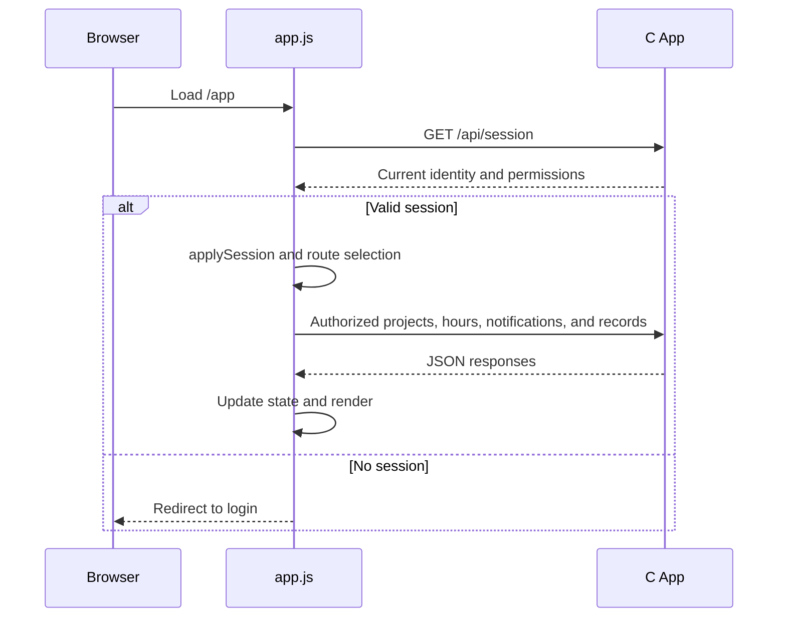

# Frontend: structure, state, and interaction

[Italiano](../../tehnical/frontend-e-interfaccia.md) | **English**

Reference: code as of **11 October 2026**. This guide is for people modifying the interface. Product usage instructions are in the [user](../prod/guida-utente.md) and [manager](../prod/guida-gestore.md) guides; the request contract is in the [app API](api-app.md).

## Files and dependencies

| File | Responsibility |
| --- | --- |
| [index.html](../../../public/index.html) | Login structure, fields, messages, and introductory content |
| [login.js](../../../public/login.js) | Login validation, submission, remembered email, and redirect |
| [app.html](../../../public/app.html) | Authenticated area structure, panels, forms, and native dialogs |
| [app.js](../../../public/app.js) | In-memory state, data loading, navigation, rendering, and saving |
| [styles.css](../../../public/styles.css) | Visual variables, general rules, and login page |
| [workspace.css](../../../public/workspace.css) | Workspace, tables, dialogs, organization, contracts, and notifications |
| [reports.css](../../../public/reports.css) | Analysis filters, cards, tables, and rates |
| [work-board.css](../../../public/work-board.css) | Kanban columns, hierarchical list, filters, blocker cards, and responsive layout for the new section |
| [i18n.js](../../../public/i18n.js), [i18n.css](../../../public/i18n.css) | Language selection, local catalogs, marked static text, and accessible selector |
| `public/locales/{en,zh,es,fr,de}.json` | Complete interface and recognized-error translations |
| [favicon.svg](../../../public/favicon.svg) | Browser visual identity |

There is no UI framework, bundler, or npm process to generate the pages. Scripts are strict-mode IIFEs; functions and state are not published as global APIs. HTML IDs form a direct contract with `getElementById`: renaming a field requires updating the JavaScript that uses it.

The interface requires JavaScript and modern browser APIs, including `fetch`, `AbortController`, `URLSearchParams`, `BigInt`, `dialog.showModal()`, and `matchMedia`. The repository defines neither a certified browser-version matrix nor a set of polyfills. A new dependency must therefore be assessed and tested on the browsers selected for deployment.

## Localization

`i18n.js` loads before application scripts. `PuntoI18n.ready` waits for the selected language's catalog before initializing labels, `Intl` formats, and data; Italian uses the source messages directly. Selection follows a valid `lang` in the URL, the browser's `punto.language` preference, supported `navigator.languages`, then Italian. A failed load explicitly announces the fallback to Italian and keeps login usable. Unavailable storage and unknown parameters do not block the page.

In HTML, `data-i18n` translates only the marked element's direct text nodes; `data-i18n-attrs` lists translatable attributes (`placeholder`, `aria-label`, `title`, meta description). In JavaScript, `t("Messaggio", [valore0, valore1])` replaces `{0}`, `{1}` placeholders through a callback, without interpreting HTML or replacement sequences in values. Preserve surrounding whitespace in concatenated fragments. Do not pass user names or notes, CSS classes, API paths, enums, filters, identifiers, or CSV formats to `t`. Predefined role names may be translated; custom role names remain unchanged.

API errors are localized at the client boundary, preserving `sourceMessage` when an existing rule must still distinguish a response by its original text. Language preference does not change authorization or payloads. `PuntoI18n.url` adds the language to cross-app links; QR codes retain a language-independent canonical URL. `Intl` presents dates and amounts in the active language, preserving EUR currency, ISO dates, and the time zones used by application rules.

Punto Ticket ships an independent copy of the runtime and catalogs. After changes, run `python3 scripts/sync_locales.py`; `python3 scripts/sync_locales.py --check` and `python3 -m unittest discover -s tests -p test_i18n.py -v` check catalogs, placeholders, marked-text coverage, and copies. The optional browser test documented in the README checks all six languages on temporary servers, local/SSO login, forms, user data, language changes, fallback, and mobile layout.

## Startup and state lifetime



`initialize()` waits for the session before showing `workspace`; it then interprets the hash and calls `refreshAll()`. This loads projects, hours, and notifications and, if permitted, users, suppliers, and contracts. Tasks/blockers, organization, history, alerts, and analysis also have loads associated with the active panel. Not all reads occur exclusively when a tab first opens.

Record state lives in the `state` object in page memory. Reloading rebuilds lists from the server. There is no offline store of records, passwords, or Google tokens in the frontend. Login uses `localStorage` only for the remembered email, under `punto.rememberedEmail`; errors or unavailable storage must not block login.

The “remember me” checkbox has two distinct effects: login sends `remember=on` to the server for session duration and stores the email in the browser after success. The password is not written to `localStorage`. The demonstration button fills in source-code demonstration values: it neither discovers nor changes deployment credentials.

## Navigation and URLs

| Hash / area | Availability |
| --- | --- |
| `#jobs`, `#work-board`, `#hours`, `#notifications` | Authenticated users, with data within their own scope |
| `#suppliers`, `#contracts`, `#users`, `#organization`, `#audit`, `#alerts` | Managers, subject to specific permissions and checks |
| `#analisi/periodo`, `#analisi/commesse`, `#analisi/utenti` | Global analysis for managers, personal analysis for operators |
| `#analisi/costi`, `#analisi/costo-ore` | Managers |

Analysis views write `from`, `to`, and, when present, `job_id` and `user_id` to the hash. The `costi` view corresponds to `view=cost`; `costo-ore` corresponds to `view=labor_cost`. The frontend translates these names before the HTTP request.

Synthetic example:

```text
/app#analisi/commesse?from=2026-10-01&to=2026-10-31&job_id=123
```

The fragment restores filters; it does not grant data access and is not a view saved in the account. The server receives filters in the subsequent API request and checks authorization. Browser history, screen sharing, and copying the address can expose filters and identifiers in the URL.

`hashchange` and `popstate` rebuild the panel. An unavailable tab falls back to Projects; an unauthorized analysis view falls back to By period. The user filter is removed for operators. After login or expiration, only a recognized Analysis hash of at most 2048 characters is retained, not an arbitrary destination.

## HTTP client and errors

`api()` centralizes calls with same-origin cookies, `cache: no-store`, JSON parsing, and a 15-second timeout. `post()` uses `URLSearchParams` with URL-encoded forms; PDFs are sent as a binary `application/pdf` body, with a 60-second timeout.

| Condition | Frontend behavior |
| --- | --- |
| `401` | Redirect to login and session-expired message |
| `403` | Warning and session refresh, avoiding recursion on the session request |
| Invalid JSON | Explicit error, without using the response as data |
| Failed HTTP response or `ok:false` | Business message returned by the server or fallback text |
| Timeout | Browser wait aborted and connection/timeout message |
| Network error | Service-unreachable message |

Aborting the browser request does not prove a server transaction was canceled. The frontend implements no general idempotency key for projects, hours, or master records: after an uncertain outcome, check the list before repeating an insertion. A disabled button prevents ordinary double clicks, but does not guarantee uniqueness across tabs, retries, or devices.

Successful mutations of management resources invalidate reports. Specific functions then reload relevant lists, statistics, or audit. Do not apply a permanent optimistic update before the backend outcome is known.

## Concurrent requests and revocations

State contains counters such as `sessionRequest`, `entriesRequest`, `reportRequest`, `documentsRequest`, `organizationRequest`, and `workRequest`. Each relevant load retains its generation and compares the counter before applying the result. Analysis also checks that the view, period, and panel are still active.

Example: a user requests October and immediately November; if October arrives last, it must not replace November's result. This check discards stale responses in the UI; it does not necessarily cancel HTTP work already underway.

`applySession()` detects changes to email, role, and permission map. It invalidates generations, clears sensitive data, closes dialogs no longer permitted, and updates available commands. Forms recheck permissions when receiving asynchronous responses too. The backend remains authoritative: a revocation in another session may be recognized by the server before the already-open page.

No general push channel for changes or permissions is implemented. The periodic timer refreshes notifications every 60 seconds only when the document is visible and the session is authenticated; it does not refresh all master records every minute. `403` responses and explicit loads contribute to realigning the page.

## Tasks, Kanban, and blockers

The `#work-board` section selects a project from the already-loaded authorized list; the “Tasks” command on each project opens that context directly. Project selection, filters, and Kanban/list mode remain in memory: they are neither serialized in the hash nor saved in the account.

`refreshWorkBoard()` requests `GET /api/work-board?job_id=...` and checks project ID, `workRequest` generation, and `workEpoch` context before applying the response. During loading it clears previous data, permissions, and cards. Identity, permission, or project changes invalidate the context; a response arriving afterward cannot restore stale data. Mutations check the same context before updating the page.

Kanban presents five fixed columns. Status changes use a select and an “Apply” button, also accessible by keyboard; dragging is not required, and manual card ordering is not implemented. The alternative list displays the parent/child hierarchy. Text search, status, and priority filter already-received tasks; the blocker register has a separate filter for open/in progress, resolved, or all. Cards show assignee, due date, description, and number of linked open blockers. They do not derive progress from hours.

Commands follow `permissions.manage_tasks`, `permissions.report_blockers`, `can_edit`, and `can_update_status` returned by the server. Assigned operators send only `status` and `revision` for tasks; manager dialogs send the complete fields. Existing assignees who are no longer eligible remain visible as “access to be checked”, avoiding unintended reassignment.

`workBusy` disables filters, project switching, and actions while saving. Every update/delete sends the revision read. A `409` in the edit dialog preserves entered data, disables saving, and offers reload; this closes the dialog and discards the draft before reading the current version. For status changes and deletions, a conflict causes a board reread. The UI neither retries the mutation automatically nor merges concurrent versions.

Text is inserted with `textContent`; descriptions use `<details>` expanders. Columns scroll horizontally on narrow viewports; blocker cards switch to one column and dialogs to stacked fields. The [module's technical specification](attivita-kanban-e-blocchi.md) defines server-side limits and authorization.

## Rendering and formats

`node()` and renderers build DOM elements and use `textContent` for application values. Tables are rebuilt with `replaceChildren()`. Preserve this approach for names, notes, descriptions, and messages: database content does not become trusted HTML.

| Type | Conversion / presentation |
| --- | --- |
| Hours | `hoursToMinutes()` converts comma, dot, or `H:MM` durations to whole minutes; uses `BigInt` to reject fractions of a minute |
| Amounts | `valueToCents()` converts form text to cents; EUR display follows the active interface locale |
| Day | `YYYY-MM-DD` string; explicit calendar validation, without relying on `Date`'s permissive normalization |
| Reports | Inclusive period of at most 366 days; filter IDs must be safe JavaScript integers |
| Alert dates | Formatting in `Europe/Rome` |
| Audit | Formatting in the browser's time zone |

`1,30` hours means 78 minutes; `1:30` means 90. Do not replace the parser with `parseFloat(value) * 60` without preserving the whole-minute requirement. HTML and JS validation help form entry, but may have limits different from the server: for example, the upload UI rejects empty files while the backend also requires a `%PDF-` signature and at least five bytes.

The Time log's initial day comes from the browser. Analysis quick periods become available with `today` returned by the server; the first request may be repeated to align the default period. No automatic conversion turns a work date into a time interval.

## Dialogs, keyboard, and feedback

Forms use `<dialog>`, `showModal()`, labels associated with fields, validation messages, and explicit close commands. `busyDialogs` tracks saves: it disables controls and prevents closing with Escape or an outside click while waiting. The lock is removed afterward, including on error paths.

Main navigation updates `aria-selected`, `tabindex`, `hidden` panels, and the page title. Arrow keys, Home, and End traverse only permitted tabs. Analysis tabs have separate keyboard handling. Below 760 px, navigation's ARIA orientation becomes horizontal.

Ordinary messages have the `status` role and close after seven seconds; errors use the `alert` role and remain until a subsequent action or dismissal. Loading areas expose `aria-busy`; empty and error states are distinct. Do not replace a failed state with “no data”.

CSS includes visible focus, responsive rules, and reduced animations through `prefers-reduced-motion`. This documents existing controls, not complete accessibility compliance: workflows need keyboard, screen-reader, magnification, and contrast checks.

## Recommended change workflow

These are development criteria, not newly implemented features:

1. Locate the panel and dialog in HTML, state and loading in JS, and authorization in the API.
2. Define loading, empty, error, success, and permission-denied states before adding the renderer.
3. Insert new data as text, validate URLs and IDs for the resource, and retain server checks.
4. Use a request counter for replaceable data and invalidate it on identity or context changes.
5. Handle back navigation, reopened dialogs, double clicks, timeouts, and responses arriving after revocation.
6. Update invalidation dependencies when the change affects reports or related lists.
7. Test affected roles, mobile, and desktop with synthetic data; consult [acceptance testing](../prod/collaudo-accettazione.md).

`app.js` is currently monolithic. A future split into modules must preserve these interactions; no component library with an independent API exists today. A graphical calendar, customizable theme, offline support, and global keyboard commands remain in the [roadmap](../prod/roadmap.md).
