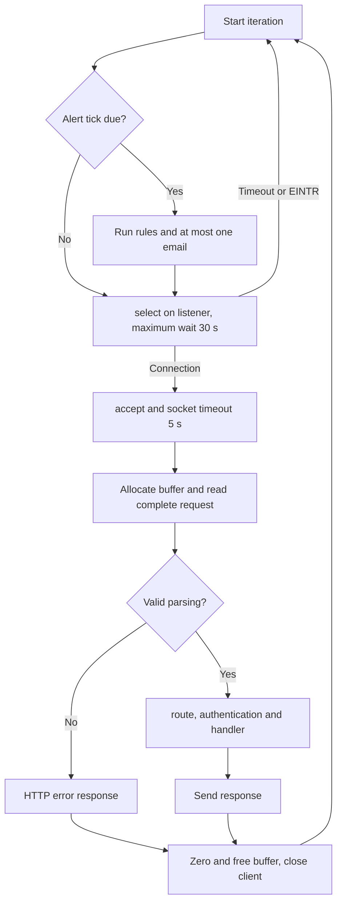

# C server internals

[Italiano](../../tehnical/interni-server-c.md) | **English**

State verified against the code on **11 October 2026**. This document describes the implemented behavior of the `punto` process and the internal contracts to preserve when modifying it. For the container inventory, see [architecture](architettura.md); for public paths and payloads, see [app API](api-app.md). No new runtime tests were performed during this write-up.

Main sources: [server.c](../../../src/server.c), [Makefile](../../../Makefile), headers in [src](../../../src), [db_mysql.c](../../../src/db_mysql.c), [calendar.c](../../../calendar-addon/src/calendar.c), [mailer.c](../../../addon/src/mailer.c).

## Compilation units and responsibilities

`Makefile` compiles C11 with `-Wall -Wextra -Wpedantic -Werror`. `DB_BACKEND=sqlite` links SQLite; `DB_BACKEND=mysql` defines `PUNTO_MYSQL`, adds `db_mysql.c` and `mysql_schema.c`, and links Connector/C and libmongoc. JSON/curl libraries are used by addon clients even when the native backend is SQLite. On macOS, passwords and randomness use CommonCrypto/Security; in the Linux build, they use OpenSSL.

| Module and header | Responsibility | Boundary to preserve |
| --- | --- | --- |
| `server.c` | HTTP configuration, listener, parsing, sessions, Host/Origin checks, dispatch, responses, scheduler and shutdown. | Source of the authenticated identity passed to modules. Does not accept author identities from business forms. |
| [workspace.h](../../../src/workspace.h) / `workspace.c` | Projects, time entries, direct assignments, rates and reports. Defines `WorkspaceResponse`. | Writes check rules and audit in the same transaction. Time-entry ownership remains personal. |
| [accounts.h](../../../src/accounts.h) / `accounts.c` | Bootstrap, authentication, active account reads and user management. | Hash/salt do not enter `Account` objects exposed to other modules. |
| [storage.h](../../../src/storage.h) / `storage.c` | Preflight, migrations, SQL health, audit append and reads. | `storage_audit()` receives the mutation's connection, not its own read connection. |
| [organization.h](../../../src/organization.h) / `organization.c` | Tree, local roles, memberships, grants and authorization calculation. | Live permission calculation uses the caller's connection and a request-local snapshot. |
| [work_board.h](../../../src/work_board.h) / `work_board.c` | Tasks, subtasks, Kanban and blockers; board queries and mutations. | Rereads accounts/grants in the current context, checks revisions, depth and audit on the same connection. |
| [procurement.h](../../../src/procurement.h) / `procurement.c` | Supplier/contract catalog, document manifest, upload/download coordination. | Checks the role before calling document storage. |
| [documents.h](../../../src/documents.h) / `documents.c` | PDF bytes in the native filesystem or Docker GridFS, key validation and integrity. | Knows nothing about sessions or roles: the caller must already have authorized the operation. |
| [alerts.h](../../../src/alerts.h) / `alerts.c` | Rules, recipients, executions, notifications, email queue and dispatch. | Time is injectable through `alerts_tick_at(now)`; business boundaries use Europe/Rome. |
| [mail_client.h](../../../src/mail_client.h) / `mail_client.c` | Private HTTP to `mail` and SMTP outcome classification. | Does not send directly through SMTP; does not invent new keys for every attempt. |
| [calendar_client.h](../../../src/calendar_client.h) / `calendar_client.c` | Authenticated Calendar bridge, field allowlist, encoding and response checking. | Receives ID and session binding only from the server; does not expose bearer/secrets to the browser. |
| [db.h](../../../src/db.h) | Common SQL interface. | Native macros map directly to SQLite; MySQL implements a limited adapter, not a general ORM. |
| [mysql_schema.h](../../../src/mysql_schema.h) / `mysql_schema.c` | DDL preparation and MySQL version checks. | DDL and versioned migrations have different phases, described in [migrations and consistency](migrazioni-e-consistenza.md). |

The seven modules `workspace`, `accounts`, `storage`, `organization`, `work_board`, `alerts`, `procurement` each own one static SQL connection. There is no connection pool. With HAProxy, these connections may reach different MySQL members: an atomic operation must remain on a single connection.

## Actual startup order

1. `main()` validates listening port, public port, IPv4 bind, public origins and bootstrap parameters; chooses static directory and database.
2. Opens the Calendar client. Entirely absent configuration is allowed in development; partial/insecure configuration stops startup. Registers `calendar_client_close()` through `atexit`.
3. Runs `storage_preflight()`. In SQLite, this is a version check without writes; in MySQL, it also includes DDL preparation after the preliminary check.
4. Opens workspace, accounts and storage, in that order. In SQLite, workspace creates base tables; accounts creates/checks the initial user; storage applies migrations.
5. Opens organization, tasks/blockers, alerts, procurement and documents. `alerts_open()` sets the process time zone to `Europe/Rome`, opens the mail client and rejects partial mail configuration. MongoDB client initialization does not yet certify document provider reachability.
6. Installs signal handlers, creates the IPv4 socket, enables `SO_REUSEADDR`, runs `bind()` and `listen(...,16)`.
7. Only after these phases does it enter the request loop and make the app available.

Initial errors produce concise messages and an unsuccessful exit; error branches close modules already opened. User bootstrap operates only if the table is empty: changing initial variables does not change an existing account's password. Details of possible persistent effects before startup are in [migrations](migrazioni-e-consistenza.md).

## HTTP loop and scheduler

The main process serves **one connection at a time**. `select()` waits only on the listener; it does not manage multiple concurrent client sockets. There are no per-request threads, keep-alive, HTTP/2, response streaming or HTTP pipelining. The internal server speaks HTTP/1.1; public TLS terminates at Nginx Proxy Manager.

Before waiting for a connection, the loop invokes `alerts_tick_at()` if approximately 30 seconds have elapsed, on the first iteration or after the clock moves backward. Due rules are evaluated before any email dispatch. Time spent in these operations delays accepting new requests; 30 seconds is a checking interval, not a real-time guarantee.

Calendar calls reading status/queue are short, but consent, selection and calendar listing may contact the provider. PDFs and SQL connections are also synchronous relative to the app process. The Calendar worker in another container avoids keeping the app HTTP request open through an entire sync, without making the main server multithreaded.

## Parser and dispatch

`read_request()` accumulates headers up to `\r\n\r\n`; it requires `HTTP/1.1`, a target beginning with `/`, no `#` fragment, a Host header and headers without illegal control characters. Duplicate sensitive headers, duplicate/nonnumeric `Content-Length`, any `Transfer-Encoding`, NUL in text data and extra bytes beyond the declared request are rejected.

The buffer starts with header capacity and grows only to the permitted body size. Task/blocker `POST` requests allow 64 KiB forms to support maximum Unicode fields even after percent-encoding; other ordinary bodies retain the 32 KiB limit. Numeric limits are in the [HTTP contract](api-app.md). The specific binary exception applies only to PDF upload recognized by its path. The server consumes the bounded body before responding to an unauthorized Host, reducing the risk that TCP closure with unread data hides the HTTP error.

Routing order:

1. Exact `/healthz` before splitting the query: calls `storage_health()` and thus `SELECT 1`, not all dependencies.
2. Splits path and query in the `Request.target` buffer and tries the Calendar router.
3. Tries the business router (`workspace_route`), which authenticates and checks format/origin before dispatch.
4. Handles login, session, logout, static assets and the `/app` page; unknown API paths receive an error.

The business router handles PDF uploads and downloads first, then calls organization, procurement, accounts, audit/storage, alerts, tasks/blockers and workspace in order. This order allows, for example, `organization_handle()` to intercept `/jobs/{id}/group-grants` before the more general project parser. Changing the order may change the meaning of already valid paths.

Each `*_handle()` returns `false` if the path does not belong to it; `true` means the module has also handled any error. It does not mean HTTP success. After a handled request, the router checks that `response.body` exists; an absent body becomes an internal error and is not dereferenced.

## Internal identity and authorization

`Session` contains token, expiration and ID; `Account` contains ID, email, name and role, without a password. `find_session()` compares the token and checks the account; routers then require the updated active account. `accounts_lookup()` distinguishes `1` (active), `0` (absent/disabled), `-1` (error): do not convert a database error into positive authorization or automatic permanent revocation.

`workspace_handle()` receives `actor_id`, historical `owner` email and role from the server. Time queries include `user_id=actor_id`; even a manager edits only their own entries under the current contract. Reports are the separate surface for aggregate reads across users.

`organization_job_access()` uses an integer bitmask: `0` denied, `1` visible, `3` visible and time tracking allowed, `-1` database/graph error. Global manager access is decided by the caller; a local role cannot elevate it. `OrganizationAccess` is a request snapshot, never a global cache reused after group or grant changes. `jobs.status` does not automatically block time recording.

`work_board_handle()` rereads the account's role and state and evaluates `organization_job_access()` on its own connection. For mutations, today's date is calculated after acquiring the guard: a wait crossing midnight does not keep an expired grant valid. Visibility is required even for a blocker's creator/owner; responsibility does not replace project authorization. `revision` protects updates and deletions, with `409` for an outdated version.

For Calendar, the router derives `session_binding=SHA256(token_sessione)` and passes it to the client. The client constructs the private path using the authenticated ID and allows only fields expected by the operation. Cookies, OAuth codes and addon tokens serve different purposes: they must not be substituted for each other.

## Memory and resource ownership

| Resource | Owner and lifetime | Practical rule |
| --- | --- | --- |
| HTTP request buffer | `main()`, until the individual request ends. `Request.body` points inside this buffer. | Do not retain `body` beyond the response; do not call `free(request.body)`. After use, the buffer is zeroed and freed. |
| Query/target | Internal array in `Request`; the query is a pointer after the `?` replaced by NUL. | Valid only during dispatch. |
| Module form fields | Decoded strings allocated by the module parser. | `free_fields()` on every path, including validation and rollback; the parser does not return pointers to store globally. |
| `WorkspaceResponse.body` | Created by the module with `malloc`/JSON builder, transferred to the caller. | The router or caller of an internal execution uses `workspace_response_free()`, which also resets status and pointer. |
| `CalendarResponse.body` | Created by the Calendar client after response validation. | Free with `calendar_response_free()`. |
| `DbStmt` | Handler performing prepare. | `db_finalize()` even on early exit; `db_column_text/blob` pointers do not survive row changes/finalization. Copy them if needed later. |
| SQL parameters | Native according to `DB_STATIC`/`DB_TRANSIENT`; the MySQL adapter copies bound data. | Use `DB_TRANSIENT` for temporary strings and do not depend on greater permissiveness in the MySQL backend. |
| Loaded PDF bytes | `documents_load()` assigns a buffer to the caller; on failure guarantees `*data=NULL`. | Procurement/server check integrity and permission; the server zeroes the buffer before `free`. |
| SQL connections | Module that opened them. | Close statements before the connection; do not use another module's connection to complete your own transaction. |
| json-c objects in addons, the task/blocker module and clients using them | Reference-counted; `json_object_object_add()`/array add transfer the reference. | Retaining a child when its parent will be destroyed requires `json_object_get()`; finish with `json_object_put()`. |
| Strings from curl/OpenSSL/drivers | Rules of the library allocating them. | `curl_free`, `SSL_free`, `EVP_*_free`, `bson_destroy`/dedicated destroy functions are not interchangeable with `free`. |

JSON builders have limits and failure flags: after failed allocation, partial JSON must not be emitted as success. Some sensitive content is explicitly cleared with `erase()` or `OPENSSL_cleanse()`; this does not guarantee that every temporary memory copy is zeroed. Calendar encryption at rest still requires decryption in memory during processing.

The response body is normally materialized in full before `respond()`. PDFs up to 10 MiB are also loaded into memory; this choice is a capacity limit, not streaming. Maximum sizes and counters must remain consistent with buffers and the frontend.

## SQL adapter and error handling

`db.h` exposes `Db`, `DbStmt`, `DbInt`, prepare/bind/step/finalize and transactional operations. Business code uses `?` parameters; it does not embed form text in SQL. The MySQL adapter normalizes only known fixed syntax (`COLLATE NOCASE`, `BEGIN IMMEDIATE`) and disables protocol multi-statements. It is incorrect to assume every SQLite query is automatically portable.

MySQL errors log operation and numeric code, without SQL, values, server messages or credentials. `1062` becomes a uniqueness constraint; `1205`, `1213`, `3101` become `DB_BUSY`; `3098` remains an error because it indicates unsupported schema/DML, not an ordinary temporary conflict. Modules may return generic `500` errors, while authentication/health paths have specific `503` responses: HTTP mapping is not universal.

A transaction contains constraint reads, the business write and `storage_audit()` on the same connection. Failed audit must also fail the mutation. After an unconfirmed `COMMIT`, the code does not automatically repeat the write: see [uncertain outcomes](migrazioni-e-consistenza.md).

## Threads and shutdown

| Process | Implemented concurrency |
| --- | --- |
| App `punto` | One application thread for HTTP and alert ticks; static module and session state. No promise of thread safety from merely adding pthread to the listener. |
| `mail` | One sequential HTTPS loop; SMTP may occupy that loop. Persistent ledger before the remote call. |
| `calendar` | One sequential API thread and one pthread worker; each owns a separate SQLite connection. `database`, `worker_connection`, `expected_provider`, `expected_generation` are thread-local. Shared atomic stop, configuration read at startup. |

In the app, `SIGINT`/`SIGTERM` set the `stopping` flag; `SIGPIPE` is ignored. No new iteration starts after stop, but a call already in progress may finish or await its timeout. Shutdown frees the listener, clients/addons, documents, SQL modules and sessions. The Calendar client also registers shutdown with `atexit`; the function is written to allow repeated calls without reusing freed resources.

Calendar waits for the worker with `pthread_join()` before destroying the API database and curl; the worker closes its own connection. Process shutdown cannot cancel an action already received by Google/SMTP. Persistent stores allow reconciliation, covered in [integration flows](flussi-integrazioni.md).

## Invariants for future changes

These are **maintenance guidelines**, derived from existing boundaries; they do not indicate new features already implemented.

1. Preserve server-side identity, origin checking, field allowlists and role checks for every new mutation. A hidden button is not an authorization check.
2. Treat prepare/statements/buffers as resources with a single owner; make the transfer point to the caller identifiable.
3. Perform audit and mutation in the same transaction; document and network APIs must remain outside prolonged SQL locks.
4. Do not introduce write retries after generic errors without distinguishing known from uncertain outcomes and without a persistent key.
5. Before adding server threads, design isolation for sessions, connections, scheduler, global time zone and curl clients. Current static state is not that design.
6. Retain rejection and data-preservation tests alongside the success case. The suite map is in [development and testing](sviluppo-test.md).

Relevant regressions include [HTTP lifecycle](../../../tests/test_server.py), [time identity and atomic audit](../../../tests/test_assignments.py), [origin behind a proxy](../../../tests/test_reverse_proxy.py), [report snapshots](../../../tests/test_reports.py), [tasks and blockers](../../../tests/test_work_board.py) and [Calendar bridge isolation](../../../tests/test_calendar_client.py).
