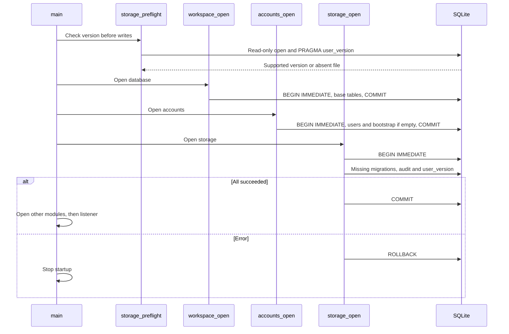
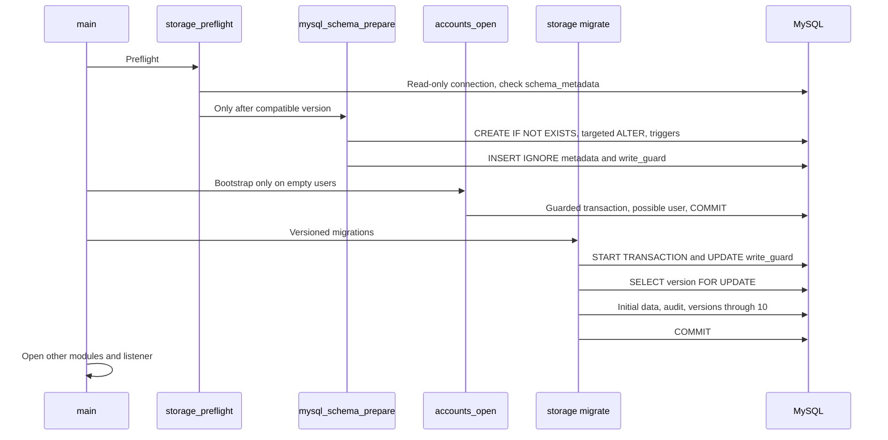

# Migrations, transactions and consistency

[Italiano](../../tehnical/migrazioni-e-consistenza.md) | **English**

Verified on **11 October 2026** against the available sources and tests. Application data version: **14**. The opening sections describe implemented behavior; the final section proposes a method for future changes. Migrations 8 → 9 → 10 and 9 → 10 are verified by native tests covering preservation of child rows, sequences, idempotency and rollback.

Sources: [storage.c](../../../src/storage.c), [mysql_schema.c](../../../src/mysql_schema.c), [MySQL adapter](../../../src/db_mysql.c), [startup](../../../src/server.c), [accounts.c](../../../src/accounts.c), [procurement.c](../../../src/procurement.c). Complete DDL and relationships are in the [data model](modello-dati.md); backup and restore are in the [operations manual](operazioni-backup-ripristino.md).

## What version 14 means

The same application version describes both backends, but the physical procedure differs:

Step 12 accepts earlier versions through 11 and adds weekly logs, corrections, schedules, templates and project lifecycle; it does not generate a separate migration 11 event. Step 13 adds explicit profiles and team visibility. Step 14 applies governance/operations/integration extensions, preserves existing data and audit, and appoints existing managers as administrators once. Later appointments remain explicit. SQLite commits DDL, FK checks, audit and marker 14 together; MySQL keeps preparatory DDL separate from the transactional audit/version commit.

| Aspect | Native SQLite | Docker MySQL |
| --- | --- | --- |
| Version identifier | `PRAGMA user_version` | `schema_metadata(id=1,version)` row |
| Base tables | Created by workspace/accounts before migrations | Prepared by `mysql_schema_prepare()` before modules are opened |
| Migrations | DDL, data transformations, audit and version in one SQLite transaction | Separate preparatory DDL; data transformations, audit and version in a subsequent transaction |
| Write coordination | `BEGIN IMMEDIATE` | `START TRANSACTION`, `cluster_write_guard` row and Group Replication certification |
| PDF storage | Separate local filesystem | Separate MongoDB GridFS |
| Rollback boundary | Current SQL transaction | Current SQL transaction; does not undo already applied DDL or external calls |

A supported version does not mean every existing column and index has been comprehensively verified. The code contains targeted checks: it is not a general schema drift detection tool. Unknown manual alterations may cause startup or a subsequent operation to fail.

Addons have independent storage lifecycles: Calendar checks `PRAGMA user_version<=2` and the encryption key; mail creates its own ledger and converts residual `sending` entries to `unknown`. NPM manages its own migrations. Inventory separately manages its own SQLite schema 6. None of these stores is upgraded by MySQL version 14. Inventory migration 4 → 5 adds separate people and identity directories, many-to-many memberships, directory history, and direct asset links. The additive DDL runs in one SQLite transaction and preserves existing assignments, custody, snapshots, and ID counters. A failed migration leaves schema 4 intact and can be retried after correcting the cause; earlier inventory binaries reject schema 5. Inventory schema changes are independent of application schema 14.

## SQLite startup, order and persistent effects



The diagram shows an existing file; if the file does not exist, preflight accepts its absence without creating it. A file with a negative/unreadable version or a version greater than 10 is rejected before creating tables or accounts.

`workspace_open()` creates `jobs`, `time_entries` and base indexes in its own transaction. `accounts_open()` creates `users`, then inserts the bootstrap manager only if `COUNT(*)=0`. These commits precede the migration transaction: **there is no single transaction enclosing the entire startup**. If a later migration fails, already committed bootstrap/base changes are not deleted.

`storage_open()` opens another connection and starts `migrate()`. To rebuild the `alert_rules` parent table, migration suspends FKs before the transaction, runs `PRAGMA foreign_key_check` before commit and re-enables FKs even on error. The starting value is read once; `version <= N` conditions apply all necessary steps in the same startup. Each step updates the marker and adds a `system.migration` event; if a step fails, rollback of the migration transaction also undoes preceding steps performed in that same transaction.

## MySQL startup, DDL and version



Here, the name `storage_preflight()` includes a mutating phase: first `mysql_schema_preflight()` verifies compatibility, then `mysql_schema_prepare()` prepares the schema. The first phase's read-only connection is not reused for DDL.

The preliminary check accepts a database without `schema_metadata`, or with an empty table after an interrupted installation; with a row, it requires `id=1`, a non-NULL version in 0–14 and no other rows. A future version is rejected before DDL preparation and bootstrap.

Preparation defines the 24 expected tables and explicitly checks:

- `jobs.contract_id`, with FK and index, for older installations;
- `job_assignments.role_id` and FK;
- `jobs.is_common`, default 0;
- the state CHECK for `alert_email_outbox`: accepts the current one, or replaces only the recognized legacy constraint that allowed `pending_configuration`; an unknown custom constraint is not blindly replaced;
- `alert_rules.days_before` with default 30 and `verification_days` with default 90, both with CHECK 1–365; extends only recognized legacy type CHECKs (before schema 9 or at schema 9), adding `inventory_due`, `inventory_return` and `inventory_verification`;
- presence of integrity/immutability triggers;
- initial `schema_metadata(1,0)` and `cluster_write_guard(1,0)` rows with idempotent insertion.

Individual MySQL DDL statements may cause implicit commits and remain applied if a subsequent step fails. On restart, the code repeats the intended idempotent preparation, without a generic downgrade procedure. A startup error therefore does not prove that no DDL changed.

Only afterward are workspace/accounts/storage opened. The versioned MySQL migration acquires the guard, reads the version `FOR UPDATE`, applies required data transformations, adds audit and advances the marker in the same transaction. The version counter is not updated by `CREATE TABLE` alone.

## Path 0 → 14

| Step | Implemented transformation | Preserved data or special characteristics |
| --- | --- | --- |
| `0 → 1` | SQLite adds `time_entries.user_id` if absent, attempts case-insensitive `owner`→`users.email` mapping, creates indexes/triggers, assignments and audit. | Unmatched hours retain NULL IDs; no universal assignment is created. Audit records mapped/unmapped counts. In MySQL, preparation has already defined columns; the version step records migration with initial zero counts, without a generic import of old SQLite databases. |
| `1 → 2` | Suppliers, contracts, PDF manifests, immutable triggers and optional project–contract link. | Does not fabricate a contract for every project or copy preexisting PDF bytes from other applications. |
| `2 → 3` | Groups, members, local roles, group grants; adds roles to assignments. Inserts role ID 1 `reader`, ID 2 `contributor`; assigns 2 to legacy rows with NULL roles. | Preserves previous access as Contributor; does not change users' global roles. |
| `3 → 4` | Historical rates, indexes and immutable-user constraint. | Does not invent a rate: hours without rates remain unpriced in reports. |
| `4 → 5` | Non-null `jobs.is_common` flag, default 0. | Existing projects remain private unless explicitly updated. Common project names are not automatically imposed by this migration. |
| `5 → 6` | Alert rules, user/email recipients, monitored subjects, invalid events, notifications and outbox. | No rule is automatically enabled for everyone. The legacy outbox allows only `pending_configuration`. |
| `6 → 7` | Email states `pending_configuration/retrying/sent/delivery_unknown/delivery_failed`. | SQLite rebuilds the outbox, copying all rows and preserving `sqlite_sequence`, even if the highest IDs had already been deleted. MySQL expands the CHECK in the DDL phase and records the version step in the transactional phase. |
| `7 → 8` | `job_tasks` tasks/subtasks and `job_blockers` log, indexes, project/user FKs and composite FKs within the same project. | No demo data or transformation of previous records. SQLite creates structures in the transaction; MySQL prepares them in the DDL phase and commits audit/version in the transaction. |
| `8 → 9` | `inventory_due` rules and `days_before` 1–365, default 30. | SQLite rebuilds `alert_rules`, preserves IDs, sequence and child rows, checks FKs and atomically commits audit/version. MySQL extends only the recognized legacy CHECK and adds the column during DDL preparation. Does not create automatic rules. |
| `9 → 10` | `inventory_return` and `inventory_verification` rules, with `verification_days` 1–365, default 90. | SQLite rebuilds `alert_rules`, preserving IDs, maximum sequence value, recipients, FKs and notification/email history; checks FKs before commit and atomically commits audit/version. MySQL prepares the new column and extends only recognized legacy CHECKs, then commits audit/version. Existing `inventory_due` rules retain their threshold and behavior; no automatic rules are created. |

Preserving the maximum outbox ID is part of the idempotency contract: the mail service uses `namespace:outbox:ID`. Reusing a previously consumed ID could cause a new message to match a historical send.

An already applied migration must not add audit records for earlier steps again. MySQL preparation repeats existence checks, while data steps depend on the marker. A schema with apparently recent columns but an inconsistent marker must not be “corrected” by manually setting `version=14`: transformations and checks would be skipped.

## Business transaction: atomic unit

The usual write model is:

```text
syntactic validation
BEGIN IMMEDIATE / START TRANSACTION with guard
read state and check current constraints
write entities and relationships
storage_audit(same_connection, before, after)
COMMIT
success response
```

On error: finalize statements, roll back and return an error. The `COMMIT` result is checked: success must not be emitted merely because the final `INSERT` succeeded. `storage_audit()` rejects calls when the connection is in autocommit, making the transaction requirement explicit.

Existing atomic examples: daily hours limit with insertion; project deletion with all hours, tasks, blockers and grants; role/user change protecting the last active manager; rate with overlap checking; alert execution with notifications/outbox/cursors; task/blocker updates with revision checking; and task removal with blocker unlinking and corresponding audit. Audit and data do not use two separate connections: the audit function receives the handler's connection.

Tasks and blockers add optimistic concurrency: the form sends the revision read, the transaction compares it and the write increments it. Two editors of the same revision cannot silently overwrite one another. Unlinking a blocker during task deletion also increments its revision. Hierarchy checks consider the entire subtree and occur before writing.

Report reads use one query with CTEs for totals and rows, without opening a write transaction or acquiring the guard. Filter options are read separately; they do not constitute an immutable multi-query snapshot of the entire database.

## Guard and multi-primary cluster

Every `BEGIN`/`START TRANSACTION` recognized by the MySQL adapter, including through prepared statements, executes:

```sql
UPDATE cluster_write_guard SET generation=generation+1 WHERE id=1;
```

The row must exist and be updated once. On a single member, the lock serializes application writers; across primaries, the common write set allows Group Replication to certify the conflict and abort an entire transaction. Under contention, even writes to different business entities may therefore fail: this is an intentional tradeoff to protect aggregate invariants, not a conflict-free distribution of writes.

MySQL connections set `READ COMMITTED`, initial autocommit 1, UTC time zone and `innodb_lock_wait_timeout` derived from the module's busy timeout (normally 5 seconds). After acquiring the guard, reads check the latest committed state visible on the connection. Cluster replication/routing behavior is described in [architecture](architettura.md) and [operations](operazioni-backup-ripristino.md).

Protection applies to transactions passed through the adapter; it does not make manual writes bypassing it safe. Preparatory DDL is not enclosed by this guard. The adapter also rejects nested `BEGIN`: on MySQL, a new `START TRANSACTION` could otherwise implicitly commit an already open transaction.

## Reconnection is not a retry

`MYSQL_OPT_RECONNECT` is disabled. `ensure_connection()` can reconnect only without open statements and outside a transaction. If a healthy connection fails `ping`, it discards it and opens a new one for the **next safe boundary operation**. An already failed command is not automatically repeated.

| Event | Implemented behavior | Consequence for the caller |
| --- | --- | --- |
| Uniqueness violation (`1062`) | `DB_CONSTRAINT_UNIQUE`, often mapped to `409`. | Correct/reread data. |
| Lock timeout, deadlock, certification (`1205/1213/3101`) | `DB_BUSY`; the handler fails and cleans up the transaction. | A new operation may be deliberately retried; do not assume an invisible retry has already occurred. |
| Incompatible schema/DML (`3098`) | Error not classified as contention. | Analyze schema/configuration. |
| Lost connection (`2006/2013/2055`) | Connection marked `broken`; no statement replay. | The outcome may depend on where the response was lost. |
| `ROLLBACK` on an already lost connection | Discards local state without connecting specifically to send rollback. | Does not turn an uncertain commit into a definitely cancelled operation. |
| Unconfirmed `COMMIT` | HTTP error through the handler, no automatic replay. | Reread data/audit before repeating the mutation. |

Not all business APIs have idempotency keys. For example, a lost response after a new time entry does not justify a second blind `POST`: the saved entry may already exist. Mail/Calendar queues address the problem specifically with persistent keys, as documented in [integration flows](flussi-integrazioni.md).

## Boundaries between databases and external services

### PDFs: SQL plus GridFS

Upload saves document bytes before the SQL manifest transaction. If manifest insertion or audit fails before commit, the code attempts blob removal. If SQL `COMMIT` has an uncertain outcome, it retains the blob: deleting it could break a manifest that was actually committed. The possible residue is therefore an unreferenced object to reconcile, rather than a PDF deleted behind a valid manifest.

There is no distributed MySQL–MongoDB transaction or automatic periodic orphan deletion. Backup must include metadata and bytes; cleanup requires reference checks and controlled operating conditions.

### Email: SQL outbox plus SQLite ledger

Outbox creation is atomic with the rule/audit. Network activity is outside the SQL transaction. Mail-addon reserves the key before SMTP, while the app updates state and audit in a new transaction. If the latter update fails, the same item remains retryable with the **same key and content**, and the ledger prevents a second send already recognized.

### Calendar: local copy plus provider

Queue commit is local; it is not commit of a Google write. `queued/unknown/applied/conflict/failed` states distinguish the stages. The event cache and `nextSyncToken` are committed together only after all pages. Generation checks prevent responses from an old connection from populating a new local account. The provider remains outside the SQLite transaction.

## Checks present in the repository

This table lists **existing tests**, not results just rerun.

| Invariant | Evidence |
| --- | --- |
| Future version rejected before bootstrap | `test_future_schema_version_is_rejected_without_bootstrap_or_database_changes` in [assignments](../../../tests/test_assignments.py). |
| Legacy hours mapped without universal access | `test_schema_migration_maps_legacy_owners_without_assigning_everyone`, same file. |
| Legacy roles and audit preserved | `test_version_two_upgrade_defaults_legacy_assignments_and_preserves_business_history` in [groups](../../../tests/test_groups.py). |
| Rate migration without data loss | `test_schema_three_upgrade_preserves_all_business_records_and_audit` in [rates](../../../tests/test_labor_rates.py). |
| Common flags initialized conservatively | `test_schema_four_upgrade_preserves_records_and_sets_safe_defaults_once` in [common projects](../../../tests/test_job_defaults.py). |
| Alert migration and audit only once | `test_schema_five_upgrade_preserves_business_and_audit_once` in [alerts](../../../tests/test_alerts.py). |
| Outbox ID sequence preserved in step 7 | `test_schema_six_upgrade_preserves_outbox_ids_sequence_business_records_and_audit` in [mail client](../../../tests/test_mail_client.py). |
| Schema 8 preserves previous data and audit only once | `test_schema_seven_upgrade_preserves_existing_accounts_jobs_hours_and_audit` in [tasks/blockers](../../../tests/test_work_board.py). |
| Schema 10 preserves rules, recipients, deliveries and ID counters; rollback on audit/FK error | Real migration tests 8/9 → 10 in [inventory](../../../tests/test_inventory_migration.py). |
| Inventory schema 5 preserves schema-4 assets, custody, snapshots, and ID counters; partial DDL failure rolls back and supports retry | Real migration and rollback tests 4 → 5 in [people and identities](../../../tests/test_inventory_directory.py). |
| Revisions, hierarchies and blocker unlinking | Dedicated cases in [tasks/blockers](../../../tests/test_work_board.py): stale updates/deletions, depth limits, deletion with children and audit rollback. |
| Failed audit cancels business changes | Dedicated tests in [assignments](../../../tests/test_assignments.py), [groups](../../../tests/test_groups.py), [rates](../../../tests/test_labor_rates.py), [contracts](../../../tests/test_procurement.py) [alerts](../../../tests/test_alerts.py) and [tasks/blockers](../../../tests/test_work_board.py). |
| Writes from every primary and conflicts | `test_01_every_primary_writes_and_conflicting_transactions_roll_back` in [MySQL HA](../../../tests/test_cluster_ha.py), an optional test with effects on the lab. |
| Quorum recovery and full shutdown | Other [MySQL HA](../../../tests/test_cluster_ha.py) cases and GTID selection in [cluster manager](../../../tests/test_cluster_manager.py). |

SQLite tests alone do not demonstrate MySQL behavior for implicit DDL, certification or reconnection. Live tests require a dedicated environment and the conditions stated in the [test manual](sviluppo-test.md).

## Proposed strategy for the next version

This section is **a work proposal**, not an existing migration runner. Migrations through version 14 are implemented; there is no automatic downgrade or HTTP schema upgrade command.

1. Define the new data's invariant, nullability and initial value without inventing business values. List impacts on audit, reports, authorization, backups and integrations.
2. Prepare fixtures for supported databases and before/after snapshots of entities to preserve, including ID counters and external blobs. Use synthetic data and test upgrades from every actually supported version.
3. For MySQL, explicitly separate repeatable DDL additions from transactional transformations. For SQLite, consider table rebuilding, FKs and `sqlite_sequence` when extending a CHECK.
4. Make changes additive initially where possible: new column/structure, verified population, compatible reads, then possible removal in a later version. This is a recommended approach, not already guaranteed support for mixed deployments of multiple app versions.
5. Increment supported markers consistently and update preflight. Do not merely change `SCHEMA_VERSION`: every step must produce valid data, audit and marker only after checks.
6. Test intermediate failures, restart and double execution. For external operations, simulate lost acknowledgments and crashes between local commits and the remote request.
7. Prepare a consistent backup and a tested restore before release. A restore may require all related stores; the old application image alone does not undo a new schema.
8. Publish migration notes with prerequisites, observed duration, possible unavailability, checks and limits. Do not announce zero-downtime upgrades until they have been designed and measured.

Any future field encryption or multi-company separation will require migration of audit, outbox, cache and backups too: it is not a property obtained by updating only one table or key.
