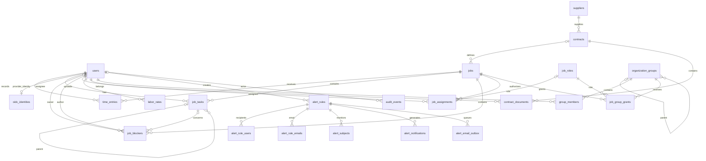

# Data model and storage dictionary

[Italiano](../../tehnical/modello-dati.md) | **English**

Verified against the repository code on **11 October 2026**. Application schema **10**; SQLite calendar schema **1** and SQLite inventory schema **5**. This document describes the current implementation, rather than the financial or cryptographic proposals in the roadmap.

Sources: [MySQL DDL](../../../src/mysql_schema.c), [migrations](../../../src/storage.c), [users](../../../src/accounts.c), [projects and time](../../../src/workspace.c), [organization](../../../src/organization.c), [tasks and blockers](../../../src/work_board.c), [contracts](../../../src/procurement.c), [documents](../../../src/documents.c), [alerts](../../../src/alerts.c), [mailer](../../../addon/src/mailer.c), [calendar](../../../calendar-addon/src/calendar.c) and [Compose](../../../compose.yaml).

## Storage inventory and ownership

| Store | Default name/path | Contents and owner |
| --- | --- | --- |
| MySQL InnoDB, three Group Replication replicas | `punto`, configurable with `MYSQL_DATABASE`/`DB_NAME` | The 25 application tables described below. Three nodes replicate the same logical database: they are not three separate business databases. |
| Application SQLite, native development | `DB_PATH`, default `data/punto.db` | An alternative to MySQL for the same features; versioned through `PRAGMA user_version`. |
| MongoDB GridFS | `punto_documents`, configurable with `DOC_DB_NAME` | Original PDFs and GridFS metadata, managed by the app through the document account. |
| Nginx Proxy Manager SQLite | `nginx-proxy-manager/data/database.sqlite` on the host, `/data/database.sqlite` in the container | NPM configuration, NPM administrative users, proxy hosts and certificate references. The schema belongs to NPM 2.16.0, not to application migrations. |
| Mail SQLite | `/var/lib/punto-mailer/delivery.sqlite3`, volume `mail_addon_data` | SMTP idempotency ledger; no copy of email text. |
| Calendar SQLite | `/var/lib/punto-calendar/calendar.sqlite3`, volume `calendar_addon_data` | Google tokens, event cache and change queue, isolated by user ID. |
| App process memory | Session array, maximum 64 | Session tokens, user IDs and expiration; lost on restart. There is no sessions table. |

The addons do not access MySQL or MongoDB. Their user IDs are logical references received from the app, without foreign keys across databases or containers. The addons' two SQLite stores are single instances: they do not inherit MySQL high availability.

## Storage conventions

- MySQL IDs are signed `BIGINT`; primary entities use `AUTO_INCREMENT`. The code uses 64-bit `DbInt`. Do not assume contiguous IDs in the cluster.
- MySQL tables use `ENGINE=InnoDB`, `utf8mb4`, and default collation `utf8mb4_bin`. Unique emails and codes identified in the DDL use `utf8mb4_general_ci`; dates and hexadecimal keys use binary ASCII. SQLite uses `NOCASE` where specified: this does not match all the Unicode rules of the MySQL collation.
- Durations are **whole minutes**, not decimal hours: `480` = 8 hours. Each entry is 1–1440 minutes; the total per user per day cannot exceed 1440. The total is constrained by application/transaction logic.
- Amounts and rates are **integer cents**. `value_cents=125000` means 1,250.00 EUR; `hourly_cents=4500` means 45.00 EUR/hour. Only `EUR` is allowed. Multiple companies, other currencies, invoices, payments and accounting do not yet have operational tables.
- The cost of each entry is `floor((minutes * hourly_cents + 30) / 60)`, using HALF_UP rounding to the cent. The report sums entry costs; a missing rate remains distinct from a zero cost.
- Business dates are `YYYY-MM-DD` strings; in MySQL, `CHAR(10)`, not `DATE`. The DDL primarily checks length and ordering; C validates the calendar. Assignment and rate windows include both endpoints; `NULL` means an open endpoint where permitted.
- Application timestamps are `YYYY-MM-DDTHH:MM:SSZ`, UTC `CHAR(20)`. `alert_rules.run_time` is `HH:MM` in the `Europe/Rome` time zone, set by the alert module. Technical timestamps in the addons are `INTEGER` Unix seconds.
- `NULL`, empty strings and zero are not interchangeable: a contract without a value = `NULL`, a free rate = `0`, an optional record field = often `''`.
- MySQL flags are `TINYINT` with `CHECK(... IN (0,1))`; APIs generally return them as JSON booleans.

## Main relationships



`alert_events.job_id` intentionally has no FK: it records attempts involving a nonexistent project. `audit_events.entity_id` is a historical polymorphic reference, not an FK: history survives deletion of the entity.

## Functional catalog of the 25 MySQL tables

The complete DDL at the end specifies **every column, type, nullability, default, index, key and CHECK**. This section explains responsibilities and rules that the DDL alone does not express.

| Table | Responsibility and interpretation |
| --- | --- |
| `schema_metadata` | One row `id=1`; `version=10` after migrations. An unknown future version prevents startup. |
| `cluster_write_guard` | One row `id=1`, `generation>=0`; updated at the start of application writes so the cluster certifies transaction conflicts, including rules depending on aggregates. This is not user data. |
| `users` | Application identity: unique email, name, global `manager`/`worker` role, enabled state, password hash and salt. The API does not expose hash/salt. Active on creation; reversible disabling; no exposed user deletion. |
| `oidc_identities` | Persistent link from the exact `(issuer,subject)` pair to the local `user_id`, itself unique and an FK to `users`. Identifies users independently of email changes and prevents two identities from claiming the same profile. Contains no passwords or tokens. |
| `suppliers` | Unique code, company name, VAT number, contacts, address, notes and active state. The flag does not delete contracts or documents. |
| `contracts` | Code, title, supplier, `draft`/`active`/`expired`/`closed`/`cancelled` status, validity, optional value in EUR and notes. No tax calculation or invoice register. |
| `contract_documents` | SQL PDF manifest: unique random `storage_key`, name, size, SHA-256, author and timestamp. `storage_key` resolves the content in GridFS; it is not a filesystem path. Immutable metadata. |
| `jobs` | Project, unique code, name, free-text client, description, `planned`/`active`/`paused`/`completed`/`cancelled` status, optional contract and `is_common`. Common projects are visible to all active users according to application rules. |
| `job_tasks` | Project task, optional parent in the same project, assigned user, title/description, Kanban status, priority and due date. `revision` protects concurrent editors. A maximum of 500 per project and an eight-level hierarchy without cycles, checked in C. |
| `job_blockers` | Project impediment, optional task in the same project, impact, optional owner, status, next action, due date, author and revision. A maximum of 500 per project. Its status does not automatically change the task's status. |
| `time_entries` | Time worked by a user on a date for a project; note. `owner` retains the historical/legacy email; authorization uses `user_id`. |
| `labor_rates` | Rate per user and inclusive interval. Immutable `user_id`; intervals for the same user cannot overlap, enforced by the application. Zero is a valid rate. |
| `job_roles` | Project-local roles, distinct from `users.role`. Built-in: `reader`/Viewer (`can_log_time=0`) and `contributor`/Contributor (`1`). `builtin` protects system roles against modification. |
| `organization_groups` | Group tree through `parent_id`. C prevents cycles and depth greater than 16. The name is not declared unique. |
| `group_members` | Direct user–group membership, composite PK. Ancestor group permissions are resolved by code without duplicating membership rows. |
| `job_group_grants` | Project–group access grant, mandatory local role and optional validity. One row per pair. |
| `job_assignments` | Direct project–user access grant and validity. Nullable `role_id` for compatibility: the code interprets an absent value as Contributor, ID 2. |
| `alert_rules` | Rule owned by a manager: name, `invalid_job`/`missing_hours`/`inventory_due`/`inventory_return`/`inventory_verification`, `days_before` lead time (1–365, default 30) and `verification_days` interval (1–365, default 90), time, enabled state, management/execution dates and last processed event. A rule is not automatically shared among managers. |
| `alert_rule_users` | Internal rule recipients; one row per user. The app requires existing active users. For time alerts, a worker recipient only receives notifications concerning them as the subject; inventory alerts are shared with all selected active recipients. |
| `alert_rule_emails` | Rule email recipients, case-insensitive addresses in the composite PK. An email address does not require an application account. |
| `alert_subjects` | Users monitored for missing hours: start of monitoring and last checked day. These are alert subjects, distinct from recipients. |
| `alert_events` | Attempts to log time against a nonexistent project ID, with user, work date, minutes and attempt timestamp. Invalid hours do not enter `time_entries`. |
| `alert_notifications` | Internal notification with immutable content, recipient, affected user, event key, text and optional read timestamp. Uniqueness `(rule_id,recipient_id,event_key)` prevents duplicate notifications. |
| `alert_email_outbox` | Email request persisted in SQL with recipient and content. Uniqueness `(rule_id,email,event_key)`; states `pending_configuration`, `retrying`, `sent`, `delivery_unknown`, `delivery_failed`. |
| `audit_events` | Append-only history: actor with snapshotted name/email, action, entity type/ID, before/after JSON. `actor_id=NULL` for system operations. The audit may contain personal data and copies of business values. |

### Integrity, deletion and concurrency

MySQL FKs do not declare `ON DELETE CASCADE`: deletion is normally restrictive. The project deletion API explicitly removes blockers, parent relationships between tasks, tasks, time entries, direct assignments and group grants, then the project, in the same transaction as the audit. The audit retains deleted identities and aggregate counts; it is not a complete backup of time entries. The contract, supplier and PDFs are not deleted by this operation.

Deleting a task is rejected if it has children. Otherwise, it unlinks blockers without deleting them, increments their revisions and retains the audit of removal and unlinking. Composite FKs `(job_id,parent_id)` and `(job_id,task_id)` prevent links between different projects. Cycle and depth checks remain application responsibilities. Updates and deletions require the current revision, unlike projects, which have no optimistic version.

A group can only be deleted after removing its children, members and grants. There is no generic `DELETE` API for users, suppliers, contracts, rates, roles and alert rules: use the updates/states exposed by the product. Contract documents and audit records have triggers that deny `UPDATE` and `DELETE`.

Additional MySQL triggers:

- `time_entries_require_user_insert`: rejects new rows with `user_id=NULL`.
- `time_entries_preserve_user_update`: a populated `user_id` cannot change or return to NULL.
- `labor_rates_preserve_user_update`: prevents moving a rate to another user.
- `contract_documents_no_update`, `contract_documents_no_delete`, `audit_events_no_update`, `audit_events_no_delete`: immutability protections.

`time_entries.user_id` remains nullable for compatibility with data predating the identity migration. SQLite attempts linking by email; rows that cannot be reconciled remain historical and do not become another user's personal hours.

Checks for 24 hours per day, the last active manager, maximum entity counts, rate overlaps, assignment validity, group cycles and task hierarchies require the application. Writing directly in SQL can violate business rules even when all CHECKs pass. Application writes update `cluster_write_guard` before checking rules; contention and unavailability may return a temporary error. Business APIs have no universal idempotency key: after an ambiguous response, reread the state before creating a second entity.

## Application SQLite and migrations

In native mode, `users`, `jobs` and `time_entries` are initialized by their respective modules, then [storage.c](../../../src/storage.c) applies the migration sequence. Types are primarily `INTEGER`, `TEXT`, `BLOB`, with FKs enabled through `PRAGMA foreign_keys=ON`; independent IDs use `INTEGER PRIMARY KEY AUTOINCREMENT`.

| Version | Evolution |
| --- | --- |
| 1 | Time–user links, assignments and immutable audit. |
| 2 | Suppliers, contracts, PDF manifest and optional contract on the project. |
| 3 | Hierarchical groups, members, local roles and group grants. |
| 4 | Historical hourly rates. |
| 5 | Common-project flag. |
| 6 | Alert rules, recipients, subjects, events, notifications and outbox. |
| 7 | Email delivery states expanded for the email service; retention of ID counters even for deleted rows. |
| 8 | Tasks and subtasks, Kanban states and blockers with revisions, FKs within the same project and auditing of new operations. |
| 9 | `inventory_due` alert rules and `days_before` lead time for inventory expiry dates; no new application table. |
| 10 | `inventory_return` and `inventory_verification` rules, `verification_days` interval 1–365 (default 90). Preserves IDs, sequence, FKs, recipients and delivery history; no new application table. |

SQLite has neither `schema_metadata` nor `cluster_write_guard`: it uses `PRAGMA user_version` and `BEGIN IMMEDIATE` transactions. Its business schema includes the other 23 tables; `sqlite_sequence` is an internal SQLite table. MySQL DDL must not be copied to the SQLite file. Migrations are performed by the app, without an HTTP migration endpoint.

The `oidc_identities` table is created idempotently during SQLite account initialization and MySQL schema preparation, including in local authentication mode, without incrementing version 10. In SQLite, `issuer` and `subject` are `TEXT COLLATE BINARY` with a composite PK, while `user_id` is `INTEGER NOT NULL UNIQUE REFERENCES users(id)`; in MySQL, provider keys use `VARBINARY`, as shown in the DDL below.

In native mode, PDFs are local files in the `DOC_FILES_DIR` directory, or the `documents` subdirectory next to the `DB_PATH` file (default `data/documents`), with validated keys and symlink exclusion. In Docker, the document backend is MongoDB.

## PDFs in MongoDB GridFS

The `punto_documents` database contains:

| Collection | Fields and function |
| --- | --- |
| `contract_pdfs.files` | GridFS document `_id` = `storage_key`, a 64-character hexadecimal string; `filename`, `length`, `chunkSize`, `uploadDate`; `metadata.sha256` and `metadata.contentType="application/pdf"`. |
| `contract_pdfs.chunks` | Binary GridFS chunks, linked through `files_id`, ordered by `n`, with `data`. Configured chunk size is 255 KiB. Bucket indexes are managed by the GridFS driver. |
| `contract_pdf_keys` | Reserves the ID during upload, with unique `_id`. Prevents cleanup of a concurrent upload from deleting chunks of another upload using the same key. |

The MySQL manifest retains the relationship to the contract and the author. Upload checks extension/name, initial `%PDF-` signature, 5 bytes–10 MiB and SHA-256. It is neither an antivirus engine nor a complete document parser. Download compares size and hash against the manifest before returning the file. A hash detects differences: it does not encrypt the PDF.

Upload crosses two databases and does not use a distributed transaction. The code reserves storage, saves the document, inserts the manifest/audit and attempts cleanup if the SQL portion fails. Backups and checks must include both stores; a MySQL dump contains only metadata, not PDFs.

## Mail ledger

One SQLite table, `deliveries`:

| Field | Type/constraint | Meaning |
| --- | --- | --- |
| `idempotency_key` | `TEXT PRIMARY KEY` | App-generated `namespace:outbox:ID` key. |
| `payload_hash` | `TEXT NOT NULL` | SHA-256 of the requested content; detects key reuse with different content. |
| `status` | `TEXT NOT NULL CHECK` | `sending`, `sent`, `unknown`, `failed`. |
| `created_at`, `updated_at` | `INTEGER NOT NULL` | Unix seconds. |

WAL and `synchronous=FULL`; the `sending` state is committed to disk before the SMTP call and converted to `unknown` on restart. The ledger does not store recipient, subject or body: they remain in plaintext in the MySQL outbox. The ledger does not have field-level encryption. Namespace, outbox and ledger must be restored consistently to avoid duplicates. Details in the [addon contract](api-addon.md).

## Calendar store

SQLite uses FKs, WAL, `synchronous=FULL`, `user_version=1`, a 3-second contention timeout and separate connections for the API and worker. Its five tables are:

| Table | Columns and constraints |
| --- | --- |
| `accounts` | `user_id INTEGER PRIMARY KEY`; `token_blob BLOB NOT NULL`; `calendar_id`, `sync_token`, `last_error`, `provider_id`, `generation TEXT NOT NULL DEFAULT ''`; `last_sync`, `reauth_required`, `next_poll`, `sync_running INTEGER NOT NULL DEFAULT 0`. `provider_id` identifies the Google account through its primary calendar; `generation` prevents results from an old connection from updating the new one. |
| `oauth_states` | `state_hash TEXT PRIMARY KEY`; `user_id INTEGER NOT NULL`; `session_hash TEXT NOT NULL`; `verifier_blob BLOB NOT NULL`; `expires INTEGER NOT NULL`. Single-use OAuth state valid for 600 seconds, bound to session and user. |
| `events` | `user_id INTEGER NOT NULL REFERENCES accounts(user_id) ON DELETE CASCADE`; `event_id`, `etag`, `status TEXT NOT NULL`; `payload BLOB NOT NULL`; PK `(user_id,event_id)`. Only one selected calendar per user. |
| `changes` | `id INTEGER PRIMARY KEY AUTOINCREMENT`; `user_id INTEGER NOT NULL REFERENCES accounts(user_id) ON DELETE CASCADE`; `idempotency_key`, `payload_hash`, `operation`, `event_id`, `etag TEXT NOT NULL`; `payload BLOB NOT NULL`; `state TEXT NOT NULL CHECK` in `queued/applied/conflict/failed/unknown`; nullable `response BLOB`, currently reserved and unused; `error TEXT NOT NULL DEFAULT ''`; `attempts`, `next_attempt INTEGER NOT NULL DEFAULT 0`; `created INTEGER NOT NULL`; UNIQUE `(user_id,idempotency_key)` and index `changes_ready(user_id,state,next_attempt,id)`. |
| `metadata` | `name TEXT PRIMARY KEY`, `value BLOB NOT NULL`; contains the encrypted storage-key check. |

`token_blob`, `verifier_blob`, `events.payload`, `changes.payload` and the key check are encrypted with AES-256-GCM. Idempotency keys, hashes, user IDs, account/calendar IDs, event IDs, ETags, status, errors, counters, dates and sync tokens remain readable. Google IDs may contain an email address: they are potentially personal data even when event content is encrypted.

Encryption authenticated data binds the user and row purpose: token; state hash for PKCE; calendar and ID for an event; idempotency key for a change. Disconnecting deletes the user's account, events, changes and related OAuth states; it also attempts remote revocation. A remote response already in progress cannot be retroactively cancelled. Simply reconnecting the same account preserves cache/queue/idempotency.

The binary format of encrypted values is versioned: version byte `1`, random 12-byte nonce, 16-byte GCM tag and ciphertext. Authenticated data is built as `punto-calendar:v1:<user_id>:<purpose>`. Do not modify blobs, identifiers or the key directly: authentication will fail. The encrypted `metadata.key_check` prevents opening with an unrelated key; there is not yet an automatic ciphertext rotation procedure.

## Inventory store

SQLite inventory uses schema **5**, foreign keys, WAL, and `synchronous=FULL` in the independent `inventory_addon_data` volume. Existing tables `assets`, `asset_history`, `asset_relations`, `inventory_import_previews`, `inventory_places`, `asset_context`, `asset_custody`, and `asset_verifications` retain the catalog, revisions, relationships, CSV previews, places, assignments, handovers, and verifications. Schema 5 adds five tables:

| Table | Columns and constraints |
| --- | --- |
| `inventory_people` | Autoincrementing `id`; unique `NOCASE` `person_code` up to 64 bytes, required `display_name` up to 160; `email`, `organization`, `job_title`, `notes`; `active`, `version`, `actor_id`, creation and update dates. Represents a real person, including someone without a login account. |
| `inventory_identities` | Autoincrementing `id`; required, unique `NOCASE` `realm`/`login` pair, up to 160 bytes each; `display_name`, `kind=personal|shared|service`, `notes`; `active`, `version`, actor, and dates. Catalogs an account without passwords or tokens; its type does not limit the number of associated people. |
| `inventory_identity_people` | `identity_id` and `person_id` FKs; `role=owner|user`, notes, active status, creation/removal actor and date. A partial index prevents multiple active links for the same pair; the many-to-many link is deactivated without deleting its row. Adding/removing increments and records both versions in the same transaction. |
| `inventory_entity_history` | Type `person|identity`, entity ID, `action=created|updated`, actor, version, date, and JSON snapshot, with optional `change`. UNIQUE `(entity_type,entity_id,version)`; directory history and immutable snapshots of added/removed links. |
| `inventory_asset_subjects` | `asset_id` FK and exactly one of `person_id`/`identity_id`; `role=owner|user|administrator`, notes, subject JSON snapshot, actor/dates/status. Unique partial indexes on active asset–person and asset–identity pairs. A write increments and records only the asset's version. |

Directories and links are independent of `users` in the application database: actor IDs are trusted app references, without cross-database FKs. Deactivation retains references; new links require active entities. An asset linked to a shared identity does not propagate to its associated people or change custody, status, license seats, or permissions. Data and snapshots remain plaintext in the volume. Migration 4 → 5 is additive and transactional, preserves previous assignments and snapshots, and does not change application schema 10. See the [inventory guide](asset-inventory.md#people-identities-and-linked-assets) for contracts and limits.

## Which data is encrypted and which is not

| Data | Protection actually implemented |
| --- | --- |
| Login passwords | PBKDF2-HMAC-SHA256 hash, 210,000 iterations, random 16-byte salt, 32-byte derived value. These are not reversibly encrypted passwords. Comparison is constant-time. |
| User names/emails, roles, projects, tasks/blockers, time/notes, rates, records and contract values | Plaintext at SQL column level; access controlled by the app and database account. |
| PDFs and document metadata | Plaintext at application level in GridFS and the SQL manifest; SHA-256 hash for integrity. |
| Audit, notifications, email outbox | Plaintext; include copies of personal and business data. |
| OAuth tokens, PKCE verifiers, event contents and calendar requests | Persistent AES-256-GCM, key mounted as a secret separate from the SQLite volume. Decrypted in service memory when needed. |
| Calendar metadata and mail ledger | Plaintext; content minimization in the mail ledger. |
| Service credentials and TLS/API keys | Files/environment according to the configuration described in [networking and security](rete-sicurezza.md); not encrypted using users' individual passwords. |
| Transport | TLS on database and addon API connections, CA and hostname verification; network separation. This is not equivalent to field encryption. |

FHE/homomorphic computation, vaults with per-user or per-field keys, KMS/HSM, partial decryption derived from users' passwords, and universal application encryption for MySQL/PDFs are not implemented. Protection of the host system's files/volumes depends on the platform and cannot be inferred from the DDL. Future field encryption must also consider audit, outbox, backups, logs and temporary copies.

For consistent backup and restore procedures, see [operations](operazioni-backup-ripristino.md). For constraints exposed to callers, see [app API](api-app.md) and [addon API](api-addon.md).

## Complete MySQL DDL, schema 10

The following definitions are extracted from the DDL strings in `mysql_schema_prepare()` and formatted without changing their contents. They are a reference for the expected schema, **not a script to run to manually upgrade an existing database**: migrations also include checks, triggers, initial data and audit.

### `schema_metadata`

```sql
CREATE TABLE IF NOT EXISTS schema_metadata (
  id TINYINT NOT NULL PRIMARY KEY,
  version INT NOT NULL,
  CHECK(id=1),
  CHECK(version>=0)
) ENGINE=InnoDB DEFAULT CHARSET=utf8mb4 COLLATE=utf8mb4_bin;
```

### `cluster_write_guard`

```sql
CREATE TABLE IF NOT EXISTS cluster_write_guard (
  id TINYINT NOT NULL PRIMARY KEY,
  generation BIGINT NOT NULL,
  CHECK(id=1),
  CHECK(generation>=0)
) ENGINE=InnoDB DEFAULT CHARSET=utf8mb4 COLLATE=utf8mb4_bin;
```

### `users`

```sql
CREATE TABLE IF NOT EXISTS users (
  id BIGINT NOT NULL AUTO_INCREMENT PRIMARY KEY,
  email VARCHAR(254) COLLATE utf8mb4_general_ci NOT NULL,
  name VARCHAR(120) NOT NULL,
  role VARCHAR(16) NOT NULL,
  active TINYINT NOT NULL DEFAULT 1,
  password_hash BINARY(32) NOT NULL,
  salt BINARY(16) NOT NULL,
  UNIQUE KEY users_email(email),
  CHECK(role IN ('manager','worker')),
  CHECK(active IN (0,1))
) ENGINE=InnoDB DEFAULT CHARSET=utf8mb4 COLLATE=utf8mb4_bin;
```

### `oidc_identities`

```sql
CREATE TABLE IF NOT EXISTS oidc_identities (
  issuer VARBINARY(1023) NOT NULL,
  subject VARBINARY(255) NOT NULL,
  user_id BIGINT NOT NULL,
  PRIMARY KEY(issuer,subject),
  UNIQUE KEY oidc_identities_user(user_id),
  CONSTRAINT oidc_identities_user_fk FOREIGN KEY(user_id) REFERENCES users(id)
) ENGINE=InnoDB DEFAULT CHARSET=utf8mb4 COLLATE=utf8mb4_bin;
```

### `suppliers`

```sql
CREATE TABLE IF NOT EXISTS suppliers (
  id BIGINT NOT NULL AUTO_INCREMENT PRIMARY KEY,
  code VARCHAR(40) COLLATE utf8mb4_general_ci NOT NULL,
  name VARCHAR(120) NOT NULL,
  vat_number VARCHAR(32) NOT NULL DEFAULT '',
  email VARCHAR(254) NOT NULL DEFAULT '',
  phone VARCHAR(40) NOT NULL DEFAULT '',
  address VARCHAR(240) NOT NULL DEFAULT '',
  notes VARCHAR(1000) NOT NULL DEFAULT '',
  active TINYINT NOT NULL DEFAULT 1,
  UNIQUE KEY suppliers_code(code),
  CHECK(CHAR_LENGTH(code)>=1),
  CHECK(CHAR_LENGTH(name)>=1),
  CHECK(active IN (0,1))
) ENGINE=InnoDB DEFAULT CHARSET=utf8mb4 COLLATE=utf8mb4_bin;
```

### `contracts`

```sql
CREATE TABLE IF NOT EXISTS contracts (
  id BIGINT NOT NULL AUTO_INCREMENT PRIMARY KEY,
  code VARCHAR(40) COLLATE utf8mb4_general_ci NOT NULL,
  title VARCHAR(120) NOT NULL,
  supplier_id BIGINT NOT NULL,
  status VARCHAR(16) NOT NULL DEFAULT 'draft',
  starts_on CHAR(10) CHARACTER SET ascii COLLATE ascii_bin NULL,
  ends_on CHAR(10) CHARACTER SET ascii COLLATE ascii_bin NULL,
  value_cents BIGINT NULL,
  currency CHAR(3) NOT NULL DEFAULT 'EUR',
  notes VARCHAR(1000) NOT NULL DEFAULT '',
  UNIQUE KEY contracts_code(code),
  KEY contracts_supplier(supplier_id,id),
  CONSTRAINT contracts_supplier_fk FOREIGN KEY(supplier_id) REFERENCES suppliers(id),
  CHECK(CHAR_LENGTH(code)>=1),
  CHECK(CHAR_LENGTH(title)>=1),
  CHECK(status IN ('draft','active','expired','closed','cancelled')),
  CHECK(starts_on IS NULL OR CHAR_LENGTH(starts_on)=10),
  CHECK(ends_on IS NULL OR CHAR_LENGTH(ends_on)=10),
  CHECK(starts_on IS NULL OR ends_on IS NULL OR starts_on<=ends_on),
  CHECK(value_cents IS NULL OR value_cents BETWEEN 0 AND 999999999999),
  CHECK(currency='EUR')
) ENGINE=InnoDB DEFAULT CHARSET=utf8mb4 COLLATE=utf8mb4_bin;
```

### `contract_documents`

```sql
CREATE TABLE IF NOT EXISTS contract_documents (
  id BIGINT NOT NULL AUTO_INCREMENT PRIMARY KEY,
  contract_id BIGINT NOT NULL,
  storage_key CHAR(64) CHARACTER SET ascii COLLATE ascii_bin NOT NULL,
  file_name VARCHAR(180) NOT NULL,
  byte_size INT NOT NULL,
  sha256 CHAR(64) CHARACTER SET ascii COLLATE ascii_bin NOT NULL,
  uploaded_by BIGINT NOT NULL,
  created_at CHAR(20) CHARACTER SET ascii COLLATE ascii_bin NOT NULL,
  UNIQUE KEY contract_documents_storage_key(storage_key),
  KEY contract_documents_contract(contract_id,id),
  CONSTRAINT contract_documents_contract_fk FOREIGN KEY(contract_id) REFERENCES contracts(id),
  CONSTRAINT contract_documents_user_fk FOREIGN KEY(uploaded_by) REFERENCES users(id),
  CHECK(CHAR_LENGTH(file_name)>=1),
  CHECK(byte_size BETWEEN 5 AND 10485760)
) ENGINE=InnoDB DEFAULT CHARSET=utf8mb4 COLLATE=utf8mb4_bin;
```

### `jobs`

```sql
CREATE TABLE IF NOT EXISTS jobs (
  id BIGINT NOT NULL AUTO_INCREMENT PRIMARY KEY,
  code VARCHAR(40) COLLATE utf8mb4_general_ci NOT NULL,
  name VARCHAR(120) NOT NULL,
  client VARCHAR(120) NOT NULL DEFAULT '',
  description VARCHAR(1000) NOT NULL DEFAULT '',
  status VARCHAR(16) NOT NULL,
  contract_id BIGINT NULL,
  is_common TINYINT NOT NULL DEFAULT 0,
  UNIQUE KEY jobs_code(code),
  KEY jobs_contract(contract_id,id),
  CONSTRAINT jobs_contract_fk FOREIGN KEY(contract_id) REFERENCES contracts(id),
  CHECK(status IN ('planned','active','paused','completed','cancelled')),
  CHECK(is_common IN (0,1))
) ENGINE=InnoDB DEFAULT CHARSET=utf8mb4 COLLATE=utf8mb4_bin;
```

### `job_tasks`

```sql
CREATE TABLE IF NOT EXISTS job_tasks (
  id BIGINT NOT NULL AUTO_INCREMENT PRIMARY KEY,
  job_id BIGINT NOT NULL,
  parent_id BIGINT NULL,
  assigned_user_id BIGINT NULL,
  title VARCHAR(160) NOT NULL,
  description VARCHAR(2000) NOT NULL DEFAULT '',
  status VARCHAR(16) NOT NULL DEFAULT 'todo',
  priority VARCHAR(16) NOT NULL DEFAULT 'normal',
  due_date CHAR(10) CHARACTER SET ascii COLLATE ascii_bin NULL,
  revision BIGINT NOT NULL DEFAULT 1,
  created_at CHAR(20) CHARACTER SET ascii COLLATE ascii_bin NOT NULL,
  updated_at CHAR(20) CHARACTER SET ascii COLLATE ascii_bin NOT NULL,
  UNIQUE KEY job_tasks_job_id(job_id,id),
  KEY job_tasks_job_status(job_id,status,id),
  KEY job_tasks_parent(job_id,parent_id,id),
  KEY job_tasks_assignee(assigned_user_id,job_id,id),
  CONSTRAINT job_tasks_job_fk FOREIGN KEY(job_id) REFERENCES jobs(id),
  CONSTRAINT job_tasks_parent_fk FOREIGN KEY(job_id,parent_id) REFERENCES job_tasks(job_id,id),
  CONSTRAINT job_tasks_assignee_fk FOREIGN KEY(assigned_user_id) REFERENCES users(id),
  CHECK(CHAR_LENGTH(title)>=1),
  CHECK(status IN ('todo','in_progress','blocked','in_review','done')),
  CHECK(priority IN ('low','normal','high','urgent')),
  CHECK(due_date IS NULL OR CHAR_LENGTH(due_date)=10),
  CHECK(revision>=1)
) ENGINE=InnoDB DEFAULT CHARSET=utf8mb4 COLLATE=utf8mb4_bin;
```

### `job_blockers`

```sql
CREATE TABLE IF NOT EXISTS job_blockers (
  id BIGINT NOT NULL AUTO_INCREMENT PRIMARY KEY,
  job_id BIGINT NOT NULL,
  task_id BIGINT NULL,
  title VARCHAR(160) NOT NULL,
  description VARCHAR(2000) NOT NULL DEFAULT '',
  impact VARCHAR(16) NOT NULL DEFAULT 'medium',
  owner_id BIGINT NULL,
  status VARCHAR(16) NOT NULL DEFAULT 'open',
  next_action VARCHAR(1000) NOT NULL DEFAULT '',
  due_date CHAR(10) CHARACTER SET ascii COLLATE ascii_bin NULL,
  created_by BIGINT NOT NULL,
  revision BIGINT NOT NULL DEFAULT 1,
  created_at CHAR(20) CHARACTER SET ascii COLLATE ascii_bin NOT NULL,
  updated_at CHAR(20) CHARACTER SET ascii COLLATE ascii_bin NOT NULL,
  KEY job_blockers_job_status(job_id,status,id),
  KEY job_blockers_task(job_id,task_id,id),
  KEY job_blockers_owner(owner_id,job_id,id),
  CONSTRAINT job_blockers_job_fk FOREIGN KEY(job_id) REFERENCES jobs(id),
  CONSTRAINT job_blockers_task_fk FOREIGN KEY(job_id,task_id) REFERENCES job_tasks(job_id,id),
  CONSTRAINT job_blockers_owner_fk FOREIGN KEY(owner_id) REFERENCES users(id),
  CONSTRAINT job_blockers_creator_fk FOREIGN KEY(created_by) REFERENCES users(id),
  CHECK(CHAR_LENGTH(title)>=1),
  CHECK(impact IN ('low','medium','high','critical')),
  CHECK(status IN ('open','in_progress','resolved')),
  CHECK(due_date IS NULL OR CHAR_LENGTH(due_date)=10),
  CHECK(revision>=1)
) ENGINE=InnoDB DEFAULT CHARSET=utf8mb4 COLLATE=utf8mb4_bin;
```

### `time_entries`

```sql
CREATE TABLE IF NOT EXISTS time_entries (
  id BIGINT NOT NULL AUTO_INCREMENT PRIMARY KEY,
  job_id BIGINT NOT NULL,
  owner VARCHAR(254) COLLATE utf8mb4_general_ci NOT NULL,
  date CHAR(10) CHARACTER SET ascii COLLATE ascii_bin NOT NULL,
  minutes SMALLINT NOT NULL,
  note VARCHAR(1000) NOT NULL DEFAULT '',
  user_id BIGINT NULL,
  KEY time_entries_owner_date(owner,date),
  KEY time_entries_job_owner(job_id,owner),
  KEY time_entries_user_date(user_id,date),
  KEY time_entries_job_user(job_id,user_id),
  CONSTRAINT time_entries_job_fk FOREIGN KEY(job_id) REFERENCES jobs(id),
  CONSTRAINT time_entries_user_fk FOREIGN KEY(user_id) REFERENCES users(id),
  CHECK(minutes BETWEEN 1 AND 1440),
  CHECK(CHAR_LENGTH(date)=10)
) ENGINE=InnoDB DEFAULT CHARSET=utf8mb4 COLLATE=utf8mb4_bin;
```

### `labor_rates`

```sql
CREATE TABLE IF NOT EXISTS labor_rates (
  id BIGINT NOT NULL AUTO_INCREMENT PRIMARY KEY,
  user_id BIGINT NOT NULL,
  hourly_cents BIGINT NOT NULL,
  currency CHAR(3) NOT NULL DEFAULT 'EUR',
  starts_on CHAR(10) CHARACTER SET ascii COLLATE ascii_bin NOT NULL,
  ends_on CHAR(10) CHARACTER SET ascii COLLATE ascii_bin NULL,
  UNIQUE KEY labor_rates_user_start(user_id,starts_on),
  KEY labor_rates_user_dates(user_id,starts_on,ends_on,id),
  CONSTRAINT labor_rates_user_fk FOREIGN KEY(user_id) REFERENCES users(id),
  CHECK(hourly_cents BETWEEN 0 AND 99999999),
  CHECK(currency='EUR'),
  CHECK(CHAR_LENGTH(starts_on)=10),
  CHECK(ends_on IS NULL OR CHAR_LENGTH(ends_on)=10),
  CHECK(ends_on IS NULL OR starts_on<=ends_on)
) ENGINE=InnoDB DEFAULT CHARSET=utf8mb4 COLLATE=utf8mb4_bin;
```

### `job_roles`

```sql
CREATE TABLE IF NOT EXISTS job_roles (
  id BIGINT NOT NULL AUTO_INCREMENT PRIMARY KEY,
  code VARCHAR(40) COLLATE utf8mb4_general_ci NOT NULL,
  name VARCHAR(120) NOT NULL,
  can_log_time TINYINT NOT NULL,
  builtin TINYINT NOT NULL DEFAULT 0,
  UNIQUE KEY job_roles_code(code),
  CHECK(CHAR_LENGTH(code)>=1),
  CHECK(CHAR_LENGTH(name)>=1),
  CHECK(can_log_time IN (0,1)),
  CHECK(builtin IN (0,1))
) ENGINE=InnoDB DEFAULT CHARSET=utf8mb4 COLLATE=utf8mb4_bin;
```

### `organization_groups`

```sql
CREATE TABLE IF NOT EXISTS organization_groups (
  id BIGINT NOT NULL AUTO_INCREMENT PRIMARY KEY,
  name VARCHAR(120) NOT NULL,
  parent_id BIGINT NULL,
  KEY organization_groups_parent(parent_id,id),
  CONSTRAINT organization_groups_parent_fk FOREIGN KEY(parent_id) REFERENCES organization_groups(id),
  CHECK(CHAR_LENGTH(name)>=1)
) ENGINE=InnoDB DEFAULT CHARSET=utf8mb4 COLLATE=utf8mb4_bin;
```

### `group_members`

```sql
CREATE TABLE IF NOT EXISTS group_members (
  group_id BIGINT NOT NULL,
  user_id BIGINT NOT NULL,
  PRIMARY KEY(group_id,user_id),
  KEY group_members_user(user_id,group_id),
  CONSTRAINT group_members_group_fk FOREIGN KEY(group_id) REFERENCES organization_groups(id),
  CONSTRAINT group_members_user_fk FOREIGN KEY(user_id) REFERENCES users(id)
) ENGINE=InnoDB DEFAULT CHARSET=utf8mb4 COLLATE=utf8mb4_bin;
```

### `job_group_grants`

```sql
CREATE TABLE IF NOT EXISTS job_group_grants (
  job_id BIGINT NOT NULL,
  group_id BIGINT NOT NULL,
  role_id BIGINT NOT NULL,
  starts_on CHAR(10) CHARACTER SET ascii COLLATE ascii_bin NULL,
  ends_on CHAR(10) CHARACTER SET ascii COLLATE ascii_bin NULL,
  PRIMARY KEY(job_id,group_id),
  KEY job_group_grants_group(group_id,job_id),
  CONSTRAINT job_group_grants_job_fk FOREIGN KEY(job_id) REFERENCES jobs(id),
  CONSTRAINT job_group_grants_group_fk FOREIGN KEY(group_id) REFERENCES organization_groups(id),
  CONSTRAINT job_group_grants_role_fk FOREIGN KEY(role_id) REFERENCES job_roles(id),
  CHECK(starts_on IS NULL OR CHAR_LENGTH(starts_on)=10),
  CHECK(ends_on IS NULL OR CHAR_LENGTH(ends_on)=10),
  CHECK(starts_on IS NULL OR ends_on IS NULL OR starts_on<=ends_on)
) ENGINE=InnoDB DEFAULT CHARSET=utf8mb4 COLLATE=utf8mb4_bin;
```

### `job_assignments`

```sql
CREATE TABLE IF NOT EXISTS job_assignments (
  job_id BIGINT NOT NULL,
  user_id BIGINT NOT NULL,
  role_id BIGINT NULL,
  starts_on CHAR(10) CHARACTER SET ascii COLLATE ascii_bin NULL,
  ends_on CHAR(10) CHARACTER SET ascii COLLATE ascii_bin NULL,
  PRIMARY KEY(job_id,user_id),
  KEY job_assignments_user(user_id,job_id),
  CONSTRAINT job_assignments_job_fk FOREIGN KEY(job_id) REFERENCES jobs(id),
  CONSTRAINT job_assignments_user_fk FOREIGN KEY(user_id) REFERENCES users(id),
  CONSTRAINT job_assignments_role_fk FOREIGN KEY(role_id) REFERENCES job_roles(id),
  CHECK(starts_on IS NULL OR CHAR_LENGTH(starts_on)=10),
  CHECK(ends_on IS NULL OR CHAR_LENGTH(ends_on)=10),
  CHECK(starts_on IS NULL OR ends_on IS NULL OR starts_on<=ends_on)
) ENGINE=InnoDB DEFAULT CHARSET=utf8mb4 COLLATE=utf8mb4_bin;
```

### `alert_rules`

```sql
CREATE TABLE IF NOT EXISTS alert_rules (
  id BIGINT NOT NULL AUTO_INCREMENT PRIMARY KEY,
  owner_id BIGINT NOT NULL,
  name VARCHAR(120) NOT NULL,
  type VARCHAR(24) NOT NULL,
  run_time CHAR(5) CHARACTER SET ascii COLLATE ascii_bin NOT NULL,
  enabled TINYINT NOT NULL DEFAULT 0,
  created_at CHAR(20) CHARACTER SET ascii COLLATE ascii_bin NOT NULL,
  updated_at CHAR(20) CHARACTER SET ascii COLLATE ascii_bin NOT NULL,
  last_run_at CHAR(20) CHARACTER SET ascii COLLATE ascii_bin NULL,
  last_run_on CHAR(10) CHARACTER SET ascii COLLATE ascii_bin NULL,
  last_event_id BIGINT NOT NULL DEFAULT 0,
  KEY alert_rules_owner(owner_id,id),
  CONSTRAINT alert_rules_owner_fk FOREIGN KEY(owner_id) REFERENCES users(id),
  days_before INT NOT NULL DEFAULT 30,
  verification_days INT NOT NULL DEFAULT 90,
  CONSTRAINT alert_rules_type CHECK(type IN ('invalid_job','missing_hours','inventory_due','inventory_return','inventory_verification')),
  CONSTRAINT alert_rules_days_before CHECK(days_before BETWEEN 1 AND 365),
  CONSTRAINT alert_rules_verification_days CHECK(verification_days BETWEEN 1 AND 365),
  CHECK(CHAR_LENGTH(run_time)=5),
  CHECK(enabled IN (0,1)),
  CHECK(last_event_id>=0)
) ENGINE=InnoDB DEFAULT CHARSET=utf8mb4 COLLATE=utf8mb4_bin;
```

### `alert_rule_users`

```sql
CREATE TABLE IF NOT EXISTS alert_rule_users (
  rule_id BIGINT NOT NULL,
  user_id BIGINT NOT NULL,
  PRIMARY KEY(rule_id,user_id),
  CONSTRAINT alert_rule_users_rule_fk FOREIGN KEY(rule_id) REFERENCES alert_rules(id),
  CONSTRAINT alert_rule_users_user_fk FOREIGN KEY(user_id) REFERENCES users(id)
) ENGINE=InnoDB DEFAULT CHARSET=utf8mb4 COLLATE=utf8mb4_bin;
```

### `alert_rule_emails`

```sql
CREATE TABLE IF NOT EXISTS alert_rule_emails (
  rule_id BIGINT NOT NULL,
  email VARCHAR(254) COLLATE utf8mb4_general_ci NOT NULL,
  PRIMARY KEY(rule_id,email),
  CONSTRAINT alert_rule_emails_rule_fk FOREIGN KEY(rule_id) REFERENCES alert_rules(id)
) ENGINE=InnoDB DEFAULT CHARSET=utf8mb4 COLLATE=utf8mb4_bin;
```

### `alert_subjects`

```sql
CREATE TABLE IF NOT EXISTS alert_subjects (
  rule_id BIGINT NOT NULL,
  user_id BIGINT NOT NULL,
  starts_on CHAR(10) CHARACTER SET ascii COLLATE ascii_bin NOT NULL,
  last_checked_on CHAR(10) CHARACTER SET ascii COLLATE ascii_bin NULL,
  PRIMARY KEY(rule_id,user_id),
  CONSTRAINT alert_subjects_rule_fk FOREIGN KEY(rule_id) REFERENCES alert_rules(id),
  CONSTRAINT alert_subjects_user_fk FOREIGN KEY(user_id) REFERENCES users(id),
  CHECK(CHAR_LENGTH(starts_on)=10),
  CHECK(last_checked_on IS NULL OR CHAR_LENGTH(last_checked_on)=10)
) ENGINE=InnoDB DEFAULT CHARSET=utf8mb4 COLLATE=utf8mb4_bin;
```

### `alert_events`

```sql
CREATE TABLE IF NOT EXISTS alert_events (
  id BIGINT NOT NULL AUTO_INCREMENT PRIMARY KEY,
  user_id BIGINT NOT NULL,
  job_id BIGINT NOT NULL,
  work_date CHAR(10) CHARACTER SET ascii COLLATE ascii_bin NOT NULL,
  minutes INT NOT NULL,
  created_at CHAR(20) CHARACTER SET ascii COLLATE ascii_bin NOT NULL,
  KEY alert_events_created(created_at,id),
  CONSTRAINT alert_events_user_fk FOREIGN KEY(user_id) REFERENCES users(id),
  CHECK(CHAR_LENGTH(work_date)=10),
  CHECK(minutes BETWEEN 1 AND 1440)
) ENGINE=InnoDB DEFAULT CHARSET=utf8mb4 COLLATE=utf8mb4_bin;
```

### `alert_notifications`

```sql
CREATE TABLE IF NOT EXISTS alert_notifications (
  id BIGINT NOT NULL AUTO_INCREMENT PRIMARY KEY,
  rule_id BIGINT NOT NULL,
  recipient_id BIGINT NOT NULL,
  subject_user_id BIGINT NOT NULL,
  event_key VARCHAR(120) CHARACTER SET ascii COLLATE ascii_bin NOT NULL,
  title VARCHAR(160) NOT NULL,
  message VARCHAR(1000) NOT NULL,
  work_date CHAR(10) CHARACTER SET ascii COLLATE ascii_bin NULL,
  recorded_minutes INT NULL,
  created_at CHAR(20) CHARACTER SET ascii COLLATE ascii_bin NOT NULL,
  read_at CHAR(20) CHARACTER SET ascii COLLATE ascii_bin NULL,
  UNIQUE KEY alert_notifications_event(rule_id,recipient_id,event_key),
  KEY alert_notifications_recipient(recipient_id,id),
  KEY alert_notifications_unread(recipient_id,read_at,id),
  CONSTRAINT alert_notifications_rule_fk FOREIGN KEY(rule_id) REFERENCES alert_rules(id),
  CONSTRAINT alert_notifications_recipient_fk FOREIGN KEY(recipient_id) REFERENCES users(id),
  CONSTRAINT alert_notifications_subject_fk FOREIGN KEY(subject_user_id) REFERENCES users(id)
) ENGINE=InnoDB DEFAULT CHARSET=utf8mb4 COLLATE=utf8mb4_bin;
```

### `alert_email_outbox`

```sql
CREATE TABLE IF NOT EXISTS alert_email_outbox (
  id BIGINT NOT NULL AUTO_INCREMENT PRIMARY KEY,
  rule_id BIGINT NOT NULL,
  email VARCHAR(254) COLLATE utf8mb4_general_ci NOT NULL,
  subject_user_id BIGINT NOT NULL,
  event_key VARCHAR(120) CHARACTER SET ascii COLLATE ascii_bin NOT NULL,
  title VARCHAR(160) NOT NULL,
  message VARCHAR(1000) NOT NULL,
  created_at CHAR(20) CHARACTER SET ascii COLLATE ascii_bin NOT NULL,
  status VARCHAR(24) NOT NULL DEFAULT 'pending_configuration',
  UNIQUE KEY alert_email_outbox_event(rule_id,email,event_key),
  CONSTRAINT alert_email_outbox_rule_fk FOREIGN KEY(rule_id) REFERENCES alert_rules(id),
  CONSTRAINT alert_email_outbox_subject_fk FOREIGN KEY(subject_user_id) REFERENCES users(id),
  CONSTRAINT alert_email_outbox_status CHECK(status IN ('pending_configuration','retrying','sent','delivery_unknown','delivery_failed'))
) ENGINE=InnoDB DEFAULT CHARSET=utf8mb4 COLLATE=utf8mb4_bin;
```

### `audit_events`

```sql
CREATE TABLE IF NOT EXISTS audit_events (
  id BIGINT NOT NULL AUTO_INCREMENT PRIMARY KEY,
  created_at CHAR(20) CHARACTER SET ascii COLLATE ascii_bin NOT NULL,
  actor_id BIGINT NULL,
  actor_name VARCHAR(120) NOT NULL,
  actor_email VARCHAR(254) COLLATE utf8mb4_general_ci NOT NULL,
  action VARCHAR(64) NOT NULL,
  entity_type VARCHAR(32) NOT NULL,
  entity_id BIGINT NOT NULL,
  before_json MEDIUMTEXT NULL,
  after_json MEDIUMTEXT NULL,
  KEY audit_events_entity(entity_type,id),
  CONSTRAINT audit_events_actor_fk FOREIGN KEY(actor_id) REFERENCES users(id)
) ENGINE=InnoDB DEFAULT CHARSET=utf8mb4 COLLATE=utf8mb4_bin;
```
