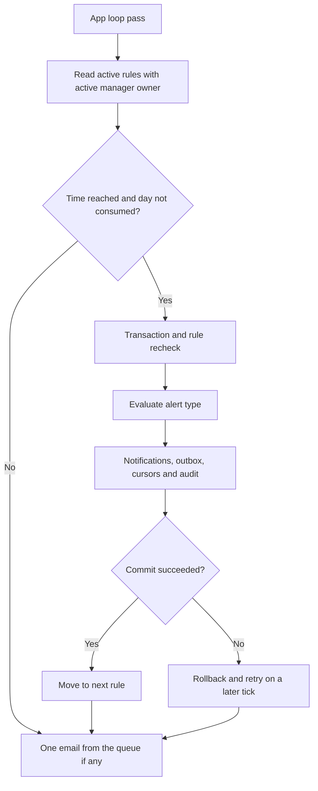

# Alert engine: scheduling, cursors and notifications

[Italiano](../../tehnical/motore-alert.md) | **English**

Reference: implementation of **10 October 2026**, schema 7. Sources: [alerts.c](../../../src/alerts.c), [alerts.h](../../../src/alerts.h), [server loop](../../../src/server.c), [time recording](../../../src/workspace.c), [alert tests](../../../tests/test_alerts.py) and [time harness](../../../tests/alerts_native_check.c). For usage, consult the [manager guide](../prod/guida-gestore.md); for payloads, consult the [app API](api-app.md).

## Responsibilities and placement

The scheduler lives in the C app's main process. There is no scheduler container, external cron, broker queue or customizable trigger language. The permitted check types are compiled into the program: `invalid_job` and `missing_hours`.

The server loop invokes `alerts_tick_at(now)` on its first pass, when at least 30 seconds have elapsed since the previous check or when it detects the clock moving backward. `select()` also has a 30-second timeout. This is an approximate cadence: long requests, queries and sends may delay the next pass.

`alerts_open()` forces `TZ=Europe/Rome` and calls `tzset()`. This setting applies to the process, not a separate calendar for each rule. Persisted timestamps are UTC, while the execution day and rule time are interpreted in Italian local time.

## Persistent and in-memory state

| State | Location | Function |
| --- | --- | --- |
| Type, time, owner, enabled state | `alert_rules` | Define the check |
| `last_run_on`, `last_run_at` | `alert_rules` | Consumed local day and timestamp of the last actual execution |
| `last_event_id` | `alert_rules` | Cursor on nonexistent-project events |
| `starts_on`, `last_checked_on` | `alert_subjects` | Time range already checked for each person |
| Recipient users/emails | `alert_rule_users`, `alert_rule_emails` | Result destinations |
| Attempts on absent projects | `alert_events` | Events rejected by the time log |
| Notifications and outbox | `alert_notifications`, `alert_email_outbox` | Deduplicated results and content to deliver |
| Last tick, delivery cursor | App memory | Local cadence and email rotation; reconstructable after restart |

Restart retains cursors and processed days. It does not retain the process timer, which restarts with an immediate check. Tables are described with types and constraints in the [data model](modello-dati.md).

## Daily cycle



The scheduler first reads candidate rule IDs and closes the read cursor. Each `run_rule()` then opens its own transaction and rechecks owner, status, time and day: a previously read list is not permanent authorization.

The functional limit is 100 rules per owner, up to 200 users in the product. The internal candidate array is limited to 20,000 items. A single rule may produce many notifications; the one-email-per-tick limit concerns only SMTP delivery, not the number of anomalies evaluated.

### Creation, editing and manual execution

| Operation | Effect on the execution schedule |
| --- | --- |
| New rule before today's scheduled time | May be processed by today's automatic run if active |
| New rule at or after today's scheduled time | Marks today as consumed; the first automatic run is later |
| Time changed to an already elapsed time | Consumes today's slot, avoiding unexpected immediate catch-up |
| Alert type changed | Restarts with subjects/cursor consistent with the new type; clears execution indicators before applying the slot check |
| Only name or recipients changed | Retains progress; does not automatically reprocess all past anomalies |
| `Run now` | Allowed for the owner even with the rule disabled; updates last run and consumed day |

A manual execution before the scheduled time therefore consumes that day's automatic run. It may be repeated manually, but cursors and keys prevent duplication of already processed anomalies.

`last_run_on` alone does not prove a check occurred: it may be set by creating or editing an already elapsed slot. Also use `last_run_at` and audit events. `next_run_at` is a calculated prediction; if a run is already overdue, the tick may process it before the future date displayed by the prediction function.

Local time calculation relies on `mktime()` and system time-zone information. Around clock changes there is no separate user policy for choosing the first or second occurrence of a repeated hour. The persistent date prevents a second automatic run on the same day after successful execution.

## `invalid_job` alert

Time recording first validates positive ID, date, minutes and note. If the project does not exist, it rolls back the time transaction and calls `alerts_record_invalid_job()` with a separate transaction. No equivalent event is generated for an existing but unauthorized project.

This tracking is best effort: if event storage is unavailable, time recording remains rejected, but the alert event may be missing. It is therefore neither an infallible record of every HTTP attempt nor a general intrusion detection system.

On creation, the rule sets its cursor to the highest existing event ID. Every execution reads subsequent events in order, up to 1000. It also advances the cursor for events from users who are no longer active, which generate no deliveries. A larger backlog requires further runs; it is not necessarily drained in one day.

The deduplication key is:

```text
invalid:<user_id>:<job_id>:<work_date>
```

Repeated attempts by the same person on the same absent project and workday produce one notification per recipient and rule. The message describes the attempt that created that notification, not the total minutes attempted afterward. Different rules retain separate notifications.

Ordinary project deletion removes linked hours; it does not itself produce an `invalid_job` anomaly. The alert acts on a later recording attempt with that ID. This distinction prevents interpreting the notification as confirmation that orphaned hours were saved.

## `missing_hours` alert

When the rule is created, active users are registered as subjects with `starts_on` equal to the current day. When executed, the rule adds any new active users not yet registered, using that day as the start of their monitoring.

For each active subject:

1. Starts at `starts_on`, or the day after `last_checked_on`.
2. Calculates midnight after the workday in Europe/Rome.
3. Stops if 172,800 seconds have not elapsed since that end of day.
4. For Monday–Friday, sums all the person's entries on that date.
5. If the total is below 480 minutes, prepares the anomaly.
6. Advances the cursor for complete days and already matured weekends too.

Each execution limits scanning to 3660 days per subject. Deactivated users are excluded from scanning but retain their cursors. Reactivating an already registered account may resume checking from the old cursor: there is no history of deactivation periods to subtract automatically.

The key is:

```text
missing:<user_id>:<work_date>
```

Example without a clock change: Monday 12 October 2026 ends on Tuesday 13 at 00:00; the threshold becomes checkable on Thursday 15 at 00:00. A 09:00 run checks it on Thursday morning. The 48 hours are a real duration: they are not calculated by simply adding two date labels.

Days completed with hours entered before the scan do not produce alerts. After cursor advancement, a retroactive addition or deletion does not reopen that day. Notification content is a snapshot of the check, not a continuously updated total.

Holidays, absences, part-time arrangements, assignments and project status do not change the threshold. Active users, including managers, are checked, not only those selected as rule recipients.

## Recipients, transaction and deduplication

A rule allows up to 50 user recipients and 50 email addresses, without duplicates. `load_delivery()` rereads users' active state and roles. A Manager may receive anomalies for all subjects; an Operator only those concerning themselves. An email address configured by the manager is not treated as a user session: it receives the events specified by the rule.

Notifications, outbox, cursors, last run and audit event are saved in the same transaction. If audit or commit fails, an advanced cursor must not remain without the corresponding result. Unique constraints are `(rule_id,recipient_id,event_key)` for notifications and `(rule_id,email,event_key)` for emails.

Execution audit events are `alert_rules.trigger` for the automatic run, with a system actor, and `alert_rules.run` for manual start. They report counts and timestamps, not a new audit event for every generated notification.

Reading notifications rechecks recipient and current role. A manager demoted to operator does not retain access to alerts on other subjects. The API shows the latest 100 accessible notifications; the unread counter is calculated separately over the entire authorized set. Marking as read preserves the first `read_at` and does not resolve the anomaly.

## Outbox and disabling

Evaluation creates emails with `pending_configuration` state, even when SMTP is absent. The dispatcher checks configuration, that the owner remains an active manager and that the address remains among the recipients. It uses a stable key derived from namespace and outbox ID and sends outside the SQL transaction.

**Disabling a rule stops automatic runs but does not delete already queued emails.** The dispatcher query does not require `enabled=1`. Removing an address from the rule prevents selection of its pending rows while absent; it does not delete those rows. Reintroducing it later may make them eligible again. Delivery already started is not cancelled by subsequent changes.

`smtp_configured` exposed by the app represents the last state known to the client: `false` may also result from an unreachable addon or invalid response. Use [diagnostics](diagnostica-e-osservabilita.md) to distinguish them. Terminal states, ledger and timeouts are covered further in [integration flows](flussi-integrazioni.md) and [addon API](api-addon.md).

## Checks and extensions

Existing tests in `test_alerts.py` cover rule ownership, roles, recipients, deduplication, rollback on audit error, threshold, clock changes, restart and elapsed slots. The C harness allows an explicit clock to be passed: changing host time is not necessary to verify the grace period. These are statements about test code coverage, not a new execution during documentation.

Introducing a new alert type will require defining the source event or query, subject scope, deduplication key, cursor, recovery rules and message confidentiality. The procedure must preserve atomicity of results and cursors. A configurable catalog of new conditions, group recipients, digests, leave or escalation remains future work and must not be achieved by directly modifying operational tables.
