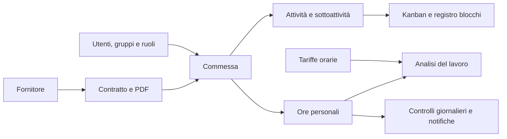

# Panoramica di prodotto

Stato documentato: **11 ottobre 2026**, codice applicativo con schema dati **9**. Questa pagina descrive le funzioni presenti; la [roadmap](roadmap.md) distingue le estensioni ancora da realizzare.

## Scopo

**punto** organizza commesse, persone e tempo lavorato in un unico spazio. Il gestore definisce quali commesse possono essere utilizzate, collega i contratti e controlla i risultati aggregati. L’operatore sceglie una commessa autorizzata e registra il lavoro della giornata, senza dover creare codici o anagrafiche.

Il percorso principale è:

Il collegamento della commessa a un contratto è facoltativo. Le attività interne possono essere registrate su commesse comuni, senza un contratto. Il valore del contratto e il costo stimato delle ore sono informazioni gestionali distinte.

## Persone e responsabilità

| Profilo | Obiettivo | Funzioni principali |
| --- | --- | --- |
| Operatore | Svolgere e rendicontare il lavoro autorizzato | Commesse, bacheca, stato delle attività assegnate, propri blocchi, proprie ore, analisi e notifiche |
| Gestore | Organizzare il lavoro e controllarne l’andamento | Censimento commesse, fornitori e contratti; utenti e accessi; attività, sottoattività e blocchi; analisi complessive; tariffe; alert; storico |
| Referente tecnico dell’installazione | Mantenere disponibile e configurare il servizio | Container, database, backup, rete e configurazione degli addon, descritti nella documentazione tecnica |

**Gestore** e **Operatore** sono i due profili dell’account. **Lettore**, **Collaboratore** e gli eventuali ruoli personalizzati sono invece ruoli su una singola commessa. Un Collaboratore può registrare le proprie ore, aggiornare lo stato delle attività assegnate e gestire i blocchi di cui è autore o responsabile; non diventa per questo amministratore degli utenti o dei contratti.

L’applicazione attuale ha un unico spazio operativo. Le società separate e i permessi finanziari per società appartengono al [piano finanziario](piano-modulo-finanziario.md).

## Moduli disponibili

| Sezione o servizio | Stato | Cosa offre oggi |
| --- | --- | --- |
| Accesso | Implementato | Login con email e password, sessione personale, opzione «Ricordami per 30 giorni», logout e revoca degli account disattivati |
| Commesse | Implementato | Codice, nome, cliente, descrizione, cinque stati, contratto facoltativo, ricerca, abilitazioni e cancellazione definitiva |
| Commesse comuni | Implementato | Una casella rende la commessa utilizzabile da tutti gli utenti attivi, compresi quelli creati successivamente |
| Attività e blocchi | Implementato | Attività e sottoattività, responsabile, priorità, scadenza, Kanban a cinque stati ed elenco gerarchico; blocchi con impatto, prossima azione e stato |
| Registro ore | Implementato | Registrazioni personali giornaliere, minuti interi, nota facoltativa, totale e limite giornaliero |
| Analisi | Implementato | Viste Per periodo, Per commessa e Per utente, con date e filtri; ambito personale per gli operatori e aggregato per i gestori |
| Valore contratti | Implementato | Valore EUR dei contratti distinti collegati alle ore filtrate, valori mancanti e ore prive di contratto |
| Costo delle ore | Implementato | Stima EUR basata su tariffe per utente e periodo di validità, con evidenza delle ore non valorizzate |
| Fornitori | Implementato | Anagrafica, contatti e stato attivo/disattivato, riservati ai gestori |
| Contratti e PDF | Implementato | Contratti con fornitore obbligatorio, valore e date facoltativi, caricamento e download degli originali |
| Utenti | Implementato | Creazione account, modifica del nome, profilo e stato di accesso |
| Gruppi e ruoli | Implementato | Albero dei gruppi, appartenenze multiple, ereditarietà e ruoli operativi personalizzati |
| Alert e trigger | Implementato | Regole del singolo gestore, orario quotidiano, destinatari e due controlli predefiniti |
| Notifiche | Implementato | Avvisi personali, contatore e marcatura come letti |
| Storico | Implementato | Eventi delle modifiche con autore, data e dettagli precedenti/successivi, riservati ai gestori |
| Invio email | Parziale nell’uso operativo | Addon e coda implementati; SMTP ancora da configurare, quindi nessuna spedizione reale |
| Google Calendar | Parziale nell’uso operativo | Addon C e API di sincronizzazione bidirezionale implementati; OAuth da configurare; schermata calendario e collegamento alle ore ancora da sviluppare |
| Modulo finanziario completo | Pianificato | Più società e valute, budget, fatture, incassi, pagamenti, partite e reporting finanziario |

«Implementato» descrive una funzione presente nel codice e nell’interfaccia, dove prevista. «Parziale» indica che una parte tecnica è disponibile ma il percorso operativo richiede ancora configurazione o interfaccia. «Pianificato» indica un progetto, non una funzione già utilizzabile.

## Esperienza dell’operatore

L’operatore trova cinque sezioni: **Commesse**, **Attività e blocchi**, **Registro ore**, **Analisi** e **Notifiche**. Il selettore delle ore contiene le commesse su cui è consentita la registrazione; quelle in sola lettura rimangono consultabili nell’elenco ma non possono ricevere nuove ore da quell’utente.

Una revoca impedisce nuove registrazioni sulla commessa, ma conserva la consultazione delle proprie ore già salvate. Le ore appartengono sempre a chi ha effettuato l’accesso: non è possibile attribuirle a un collega dal modulo di registrazione. L’operatore può aggiungere ore, ma non correggere o eliminare quelle già salvate.

La bacheca è visibile a chi può consultare la commessa. Con accesso di Collaboratore l’operatore aggiorna lo stato delle attività assegnate a lui e può segnalare impedimenti. Assegnazione e autorizzazione restano distinte: il nome del responsabile non sostituisce l’abilitazione.

Per iniziare: [guida utente](guida-utente.md) e [Attività, Kanban e blocchi](attivita-kanban-e-blocchi.md).

## Esperienza del gestore

Il gestore dispone delle stesse funzioni personali e delle sezioni **Alert e trigger**, **Fornitori**, **Contratti**, **Utenti**, **Gruppi e ruoli** e **Storico**. Amministra tutte le commesse dello spazio e può consultare gli aggregati delle ore di tutti gli utenti in Analisi.

Il Registro ore resta personale anche per il gestore: le normali azioni di modifica e cancellazione delle registrazioni riguardano le proprie ore. Lo Storico e gli alert possono fornire il contesto operativo relativo ad altri utenti; questo non abilita un registro modificabile di tutte le loro ore. La cancellazione di una commessa è un’operazione distinta e rimuove anche attività, sottoattività, blocchi e tutte le ore collegate di tutti gli utenti.

Per impostare lo spazio: [guida del gestore](guida-gestore.md).

## Commesse per il lavoro comune

Il catalogo di riferimento per le attività trasversali comprende:

| Commessa | Utilizzo suggerito |
| --- | --- |
| Generale | Lavoro generale non attribuito a una commessa specifica |
| Formazione | Corsi, studio e aggiornamento professionale |
| Riunioni | Riunioni interne non imputate a un progetto specifico |
| Attività interne | Organizzazione e altre attività interne |

Il meccanismo è la casella **Commessa comune**. I nomi non sono riservati dal software e una nuova installazione non li genera automaticamente: il gestore verifica o crea le quattro anagrafiche, sceglie codici univoci e le rende comuni. Le regole aziendali devono chiarire quando usare questi contenitori e quando imputare il lavoro direttamente a una commessa di progetto.

## Confini attuali del prodotto

Le cinque etichette di stato della commessa descrivono l’avanzamento ma non costituiscono un workflow con approvazioni o blocchi automatici. Una commessa Completata o Annullata può ancora ricevere ore da un utente autorizzato. Le date di un contratto non ne cambiano automaticamente lo stato.

Attività e sottoattività hanno stati indipendenti. Non sono ancora disponibili dipendenze, Gantt, pianificazione del carico, checklist separate o associazione delle ore a una singola attività. I blocchi descrivono impedimenti presenti; il registro dei rischi futuri rimane da sviluppare. Scadenze, attività e blocchi non alimentano nuove notifiche automatiche.

Il controllo delle ore mancanti applica oggi 8 ore per ogni giorno dal lunedì al venerdì, trascorse 48 ore dalla fine della giornata. Non conosce festività, ferie, part time o turni. Una notifica documenta l’anomalia rilevata; il pulsante di lettura non modifica le ore.

I report economici attuali usano solo EUR e vengono ricalcolati dai dati correnti. Non producono fatture, documenti fiscali, incassi o valori contabili congelati. Il campo Cliente della commessa è un testo descrittivo, non un’anagrafica completa di fatturazione.

L’addon Calendar cifra token e contenuti nel proprio archivio, mentre l’applicazione non dispone ancora di un vault che cifri tutti i campi o i PDF contrattuali. L’elaborazione autorizzata usa dati in chiaro in memoria. I requisiti di cifratura più estesi non devono essere considerati già soddisfatti.

## Documenti di riferimento

- [Processi e regole](processi-e-regole.md): permessi, limiti, date, cancellazioni e significato dei report.
- [Attività, Kanban e blocchi](attivita-kanban-e-blocchi.md): organizzazione, permessi e gestione degli impedimenti.
- [Roadmap](roadmap.md): stato dei miglioramenti operativi, del modulo attività e del percorso finanziario.
- [Glossario](glossario.md): termini del prodotto.
- [Architettura tecnica](../tehnical/architettura.md): componenti e responsabilità.
- [Verifica UI del 10 ottobre 2026](../tehnical/verifica-ui-2026-10-10.md): evidenza storica riferita alla versione esaminata; non certifica tutte le aggiunte successive.
