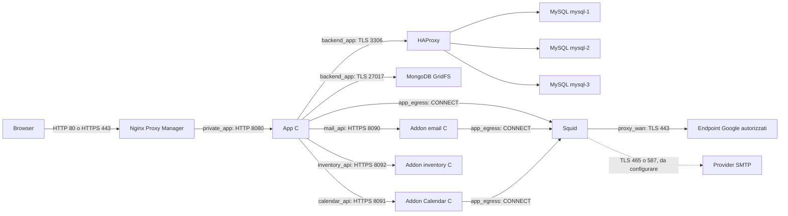

# Architettura tecnica

**Italiano** | [English](../en/tehnical/architettura.md)

Questa guida descrive il codice e la configurazione presenti l’**11 ottobre 2026**. Le funzionalità pianificate nei documenti di roadmap non diventano implementate per il solo fatto di essere descritte. Per l'ingresso alla documentazione consultare il [README del progetto](../../README.md).

## Componenti e responsabilità

Punto è una web app in italiano con server HTTP scritto in C11 e frontend HTML, CSS e JavaScript senza una fase di compilazione npm. L'applicazione centrale gestisce autenticazione, autorizzazioni, commesse, attività/sottoattività, Kanban, blocchi, ore, organizzazione, fornitori, contratti, report, tariffe, alert e audit. Tre processi C indipendenti gestiscono SMTP, Google Calendar e inventario beni attraverso API private. Punto Ticket è un’app autonoma facoltativa, con account e archivio propri.

Esistono due modalità di esecuzione separate:

| Modalità | Dati strutturati | Documenti PDF | Integrazioni |
| --- | --- | --- | --- |
| Nativa | SQLite, normalmente `data/punto.db` | Directory locale `documents` accanto al database; configurabile con `DOC_FILES_DIR` | Client addon facoltativi; assenti se le relative variabili non sono impostate |
| Docker Compose | MySQL 8.4, tre membri Group Replication multi-primary | MongoDB 8.0 GridFS | Addon email, Calendar e inventory, con API HTTPS e archivi SQLite indipendenti |

Le modalità non condividono dati e non eseguono una conversione o un'importazione automatica. Il Dockerfile dell'app compila esplicitamente il backend MySQL. Il `DB_PATH` della modalità nativa non identifica il database Docker.

Il collegamento browser–NPM usa HTTPS soltanto dopo la configurazione del certificato pubblico. Il collegamento NPM–app è HTTP sulla rete privata. HAProxy inoltra il protocollo MySQL senza terminare TLS: la verifica del certificato avviene fra client e server SQL.

## Gli undici servizi Compose

La fonte operativa è [compose.yaml](../../compose.yaml). L’overlay [Ticket](../../compose.tickets.yaml) porta il totale a dodici. La [nomenclatura Docker](nomi-servizi-e-immagini.md) distingue servizio Compose, immagine e alias DNS e descrive la migrazione dei nomi. I nomi dei volumi nella tabella sono quelli logici Compose; il nome effettivo sul daemon può avere il prefisso del progetto.

| Servizio | Implementazione | Responsabilità | Persistenza |
| --- | --- | --- | --- |
| `app` | C11, immagine Debian Bookworm, UID/GID `10001` | HTTP, sessioni, regole di dominio, pianificatore alert, client addon | SQL e GridFS esterni al container; nessun volume applicativo locale |
| `mysql-1` | `mysql:8.4`, server ID `1` | Membro scrivibile del gruppo | `mysql_data` → `/var/lib/mysql` |
| `mysql-2` | `mysql:8.4`, server ID `2` | Membro scrivibile del gruppo | `mysql_data_2` → `/var/lib/mysql` |
| `mysql-3` | `mysql:8.4`, server ID `3` | Membro scrivibile del gruppo | `mysql_data_3` → `/var/lib/mysql` |
| `proxy-db` | HAProxy `3.2-alpine` e monitor Python | Distribuzione delle nuove connessioni fra membri SQL utilizzabili | Nessun volume dati |
| `mongodb` | `mongo:8.0` | PDF originali in GridFS | `documents_data` → `/data/db`; `documents_config` → `/data/configdb` |
| `proxy-web` | Derivata da `jc21/nginx-proxy-manager:2.16.0` | Ingresso HTTP/HTTPS, host pubblici, certificati, pannello locale | Bind mount `nginx-proxy-manager/data` e `nginx-proxy-manager/letsencrypt` |
| `proxy-egress` | Squid su Debian Trixie, UID/GID `10002` | Proxy esplicito in uscita, allowlist per sorgente | Configurazione montata in sola lettura; cache disabilitata |
| `mail` | C, OpenSSL, libcurl, SQLite, UID/GID `10003` | Invio SMTP TLS e registro di idempotenza | `mail_addon_data` → `/var/lib/punto-mailer` |
| `calendar` | C, OpenSSL, libcurl, SQLite, json-c, pthread, UID/GID `10004` | OAuth, cache eventi e coda delle modifiche Google | `calendar_addon_data` → `/var/lib/punto-calendar` |
| `inventory` | C, OpenSSL, SQLite, UID/GID `10005` | Catalogo beni e storico attraverso HTTPS privato | `inventory_addon_data` → `/var/lib/punto-inventory` |

Compose attende Squid prima degli addon; attende Squid, addon, HAProxy e MongoDB prima dell'app; attende l'app prima di NPM. Queste dipendenze regolano l'avvio. Non costituiscono un orchestratore di failover né assicurano che un servizio dipendente già avviato venga arrestato quando un altro diventa indisponibile.

## Struttura del codice

| Area | File principali | Compito |
| --- | --- | --- |
| Trasporto e sessione | [server.c](../../src/server.c) | Listener HTTP, parsing richieste, controlli Host/Origin, cookie, routing, file statici e ciclo del pianificatore |
| Account | [accounts.c](../../src/accounts.c) | Utenti, password derivate, profili globali e stato attivo |
| Commesse e ore | [workspace.c](../../src/workspace.c) | Commesse, registrazioni e analisi |
| Attività e blocchi | [work_board.c](../../src/work_board.c) | Gerarchie, bacheca Kanban, impedimenti, revisioni e autorizzazioni per commessa |
| Persistenza e audit | [storage.c](../../src/storage.c) | Migrazioni e storico applicativo |
| Organizzazione | [organization.c](../../src/organization.c) | Albero gruppi, membri, ruoli sulle commesse e abilitazioni |
| Contratti e fornitori | [procurement.c](../../src/procurement.c) | Dati relazionali di approvvigionamento |
| PDF | [documents.c](../../src/documents.c) | GridFS oppure filesystem locale, upload e verifica integrità |
| Alert | [alerts.c](../../src/alerts.c) | Regole, esecuzioni, notifiche e outbox email |
| Driver MySQL | [db_mysql.c](../../src/db_mysql.c), [mysql_schema.c](../../src/mysql_schema.c) | Adattamento delle query, TLS, schema MySQL e concorrenza |
| Bridge addon | [mail_client.c](../../src/mail_client.c), [calendar_client.c](../../src/calendar_client.c), [inventory_client.c](../../src/inventory_client.c) | HTTPS privato, autenticazione del servizio e validazione del contratto |
| Addon | [mailer.c](../../addon/src/mailer.c), [calendar.c](../../calendar-addon/src/calendar.c), [inventory.c](../../inventory-addon/src/inventory.c) | Processi separati con persistenza propria |
| Interfaccia | [public](../../public) | Pagine e risorse distribuite dal server C |

Il server principale usa un ciclo `select`/`accept` e gestisce le richieste nel processo applicativo. Non è presente un pool generale di worker HTTP. Il pianificatore alert viene richiamato dal ciclo circa ogni 30 secondi. Le sessioni sono conservate in memoria, con limite di 64 sessioni: un riavvio dell'app richiede nuovamente il login. Aggiungere repliche dell'app richiederebbe anche un progetto per sessioni e coordinamento delle attività, non soltanto aumentare il numero dei container.

Sette moduli dell’app possiedono una connessione SQL ciascuno: workspace, account, storage, organizzazione, attività/blocchi, alert e procurement. Non esiste un pool. Le mutazioni di attività e blocchi verificano una `revision` per respingere modifiche basate su una versione superata; dettagli in [implementazione del modulo](attivita-kanban-e-blocchi.md).

Il worker Calendar è invece un thread distinto, con propria connessione SQLite. Esegue le chiamate Google fuori dalle transazioni di scrittura; `/sync` accoda una richiesta e risponde `202`, mentre stato e health check rimangono disponibili.

## Persistenza, consistenza e transazioni

Lo schema applicativo corrente è **versione 10**, con 24 tabelle MySQL o 22 tabelle funzionali SQLite, oltre alla tabella interna `sqlite_sequence`. Lo schema 9 estende le regole alert con `inventory_due` e `days_before`; lo schema 10 aggiunge `inventory_return`, `inventory_verification` e `verification_days` (1–365, predefinito 90). Entrambi conservano ID, relazioni e storico, senza aggiungere altre tabelle applicative. Le tabelle `job_tasks` e `job_blockers`, introdotte nello schema 8, appartengono alla stessa persistenza delle commesse; non introducono un servizio o un database separato. Le migrazioni sono applicate all'avvio e un database con versione non supportata viene rifiutato. Calendar non aggiunge tabelle allo schema MySQL: conserva i propri dati nel volume dedicato.

MySQL contiene i dati gestionali, i metadati PDF e l'outbox degli alert. GridFS contiene i byte PDF. Un upload attraversa entrambi gli archivi, senza transazione distribuita: un errore può lasciare un blob non referenziato, e non è presente una riconciliazione automatica. Il backup coordinato deve preservare sia SQL sia documenti.

Il registro SQLite email conserva chiave di idempotenza, impronta del contenuto, stato e orari. Destinatario, oggetto e testo rimangono nell'outbox MySQL. La chiave dell'invio dipende da `MAIL_API_NAMESPACE` e ID outbox; il ripristino deve mantenere insieme database SQL, registro email e namespace.

Calendar conserva account, state OAuth, cache degli eventi, operazioni pendenti e metadati. Token OAuth e payload sensibili sono cifrati con AES-256-GCM; una chiave esterna al volume è necessaria per decifrarli. Gli ID, gli stati e altri metadati operativi rimangono leggibili. Le scritture remote usano idempotenza, ETag e gestione degli esiti incerti; un backup non può annullare operazioni già completate presso Google o un provider SMTP.

## Disponibilità del cluster SQL

[cluster.cnf](../../docker/mysql/cluster.cnf) configura Group Replication con tre membri multi-primary, GTID, binlog ROW, controllo `BEFORE_AND_AFTER`, verifica TLS e incremento degli ID automatici pari a tre. Tutti i membri possono ricevere scritture; non viene designato un solo writer permanente.

[HAProxy](../../docker/db-proxy/haproxy.cfg) usa round-robin per le nuove connessioni. Ogni connessione e la relativa transazione rimangono sul nodo scelto. Il [monitor](../../docker/db-proxy/health.py) ammette soltanto un nodo che risulti `ONLINE`, `PRIMARY`, non in sola lettura e con almeno due membri online. Un semplice `SELECT 1` sul singolo nodo non verifica questi requisiti.

Il quorum è **2 su 3**. La perdita di un membro consente al gruppo superstite di continuare, dopo il rilevamento del guasto; la perdita di due membri blocca le scritture. Connessioni interrotte possono richiedere un nuovo tentativo dell'app e non va promesso un failover privo di errori transitori.

Tutti i container sono attualmente sullo stesso host. Questa topologia protegge dal guasto di un processo SQL, ma il guasto dell'host, del disco, del daemon Docker o della VM Docker Desktop coinvolge l'intero stack. App, HAProxy, MongoDB, NPM, Squid e ciascun addon sono singole istanze. Il cluster SQL non rende l'intera applicazione disponibile su più host e non sostituisce backup esterni verificati.

## Limiti e attività successive

SMTP e OAuth Google sono predisposti, ma la configurazione dei fornitori è rinviata. Lo stato sano dell'addon significa che l'API locale funziona; non attesta accesso a un fornitore reale. Le API Calendar sono disponibili, mentre interfaccia grafica calendario e collegamento evento–commessa–ore non sono ancora realizzati.

Non è implementata una cifratura generale delle celle SQL o dei PDF, un vault di chiavi per campo o un'elaborazione omomorfica. I processi autorizzati leggono i dati in memoria. La protezione effettiva e i suoi confini sono descritti in [rete e sicurezza](rete-sicurezza.md).

Per avviare o aggiornare lo stack usare [installazione e configurazione](installazione-configurazione.md). Per backup, guasti e ripristino leggere [operazioni](operazioni-backup-ripristino.md). Per compilazione e collaudi consultare [sviluppo e test](sviluppo-test.md).
