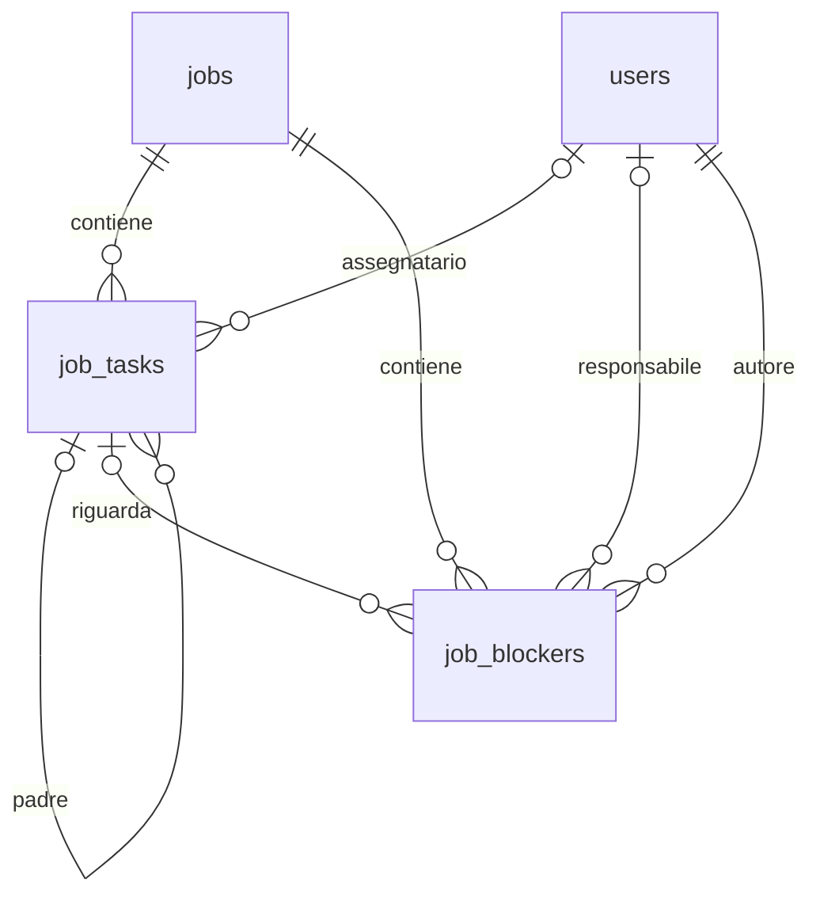

# Implementazione di attività, Kanban e blocchi

**Italiano** | [English](../en/tehnical/attivita-kanban-e-blocchi.md)

Riferimento del codice: **11 ottobre 2026**. Il modulo introduce lo **schema applicativo 8** e le tabelle `job_tasks` e `job_blockers`. Le fonti sono [work_board.c](../../src/work_board.c), [storage.c](../../src/storage.c), [mysql_schema.c](../../src/mysql_schema.c), [server.c](../../src/server.c), [frontend](../../public/app.js) e [test](../../tests/test_work_board.py). La [guida di prodotto](../prod/attivita-kanban-e-blocchi.md) descrive il flusso operativo.

## Relazioni e migrazione

Le FK composte `(job_id,parent_id)` e `(job_id,task_id)` referenziano la chiave univoca `(job_id,id)` di `job_tasks`. Il database impedisce quindi collegamenti fra commesse differenti. Il C impone assenza di cicli e profondità massima 8 anche quando viene spostato un intero sottoalbero.

La migrazione SQLite 7→8 crea le due tabelle e gli indici nella transazione di migrazione, aggiunge un evento `system.migration` con ID 8 e aggiorna `PRAGMA user_version`. I dati precedenti non vengono trasformati né popolati con attività dimostrative. MySQL prepara i DDL nel preflight e registra la versione 8 nella transazione applicativa secondo il modello già esistente. Il DDL MySQL ha commit impliciti: non equivale a una migrazione DDL interamente annullabile.

Il database MySQL comprende ora 24 tabelle; SQLite ne comprende 22 funzionali, oltre alla propria `sqlite_sequence`. Gli archivi dei due addon non cambiano versione. Eseguire backup prima dell'aggiornamento e non abbassare manualmente la versione per avviare un binario precedente.

## Campi e limiti

| Risorsa | Campi |
| --- | --- |
| Attività | `id`, `job_id`, `parent_id`, `assigned_user_id`, `title`, `description`, `status`, `priority`, `due_date`, `revision`, `created_at`, `updated_at` |
| Blocco | `id`, `job_id`, `task_id`, `title`, `description`, `impact`, `owner_id`, `status`, `next_action`, `due_date`, `created_by`, `revision`, `created_at`, `updated_at` |

ID e revisioni usano interi a 64 bit. Titolo: 1–160 caratteri; descrizione: massimo 2000; prossima azione: massimo 1000. Le date facoltative sono ISO `YYYY-MM-DD` validate nel calendario; gli istanti sono UTC `YYYY-MM-DDTHH:MM:SSZ`. Per i riferimenti e le date nullable un campo form vuoto indica `NULL`. Nel JSON i riferimenti e le date mancanti sono `null`, non zero né stringa vuota.

Gli stati attività sono `todo`, `in_progress`, `blocked`, `in_review`, `done`; le priorità `low`, `normal`, `high`, `urgent`. Gli stati blocco sono `open`, `in_progress`, `resolved`; gli impatti `low`, `medium`, `high`, `critical`. I default sono `todo`/`normal` per le attività e `open`/`medium` per i blocchi. Non esistono transizioni automatiche fra stato del blocco, attività superiore e commessa.

Ogni commessa può contenere al massimo 500 attività e 500 blocchi. Il limite viene verificato nella transazione di creazione; la lettura restituisce il contenuto completo entro tali limiti.

## API

Le API riusano sessione, verifica dell'origine e form `application/x-www-form-urlencoded` dell'app. La query è ammessa soltanto nella lettura della bacheca. I `POST` sulle collezioni e sui percorsi elemento/cancellazione accettano fino a 64 KiB di form, anche per i testi Unicode al limite dopo percent-encoding; gli altri corpi HTTP ordinari mantengono 32 KiB.

| Metodo e percorso | Ingresso | Esito |
| --- | --- | --- |
| `GET /api/work-board?job_id=N` | `job_id` obbligatorio, commessa visibile | `tasks`, `blockers`, `assignees`, permessi della commessa |
| `POST /api/tasks` | `job_id`, `title`; altri campi business facoltativi | Crea attività, `201` con `id` e `revision=1` |
| `POST /api/tasks/{id}` | `revision` e campi modificati | Aggiorna e incrementa revisione |
| `POST /api/tasks/{id}/delete` | Solo `revision` | Elimina attività senza figli, conserva e scollega i blocchi |
| `POST /api/blockers` | `job_id`, `title`; altri campi business facoltativi | Crea blocco, `201` con `id` e `revision=1` |
| `POST /api/blockers/{id}` | `revision` e campi modificati | Aggiorna e incrementa revisione |
| `POST /api/blockers/{id}/delete` | Solo `revision` | Elimina blocco |

`job_id` è immutabile. Gli update sono parziali: i campi omessi restano invariati. Il server rifiuta campi sconosciuti, duplicati, identificativi non validi e parametri non autorizzati. `created_by` e timestamp sono derivati dal server e non sono impostabili dal form.

Le letture aggiungono i nomi degli assegnatari e i flag `can_edit` / `can_update_status` per le attività e `can_edit` per i blocchi. `permissions.manage_tasks` è riservato ai gestori; `permissions.report_blockers` richiede Gestore o Collaboratore attuale. La lista `assignees` contiene coppie `id`/`name` di persone attive ed eleggibili ed è restituita ai gestori; per gli operatori è sempre `[]`. La presenza di un nome nel record storico non significa che quella persona abbia ancora accesso. L’assegnatario precedente invariato può essere conservato anche dopo la revoca, mentre una nuova assegnazione richiede eleggibilità attuale.

## Autorizzazione e concorrenza

Il modulo usa una propria connessione SQL e riutilizza `organization_job_access` per accessi diretti, gruppi gerarchici e commesse comuni. I permessi vengono riletti a ogni richiesta; le assegnazioni delle attività non creano grant. L'utente deve essere abilitato oggi, indipendentemente dalla data di scadenza dell'attività.

Il gestore organizza le attività e può assegnarle a un gestore attivo o a un collaboratore attualmente abilitato. Il collaboratore assegnato può modificare soltanto lo stato della propria attività. Un collaboratore può creare blocchi e modificare quelli di cui è autore o responsabile; assegnazione ad altri ed eliminazione sono riservate al gestore. Un lettore consulta soltanto. Risorse inesistenti e non visibili producono lo stesso `404` con messaggio generico, senza rivelare l’esistenza dell’elemento.

Le modifiche verificano `revision` dentro la transazione e aggiornano insieme dati e audit. Una revisione obsoleta produce `409`. La protezione usa `BEGIN IMMEDIATE` su SQLite e la guardia di certificazione del driver MySQL. Gli errori di audit annullano la mutazione. La data corrente e i timestamp delle scritture sono calcolati dopo l’acquisizione della guardia, anche se l’attesa attraversa mezzanotte. Una richiesta fallita non viene ripetuta automaticamente dal frontend.

Le azioni audit sono `tasks.create`, `tasks.update`, `tasks.delete`, `blockers.create`, `blockers.update`, `blockers.delete` e `blockers.task_detached`, con snapshot prima/dopo sulla connessione della mutazione.

La cancellazione di un’attività con figli produce conflitto. Se non ha figli, i blocchi vengono scollegati, aggiornando la revisione per invalidare editor aperti, e l'attività viene eliminata nella stessa transazione. La cancellazione della commessa elimina prima blocchi e relazioni fra attività, poi attività, ore e grant. L'audit di commessa registra anche `deleted_tasks` e `deleted_blockers`.

Le nuove risorse non introducono cifratura di campo: titoli, descrizioni e snapshot audit seguono l'attuale protezione dello storage applicativo. Non costituiscono una soluzione di elaborazione omomorfica o un vault delle chiavi.

## Verifica e confini

La suite dedicata usa database temporanei e verifica permessi, revoche, gerarchie, conflitti, validazione, audit, cancellazioni e migrazione. La prova UI deve includere Gestore, Collaboratore e Lettore, modifica concorrente, tastiera e layout mobile. Il numero di prove eseguite e il risultato della distribuzione vanno riportati nel verbale del rilascio, non dedotti dalla presenza dei test.

Le registrazioni ore restano collegate alla commessa: questa versione non aggiunge `task_id` alle ore, non calcola avanzamento da minuti lavorati e non implementa ancora dipendenze, capacità del team, notifiche di assegnazione o probabilità dei rischi.
