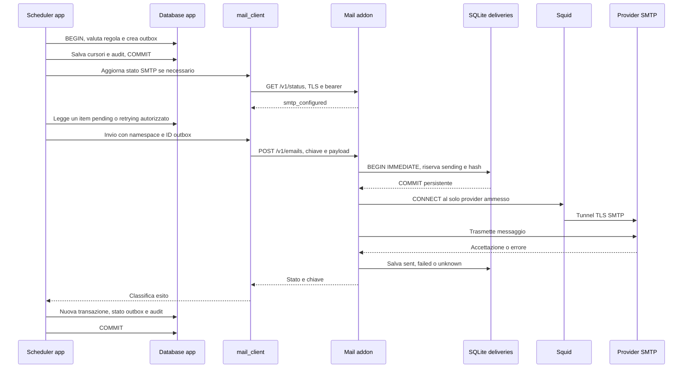
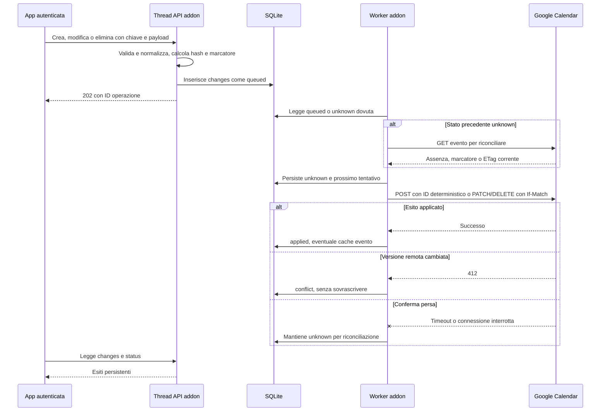
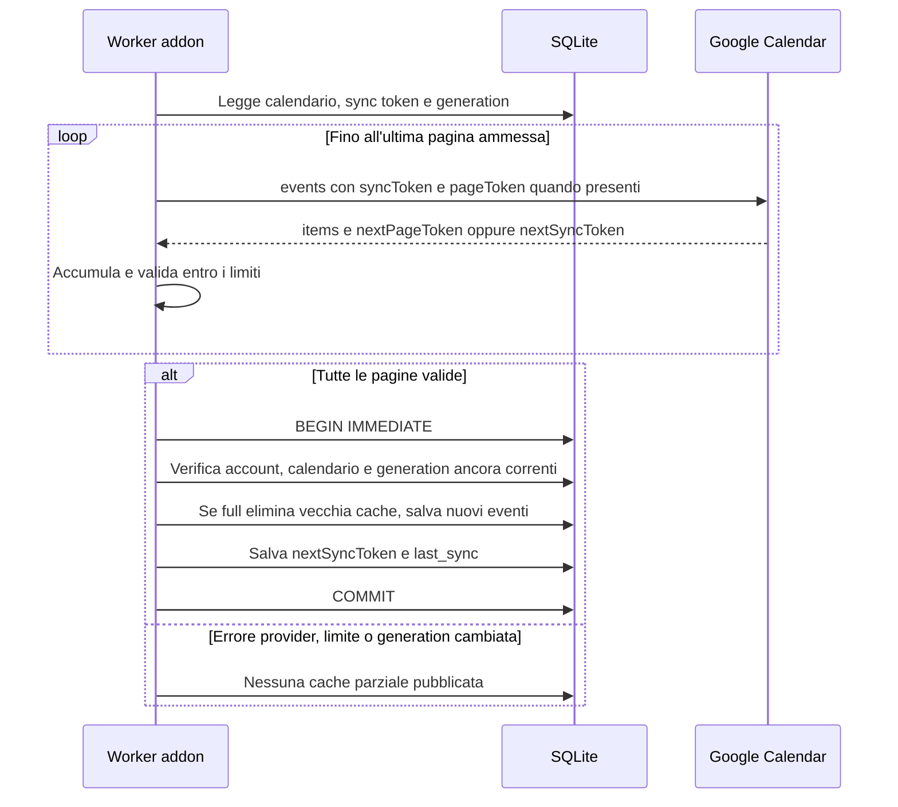
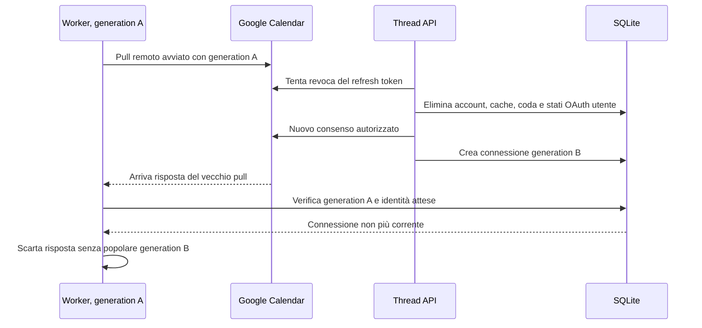

# Flussi delle integrazioni mail e Google Calendar

**Italiano** | [English](../en/tehnical/flussi-integrazioni.md)

Verificato sul codice e sui fixture il **10 ottobre 2026**. I diagrammi descrivono i flussi implementati; SMTP e client OAuth Google restano da configurare per l'uso reale. Sono illustrati i punti di persistenza e le possibili interruzioni, senza ripetere il catalogo completo in [API addon](api-addon.md) e [API app](api-app.md).

Fonti: [alerts.c](../../src/alerts.c), [mail_client.c](../../src/mail_client.c), [mailer.c](../../addon/src/mailer.c), [server.c](../../src/server.c), [calendar_client.c](../../src/calendar_client.c), [calendar.c](../../calendar-addon/src/calendar.c), [privacy NPM](../../docker/nginx-proxy-manager/proxy-privacy.mjs). Non sono state effettuate nuove chiamate a provider o prove runtime per questa stesura.

## Due integrazioni, due registri persistenti

| Aspetto | Email | Calendar |
| --- | --- | --- |
| Origine dell'intento | Esecuzione di una regola alert | Chiamata autenticata dell'utente attraverso l'app |
| Prima persistenza | `alert_email_outbox` nel database applicativo | `changes` nella SQLite dell'addon |
| Protezione prima dell'azione esterna | Ledger `deliveries`, stato `sending` | Stato `unknown` della modifica |
| Identità del tentativo | `MAIL_API_NAMESPACE:outbox:ID` | Chiave utente + `idempotency_key` e contenuto normalizzato |
| Esito remoto incerto | Terminale `unknown`, controllo manuale | `unknown`, verifica evento remoto prima di eventuale retry |
| Cache dati remoti | Nessuna casella email sincronizzata | Copia locale degli eventi Google con token incrementale |
| Elaborazione | Tick dell'app, chiamata mail sincrona | Worker nell'addon separato dal thread API |

Nessun diagramma implica una transazione distribuita. Il commit locale, l'accettazione del provider e la risposta al client sono momenti distinti. Cifratura e proprietà degli archivi sono nel [modello dati](modello-dati.md); criteri SQL in [migrazioni e consistenza](migrazioni-e-consistenza.md).

## Email: generazione dell'alert e consegna

Il flusso seguente presuppone SMTP configurato. La pianificazione, la soglia delle ore e i cursori dell'alert sono descritti in [motore alert](motore-alert.md).



Il primo commit rende persistente l'intento prima dell'invio. Il ledger rende persistente `sending` prima che SMTP possa accettare il messaggio. Il secondo commit SQL allinea lo stato applicativo, ma non è necessario perché il provider abbia già ricevuto l'email.

Le chiamate di rete avvengono **fuori dal guard SQL**. L'app estrae e copia i dati dell'item, finalizza lo statement, contatta il servizio e poi aggiorna lo stato con `WHERE id=? AND status=?`. L'audit `alert_emails.delivery` e il nuovo stato fanno parte della stessa transazione: se l'audit fallisce, entrambi vengono annullati e un successivo tentativo riusa la stessa chiave.

La selezione dell'outbox richiede ancora un gestore proprietario attivo e l'indirizzo presente nei destinatari della regola. Non verifica `alert_rules.enabled`: **disabilitare una regola interrompe i trigger automatici, ma non annulla email già accodate**. La revoca dell'indirizzo o la disabilitazione/declassamento del proprietario fanno invece escludere l'item dalle consegne. Una richiesta già in corso rimane un caso distinto.

### SMTP non configurato e stato non raggiungibile

Il client interroga lo stato circa una volta al minuto. Finché non ha uno stato valido con `smtp_configured=true`, il tick non presenta nuove email all'addon e le righe restano in SQL. Il valore `smtp_configured=false` esposto dall'app può indicare anche una verifica fallita per trasporto/TLS/risposta non valida, non soltanto credenziali provider assenti.

Se il servizio perde configurazione dopo il controllo dello stato, `POST /v1/emails` restituisce `smtp_not_configured` senza consumare la chiave e l'app mantiene `pending_configuration`. L'attivazione futura del provider può dunque consegnare anche messaggi generati in precedenza; il backlog è parte dell'operazione di attivazione.

### Crash, timeout e replay email

| Punto d'interruzione | Stato persistente | Comportamento al tentativo successivo |
| --- | --- | --- |
| Prima del commit outbox | Nessun intento SQL confermato | La regola può essere rieseguita; audit/cursori non sono avanzati a metà. |
| Dopo outbox, prima del ledger | Item SQL ripetibile | Stessa chiave e stesso payload possono essere presentati al servizio. |
| Dopo `sending`, prima dell'esito registrato | Ledger `sending` | Al riavvio diventa `unknown`; non viene rispedito automaticamente. Può richiedere verifica anche se SMTP non aveva ancora ricevuto i byte. |
| SMTP accetta, risposta all'app persa | Ledger `sent` se l'esito è stato salvato | Il replay restituisce `sent` senza inviare di nuovo. |
| SMTP accetta, risposta al servizio persa | `unknown` | Nessuna conferma di consegna; verifica manuale del provider. |
| Stato SQL/audit non confermato | Ledger conserva l'esito, item SQL ancora ripetibile | Replay della stessa chiave ricostruisce lo stato senza duplicare un invio noto. |
| Stessa chiave, contenuto differente | Hash ledger già presente | `idempotency_conflict`; non viene riutilizzato il precedente invio per un nuovo messaggio. |

La riserva protegge dai duplicati sacrificando il retry automatico di alcuni casi dubbi. `sent` significa accettazione SMTP, non lettura né recapito finale. Non esiste un processo che interroga automaticamente la casella o il registro del provider per sciogliere `unknown`.

L'app aspetta al massimo 3 secondi per la risposta dell'addon, mentre il timeout SMTP predefinito è 20 secondi. La richiesta può quindi continuare nell'addon dopo che l'app ha perso la risposta. Un reinvio con chiave diversa aggirerebbe la protezione: il retry deve mantenere namespace, ID e contenuto.

## OAuth Calendar: dall'utente ai token cifrati

Il servizio non usa una credenziale Google unica per leggere tutti i calendari dell'organizzazione. Il percorso API supportato permette a ogni utente dell'app di collegare un proprio account Google tramite consenso, usando il client OAuth Web configurato dall'amministratore. Il diagramma descrive questo contratto API: la schermata grafica dell'app per avviare il collegamento e guidare l'utente al consenso è ancora da implementare.

```mermaid
sequenceDiagram
    actor U as Utente
    participant Browser as Browser
    participant App as App C
    participant Cal as Calendar addon
    participant Store as SQLite con payload cifrati
    participant Google as OAuth e Calendar Google
    U->>Browser: Avvia collegamento
    Browser->>App: POST oauth/start con cookie e origine valida
    App->>App: Rilegge account e deriva session_binding
    App->>Cal: POST privato, ID utente e binding
    Cal->>Store: Salva hash state, binding e PKCE cifrato, TTL 600 s
    Cal-->>App: URL consenso e expires_in
    App-->>Browser: URL Google validato
    Browser->>Google: Consenso con challenge S256
    Google-->>Browser: Redirect a callback con code e state
    Browser->>App: GET callback con stessa sessione
    App->>Cal: Callback privata con binding derivato
    Cal->>Store: Verifica utente, binding e scadenza; consuma state
    Cal->>Google: Scambia code e verifier tramite Squid/TLS
    Google-->>Cal: Token e scadenza
    Cal->>Google: Legge identità del calendario primario
    Cal->>Store: Transazione token cifrati e nuova generation
    Cal-->>App: Collegamento confermato
    App-->>Browser: 303 /app?calendar=connected
```

Il browser non invia `user_id` né il bearer addon. La sessione viene riletta dal database app; il binding è l'hash del token corrente. Lo state viene consumato **prima** dello scambio remoto: un doppio callback non può riutilizzarlo. Se lo scambio fallisce dopo il consumo occorre iniziare un nuovo consenso, non ripetere lo stesso codice/state.

L'addon conserva il verificatore PKCE e i token con AES-256-GCM; il browser riceve soltanto l'URL del consenso e lo stato finale. La callback app risponde con un redirect generico connesso/errore, senza riportare codice, state o token. La location callback di NPM preserva restrizioni/ACL della route app e sopprime i log contenenti la query sensibile; non si aggiunge un endpoint pubblico dell'addon.

L'identità dell'account è l'ID del calendario primario restituito dal provider, non un'email digitata liberamente dall'utente nell'app. Un nuovo consenso sullo stesso account conserva selezione, cache e coda; un account differente senza disconnessione produce `google_account_mismatch`.

### Rinnovo dei token

Prima di una chiamata Google, il servizio decifra i token dell'utente. Se l'access token scade entro 60 secondi, usa il refresh token; se il provider risponde `401`, prova un rinnovo e un secondo tentativo della richiesta. Il vecchio refresh token viene conservato se il rinnovo non ne emette uno nuovo. Un fallimento di rinnovo `400` imposta `reauth_required`; altri errori sono distinti come indisponibilità del rinnovo.

Questo retry di autenticazione è un comportamento specifico del client Google, non il replay generale delle transazioni SQL. Per le mutazioni continuano a valere ID deterministico, ETag e stato `unknown`, necessari a trattare gli esiti remoti ambigui.

## Scrittura bidirezionale: intento locale e controllo della versione



Il diagramma omette il ramo in cui la riconciliazione dimostra che l'azione era già stata applicata: in quel caso il worker salva `applied` senza ripetere la scrittura. Se il contenuto remoto non permette di procedere, salva conflitto/fallimento anziché forzare l'operazione.

Le creazioni hanno ID Google deterministico da utente e chiave, mentre `puntoMutation` lega anche il contenuto richiesto. Modifiche e cancellazioni inviano l'ETag letto in precedenza. Questo consente di distinguere una propria operazione già applicata da un evento cambiato da un altro client. Il payload normalizzato e la chiave restano persistenti attraverso i riavvii.

Stessa chiave e stesso payload restituiscono la riga esistente con `replayed:true`; stessa chiave e payload diverso danno conflitto. `202` conferma l'accodamento, non l'applicazione remota. `conflict` e `failed` richiedono una scelta del chiamante; l'API corrente espone consultazione degli esiti ma non un wizard di risoluzione dei conflitti.

Il worker considera un utente dovuto per polling o per coda e ne elabora al massimo 20 modifiche nel ciclo, poi effettua il pull. Le attese progressive da 30 a 3840 secondi definiscono il prossimo momento consentito del tentativo. Il lavoro è seriale nel worker: più utenti/provider lenti possono spostare l'esecuzione effettiva oltre queste soglie.

## Pull completo e incrementale: pubblicazione atomica della cache



La richiesta Google usa `maxResults=250`, `showDeleted=true`, `singleEvents=false`. Non aggiunge i filtri UI `from/to` al download incrementale: tali filtri si applicano alla consultazione della cache. Master ricorrenti, eccezioni e cancellazioni devono rimanere rappresentabili; non è una cache delle sole occorrenze visibili nel periodo.

Il servizio accumula tutte le pagine prima della transazione di aggiornamento. I limiti proteggono memoria e durata: 100 pagine, 20.000 eventi, 64 KiB per evento, 16 MiB complessivi; il catalogo API riporta anche i limiti delle risposte al chiamante. `nextSyncToken` deve arrivare alla fine e viene confermato con gli eventi, mai appena ricevuta una pagina intermedia.

Un `410` su sync incrementale invalida il token e avvia un solo percorso di riscaricamento completo. La vecchia cache rimane finché tutte le pagine del full non sono pronte; se il full fallisce non viene svuotata preventivamente. La coda `changes` non viene cancellata da questo recupero.

La selezione esplicita di un calendario diverso è invece una nuova operazione utente: cambia generazione, azzera token/ultimo sync ed elimina la cache precedente in una transazione. Rifiuta il cambio se ci sono operazioni `queued`/`unknown`. Imposta il prossimo polling al normale intervallo; una richiesta `/sync` può anticiparlo.

## Disconnessione, riconnessione e risposte tardive

Il thread API e il worker condividono il file SQLite, ma possiedono connessioni distinte. Un semplice controllo dell'ID utente non basta: dopo la disconnessione un nuovo account potrebbe essere associato allo stesso utente, oppure lo stesso account potrebbe essere riconnesso mentre arriva una vecchia risposta remota.



Ogni consenso e selezione genera un identificatore casuale della connessione. Il worker cattura `expected_provider` e `expected_generation` in variabili thread-local; lettura/salvataggio token, errori account, cache e completamento del lavoro verificano la connessione attesa. Il refresh effettuato dal worker non può reinserire un account eliminato come se fosse una nuova autenticazione.

`disconnect` tenta la revoca remota, poi cancella lo stato locale e restituisce separatamente `disconnected` e `remote_revoked`. Un provider irraggiungibile può lasciare la revoca non confermata pur dopo la pulizia locale. Il nuovo consenso sullo stesso account senza disconnessione conserva gli intenti; una disconnessione esplicita elimina anche lo storico di idempotenza locale.

Questa protezione difende la nuova cache da risposte vecchie; **non annulla una chiamata già accettata dal provider**. Un evento già creato non sparisce perché il collegamento è stato rimosso. Per la stessa ragione l'arresto del container non costituisce una cancellazione remota degli intenti in corso.

Il test di reattività copre un pull lento del worker mentre `/status` e `/healthz` rimangono disponibili nel thread API. Non significa che più richieste API private siano gestite contemporaneamente: un consenso o una selezione sincrona possono occupare il thread API.

## Percorso di rete e dati sensibili

Tutti i passaggi app→addon usano la rete API dedicata, HTTPS con CA/hostname e bearer. Tutti i passaggi addon→provider usano il tunnel CONNECT di Squid con allowlist della sorgente. Mail e Calendar hanno destinazioni differenti; l'addon non può scegliere di usare Internet direttamente perché l'API gli ha ricevuto un URL.

I token OAuth e i payload Calendar sono cifrati prima della persistenza e decifrati quando necessari. Metadati, ID Google e sync token non sono tutti cifrati: per la classificazione completa vedere [modello dati](modello-dati.md). L'outbox email conserva il testo in SQL; il ledger SMTP non lo copia. Un backup deve mantenere le corrispondenze e le chiavi, non soltanto i singoli file separati.

Codici OAuth, token e credenziali non devono entrare in audit business, errori HTTP o log di diagnosi. I test del bridge rifiutano risposte addon contenenti campi sensibili anche annidati; i test NPM controllano la callback sia in successo sia in errore upstream. Questa difesa non rende automaticamente sicuro un nuovo logger aggiunto in futuro.

## Corrispondenza con i test

I nomi seguenti sono casi presenti nel repository; la tabella non afferma una nuova esecuzione durante la documentazione.

| Scenario | Test di riferimento |
| --- | --- |
| SMTP disabilitato: nessun invio e coda conservata | `test_disabled_smtp_preserves_requests_for_later_configuration` in [mail addon](../../tests/test_mail_addon.py); `test_unconfigured_service_preserves_pending_outbox_without_submitting` in [client mail](../../tests/test_mail_client.py). |
| Persistenza prima dell'invio, replay e crash | `test_starttls_delivery_is_tunneled_and_idempotent_after_restart`, `test_crashed_sending_record_recovers_as_unknown`, `test_ambiguous_delivery_is_never_resent` in [mail addon](../../tests/test_mail_addon.py). |
| Timeout app e fallimento audit dopo SMTP | `test_timeout_is_bounded_and_keeps_the_same_idempotency_key_for_retry`, `test_delivery_audit_failure_keeps_queue_and_retry_uses_the_same_service_key` in [client mail](../../tests/test_mail_client.py). |
| Revoca destinatario/proprietario | `test_revoked_email_recipient_and_disabled_rule_owner_are_not_delivered` in [client mail](../../tests/test_mail_client.py). |
| State PKCE, sessione e utente | `test_oauth_pkce_single_use_session_binding_and_per_user_isolation`, `test_expired_oauth_state_is_rejected_without_token_exchange` in [Calendar addon](../../tests/test_calendar_addon.py). |
| Identità derivata dal server e callback senza segreti | `test_identity_and_internal_oauth_binding_cannot_be_overridden`, `test_oauth_callback_is_session_bound_and_redirects_without_echoing_code` in [bridge Calendar](../../tests/test_calendar_client.py). |
| Privacy della callback dietro proxy | `test_runtime_callback_suppresses_access_and_upstream_errors_preserving_acl` in [privacy NPM](../../tests/test_proxy_privacy.py); prova runtime facoltativa. |
| Cifratura, riavvio, chiave errata e trapianto token | Casi `test_tokens_and_event_contents_are_encrypted_and_survive_restart`, `test_wrong_encryption_key_fails_startup_without_resetting_accounts`, `test_encrypted_tokens_cannot_be_transplanted_to_another_user` in [Calendar addon](../../tests/test_calendar_addon.py). |
| Paginazione atomica e token scaduto | `test_full_incremental_pagination_commits_atomically_and_410_recovers`, stesso file. |
| Modifiche remote ed ETag | `test_outbound_create_update_delete_use_durable_idempotency_and_etags`, `test_etag_conflict_is_reported_without_overwriting_google`, stesso file. |
| Conferma remota persa | `test_lost_remote_ack_is_reconciled_after_restart_without_resending`, stesso file. |
| Riconnessione conserva coda e respinge account diverso | `test_reauthorization_preserves_selected_calendar_cache_and_change_history`, stesso file. |
| Pull tardivo dopo riconnessione | `test_inflight_pull_is_discarded_after_switching_google_accounts`, `test_inflight_pull_is_discarded_after_reconnecting_the_same_google_account`, stesso file. |
| Health/stato durante worker lento | `test_background_sync_keeps_private_status_and_health_responsive`, stesso file. |

SMTP, OAuth e Calendar dei fixture sono simulatori locali con TLS e proxy: dimostrano il comportamento del codice sotto quelle condizioni, non autorizzano un account reale né certificano la configurazione del progetto Google Cloud. L'esecuzione delle suite e i controlli di rete sono nel [manuale test](sviluppo-test.md).

## Evoluzioni proposte

Le seguenti possibilità sono **proposte**, non componenti già presenti: interfaccia per la risoluzione dei conflitti, associazione esplicita evento–commessa, conversione verificata degli appuntamenti in consuntivi, più provider calendario, webhook push Google, lettura dello storico completo delle modifiche e riconciliazione automatica degli esiti SMTP tramite servizi specifici del fornitore.

Ogni evoluzione deve preservare l'ordine persistenza→effetto remoto, l'identità per utente e la distinzione tra esito locale e remoto. Per aggiungere concorrenza o HA agli addon occorrerà definire anche l'assegnazione esclusiva del lavoro, le generazioni e la coerenza dei registri: replicare soltanto il container non costituisce questa soluzione.
