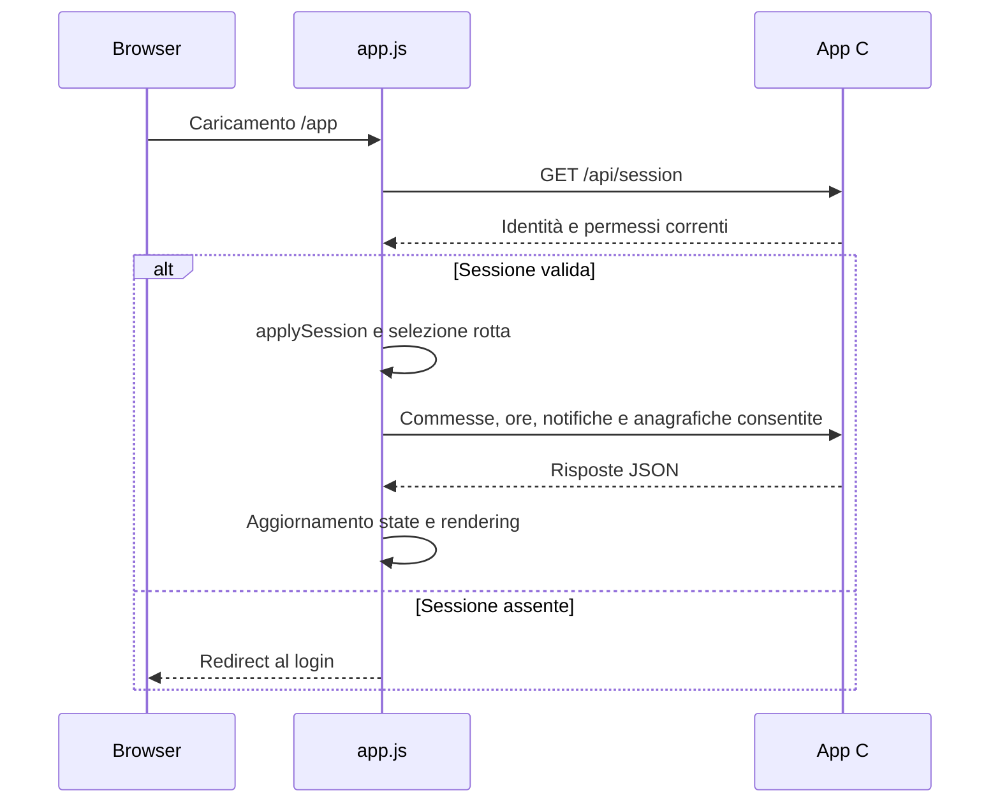

# Frontend: struttura, stato e interazione

Riferimento: codice del **10 ottobre 2026**. Questa guida è destinata a chi modifica l’interfaccia. Le istruzioni per usare il prodotto sono nelle guide [utente](../prod/guida-utente.md) e [gestore](../prod/guida-gestore.md); il contratto delle richieste è in [API app](api-app.md).

## File e dipendenze

| File | Responsabilità |
| --- | --- |
| [index.html](../../public/index.html) | Struttura del login, campi, messaggi e contenuti introduttivi |
| [login.js](../../public/login.js) | Validazione del login, invio, ricordo email e redirect |
| [app.html](../../public/app.html) | Struttura dell’area autenticata, pannelli, moduli e dialog nativi |
| [app.js](../../public/app.js) | Stato in memoria, caricamento dati, navigazione, rendering e salvataggi |
| [styles.css](../../public/styles.css) | Variabili visive, regole generali e pagina di accesso |
| [workspace.css](../../public/workspace.css) | Area di lavoro, tabelle, dialog, organizzazione, contratti e notifiche |
| [reports.css](../../public/reports.css) | Filtri, schede, tabelle e tariffe delle analisi |
| [favicon.svg](../../public/favicon.svg) | Identità grafica del browser |

Non ci sono un framework UI, un bundler o un processo npm per generare le pagine. Gli script sono IIFE in modalità strict; funzioni e stato non sono pubblicati come API globali. Gli ID HTML costituiscono un contratto diretto con `getElementById`: rinominare un campo richiede di aggiornare il JavaScript che lo usa.

L’interfaccia richiede JavaScript e API browser moderne, fra cui `fetch`, `AbortController`, `URLSearchParams`, `BigInt`, `dialog.showModal()` e `matchMedia`. Il repository non definisce una matrice certificata di versioni browser né un insieme di polyfill. Una nuova dipendenza va quindi valutata e collaudata sui browser scelti per la distribuzione.

## Avvio e durata dello stato



`initialize()` attende la sessione prima di mostrare `workspace`; interpreta poi l’hash e richiama `refreshAll()`. Questo carica commesse, ore e notifiche e, se consentito, utenti, fornitori e contratti. Organizzazione, storico, alert e analisi hanno anche caricamenti associati al pannello attivo. Non tutte le letture sono effettuate esclusivamente alla prima apertura della scheda.

Lo stato dei record vive nell’oggetto `state`, nella memoria della pagina. Un ricaricamento ricostruisce le liste dal server. Non esiste un archivio offline dei record, delle password o dei token Google nel frontend. Il login usa `localStorage` soltanto per l’email ricordata, sotto `punto.rememberedEmail`; errori o indisponibilità di questo storage non devono bloccare l’accesso.

La casella «ricordami» ha due effetti distinti: il login invia `remember=on` al server per la durata della sessione e conserva l’email nel browser dopo il successo. La password non viene scritta in `localStorage`. Il pulsante dimostrativo compila i valori dimostrativi del sorgente: non scopre né modifica le credenziali del deployment.

## Navigazione e URL

| Hash / area | Disponibilità |
| --- | --- |
| `#jobs`, `#hours`, `#notifications` | Utenti autenticati, con dati nel proprio ambito |
| `#suppliers`, `#contracts`, `#users`, `#organization`, `#audit`, `#alerts` | Gestori, secondo i permessi e i controlli specifici |
| `#analisi/periodo`, `#analisi/commesse`, `#analisi/utenti` | Analisi globale per gestori, personale per operatori |
| `#analisi/costi`, `#analisi/costo-ore` | Gestori |

Le viste Analisi scrivono nell’hash `from`, `to` e, quando presenti, `job_id` e `user_id`. La vista `costi` corrisponde a `view=cost`; `costo-ore` a `view=labor_cost`. Il frontend traduce questi nomi prima della richiesta HTTP.

Esempio sintetico:

```text
/app#analisi/commesse?from=2026-10-01&to=2026-10-31&job_id=123
```

Il frammento consente di ritrovare i filtri, non concede l’accesso ai dati e non è una vista salvata nell’account. Il server riceve i filtri nella successiva richiesta API e verifica l’autorizzazione. Browser history, condivisione dello schermo e copia dell’indirizzo possono rendere visibili i filtri e gli identificativi presenti nell’URL.

`hashchange` e `popstate` ricostruiscono il pannello. Una scheda non disponibile ricade su Commesse; una vista analitica non consentita ricade su Per periodo. Il filtro utente viene rimosso per l’operatore. Dopo login o scadenza viene mantenuto solo un hash Analisi riconosciuto lungo al massimo 2048 caratteri, non una destinazione arbitraria.

## Client HTTP ed errori

`api()` centralizza le chiamate con cookie della stessa origine, `cache: no-store`, parsing JSON e timeout di 15 secondi. `post()` usa `URLSearchParams` con form URL-encoded; i PDF sono inviati come corpo binario `application/pdf`, con timeout di 60 secondi.

| Condizione | Comportamento del frontend |
| --- | --- |
| `401` | Redirect al login e messaggio di sessione scaduta |
| `403` | Avviso e aggiornamento della sessione, salvo ricorsione sulla richiesta sessione |
| JSON non valido | Errore esplicito, senza usare la risposta come dati |
| Risposta HTTP fallita o `ok:false` | Messaggio business restituito dal server o testo di ripiego |
| Timeout | Interruzione dell’attesa browser e messaggio di connessione/tempo |
| Errore di rete | Messaggio di servizio non raggiungibile |

L’interruzione della richiesta browser non prova l’annullamento di una transazione sul server. Il frontend non implementa una chiave generale di idempotenza per commesse, ore e anagrafiche: dopo un esito incerto verificare l’elenco prima di ripetere un inserimento. Il pulsante disabilitato evita doppi clic ordinari, ma non garantisce unicità fra due schede, retry o dispositivi.

Le mutazioni riuscite sulle risorse gestionali invalidano i report. Le funzioni specifiche ricaricano poi liste, statistiche o audit pertinenti. Non applicare un aggiornamento ottimistico permanente prima di conoscere l’esito del backend.

## Richieste concorrenti e revoche

Lo stato contiene contatori come `sessionRequest`, `entriesRequest`, `reportRequest`, `documentsRequest` e `organizationRequest`. Ogni caricamento rilevante conserva la propria generazione e confronta il contatore prima di applicare il risultato. Per le analisi verifica anche vista, periodo e pannello ancora attivi.

Esempio: l’utente richiede ottobre e subito novembre; se ottobre arriva per ultimo, non deve sostituire il risultato di novembre. Questo controllo scarta risposte obsolete nella UI; non annulla necessariamente il lavoro HTTP già in corso.

`applySession()` rileva cambi di email, ruolo e mappa permessi. Invalida generazioni, pulisce dati sensibili, chiude dialog non più ammessi e aggiorna i comandi disponibili. I moduli verificano nuovamente i permessi anche quando ricevono una risposta asincrona. Il backend rimane l’autorità: una revoca in un’altra sessione può essere riconosciuta prima dal server che dalla pagina già aperta.

Non è implementato un canale push generale delle modifiche o dei permessi. Il timer periodico aggiorna le notifiche ogni 60 secondi solo quando il documento è visibile e la sessione risulta autenticata; non aggiorna tutte le anagrafiche ogni minuto. La risposta `403` e i caricamenti espliciti fanno parte del riallineamento della pagina.

## Rendering e formati

Le funzioni `node()` e i renderer costruiscono elementi DOM e usano `textContent` per i valori applicativi. Le tabelle sono ricostruite con `replaceChildren()`. Conservare questo approccio per nomi, note, descrizioni e messaggi: un contenuto memorizzato nel database non diventa HTML fidato.

| Tipo | Conversione / presentazione |
| --- | --- |
| Ore | `hoursToMinutes()` converte durate con virgola, punto o `H:MM` in minuti interi; usa `BigInt` per rifiutare frazioni di minuto |
| Importi | `valueToCents()` converte il testo del modulo in centesimi; la visualizzazione EUR usa formattazione italiana |
| Giornata | Stringa `YYYY-MM-DD`; validazione calendario esplicita, senza affidarsi alla normalizzazione permissiva di `Date` |
| Report | Periodo inclusivo massimo 366 giorni; gli ID dei filtri devono essere interi JavaScript sicuri |
| Date alert | Formattazione in `Europe/Rome` |
| Audit | Formattazione nel fuso del browser |

`1,30` ore significa 78 minuti; `1:30` significa 90. Non sostituire il parser con `parseFloat(value) * 60` senza preservare il requisito dei minuti interi. Le validazioni HTML e JS aiutano la compilazione, ma possono avere limiti diversi da quelli del server: per esempio l’upload UI scarta file vuoti mentre il backend richiede anche firma `%PDF-` e almeno cinque byte.

Il giorno iniziale del Registro ore deriva dal browser. I periodi rapidi di Analisi diventano disponibili con `today` restituito dal server; la prima richiesta può essere ripetuta per allineare il periodo predefinito. Nessuna conversione automatica trasforma una data di lavoro in una fascia oraria.

## Dialog, tastiera e feedback

I moduli usano `<dialog>`, `showModal()`, etichette associate ai campi, messaggi di validazione e comandi espliciti di chiusura. `busyDialogs` tiene traccia dei salvataggi: disabilita i controlli e impedisce chiusure con Escape o click esterno durante l’attesa. Alla fine il blocco viene rimosso anche nel percorso di errore.

La navigazione principale aggiorna `aria-selected`, `tabindex`, pannelli `hidden` e titolo pagina. Frecce, Home ed End attraversano solo le schede consentite. Le schede Analisi hanno gestione tastiera separata. Sotto 760 px l’orientamento ARIA della navigazione diventa orizzontale.

I messaggi ordinari hanno ruolo `status` e si chiudono dopo sette secondi; gli errori usano ruolo `alert` e rimangono fino a un’azione successiva o chiusura. Le aree in caricamento espongono `aria-busy`; stati vuoti ed errori sono distinti. Non sostituire uno stato fallito con «nessun dato».

I CSS includono focus visibile, regole responsive e riduzione delle animazioni con `prefers-reduced-motion`. Questo documenta controlli presenti, non certifica una conformità completa di accessibilità: servono verifiche dei flussi con tastiera, lettore di schermo, ingrandimento e contrasto.

## Percorso di modifica consigliato

Questi sono criteri di sviluppo, non nuove funzioni già implementate:

1. Individuare pannello e dialog in HTML, stato e caricamento in JS, autorizzazione nell’API.
2. Definire caricamento, vuoto, errore, successo e assenza di permesso prima di aggiungere il renderer.
3. Inserire i nuovi dati come testo, validare URL e ID secondo la risorsa e conservare i controlli server.
4. Usare un contatore di richiesta per dati sostituibili e invalidarlo su cambio identità o contesto.
5. Gestire navigazione indietro, riapertura dialog, doppio clic, timeout e risposta arrivata dopo una revoca.
6. Aggiornare le dipendenze di invalidazione quando la modifica cambia report o liste correlate.
7. Collaudare i ruoli coinvolti, mobile e desktop con dati sintetici; consultare [collaudo di accettazione](../prod/collaudo-accettazione.md).

Il file `app.js` è attualmente monolitico. Una futura suddivisione in moduli dovrà preservare queste interazioni; non esiste oggi una libreria di componenti con API autonoma. Calendario grafico, tema personalizzabile, offline e comandi globali da tastiera restano nella [roadmap](../prod/roadmap.md).
