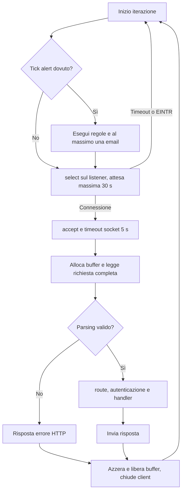

# Interni del server C

**Italiano** | [English](../en/tehnical/interni-server-c.md)

Stato verificato sul codice l’**11 ottobre 2026**. Questo documento descrive il funzionamento implementato del processo `punto` e i contratti interni da rispettare quando lo si modifica. Per l'inventario dei container vedere [architettura](architettura.md); per i percorsi e i payload pubblici vedere [API app](api-app.md). Non sono state eseguite nuove prove runtime durante questa stesura.

Fonti principali: [server.c](../../src/server.c), [Makefile](../../Makefile), gli header in [src](../../src), [db_mysql.c](../../src/db_mysql.c), [calendar.c](../../calendar-addon/src/calendar.c), [mailer.c](../../addon/src/mailer.c).

## Unità di compilazione e responsabilità

`Makefile` compila in C11 con `-Wall -Wextra -Wpedantic -Werror`. `DB_BACKEND=sqlite` collega SQLite; `DB_BACKEND=mysql` definisce `PUNTO_MYSQL`, aggiunge `db_mysql.c` e `mysql_schema.c`, collega Connector/C e libmongoc. Le librerie JSON/curl sono usate dai client degli addon anche quando il backend nativo è SQLite. Su macOS password e casualità usano CommonCrypto/Security; nella build Linux usano OpenSSL.

| Modulo e header | Responsabilità | Confine da preservare |
| --- | --- | --- |
| `server.c` | Configurazione HTTP, listener, parsing, sessioni, controlli Host/Origin, dispatch, risposte, scheduler e arresto. | È la sorgente dell'identità autenticata passata ai moduli. Non accetta identità autore dal form business. |
| [workspace.h](../../src/workspace.h) / `workspace.c` | Commesse, ore, assegnazioni dirette, tariffe e report. Definisce `WorkspaceResponse`. | Le scritture verificano regole e audit nella stessa transazione. La proprietà delle ore rimane personale. |
| [accounts.h](../../src/accounts.h) / `accounts.c` | Bootstrap, autenticazione, lettura account attivi e gestione utenti. | Hash/salt non entrano negli oggetti `Account` esposti agli altri moduli. |
| [storage.h](../../src/storage.h) / `storage.c` | Preflight, migrazioni, health SQL, append e lettura audit. | `storage_audit()` riceve la connessione della mutazione, non usa la propria connessione di lettura. |
| [organization.h](../../src/organization.h) / `organization.c` | Alberatura, ruoli locali, appartenenze, grant e calcolo autorizzazioni. | Il calcolo live dei permessi usa la connessione del chiamante e uno snapshot locale alla richiesta. |
| [work_board.h](../../src/work_board.h) / `work_board.c` | Attività, sottoattività, Kanban e blocchi; query della bacheca e mutazioni. | Rilegge account/grant nel contesto corrente, controlla revisioni, profondità e audit sulla stessa connessione. |
| [procurement.h](../../src/procurement.h) / `procurement.c` | Catalogo fornitori/contratti, manifesto documenti, coordinamento upload/download. | Verifica il ruolo prima di chiamare lo storage documentale. |
| [documents.h](../../src/documents.h) / `documents.c` | Byte PDF in filesystem nativo o GridFS Docker, validazione chiavi e integrità. | Non conosce sessioni o ruoli: il chiamante deve già aver autorizzato l'operazione. |
| [alerts.h](../../src/alerts.h) / `alerts.c` | Regole, destinatari, esecuzioni, notifiche, coda email e dispatch. | Il tempo è iniettabile con `alerts_tick_at(now)`; i confini business usano Europe/Rome. |
| [mail_client.h](../../src/mail_client.h) / `mail_client.c` | HTTP privato verso `mail` e classificazione degli esiti SMTP. | Non spedisce tramite SMTP direttamente; non inventa nuove chiavi a ogni tentativo. |
| [calendar_client.h](../../src/calendar_client.h) / `calendar_client.c` | Bridge autenticato per Calendar, allowlist campi, codifica e controllo risposte. | Riceve ID e legame sessione solo dal server; non espone bearer/secret al browser. |
| [db.h](../../src/db.h) | Interfaccia SQL comune. | Le macro native mappano direttamente SQLite; MySQL implementa un adattatore limitato, non un ORM generale. |
| [mysql_schema.h](../../src/mysql_schema.h) / `mysql_schema.c` | Preparazione DDL e controlli versione MySQL. | DDL e migrazioni versionate hanno fasi diverse, illustrate in [migrazioni e consistenza](migrazioni-e-consistenza.md). |

I sette moduli `workspace`, `accounts`, `storage`, `organization`, `work_board`, `alerts`, `procurement` possiedono ciascuno una connessione SQL statica. Non esiste un pool di connessioni. Con HAProxy queste connessioni possono raggiungere membri MySQL differenti: un'operazione atomica deve rimanere su una sola connessione.

## Ordine reale di avvio

1. `main()` valida porta di ascolto, porta pubblica, bind IPv4, origini pubbliche e parametri bootstrap; sceglie directory statica e database.
2. Apre il client Calendar. Una configurazione totalmente assente è ammessa in sviluppo; una configurazione parziale/insicura interrompe l'avvio. Registra `calendar_client_close()` tramite `atexit`.
3. Esegue `storage_preflight()`. In SQLite è un controllo di versione senza scritture; in MySQL include anche preparazione DDL dopo il controllo preliminare.
4. Apre workspace, account e storage, in quest'ordine. In SQLite workspace crea le tabelle base; accounts crea/controlla l'utente iniziale; storage applica le migrazioni.
5. Apre organizzazione, attività/blocchi, alert, procurement e documenti. `alerts_open()` imposta il fuso di processo a `Europe/Rome`, apre il client mail e rifiuta la configurazione mail parziale. L'inizializzazione del client MongoDB non certifica ancora la raggiungibilità del provider documentale.
6. Installa i gestori dei segnali, crea il socket IPv4, abilita `SO_REUSEADDR`, esegue `bind()` e `listen(...,16)`.
7. Solo dopo queste fasi entra nel ciclo delle richieste e rende disponibile l'app.

Gli errori iniziali producono messaggi sintetici e uscita non riuscita; i rami di errore chiudono i moduli già aperti. Il bootstrap utenti agisce solo se la tabella è vuota: cambiare le variabili iniziali non modifica la password di un account esistente. I dettagli dei possibili effetti persistenti prima dell'avvio sono in [migrazioni](migrazioni-e-consistenza.md).

## Ciclo HTTP e pianificatore

Il processo principale serve **una connessione alla volta**. `select()` aspetta solo il listener; non gestisce più socket client concorrenti. Non ci sono thread per richiesta, keep-alive, HTTP/2, streaming delle risposte o pipeline HTTP. Il server interno parla HTTP/1.1; TLS pubblico termina in Nginx Proxy Manager.

Prima di attendere una connessione, il ciclo invoca `alerts_tick_at()` se sono trascorsi circa 30 secondi, oppure al primo giro o dopo un arretramento dell'orologio. Le regole dovute vengono valutate prima dell'eventuale dispatch di una email. Il tempo speso in queste operazioni ritarda l'accettazione di nuove richieste; 30 secondi è un intervallo di controllo, non una garanzia real-time.

Le chiamate Calendar di lettura stato/coda sono brevi, ma consenso, selezione e lettura calendari possono contattare il provider. Anche PDF e connessioni SQL sono sincroni rispetto al processo app. Il worker Calendar in un altro container evita di mantenere aperta la richiesta HTTP app durante un intero sync, senza rendere multithread il server principale.

## Parser e dispatch

`read_request()` accumula gli header fino a `\r\n\r\n`; richiede `HTTP/1.1`, un target che inizi con `/`, assenza di frammento `#`, Host presente e intestazioni senza controlli illegali. Header duplicati sensibili, `Content-Length` duplicato/non numerico, ogni `Transfer-Encoding`, NUL nei dati testuali e byte aggiuntivi oltre la richiesta dichiarata vengono rifiutati.

Il buffer nasce con la capacità degli header e cresce solo fino alla dimensione ammessa del corpo. I `POST` di attività/blocchi ammettono 64 KiB di form per sostenere i campi Unicode massimi anche dopo percent-encoding; gli altri corpi ordinari conservano il limite di 32 KiB. I limiti numerici sono nel [contratto HTTP](api-app.md). La particolare eccezione binaria riguarda soltanto il caricamento PDF riconosciuto dal percorso. Il server consuma il corpo limitato prima di rispondere al caso Host non autorizzato, per ridurre il rischio che la chiusura TCP con dati non letti nasconda l'errore HTTP.

Ordine di routing:

1. `/healthz` esatto prima della separazione della query: consulta `storage_health()` e quindi `SELECT 1`, non tutte le dipendenze.
2. Separa percorso e query nel buffer `Request.target` e prova il router Calendar.
3. Prova il router business (`workspace_route`), che autentica e controlla formato/origine prima del dispatch.
4. Gestisce login, sessione, logout, asset statici e pagina `/app`; percorsi API sconosciuti ricevono errore.

Il router business tratta per primi upload e download PDF, poi chiama in ordine organizzazione, procurement, account, audit/storage, alert, attività/blocchi e workspace. Questo ordine consente, per esempio, a `organization_handle()` di intercettare `/jobs/{id}/group-grants` prima del parser più generale delle commesse. Cambiare l'ordine può cambiare il significato di percorsi già validi.

Ogni `*_handle()` restituisce `false` se il percorso non gli appartiene; `true` significa che il modulo ha gestito anche un eventuale errore. Non significa successo HTTP. Dopo un handler riuscito il router verifica che `response.body` esista; un body assente diventa errore interno e non viene dereferenziato.

## Identità e autorizzazione interna

`Session` contiene token, scadenza e ID; `Account` contiene ID, email, nome e ruolo, senza password. `find_session()` confronta il token e verifica l'account; i router richiedono poi l'account attivo aggiornato. `accounts_lookup()` distingue `1` (attivo), `0` (assente/disabilitato), `-1` (errore): non convertire un errore database in un'autorizzazione positiva o in una revoca definitiva automatica.

`workspace_handle()` riceve `actor_id`, email storica `owner` e ruolo dal server. Le query delle ore includono `user_id=actor_id`; anche un gestore modifica soltanto proprie registrazioni nel contratto corrente. I report sono la superficie separata per letture aggregate su più utenti.

`organization_job_access()` usa un intero bitmask: `0` negato, `1` visibile, `3` visibile e consuntivabile, `-1` errore di database/grafo. L'accesso globale dei gestori è deciso dal chiamante; un ruolo locale non può elevarlo. `OrganizationAccess` è una fotografia della richiesta, mai una cache globale riutilizzata dopo cambi di gruppi o grant. Lo stato `jobs.status` non è un blocco automatico alla registrazione delle ore.

`work_board_handle()` rilegge ruolo e stato dell’account e valuta `organization_job_access()` sulla propria connessione. Per le mutazioni la data odierna è calcolata dopo l’acquisizione della guardia: un’attesa che attraversa mezzanotte non mantiene valida una grant scaduta. La visibilità è richiesta anche per il creatore/responsabile di un blocco; avere un incarico non sostituisce un’abilitazione alla commessa. `revision` protegge update e cancellazioni, con `409` in caso di versione obsoleta.

Per Calendar il router deriva `session_binding=SHA256(token_sessione)` e lo passa al client. Il client costruisce il percorso privato con l'ID autenticato e ammette solo i campi previsti dall'operazione. Cookie, codice OAuth e token addon hanno funzioni diverse: non devono essere sostituiti l'uno all'altro.

## Proprietà della memoria e delle risorse

| Risorsa | Proprietario e durata | Regola pratica |
| --- | --- | --- |
| Buffer richiesta HTTP | `main()`, fino al termine della singola richiesta. `Request.body` punta dentro questo buffer. | Non conservare `body` oltre la risposta; non fare `free(request.body)`. Dopo l'uso il buffer viene azzerato e liberato. |
| Query/target | Array interno a `Request`; la query è un puntatore dopo il `?` sostituito da NUL. | Valido soltanto durante il dispatch. |
| Campi form dei moduli | Stringhe decodificate allocate dal parser del modulo. | `free_fields()` in tutti i percorsi, inclusi validazione e rollback; il parser non restituisce puntatori da memorizzare globalmente. |
| `WorkspaceResponse.body` | Creato dal modulo con `malloc`/builder JSON, trasferito al chiamante. | Il router o il chiamante di un'esecuzione interna usa `workspace_response_free()`, che azzera anche status e puntatore. |
| `CalendarResponse.body` | Creato dal client Calendar dopo validazione della risposta. | Liberare con `calendar_response_free()`. |
| `DbStmt` | Handler che esegue prepare. | `db_finalize()` anche in uscita anticipata; i puntatori `db_column_text/blob` non sopravvivono a cambio riga/finalizzazione. Copiare se servono successivamente. |
| Parametri SQL | Nativo secondo `DB_STATIC`/`DB_TRANSIENT`; adattatore MySQL copia i dati associati. | Usare `DB_TRANSIENT` per stringhe temporanee e non dipendere dalla maggiore permissività del backend MySQL. |
| Byte PDF caricati | `documents_load()` assegna un buffer al chiamante; al fallimento garantisce `*data=NULL`. | Procurement/server controllano integrità e permesso; il server azzera il buffer prima del `free`. |
| Connessioni SQL | Modulo che le ha aperte. | Chiudere statement prima della connessione; non usare la connessione di un altro modulo per completare una propria transazione. |
| Oggetti json-c negli addon, nel modulo attività/blocchi e nei client che li usano | Conta riferimenti; `json_object_object_add()`/array add trasferiscono il riferimento. | Quando si conserva un figlio mentre il padre sarà distrutto occorre `json_object_get()`; alla fine `json_object_put()`. |
| Stringhe da curl/OpenSSL/driver | Regole della libreria che le alloca. | `curl_free`, `SSL_free`, `EVP_*_free`, `bson_destroy`/destroy dedicati non sono intercambiabili con `free`. |

I builder JSON hanno limiti e flag di fallimento: dopo allocazione fallita non va emesso un JSON parziale come successo. Alcuni contenuti sensibili sono cancellati esplicitamente con `erase()` o `OPENSSL_cleanse()`; questo non equivale a garantire che ogni copia temporanea della memoria sia azzerata. La cifratura a riposo Calendar richiede comunque decifratura in memoria durante l'elaborazione.

Il corpo di risposta viene normalmente materializzato per intero prima di `respond()`. Anche i PDF fino a 10 MiB sono caricati in memoria; questa scelta è un limite di capacità, non uno streaming. Le dimensioni massime e i contatori devono rimanere coerenti con i buffer e con il front-end.

## Adapter SQL e gestione errori

`db.h` espone `Db`, `DbStmt`, `DbInt`, prepare/bind/step/finalize e operazioni transazionali. Il codice business usa parametri `?`; non incorpora testi dei form nell'SQL. L'adattatore MySQL normalizza soltanto sintassi fissa nota (`COLLATE NOCASE`, `BEGIN IMMEDIATE`) e disabilita le multi-statement del protocollo. Non è corretto assumere che qualsiasi query SQLite sia automaticamente portabile.

Gli errori MySQL registrano operazione e codice numerico, senza SQL, valori, messaggi server o credenziali. `1062` diventa vincolo di unicità; `1205`, `1213`, `3101` diventano `DB_BUSY`; `3098` resta errore, perché indica schema/DML non supportato e non un normale conflitto temporaneo. I moduli possono rendere errori generici `500`, mentre i percorsi di autenticazione/health hanno specifiche risposte `503`: il mapping HTTP non è universale.

Una transazione contiene lettura dei vincoli, scrittura business e `storage_audit()` sulla stessa connessione. Un audit fallito deve fallire anche la mutazione. Dopo `COMMIT` non confermato il codice non ripete automaticamente la scrittura: vedere [esiti incerti](migrazioni-e-consistenza.md).

## Thread e chiusura

| Processo | Concorrenza implementata |
| --- | --- |
| App `punto` | Un thread applicativo per HTTP e tick alert; stato statico di moduli e sessioni. Nessuna promessa di thread-safety aggiungendo soltanto pthread al listener. |
| `mail` | Un ciclo HTTPS sequenziale; SMTP può occupare quel ciclo. Ledger persistente prima della chiamata remota. |
| `calendar` | Un thread API sequenziale e un worker pthread; ognuno possiede una connessione SQLite distinta. `database`, `worker_connection`, `expected_provider`, `expected_generation` sono thread-local. Stop atomico condiviso, configurazione letta all'avvio. |

Nell'app `SIGINT`/`SIGTERM` impostano il flag `stopping`; `SIGPIPE` è ignorato. Non viene avviata una nuova iterazione dopo lo stop, ma una chiamata già in corso può terminare o attendere il proprio timeout. Alla chiusura si liberano listener, client/addon, documenti, moduli SQL e sessioni. Il client Calendar ha una chiusura anche registrata con `atexit`; la funzione è scritta per essere richiamabile senza riutilizzare risorse già liberate.

Calendar attende il worker con `pthread_join()` prima di distruggere il database API e curl; il worker chiude la propria connessione. L'arresto del processo non può annullare un'azione già ricevuta da Google/SMTP. Gli archivi persistenti ne consentono la riconciliazione, trattata in [flussi integrazioni](flussi-integrazioni.md).

## Invarianti per una modifica futura

Queste sono **linee guida di manutenzione**, ricavate dai confini esistenti; non indicano nuove funzionalità già implementate.

1. Conservare identità server-side, controllo di origine, allowlist campi e verifiche di ruolo su ogni nuova mutazione. Un pulsante nascosto non è un controllo di autorizzazione.
2. Trattare prepare/statement/buffer come risorse con un unico proprietario; rendere riconoscibile il punto di trasferimento al chiamante.
3. Eseguire audit e mutazione nella medesima transazione; le API documentali e di rete devono restare fuori dai lock SQL prolungati.
4. Non introdurre retry di scritture dopo errore generico senza distinguere esito noto da esito incerto e senza una chiave persistente.
5. Prima di aggiungere thread al server, progettare isolamento di sessioni, connessioni, scheduler, fuso globale e client curl. Lo stato statico corrente non costituisce tale progetto.
6. Mantenere i test di rifiuto e di conservazione dati oltre al caso di successo. La mappa delle suite è in [sviluppo e test](sviluppo-test.md).

Le regressioni rilevanti comprendono [lifecycle HTTP](../../tests/test_server.py), [identità delle ore e audit atomico](../../tests/test_assignments.py), [origine dietro proxy](../../tests/test_reverse_proxy.py), [snapshot dei report](../../tests/test_reports.py), [attività e blocchi](../../tests/test_work_board.py) e [isolamento del bridge Calendar](../../tests/test_calendar_client.py).
