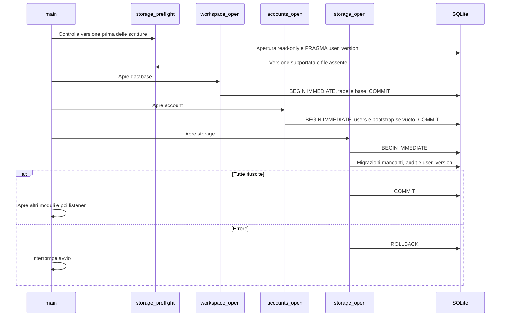
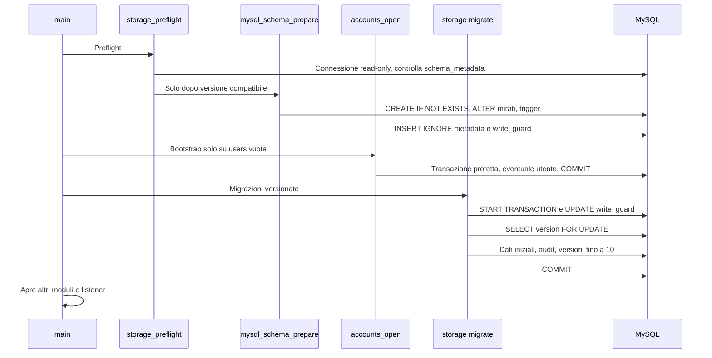

# Migrazioni, transazioni e consistenza

**Italiano** | [English](../en/tehnical/migrazioni-e-consistenza.md)

Verificato l’**11 ottobre 2026** sui sorgenti e sui test presenti. Versione applicativa dei dati: **10**. Le sezioni iniziali descrivono il comportamento implementato; la sezione finale propone un metodo per le evoluzioni future. Le migrazioni 8 → 9 → 10 e 9 → 10 sono verificate da test nativi su conservazione delle righe figlie, sequenze, idempotenza e rollback.

Fonti: [storage.c](../../src/storage.c), [mysql_schema.c](../../src/mysql_schema.c), [adapter MySQL](../../src/db_mysql.c), [avvio](../../src/server.c), [accounts.c](../../src/accounts.c), [procurement.c](../../src/procurement.c). Il DDL completo e le relazioni sono nel [modello dati](modello-dati.md); backup e ripristino nel [manuale operativo](operazioni-backup-ripristino.md).

## Che cosa significa versione 10

La stessa versione applicativa descrive i due backend, ma la procedura fisica è differente:

| Aspetto | SQLite nativo | MySQL Docker |
| --- | --- | --- |
| Identificatore di versione | `PRAGMA user_version` | Riga `schema_metadata(id=1,version)` |
| Tabelle base | Create da workspace/accounts prima delle migrazioni | Preparate da `mysql_schema_prepare()` prima dell'apertura dei moduli |
| Migrazioni | DDL, trasformazioni dati, audit e versione in una transazione SQLite | DDL preparatorio separato; trasformazioni dati, audit e versione in una successiva transazione |
| Coordinamento scritture | `BEGIN IMMEDIATE` | `START TRANSACTION`, riga `cluster_write_guard` e certificazione Group Replication |
| Storage PDF | Filesystem locale separato | MongoDB GridFS separato |
| Confine del rollback | La transazione SQL corrente | La transazione SQL corrente; non annulla DDL già applicato o chiamate esterne |

Versione supportata non significa verifica completa di ogni colonna e indice esistente. Il codice contiene controlli mirati: non è uno strumento generale di rilevamento della divergenza dello schema. Alterazioni manuali sconosciute possono far fallire l'avvio oppure una successiva operazione.

Gli addon hanno cicli di archivio indipendenti: Calendar verifica `PRAGMA user_version<=1` e la chiave cifrante; mail crea il proprio ledger e converte `sending` residui in `unknown`. NPM gestisce autonomamente le proprie migrazioni. Inventory gestisce separatamente il proprio schema SQLite 5, con persone, identità e collegamenti molti a molti. Nessuno di questi archivi viene aggiornato dalla versione 10 MySQL.

## Avvio SQLite, ordine ed effetti persistenti



Il diagramma mostra il caso di file già esistente; se il file non esiste il preflight accetta l'assenza senza crearlo. Un file con versione negativa/non leggibile o maggiore di 10 viene rifiutato prima di creare tabelle o account.

`workspace_open()` crea `jobs`, `time_entries` e indici base in una sua transazione. `accounts_open()` crea `users`, quindi inserisce il gestore bootstrap soltanto se `COUNT(*)=0`. Questi commit precedono la transazione delle migrazioni: **non esiste una sola transazione che racchiuda l'intero avvio**. Se una migrazione successiva fallisce, il bootstrap/base già confermati non vengono cancellati.

`storage_open()` apre un'altra connessione e avvia `migrate()`. Per ricostruire la tabella padre `alert_rules`, la migrazione sospende le FK prima della transazione, esegue `PRAGMA foreign_key_check` prima del commit e riabilita le FK anche in caso di errore. Il valore di partenza viene letto una volta; le condizioni `version <= N` applicano tutti i passi necessari nello stesso avvio. Ogni passo aggiorna il marcatore e aggiunge un evento `system.migration`; se un passo fallisce, il rollback della transazione di migrazione annulla anche i passi precedenti eseguiti in quella stessa transazione.

## Avvio MySQL, DDL e versione



Qui il nome `storage_preflight()` comprende una fase mutante: prima `mysql_schema_preflight()` verifica la compatibilità, poi `mysql_schema_prepare()` prepara lo schema. La connessione read-only della prima fase non è riutilizzata per il DDL.

Il controllo preliminare accetta il database senza `schema_metadata`, oppure con tabella vuota dopo un'installazione interrotta; con una riga richiede `id=1`, versione non NULL in 0–10 e nessun'altra riga. Una versione futura viene respinta prima della preparazione DDL e del bootstrap.

La preparazione definisce le 24 tabelle attese e controlla esplicitamente:

- `jobs.contract_id`, con FK e indice, per installazioni precedenti;
- `job_assignments.role_id` e FK;
- `jobs.is_common`, default 0;
- il CHECK degli stati di `alert_email_outbox`: accetta quello corrente, oppure sostituisce soltanto il vincolo legacy riconosciuto che ammetteva `pending_configuration`; un vincolo personalizzato sconosciuto non viene sostituito alla cieca;
- `alert_rules.days_before` con default 30 e `verification_days` con default 90, entrambe con CHECK 1–365; ampliamento dei soli CHECK dei tipi legacy riconosciuti (prima dello schema 9 o allo schema 9), aggiungendo `inventory_due`, `inventory_return` e `inventory_verification`;
- presenza dei trigger di integrità/immutabilità;
- righe iniziali `schema_metadata(1,0)` e `cluster_write_guard(1,0)` con inserimento idempotente.

I singoli DDL MySQL possono produrre commit impliciti e rimangono applicati se un passo successivo fallisce. Al riavvio il codice ripete la preparazione idempotente prevista, senza una generica procedura di downgrade. Un errore di startup non dimostra dunque che nessun DDL sia cambiato.

Solo dopo si aprono workspace/accounts/storage. La migrazione versionata MySQL acquisisce il guard, legge la versione `FOR UPDATE`, applica le trasformazioni dati necessarie, aggiunge audit e avanza il marcatore nella medesima transazione. Il contatore versione non è aggiornato dal solo `CREATE TABLE`.

## Percorso 0 → 10

| Passaggio | Trasformazione implementata | Dati preservati o particolarità |
| --- | --- | --- |
| `0 → 1` | SQLite aggiunge `time_entries.user_id` se assente, tenta il mapping `owner`→`users.email` case-insensitive, crea indici/triggers, assegnazioni e audit. | Ore senza corrispondenza restano con ID NULL; nessuna assegnazione universale viene creata. L'audit registra quantità mappate/non mappate. In MySQL la preparazione ha già definito le colonne; il passo versione registra la migrazione con conteggi iniziali zero, senza una generica importazione di vecchi DB SQLite. |
| `1 → 2` | Fornitori, contratti, manifesti PDF, trigger immutabili e collegamento facoltativo commessa–contratto. | Non fabbrica un contratto per ogni commessa e non copia byte PDF preesistenti da altre applicazioni. |
| `2 → 3` | Gruppi, membri, ruoli locali, grant di gruppo; aggiunta ruolo alle assegnazioni. Inserisce ruoli ID 1 `reader`, ID 2 `contributor`; assegna 2 alle righe legacy con ruolo NULL. | Conserva le abilitazioni precedenti come Collaboratore; non cambia il ruolo globale degli utenti. |
| `3 → 4` | Tariffe storicizzate, indici e vincolo utente immutabile. | Non inventa una tariffa: le ore senza tariffa restano non valorizzate nei report. |
| `4 → 5` | Flag `jobs.is_common` non nullo, default 0. | Le commesse esistenti restano private salvo aggiornamento esplicito. I nomi delle commesse comuni non vengono imposti automaticamente da questa migrazione. |
| `5 → 6` | Regole alert, destinatari utenti/email, soggetti monitorati, eventi invalidi, notifiche e outbox. | Nessuna regola viene attivata automaticamente per tutti. L'outbox legacy ammette solo `pending_configuration`. |
| `6 → 7` | Stati email `pending_configuration/retrying/sent/delivery_unknown/delivery_failed`. | SQLite ricostruisce l'outbox copiando tutte le righe e preserva `sqlite_sequence`, anche se gli ID più alti erano già eliminati. MySQL espande il CHECK nella fase DDL e registra il passo versione nella fase transazionale. |
| `7 → 8` | Attività/sottoattività `job_tasks` e registro `job_blockers`, indici, FK alla commessa e agli utenti e FK composte alla stessa commessa. | Nessun dato dimostrativo o trasformazione dei record precedenti. SQLite crea le strutture nella transazione; MySQL le prepara nella fase DDL e conferma audit/versione nella transazione. |
| `8 → 9` | Regole `inventory_due` e `days_before` 1–365, predefinito 30. | SQLite ricostruisce `alert_rules`, preserva ID, sequenza e righe figlie, controlla le FK e conferma audit/versione atomicamente. MySQL amplia il solo CHECK legacy riconosciuto e aggiunge la colonna in preparazione DDL. Non crea regole automatiche. |
| `9 → 10` | Regole `inventory_return` e `inventory_verification`, con `verification_days` 1–365, predefinito 90. | SQLite ricostruisce `alert_rules` conservando ID, massimo della sequenza, destinatari, FK e storico delle notifiche/email; verifica le FK prima del commit e conferma audit/versione atomicamente. MySQL prepara la nuova colonna e amplia soltanto i CHECK legacy riconosciuti, poi conferma audit/versione. Le regole `inventory_due` esistenti mantengono soglia e comportamento; non crea regole automatiche. |

La conservazione del massimo ID outbox è parte del contratto di idempotenza: il servizio mail usa `namespace:outbox:ID`. Riutilizzare un ID precedentemente consumato potrebbe far coincidere un nuovo messaggio con un invio storico.

Una migrazione già applicata non deve aggiungere nuovamente gli audit dei passi precedenti. La preparazione MySQL ripete controlli di esistenza, mentre i passi dati dipendono dal marcatore. Uno schema con colonne apparentemente recenti ma marcatore non coerente non va “corretto” impostando manualmente `version=10`: si salterebbero trasformazioni e verifiche.

## Transazione business: unità atomica

Il modello usuale di scrittura è:

```text
validazione sintattica
BEGIN IMMEDIATE / START TRANSACTION con guard
lettura stato e verifica vincoli attuali
scrittura entità e relazioni
storage_audit(stessa_connessione, prima, dopo)
COMMIT
risposta di successo
```

In caso di errore: finalizzare gli statement, fare rollback e restituire errore. Il risultato di `COMMIT` viene verificato: non si deve emettere successo solo perché l'ultima `INSERT` è riuscita. `storage_audit()` rifiuta la chiamata quando la connessione è in autocommit, rendendo esplicito il vincolo transazionale.

Esempi atomici presenti: limite delle ore giornaliere con inserimento, cancellazione commessa con tutte le ore, attività, blocchi e grant, modifica ruolo/utente con protezione dell'ultimo gestore attivo, tariffa con verifica sovrapposizioni, esecuzione alert con notifiche/outbox/cursori, modifica attività/blocco con controllo revisione e rimozione attività con scollegamento dei blocchi e relativo audit. Audit e dati non usano due connessioni differenti: la funzione audit riceve quella dell'handler.

Attività e blocchi aggiungono concorrenza ottimistica: il form invia la revisione letta, la transazione la confronta e la scrittura la incrementa. Due editor della stessa revisione non possono sostituirsi silenziosamente. Lo scollegamento di un blocco durante l’eliminazione dell’attività incrementa anch’esso la revisione. I controlli della gerarchia considerano tutto il sottoalbero e avvengono prima della scrittura.

Le letture dei report usano una singola query con CTE per totali e righe, senza aprire una transazione di scrittura né acquisire il guard. Le opzioni filtro vengono lette separatamente; non costituiscono un intero snapshot multi-query immutabile del database.

## Guard e cluster multi-primary

Ogni `BEGIN`/`START TRANSACTION` riconosciuto dall'adattatore MySQL, anche attraverso prepared statement, esegue:

```sql
UPDATE cluster_write_guard SET generation=generation+1 WHERE id=1;
```

La riga deve esistere ed essere aggiornata una volta. Sul singolo membro il lock serializza gli scrittori applicativi; tra primari il write-set comune consente a Group Replication di certificare il conflitto e annullare una transazione intera. In caso di contesa possono quindi fallire anche scritture su entità business diverse: è un compromesso intenzionale per proteggere invarianti aggregate, non una distribuzione senza conflitti delle scritture.

Le connessioni MySQL impostano `READ COMMITTED`, autocommit iniziale 1, fuso UTC e `innodb_lock_wait_timeout` derivato dal busy timeout del modulo (normalmente 5 secondi). Dopo l'acquisizione del guard le letture verificano lo stato impegnato più recente visibile sulla connessione. Il comportamento di replica/routing del cluster è descritto in [architettura](architettura.md) e [operazioni](operazioni-backup-ripristino.md).

La protezione si applica alle transazioni passate dall'adattatore, non rende sicure scritture manuali che la aggirano. Il DDL preparatorio non è racchiuso da questo guard. L'adattatore rifiuta inoltre un `BEGIN` annidato: su MySQL un nuovo `START TRANSACTION` potrebbe altrimenti provocare il commit implicito di una transazione già aperta.

## Riconnessione non equivale a retry

`MYSQL_OPT_RECONNECT` è disabilitato. `ensure_connection()` può riconnettersi solo senza statement aperti e fuori da una transazione. Se una connessione sana fallisce al `ping`, la scarta e ne apre una nuova per la **successiva operazione sicura di confine**. Un comando già fallito non viene ripetuto automaticamente.

| Evento | Comportamento implementato | Conseguenza per chi chiama |
| --- | --- | --- |
| Unicità violata (`1062`) | `DB_CONSTRAINT_UNIQUE`, spesso tradotto in `409`. | Correggere/rileggere il dato. |
| Lock timeout, deadlock, certificazione (`1205/1213/3101`) | `DB_BUSY`; l'handler fallisce e pulisce la transazione. | È possibile ritentare consapevolmente una nuova operazione, non presumere un retry invisibile già avvenuto. |
| Schema/DML incompatibile (`3098`) | Errore non classificato come contesa. | Analizzare schema/configurazione. |
| Connessione persa (`2006/2013/2055`) | Connessione marcata `broken`; nessun replay dello statement. | L'esito può dipendere dal punto in cui si è persa la risposta. |
| `ROLLBACK` su connessione già persa | Scarta lo stato locale senza connettersi appositamente per inviare rollback. | Non trasforma un commit incerto in un'operazione certamente annullata. |
| `COMMIT` senza conferma | Errore HTTP tramite handler, nessun replay automatico. | Rileggere dati/audit prima di ripetere la mutazione. |

Le API business non possiedono tutte chiavi di idempotenza. Ad esempio, una risposta persa dopo una nuova registrazione ore non giustifica una seconda `POST` cieca: il salvataggio potrebbe esistere già. Le code mail/Calendar risolvono il problema in modo specifico con chiavi persistenti, come documentato in [flussi integrazioni](flussi-integrazioni.md).

## Confini tra database e servizi esterni

### PDF: SQL più GridFS

L'upload salva i byte documentali prima della transazione SQL del manifesto. Se l'inserimento manifesto o l'audit falliscono prima del commit, il codice tenta la rimozione del blob. Se il `COMMIT` SQL ha esito incerto, conserva il blob: eliminandolo si potrebbe rompere un manifesto effettivamente confermato. Il residuo possibile è quindi un oggetto non referenziato, da riconciliare, anziché un PDF cancellato dietro un manifesto valido.

Non esiste transazione distribuita MySQL–MongoDB, né cancellazione periodica automatica degli orfani. Il backup deve includere metadati e byte; per una pulizia servono verifica dei riferimenti e condizioni operative controllate.

### Email: outbox SQL più ledger SQLite

La produzione dell'outbox è atomica con la regola/audit. La rete è fuori dalla transazione SQL. Mail-addon riserva la chiave prima di SMTP, mentre l'app aggiorna stato e audit in una nuova transazione. Se quest'ultimo aggiornamento fallisce, lo stesso item resta ripetibile con **stessa chiave e contenuto**, e il ledger impedisce un secondo invio già riconosciuto.

### Calendar: copia locale più provider

Il commit della coda è locale; non è il commit di una scrittura Google. Gli stati `queued/unknown/applied/conflict/failed` distinguono i passaggi. La cache eventi e `nextSyncToken` vengono confermati insieme solo dopo tutte le pagine. Le verifiche di generazione impediscono a risposte di una connessione vecchia di popolare un nuovo account locale. Il provider resta fuori dalla transazione SQLite.

## Verifiche presenti nel repository

Questa tabella indica **test esistenti**, non risultati appena rieseguiti.

| Invariante | Evidenza |
| --- | --- |
| Versione futura rifiutata prima del bootstrap | `test_future_schema_version_is_rejected_without_bootstrap_or_database_changes` in [assegnazioni](../../tests/test_assignments.py). |
| Ore legacy mappate senza abilitazioni universali | `test_schema_migration_maps_legacy_owners_without_assigning_everyone`, stesso file. |
| Ruoli legacy e audit conservati | `test_version_two_upgrade_defaults_legacy_assignments_and_preserves_business_history` in [gruppi](../../tests/test_groups.py). |
| Migrazione tariffe senza perdita dati | `test_schema_three_upgrade_preserves_all_business_records_and_audit` in [tariffe](../../tests/test_labor_rates.py). |
| Flag comuni inizializzati in modo conservativo | `test_schema_four_upgrade_preserves_records_and_sets_safe_defaults_once` in [commesse comuni](../../tests/test_job_defaults.py). |
| Migrazione alert e audit una sola volta | `test_schema_five_upgrade_preserves_business_and_audit_once` in [alert](../../tests/test_alerts.py). |
| Sequenza ID outbox conservata al passo 7 | `test_schema_six_upgrade_preserves_outbox_ids_sequence_business_records_and_audit` in [client mail](../../tests/test_mail_client.py). |
| Schema 8 conserva dati precedenti e audit una sola volta | `test_schema_seven_upgrade_preserves_existing_accounts_jobs_hours_and_audit` in [attività/blocchi](../../tests/test_work_board.py). |
| Schema 10 conserva regole, destinatari, consegne e contatori ID; rollback su errore audit/FK | Test delle migrazioni reali 8/9 → 10 in [inventory](../../tests/test_inventory_migration.py). |
| Revisioni, gerarchie e scollegamento blocchi | Casi dedicati in [attività/blocchi](../../tests/test_work_board.py): update/delete obsoleti, limiti di profondità, cancellazione con figli e rollback dell’audit. |
| Audit fallito annulla business | Test dedicati in [assegnazioni](../../tests/test_assignments.py), [gruppi](../../tests/test_groups.py), [tariffe](../../tests/test_labor_rates.py), [contratti](../../tests/test_procurement.py) [alert](../../tests/test_alerts.py) e [attività/blocchi](../../tests/test_work_board.py). |
| Scritture da ogni primario e conflitti | `test_01_every_primary_writes_and_conflicting_transactions_roll_back` in [HA MySQL](../../tests/test_cluster_ha.py), prova facoltativa con effetti sul laboratorio. |
| Recupero quorum e arresto completo | Altri casi di [HA MySQL](../../tests/test_cluster_ha.py) e selezione GTID in [cluster manager](../../tests/test_cluster_manager.py). |

Le prove SQLite non dimostrano da sole il comportamento MySQL di DDL implicito, certificazione o riconnessione. I test live richiedono un ambiente dedicato e le condizioni indicate nel [manuale test](sviluppo-test.md).

## Strategia proposta per una prossima versione

Questa sezione è **una proposta di lavoro**, non un migration runner già presente. Le migrazioni fino alla 10 sono implementate; non sono presenti un downgrade automatico o un comando HTTP di aggiornamento schema.

1. Definire l'invariante del nuovo dato, la nullabilità e il valore iniziale senza inventare valori business. Elencare impatti su audit, report, autorizzazioni, backup e integrazioni.
2. Preparare fixture dei database supportati e snapshot prima/dopo delle entità da conservare, inclusi contatori ID e blob esterni. Usare dati sintetici e testare upgrade da ogni versione effettivamente supportata.
3. Separare esplicitamente per MySQL le aggiunte DDL ripetibili dalle trasformazioni transazionali. Per SQLite valutare ricostruzione della tabella, FK e `sqlite_sequence` quando occorre ampliare un CHECK.
4. Rendere le modifiche inizialmente additive quando possibile: nuova colonna/struttura, popolamento verificato, letture compatibili, poi eventuale rimozione in una versione successiva. È un approccio consigliato, non supporto già garantito a deploy misti di più versioni dell'app.
5. Incrementare coerentemente i marcatori supportati e aggiornare il preflight. Non limitarsi a cambiare `SCHEMA_VERSION`: ogni passaggio deve produrre dati validi, audit e marcatore solo dopo le verifiche.
6. Provare fallimenti intermedi, riavvio e doppia esecuzione. Per operazioni esterne simulare conferme perse e crash tra i commit locali e la richiesta remota.
7. Preparare un backup coerente e un ripristino provato prima del rilascio. Un ripristino può richiedere tutti gli archivi correlati; la sola vecchia immagine applicativa non annulla uno schema nuovo.
8. Pubblicare note di migrazione con prerequisiti, durata osservata, eventuale indisponibilità, verifiche e limiti. Non annunciare aggiornamento senza interruzioni finché non è stato progettato e misurato.

Qualsiasi futura cifratura dei campi o separazione multi-società richiederà migrazioni anche di audit, outbox, cache e backup: non è una proprietà ottenibile aggiornando soltanto una tabella o una chiave.
