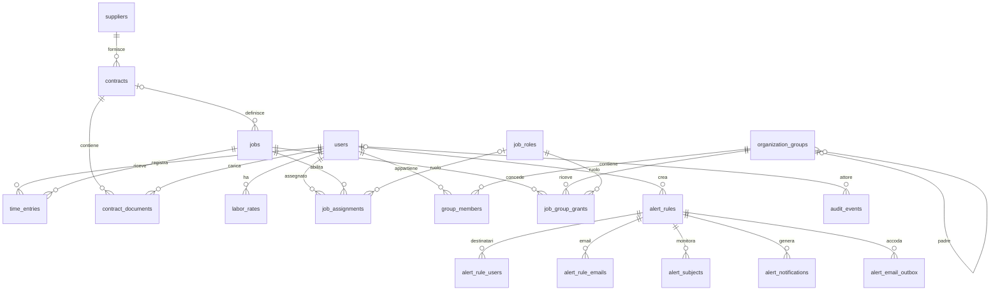

# Modello dei dati e dizionario degli archivi

Verificato sul codice del repository il **10 ottobre 2026**. Schema applicativo **7**; schema del calendario SQLite **1**. Questo documento descrive l'implementazione presente, non le proposte finanziarie o crittografiche della roadmap.

Fonti: [DDL MySQL](../../src/mysql_schema.c), [migrazioni](../../src/storage.c), [utenti](../../src/accounts.c), [commesse e ore](../../src/workspace.c), [organizzazione](../../src/organization.c), [contratti](../../src/procurement.c), [documenti](../../src/documents.c), [alert](../../src/alerts.c), [mailer](../../addon/src/mailer.c), [calendario](../../calendar-addon/src/calendar.c) e [Compose](../../compose.yaml).

## Inventario e responsabilità

| Archivio | Nome/percorso predefinito | Contenuto e proprietario |
| --- | --- | --- |
| MySQL InnoDB, tre repliche Group Replication | `punto`, configurabile con `MYSQL_DATABASE`/`DB_NAME` | Le 22 tabelle applicative sotto descritte. Tre nodi replicano lo stesso database logico: non sono tre database business diversi. |
| SQLite applicativo, sviluppo nativo | `DB_PATH`, predefinito `data/punto.db` | Alternativa a MySQL per le stesse funzioni; versione con `PRAGMA user_version`. |
| MongoDB GridFS | `punto_documents`, configurabile con `DOC_DB_NAME` | Originali PDF e metadati GridFS, gestiti dall'app tramite account documentale. |
| SQLite Nginx Proxy Manager | `nginx-proxy-manager/data/database.sqlite` sull'host, `/data/database.sqlite` nel container | Configurazione NPM, utenti amministrativi NPM, host proxy e riferimenti ai certificati. Schema di competenza di NPM 2.16.0, non delle migrazioni applicative. |
| SQLite mail-addon | `/var/lib/punto-mailer/delivery.sqlite3`, volume `mail_addon_data` | Registro di idempotenza SMTP; nessuna copia del testo delle email. |
| SQLite calendar-addon | `/var/lib/punto-calendar/calendar.sqlite3`, volume `calendar_addon_data` | Token Google, cache eventi e coda delle modifiche, isolati per ID utente. |
| Memoria del processo app | Array di sessioni, massimo 64 | Token di sessione, ID utente e scadenza; persi al riavvio. Non esiste una tabella sessioni. |

Gli addon non accedono a MySQL o MongoDB. I loro ID utente sono riferimenti logici ricevuti dall'app, senza foreign key tra database o container. Le due SQLite degli addon sono singole istanze: non ereditano l'alta disponibilità MySQL.

## Convenzioni di memorizzazione

- Gli ID MySQL sono `BIGINT` con segno; le entità principali usano `AUTO_INCREMENT`. Il codice usa `DbInt` a 64 bit. Non assumere ID contigui nel cluster.
- Le tabelle MySQL sono `ENGINE=InnoDB`, `utf8mb4`, collazione predefinita `utf8mb4_bin`. Email e codici univoci indicati nel DDL usano `utf8mb4_general_ci`; date e chiavi esadecimali usano ASCII binario. SQLite usa `NOCASE` dove previsto: non equivale a tutte le regole Unicode della collazione MySQL.
- Le durate sono **minuti interi**, non ore decimali: `480` = 8 ore. Ogni registrazione vale 1–1440 minuti; la somma per utente e giorno non può superare 1440. Il vincolo sulla somma è applicativo/transazionale.
- Importi e tariffe sono **centesimi interi**. `value_cents=125000` significa 1.250,00 EUR; `hourly_cents=4500` significa 45,00 EUR/ora. È ammessa solo `EUR`. Più società, altre valute, fatture, pagamenti e contabilità non hanno ancora tabelle operative.
- Il costo di ogni registrazione è `floor((minutes * hourly_cents + 30) / 60)`, arrotondamento HALF_UP al centesimo. Il report somma i costi delle registrazioni; una tariffa mancante resta distinta dal costo zero.
- Le date business sono stringhe `YYYY-MM-DD`; in MySQL `CHAR(10)`, non `DATE`. Il DDL verifica soprattutto lunghezza e ordinamento; il C valida il calendario. Le finestre di assegnazione e di tariffa includono entrambi gli estremi; `NULL` significa estremo aperto dove ammesso.
- Gli istanti applicativi sono `YYYY-MM-DDTHH:MM:SSZ`, `CHAR(20)` UTC. `alert_rules.run_time` è `HH:MM` nel fuso `Europe/Rome`, impostato dal modulo alert. Negli addon gli orari tecnici sono secondi Unix `INTEGER`.
- `NULL`, stringa vuota e zero non sono intercambiabili: contratto senza valore = `NULL`, tariffa gratuita = `0`, campo anagrafico opzionale = spesso `''`.
- Le flag MySQL sono `TINYINT` con `CHECK(... IN (0,1))`; le API le restituiscono generalmente come booleani JSON.

## Relazioni principali



`alert_events.job_id` è intenzionalmente privo di FK: registra tentativi relativi a una commessa inesistente. `audit_events.entity_id` è un riferimento polimorfico storico, non una FK: lo storico sopravvive alla cancellazione dell'entità.

## Catalogo funzionale delle 22 tabelle MySQL

Il DDL completo in fondo specifica **ogni colonna, tipo, nullabilità, default, indice, chiave e CHECK**. Qui sono spiegate le responsabilità e le regole che il solo DDL non esprime.

| Tabella | Responsabilità e interpretazione |
| --- | --- |
| `schema_metadata` | Una riga `id=1`; `version=7` dopo le migrazioni. Una versione futura sconosciuta impedisce l'avvio. |
| `cluster_write_guard` | Una riga `id=1`, `generation>=0`; aggiornata all'inizio delle scritture applicative per far certificare sul cluster i conflitti fra transazioni, incluse regole dipendenti da aggregati. Non è un dato utente. |
| `users` | Identità applicativa: email univoca, nome, ruolo globale `manager`/`worker`, abilitazione, hash password e salt. L'API non espone hash/salt. Creazione attiva; disabilitazione reversibile; nessuna cancellazione utente esposta. |
| `suppliers` | Codice univoco, ragione sociale, partita IVA, contatti, indirizzo, note e stato attivo. Il flag non elimina contratti o documenti. |
| `contracts` | Codice, titolo, fornitore, stato `draft`/`active`/`expired`/`closed`/`cancelled`, validità, valore facoltativo in EUR e note. Nessun calcolo fiscale o registro fatture. |
| `contract_documents` | Manifesto SQL del PDF: `storage_key` casuale univoca, nome, dimensione, SHA-256, autore e istante. `storage_key` risolve il contenuto in GridFS; non è un percorso filesystem. Metadati immutabili. |
| `jobs` | Commessa, codice univoco, nome, cliente libero, descrizione, stato `planned`/`active`/`paused`/`completed`/`cancelled`, contratto opzionale e `is_common`. Le commesse comuni sono visibili a tutti gli utenti attivi secondo le regole applicative. |
| `time_entries` | Durata lavorata da un utente in una data per una commessa; nota. `owner` conserva l'email storica/legacy; l'autorizzazione usa `user_id`. |
| `labor_rates` | Tariffa per utente e intervallo inclusivo. `user_id` immutabile; intervalli dello stesso utente non sovrapposti per controllo applicativo. Zero è una tariffa valida. |
| `job_roles` | Ruoli locali alla commessa, distinti da `users.role`. Built-in: `reader`/Lettore (`can_log_time=0`) e `contributor`/Collaboratore (`1`). `builtin` protegge i ruoli di sistema dalle modifiche. |
| `organization_groups` | Alberatura di gruppi tramite `parent_id`. Il C impedisce cicli e profondità superiore a 16. Il nome non è dichiarato univoco. |
| `group_members` | Appartenenza diretta utente–gruppo, PK composta. Le autorizzazioni dei gruppi antenati sono risolte dal codice senza duplicare righe di appartenenza. |
| `job_group_grants` | Abilitazione commessa–gruppo, ruolo locale obbligatorio e validità opzionale. Una riga per coppia. |
| `job_assignments` | Abilitazione diretta commessa–utente e validità. `role_id` nullable per compatibilità: il codice interpreta il valore assente come Collaboratore, ID 2. |
| `alert_rules` | Regola di proprietà di un gestore: nome, `invalid_job`/`missing_hours`, ora, abilitazione, date di gestione/esecuzione e ultimo evento processato. Una regola non è condivisa automaticamente tra gestori. |
| `alert_rule_users` | Destinatari interni della regola; una riga per utente. L'app richiede utenti esistenti e attivi; un destinatario worker riceve solo notifiche che lo riguardano come soggetto. |
| `alert_rule_emails` | Destinatari email della regola, indirizzi case-insensitive nella PK composta. Non occorre un account applicativo per un indirizzo email. |
| `alert_subjects` | Utenti osservati per le ore mancanti: inizio del monitoraggio e ultimo giorno verificato. Sono soggetti dell'alert, distinti dai destinatari. |
| `alert_events` | Tentativi di registrare ore su ID commessa inesistente, con utente, data lavorata, minuti e momento del tentativo. Le ore invalide non entrano in `time_entries`. |
| `alert_notifications` | Notifica interna immutata nel contenuto, con destinatario, utente interessato, chiave evento, testo e lettura opzionale. Unicità `(rule_id,recipient_id,event_key)` evita notifiche duplicate. |
| `alert_email_outbox` | Richiesta email persistente in SQL con destinatario e contenuto. Unicità `(rule_id,email,event_key)`; stati `pending_configuration`, `retrying`, `sent`, `delivery_unknown`, `delivery_failed`. |
| `audit_events` | Storico append-only: attore con nome/email fotografati, azione, tipo/ID entità, JSON prima/dopo. `actor_id=NULL` per operazioni di sistema. L'audit può contenere dati personali e copie di valori business. |

### Integrità, cancellazione e concorrenza

Le FK MySQL non dichiarano `ON DELETE CASCADE`: la cancellazione è normalmente restrittiva. L'API di cancellazione commessa elimina esplicitamente ore, assegnazioni dirette e grant di gruppo, poi la commessa, nella stessa transazione con l'audit. L'audit conserva identità e conteggi aggregati eliminati, non costituisce un backup integrale delle ore. Contratto, fornitore e PDF non sono cancellati da questa operazione.

Una cancellazione gruppo è consentita solo dopo aver rimosso figli, membri e grant. Per utenti, fornitori, contratti, tariffe, ruoli e regole alert non esiste una generica API `DELETE`: usare gli aggiornamenti/stati esposti dal prodotto. Documenti contrattuali e audit hanno trigger che negano `UPDATE` e `DELETE`.

Trigger MySQL aggiuntivi:

- `time_entries_require_user_insert`: rifiuta nuove righe con `user_id=NULL`.
- `time_entries_preserve_user_update`: un `user_id` già valorizzato non può cambiare o tornare NULL.
- `labor_rates_preserve_user_update`: impedisce lo spostamento di una tariffa su un altro utente.
- `contract_documents_no_update`, `contract_documents_no_delete`, `audit_events_no_update`, `audit_events_no_delete`: protezioni di immutabilità.

`time_entries.user_id` rimane nullable per compatibilità con dati precedenti alla migrazione delle identità. SQLite tenta il collegamento tramite email; righe non riconciliabili restano storiche e non diventano ore personali di un altro utente.

I controlli di 24 ore giornaliere, ultimo gestore attivo, massimo numero di entità, sovrapposizioni tariffarie, validità delle assegnazioni e cicli dei gruppi richiedono l'applicazione. Scrivere direttamente in SQL può violare regole business anche quando tutti i CHECK passano. Le scritture applicative aggiornano `cluster_write_guard` prima di verificare le regole; contese e indisponibilità possono restituire un errore temporaneo. Le API business non hanno una chiave di idempotenza universale: dopo una risposta ambigua rileggere lo stato prima di creare una seconda entità.

## SQLite applicativo e migrazioni

In modalità nativa, `users`, `jobs` e `time_entries` vengono inizializzate dai rispettivi moduli, poi [storage.c](../../src/storage.c) applica la sequenza di migrazione. I tipi sono prevalentemente `INTEGER`, `TEXT`, `BLOB`, con FK abilitate tramite `PRAGMA foreign_keys=ON`; gli ID autonomi usano `INTEGER PRIMARY KEY AUTOINCREMENT`.

| Versione | Evoluzione |
| --- | --- |
| 1 | Collegamento ore–utente, assegnazioni e audit immutabile. |
| 2 | Fornitori, contratti, manifesto PDF e contratto opzionale sulla commessa. |
| 3 | Gruppi gerarchici, membri, ruoli locali e grant di gruppo. |
| 4 | Tariffe orarie storicizzate. |
| 5 | Flag commessa comune. |
| 6 | Regole, destinatari, soggetti, eventi, notifiche e outbox alert. |
| 7 | Stati di consegna email ampliati per mail-addon; mantenimento dei contatori ID anche delle righe eliminate. |

SQLite non possiede `schema_metadata` né `cluster_write_guard`: usa `PRAGMA user_version` e transazioni `BEGIN IMMEDIATE`. Il suo schema business comprende le altre 20 tabelle; `sqlite_sequence` è una tabella interna SQLite. Non si devono copiare i DDL MySQL sul file SQLite. Le migrazioni sono eseguite dall'app, senza un endpoint HTTP di migrazione.

In modalità nativa i PDF sono file locali nella directory `DOC_FILES_DIR`, oppure nella sottocartella `documents` accanto al file `DB_PATH` (per default `data/documents`), con chiavi validate ed esclusione di symlink. In Docker il backend documentale è MongoDB.

## PDF in MongoDB GridFS

Il database `punto_documents` contiene:

| Collezione | Campi e funzione |
| --- | --- |
| `contract_pdfs.files` | Documento GridFS `_id` = `storage_key` stringa esadecimale di 64 caratteri; `filename`, `length`, `chunkSize`, `uploadDate`; `metadata.sha256` e `metadata.contentType="application/pdf"`. |
| `contract_pdfs.chunks` | Segmenti binari GridFS, collegati tramite `files_id`, ordinati da `n`, con `data`. Dimensione del segmento configurata a 255 KiB. Gli indici del bucket sono gestiti dal driver GridFS. |
| `contract_pdf_keys` | Prenotazione dell'ID durante il caricamento, con `_id` univoco. Evita che la pulizia di un upload concorrente elimini i segmenti di un altro upload con la stessa chiave. |

Il manifesto MySQL mantiene la relazione al contratto e l'autore. L'upload verifica estensione/nome, firma iniziale `%PDF-`, 5 byte–10 MiB e SHA-256. Non è un motore antivirus né un parser completo del documento. Il download confronta dimensione e hash con il manifesto prima di restituire il file. Un hash rileva differenze: non cifra il PDF.

Il caricamento attraversa due database e non usa una transazione distribuita. Il codice riserva lo storage, salva il documento, inserisce manifesto/audit e tenta la pulizia se la parte SQL fallisce. Backup e verifiche devono includere entrambi gli archivi; un dump MySQL contiene solo metadati, non i PDF.

## Registro mail-addon

Una tabella SQLite, `deliveries`:

| Campo | Tipo/vincolo | Significato |
| --- | --- | --- |
| `idempotency_key` | `TEXT PRIMARY KEY` | Chiave `namespace:outbox:ID` generata dall'app. |
| `payload_hash` | `TEXT NOT NULL` | SHA-256 del contenuto richiesto; rileva il riuso della chiave con contenuto diverso. |
| `status` | `TEXT NOT NULL CHECK` | `sending`, `sent`, `unknown`, `failed`. |
| `created_at`, `updated_at` | `INTEGER NOT NULL` | Secondi Unix. |

WAL e `synchronous=FULL`; lo stato `sending` viene confermato su disco prima della chiamata SMTP e trasformato in `unknown` al riavvio. Non sono salvati destinatario, oggetto o corpo nel ledger: restano in chiaro nell'outbox MySQL. Il ledger non è cifrato a livello di campo. Namespace, outbox e ledger devono essere ripristinati coerentemente per evitare duplicati. Dettagli nel [contratto addon](api-addon.md).

## Archivio calendar-addon

SQLite usa FK, WAL, `synchronous=FULL`, `user_version=1`, timeout di contesa 3 secondi e connessioni distinte per API e worker. Le cinque tabelle sono:

| Tabella | Colonne e vincoli |
| --- | --- |
| `accounts` | `user_id INTEGER PRIMARY KEY`; `token_blob BLOB NOT NULL`; `calendar_id`, `sync_token`, `last_error`, `provider_id`, `generation TEXT NOT NULL DEFAULT ''`; `last_sync`, `reauth_required`, `next_poll`, `sync_running INTEGER NOT NULL DEFAULT 0`. `provider_id` identifica l'account Google tramite il calendario primario; `generation` impedisce a risultati di una vecchia connessione di aggiornare la nuova. |
| `oauth_states` | `state_hash TEXT PRIMARY KEY`; `user_id INTEGER NOT NULL`; `session_hash TEXT NOT NULL`; `verifier_blob BLOB NOT NULL`; `expires INTEGER NOT NULL`. Stato OAuth monouso valido 600 secondi, legato a sessione e utente. |
| `events` | `user_id INTEGER NOT NULL REFERENCES accounts(user_id) ON DELETE CASCADE`; `event_id`, `etag`, `status TEXT NOT NULL`; `payload BLOB NOT NULL`; PK `(user_id,event_id)`. Un solo calendario selezionato per utente. |
| `changes` | `id INTEGER PRIMARY KEY AUTOINCREMENT`; `user_id INTEGER NOT NULL REFERENCES accounts(user_id) ON DELETE CASCADE`; `idempotency_key`, `payload_hash`, `operation`, `event_id`, `etag TEXT NOT NULL`; `payload BLOB NOT NULL`; `state TEXT NOT NULL CHECK` in `queued/applied/conflict/failed/unknown`; `response BLOB` nullable, attualmente riservato e non usato; `error TEXT NOT NULL DEFAULT ''`; `attempts`, `next_attempt INTEGER NOT NULL DEFAULT 0`; `created INTEGER NOT NULL`; UNIQUE `(user_id,idempotency_key)` e indice `changes_ready(user_id,state,next_attempt,id)`. |
| `metadata` | `name TEXT PRIMARY KEY`, `value BLOB NOT NULL`; contiene il controllo cifrato della chiave di archivio. |

`token_blob`, `verifier_blob`, `events.payload`, `changes.payload` e il controllo della chiave sono cifrati AES-256-GCM. Le chiavi di idempotenza, hash, ID utente, account/calendario, ID evento, ETag, stato, errori, contatori, date e sync token rimangono leggibili. Gli ID Google possono contenere un indirizzo email: sono dati potenzialmente personali, anche quando il contenuto dell'evento è cifrato.

I dati autenticati della cifratura legano utente e finalità della riga: token; hash state per PKCE; calendario e ID per evento; chiave di idempotenza per modifica. La disconnessione elimina account, eventi e modifiche dell'utente e i relativi stati OAuth; tenta anche la revoca remota. Una risposta remota già in corso non può essere annullata retroattivamente. Una semplice riconnessione dello stesso account conserva cache/coda/idempotenza.

Il formato binario dei valori cifrati è versionato: byte versione `1`, nonce casuale di 12 byte, tag GCM di 16 byte e ciphertext. I dati autenticati sono costruiti come `punto-calendar:v1:<user_id>:<purpose>`. Non modificare direttamente blob, identificatori o chiave: l'autenticazione fallisce. Il controllo cifrato `metadata.key_check` impedisce l'apertura con una chiave estranea; non esiste ancora una procedura automatica di rotazione dei ciphertext.

## Quali dati sono cifrati e quali no

| Dati | Protezione effettivamente implementata |
| --- | --- |
| Password login | Hash PBKDF2-HMAC-SHA256, 210.000 iterazioni, salt casuale 16 byte, derivato 32 byte. Non sono password cifrate reversibilmente. Il confronto è a tempo costante. |
| Nome/email utenti, ruoli, commesse, ore/note, tariffe, anagrafiche e valori contratti | In chiaro a livello di colonna SQL; accesso controllato dall'app e dall'account database. |
| PDF e metadati documentali | In chiaro a livello applicativo in GridFS e nel manifesto SQL; hash SHA-256 per integrità. |
| Audit, notifiche, email outbox | In chiaro; includono copie di dati personali e business. |
| Token OAuth, verificatori PKCE, contenuti eventi e richieste calendar | AES-256-GCM persistente, chiave montata come secret separata dal volume SQLite. Decifrati nella memoria del servizio quando necessari. |
| Metadati calendario e registro mail | In chiaro; minimizzazione dei contenuti nel ledger mail. |
| Credenziali di servizio e chiavi TLS/API | File/ambiente secondo la configurazione descritta in [rete e sicurezza](rete-sicurezza.md); non vengono cifrate usando password individuali degli utenti. |
| Trasporto | TLS sui collegamenti database e API addon, verifiche CA e hostname; separazione di rete. Non equivale a cifratura dei campi. |

Non sono implementati FHE/calcolo omomorfico, vault con chiavi per utente o campo, KMS/HSM, decifratura parziale derivata dalle password degli utenti, né cifratura applicativa universale di MySQL/PDF. La protezione dei file/volumi del sistema ospitante dipende dalla piattaforma e non può essere dedotta dal DDL. Anche una futura cifratura dei campi deve considerare audit, outbox, backup, log e copie temporanee.

Per procedure coerenti di backup e ripristino vedere [operazioni](operazioni-backup-ripristino.md). Per i vincoli esposti ai chiamanti vedere [API app](api-app.md) e [API addon](api-addon.md).

## DDL MySQL completo, schema 7

Le definizioni seguenti sono estratte dalle stringhe DDL di `mysql_schema_prepare()` e formattate senza modificarne il contenuto. Sono un riferimento dello schema atteso, **non uno script da lanciare per aggiornare manualmente un database esistente**: le migrazioni includono anche verifiche, trigger, dati iniziali e audit.

### `schema_metadata`

```sql
CREATE TABLE IF NOT EXISTS schema_metadata (
  id TINYINT NOT NULL PRIMARY KEY,
  version INT NOT NULL,
  CHECK(id=1),
  CHECK(version>=0)
) ENGINE=InnoDB DEFAULT CHARSET=utf8mb4 COLLATE=utf8mb4_bin;
```

### `cluster_write_guard`

```sql
CREATE TABLE IF NOT EXISTS cluster_write_guard (
  id TINYINT NOT NULL PRIMARY KEY,
  generation BIGINT NOT NULL,
  CHECK(id=1),
  CHECK(generation>=0)
) ENGINE=InnoDB DEFAULT CHARSET=utf8mb4 COLLATE=utf8mb4_bin;
```

### `users`

```sql
CREATE TABLE IF NOT EXISTS users (
  id BIGINT NOT NULL AUTO_INCREMENT PRIMARY KEY,
  email VARCHAR(254) COLLATE utf8mb4_general_ci NOT NULL,
  name VARCHAR(120) NOT NULL,
  role VARCHAR(16) NOT NULL,
  active TINYINT NOT NULL DEFAULT 1,
  password_hash BINARY(32) NOT NULL,
  salt BINARY(16) NOT NULL,
  UNIQUE KEY users_email(email),
  CHECK(role IN ('manager','worker')),
  CHECK(active IN (0,1))
) ENGINE=InnoDB DEFAULT CHARSET=utf8mb4 COLLATE=utf8mb4_bin;
```

### `suppliers`

```sql
CREATE TABLE IF NOT EXISTS suppliers (
  id BIGINT NOT NULL AUTO_INCREMENT PRIMARY KEY,
  code VARCHAR(40) COLLATE utf8mb4_general_ci NOT NULL,
  name VARCHAR(120) NOT NULL,
  vat_number VARCHAR(32) NOT NULL DEFAULT '',
  email VARCHAR(254) NOT NULL DEFAULT '',
  phone VARCHAR(40) NOT NULL DEFAULT '',
  address VARCHAR(240) NOT NULL DEFAULT '',
  notes VARCHAR(1000) NOT NULL DEFAULT '',
  active TINYINT NOT NULL DEFAULT 1,
  UNIQUE KEY suppliers_code(code),
  CHECK(CHAR_LENGTH(code)>=1),
  CHECK(CHAR_LENGTH(name)>=1),
  CHECK(active IN (0,1))
) ENGINE=InnoDB DEFAULT CHARSET=utf8mb4 COLLATE=utf8mb4_bin;
```

### `contracts`

```sql
CREATE TABLE IF NOT EXISTS contracts (
  id BIGINT NOT NULL AUTO_INCREMENT PRIMARY KEY,
  code VARCHAR(40) COLLATE utf8mb4_general_ci NOT NULL,
  title VARCHAR(120) NOT NULL,
  supplier_id BIGINT NOT NULL,
  status VARCHAR(16) NOT NULL DEFAULT 'draft',
  starts_on CHAR(10) CHARACTER SET ascii COLLATE ascii_bin NULL,
  ends_on CHAR(10) CHARACTER SET ascii COLLATE ascii_bin NULL,
  value_cents BIGINT NULL,
  currency CHAR(3) NOT NULL DEFAULT 'EUR',
  notes VARCHAR(1000) NOT NULL DEFAULT '',
  UNIQUE KEY contracts_code(code),
  KEY contracts_supplier(supplier_id,id),
  CONSTRAINT contracts_supplier_fk FOREIGN KEY(supplier_id) REFERENCES suppliers(id),
  CHECK(CHAR_LENGTH(code)>=1),
  CHECK(CHAR_LENGTH(title)>=1),
  CHECK(status IN ('draft','active','expired','closed','cancelled')),
  CHECK(starts_on IS NULL OR CHAR_LENGTH(starts_on)=10),
  CHECK(ends_on IS NULL OR CHAR_LENGTH(ends_on)=10),
  CHECK(starts_on IS NULL OR ends_on IS NULL OR starts_on<=ends_on),
  CHECK(value_cents IS NULL OR value_cents BETWEEN 0 AND 999999999999),
  CHECK(currency='EUR')
) ENGINE=InnoDB DEFAULT CHARSET=utf8mb4 COLLATE=utf8mb4_bin;
```

### `contract_documents`

```sql
CREATE TABLE IF NOT EXISTS contract_documents (
  id BIGINT NOT NULL AUTO_INCREMENT PRIMARY KEY,
  contract_id BIGINT NOT NULL,
  storage_key CHAR(64) CHARACTER SET ascii COLLATE ascii_bin NOT NULL,
  file_name VARCHAR(180) NOT NULL,
  byte_size INT NOT NULL,
  sha256 CHAR(64) CHARACTER SET ascii COLLATE ascii_bin NOT NULL,
  uploaded_by BIGINT NOT NULL,
  created_at CHAR(20) CHARACTER SET ascii COLLATE ascii_bin NOT NULL,
  UNIQUE KEY contract_documents_storage_key(storage_key),
  KEY contract_documents_contract(contract_id,id),
  CONSTRAINT contract_documents_contract_fk FOREIGN KEY(contract_id) REFERENCES contracts(id),
  CONSTRAINT contract_documents_user_fk FOREIGN KEY(uploaded_by) REFERENCES users(id),
  CHECK(CHAR_LENGTH(file_name)>=1),
  CHECK(byte_size BETWEEN 5 AND 10485760)
) ENGINE=InnoDB DEFAULT CHARSET=utf8mb4 COLLATE=utf8mb4_bin;
```

### `jobs`

```sql
CREATE TABLE IF NOT EXISTS jobs (
  id BIGINT NOT NULL AUTO_INCREMENT PRIMARY KEY,
  code VARCHAR(40) COLLATE utf8mb4_general_ci NOT NULL,
  name VARCHAR(120) NOT NULL,
  client VARCHAR(120) NOT NULL DEFAULT '',
  description VARCHAR(1000) NOT NULL DEFAULT '',
  status VARCHAR(16) NOT NULL,
  contract_id BIGINT NULL,
  is_common TINYINT NOT NULL DEFAULT 0,
  UNIQUE KEY jobs_code(code),
  KEY jobs_contract(contract_id,id),
  CONSTRAINT jobs_contract_fk FOREIGN KEY(contract_id) REFERENCES contracts(id),
  CHECK(status IN ('planned','active','paused','completed','cancelled')),
  CHECK(is_common IN (0,1))
) ENGINE=InnoDB DEFAULT CHARSET=utf8mb4 COLLATE=utf8mb4_bin;
```

### `time_entries`

```sql
CREATE TABLE IF NOT EXISTS time_entries (
  id BIGINT NOT NULL AUTO_INCREMENT PRIMARY KEY,
  job_id BIGINT NOT NULL,
  owner VARCHAR(254) COLLATE utf8mb4_general_ci NOT NULL,
  date CHAR(10) CHARACTER SET ascii COLLATE ascii_bin NOT NULL,
  minutes SMALLINT NOT NULL,
  note VARCHAR(1000) NOT NULL DEFAULT '',
  user_id BIGINT NULL,
  KEY time_entries_owner_date(owner,date),
  KEY time_entries_job_owner(job_id,owner),
  KEY time_entries_user_date(user_id,date),
  KEY time_entries_job_user(job_id,user_id),
  CONSTRAINT time_entries_job_fk FOREIGN KEY(job_id) REFERENCES jobs(id),
  CONSTRAINT time_entries_user_fk FOREIGN KEY(user_id) REFERENCES users(id),
  CHECK(minutes BETWEEN 1 AND 1440),
  CHECK(CHAR_LENGTH(date)=10)
) ENGINE=InnoDB DEFAULT CHARSET=utf8mb4 COLLATE=utf8mb4_bin;
```

### `labor_rates`

```sql
CREATE TABLE IF NOT EXISTS labor_rates (
  id BIGINT NOT NULL AUTO_INCREMENT PRIMARY KEY,
  user_id BIGINT NOT NULL,
  hourly_cents BIGINT NOT NULL,
  currency CHAR(3) NOT NULL DEFAULT 'EUR',
  starts_on CHAR(10) CHARACTER SET ascii COLLATE ascii_bin NOT NULL,
  ends_on CHAR(10) CHARACTER SET ascii COLLATE ascii_bin NULL,
  UNIQUE KEY labor_rates_user_start(user_id,starts_on),
  KEY labor_rates_user_dates(user_id,starts_on,ends_on,id),
  CONSTRAINT labor_rates_user_fk FOREIGN KEY(user_id) REFERENCES users(id),
  CHECK(hourly_cents BETWEEN 0 AND 99999999),
  CHECK(currency='EUR'),
  CHECK(CHAR_LENGTH(starts_on)=10),
  CHECK(ends_on IS NULL OR CHAR_LENGTH(ends_on)=10),
  CHECK(ends_on IS NULL OR starts_on<=ends_on)
) ENGINE=InnoDB DEFAULT CHARSET=utf8mb4 COLLATE=utf8mb4_bin;
```

### `job_roles`

```sql
CREATE TABLE IF NOT EXISTS job_roles (
  id BIGINT NOT NULL AUTO_INCREMENT PRIMARY KEY,
  code VARCHAR(40) COLLATE utf8mb4_general_ci NOT NULL,
  name VARCHAR(120) NOT NULL,
  can_log_time TINYINT NOT NULL,
  builtin TINYINT NOT NULL DEFAULT 0,
  UNIQUE KEY job_roles_code(code),
  CHECK(CHAR_LENGTH(code)>=1),
  CHECK(CHAR_LENGTH(name)>=1),
  CHECK(can_log_time IN (0,1)),
  CHECK(builtin IN (0,1))
) ENGINE=InnoDB DEFAULT CHARSET=utf8mb4 COLLATE=utf8mb4_bin;
```

### `organization_groups`

```sql
CREATE TABLE IF NOT EXISTS organization_groups (
  id BIGINT NOT NULL AUTO_INCREMENT PRIMARY KEY,
  name VARCHAR(120) NOT NULL,
  parent_id BIGINT NULL,
  KEY organization_groups_parent(parent_id,id),
  CONSTRAINT organization_groups_parent_fk FOREIGN KEY(parent_id) REFERENCES organization_groups(id),
  CHECK(CHAR_LENGTH(name)>=1)
) ENGINE=InnoDB DEFAULT CHARSET=utf8mb4 COLLATE=utf8mb4_bin;
```

### `group_members`

```sql
CREATE TABLE IF NOT EXISTS group_members (
  group_id BIGINT NOT NULL,
  user_id BIGINT NOT NULL,
  PRIMARY KEY(group_id,user_id),
  KEY group_members_user(user_id,group_id),
  CONSTRAINT group_members_group_fk FOREIGN KEY(group_id) REFERENCES organization_groups(id),
  CONSTRAINT group_members_user_fk FOREIGN KEY(user_id) REFERENCES users(id)
) ENGINE=InnoDB DEFAULT CHARSET=utf8mb4 COLLATE=utf8mb4_bin;
```

### `job_group_grants`

```sql
CREATE TABLE IF NOT EXISTS job_group_grants (
  job_id BIGINT NOT NULL,
  group_id BIGINT NOT NULL,
  role_id BIGINT NOT NULL,
  starts_on CHAR(10) CHARACTER SET ascii COLLATE ascii_bin NULL,
  ends_on CHAR(10) CHARACTER SET ascii COLLATE ascii_bin NULL,
  PRIMARY KEY(job_id,group_id),
  KEY job_group_grants_group(group_id,job_id),
  CONSTRAINT job_group_grants_job_fk FOREIGN KEY(job_id) REFERENCES jobs(id),
  CONSTRAINT job_group_grants_group_fk FOREIGN KEY(group_id) REFERENCES organization_groups(id),
  CONSTRAINT job_group_grants_role_fk FOREIGN KEY(role_id) REFERENCES job_roles(id),
  CHECK(starts_on IS NULL OR CHAR_LENGTH(starts_on)=10),
  CHECK(ends_on IS NULL OR CHAR_LENGTH(ends_on)=10),
  CHECK(starts_on IS NULL OR ends_on IS NULL OR starts_on<=ends_on)
) ENGINE=InnoDB DEFAULT CHARSET=utf8mb4 COLLATE=utf8mb4_bin;
```

### `job_assignments`

```sql
CREATE TABLE IF NOT EXISTS job_assignments (
  job_id BIGINT NOT NULL,
  user_id BIGINT NOT NULL,
  role_id BIGINT NULL,
  starts_on CHAR(10) CHARACTER SET ascii COLLATE ascii_bin NULL,
  ends_on CHAR(10) CHARACTER SET ascii COLLATE ascii_bin NULL,
  PRIMARY KEY(job_id,user_id),
  KEY job_assignments_user(user_id,job_id),
  CONSTRAINT job_assignments_job_fk FOREIGN KEY(job_id) REFERENCES jobs(id),
  CONSTRAINT job_assignments_user_fk FOREIGN KEY(user_id) REFERENCES users(id),
  CONSTRAINT job_assignments_role_fk FOREIGN KEY(role_id) REFERENCES job_roles(id),
  CHECK(starts_on IS NULL OR CHAR_LENGTH(starts_on)=10),
  CHECK(ends_on IS NULL OR CHAR_LENGTH(ends_on)=10),
  CHECK(starts_on IS NULL OR ends_on IS NULL OR starts_on<=ends_on)
) ENGINE=InnoDB DEFAULT CHARSET=utf8mb4 COLLATE=utf8mb4_bin;
```

### `alert_rules`

```sql
CREATE TABLE IF NOT EXISTS alert_rules (
  id BIGINT NOT NULL AUTO_INCREMENT PRIMARY KEY,
  owner_id BIGINT NOT NULL,
  name VARCHAR(120) NOT NULL,
  type VARCHAR(24) NOT NULL,
  run_time CHAR(5) CHARACTER SET ascii COLLATE ascii_bin NOT NULL,
  enabled TINYINT NOT NULL DEFAULT 0,
  created_at CHAR(20) CHARACTER SET ascii COLLATE ascii_bin NOT NULL,
  updated_at CHAR(20) CHARACTER SET ascii COLLATE ascii_bin NOT NULL,
  last_run_at CHAR(20) CHARACTER SET ascii COLLATE ascii_bin NULL,
  last_run_on CHAR(10) CHARACTER SET ascii COLLATE ascii_bin NULL,
  last_event_id BIGINT NOT NULL DEFAULT 0,
  KEY alert_rules_owner(owner_id,id),
  CONSTRAINT alert_rules_owner_fk FOREIGN KEY(owner_id) REFERENCES users(id),
  CHECK(type IN ('invalid_job','missing_hours')),
  CHECK(CHAR_LENGTH(run_time)=5),
  CHECK(enabled IN (0,1)),
  CHECK(last_event_id>=0)
) ENGINE=InnoDB DEFAULT CHARSET=utf8mb4 COLLATE=utf8mb4_bin;
```

### `alert_rule_users`

```sql
CREATE TABLE IF NOT EXISTS alert_rule_users (
  rule_id BIGINT NOT NULL,
  user_id BIGINT NOT NULL,
  PRIMARY KEY(rule_id,user_id),
  CONSTRAINT alert_rule_users_rule_fk FOREIGN KEY(rule_id) REFERENCES alert_rules(id),
  CONSTRAINT alert_rule_users_user_fk FOREIGN KEY(user_id) REFERENCES users(id)
) ENGINE=InnoDB DEFAULT CHARSET=utf8mb4 COLLATE=utf8mb4_bin;
```

### `alert_rule_emails`

```sql
CREATE TABLE IF NOT EXISTS alert_rule_emails (
  rule_id BIGINT NOT NULL,
  email VARCHAR(254) COLLATE utf8mb4_general_ci NOT NULL,
  PRIMARY KEY(rule_id,email),
  CONSTRAINT alert_rule_emails_rule_fk FOREIGN KEY(rule_id) REFERENCES alert_rules(id)
) ENGINE=InnoDB DEFAULT CHARSET=utf8mb4 COLLATE=utf8mb4_bin;
```

### `alert_subjects`

```sql
CREATE TABLE IF NOT EXISTS alert_subjects (
  rule_id BIGINT NOT NULL,
  user_id BIGINT NOT NULL,
  starts_on CHAR(10) CHARACTER SET ascii COLLATE ascii_bin NOT NULL,
  last_checked_on CHAR(10) CHARACTER SET ascii COLLATE ascii_bin NULL,
  PRIMARY KEY(rule_id,user_id),
  CONSTRAINT alert_subjects_rule_fk FOREIGN KEY(rule_id) REFERENCES alert_rules(id),
  CONSTRAINT alert_subjects_user_fk FOREIGN KEY(user_id) REFERENCES users(id),
  CHECK(CHAR_LENGTH(starts_on)=10),
  CHECK(last_checked_on IS NULL OR CHAR_LENGTH(last_checked_on)=10)
) ENGINE=InnoDB DEFAULT CHARSET=utf8mb4 COLLATE=utf8mb4_bin;
```

### `alert_events`

```sql
CREATE TABLE IF NOT EXISTS alert_events (
  id BIGINT NOT NULL AUTO_INCREMENT PRIMARY KEY,
  user_id BIGINT NOT NULL,
  job_id BIGINT NOT NULL,
  work_date CHAR(10) CHARACTER SET ascii COLLATE ascii_bin NOT NULL,
  minutes INT NOT NULL,
  created_at CHAR(20) CHARACTER SET ascii COLLATE ascii_bin NOT NULL,
  KEY alert_events_created(created_at,id),
  CONSTRAINT alert_events_user_fk FOREIGN KEY(user_id) REFERENCES users(id),
  CHECK(CHAR_LENGTH(work_date)=10),
  CHECK(minutes BETWEEN 1 AND 1440)
) ENGINE=InnoDB DEFAULT CHARSET=utf8mb4 COLLATE=utf8mb4_bin;
```

### `alert_notifications`

```sql
CREATE TABLE IF NOT EXISTS alert_notifications (
  id BIGINT NOT NULL AUTO_INCREMENT PRIMARY KEY,
  rule_id BIGINT NOT NULL,
  recipient_id BIGINT NOT NULL,
  subject_user_id BIGINT NOT NULL,
  event_key VARCHAR(120) CHARACTER SET ascii COLLATE ascii_bin NOT NULL,
  title VARCHAR(160) NOT NULL,
  message VARCHAR(1000) NOT NULL,
  work_date CHAR(10) CHARACTER SET ascii COLLATE ascii_bin NULL,
  recorded_minutes INT NULL,
  created_at CHAR(20) CHARACTER SET ascii COLLATE ascii_bin NOT NULL,
  read_at CHAR(20) CHARACTER SET ascii COLLATE ascii_bin NULL,
  UNIQUE KEY alert_notifications_event(rule_id,recipient_id,event_key),
  KEY alert_notifications_recipient(recipient_id,id),
  KEY alert_notifications_unread(recipient_id,read_at,id),
  CONSTRAINT alert_notifications_rule_fk FOREIGN KEY(rule_id) REFERENCES alert_rules(id),
  CONSTRAINT alert_notifications_recipient_fk FOREIGN KEY(recipient_id) REFERENCES users(id),
  CONSTRAINT alert_notifications_subject_fk FOREIGN KEY(subject_user_id) REFERENCES users(id)
) ENGINE=InnoDB DEFAULT CHARSET=utf8mb4 COLLATE=utf8mb4_bin;
```

### `alert_email_outbox`

```sql
CREATE TABLE IF NOT EXISTS alert_email_outbox (
  id BIGINT NOT NULL AUTO_INCREMENT PRIMARY KEY,
  rule_id BIGINT NOT NULL,
  email VARCHAR(254) COLLATE utf8mb4_general_ci NOT NULL,
  subject_user_id BIGINT NOT NULL,
  event_key VARCHAR(120) CHARACTER SET ascii COLLATE ascii_bin NOT NULL,
  title VARCHAR(160) NOT NULL,
  message VARCHAR(1000) NOT NULL,
  created_at CHAR(20) CHARACTER SET ascii COLLATE ascii_bin NOT NULL,
  status VARCHAR(24) NOT NULL DEFAULT 'pending_configuration',
  UNIQUE KEY alert_email_outbox_event(rule_id,email,event_key),
  CONSTRAINT alert_email_outbox_rule_fk FOREIGN KEY(rule_id) REFERENCES alert_rules(id),
  CONSTRAINT alert_email_outbox_subject_fk FOREIGN KEY(subject_user_id) REFERENCES users(id),
  CONSTRAINT alert_email_outbox_status CHECK(status IN ('pending_configuration','retrying','sent','delivery_unknown','delivery_failed'))
) ENGINE=InnoDB DEFAULT CHARSET=utf8mb4 COLLATE=utf8mb4_bin;
```

### `audit_events`

```sql
CREATE TABLE IF NOT EXISTS audit_events (
  id BIGINT NOT NULL AUTO_INCREMENT PRIMARY KEY,
  created_at CHAR(20) CHARACTER SET ascii COLLATE ascii_bin NOT NULL,
  actor_id BIGINT NULL,
  actor_name VARCHAR(120) NOT NULL,
  actor_email VARCHAR(254) COLLATE utf8mb4_general_ci NOT NULL,
  action VARCHAR(64) NOT NULL,
  entity_type VARCHAR(32) NOT NULL,
  entity_id BIGINT NOT NULL,
  before_json MEDIUMTEXT NULL,
  after_json MEDIUMTEXT NULL,
  KEY audit_events_entity(entity_type,id),
  CONSTRAINT audit_events_actor_fk FOREIGN KEY(actor_id) REFERENCES users(id)
) ENGINE=InnoDB DEFAULT CHARSET=utf8mb4 COLLATE=utf8mb4_bin;
```
