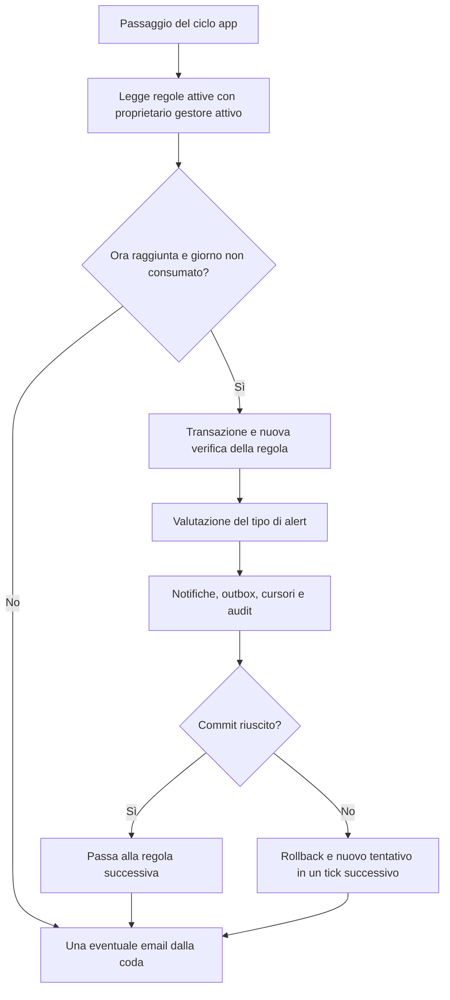

# Motore alert: pianificazione, cursori e notifiche

**Italiano** | [English](../en/tehnical/motore-alert.md)

Riferimento: implementazione del **10 ottobre 2026**, schema 7. Fonti: [alerts.c](../../src/alerts.c), [alerts.h](../../src/alerts.h), [ciclo server](../../src/server.c), [registrazione ore](../../src/workspace.c), [test alert](../../tests/test_alerts.py) e [harness temporale](../../tests/alerts_native_check.c). Per l’utilizzo consultare [guida gestore](../prod/guida-gestore.md); per i payload consultare [API app](api-app.md).

## Responsabilità e collocazione

Il pianificatore vive nel processo principale dell’app C. Non esistono un container scheduler, un cron esterno, una coda broker o un linguaggio di trigger personalizzabili. I tipi di controllo ammessi sono compilati nel programma: `invalid_job` e `missing_hours`.

Il ciclo del server invoca `alerts_tick_at(now)` al primo passaggio, quando sono trascorsi almeno 30 secondi dal controllo precedente o quando rileva un arretramento dell’orologio. Anche `select()` ha timeout di 30 secondi. Si tratta di una cadenza approssimativa: richieste lunghe, query e invii possono ritardare il passaggio successivo.

`alerts_open()` forza `TZ=Europe/Rome` e chiama `tzset()`. Questa impostazione riguarda il processo, non un calendario distinto per ogni regola. Gli istanti persistiti sono UTC, mentre giorno di esecuzione e orario della regola sono interpretati in ora italiana.

## Stato persistente e stato in memoria

| Stato | Dove si trova | Funzione |
| --- | --- | --- |
| Tipo, ora, proprietario, attivazione | `alert_rules` | Definiscono il controllo |
| `last_run_on`, `last_run_at` | `alert_rules` | Giorno locale consumato e istante dell’ultima esecuzione effettiva |
| `last_event_id` | `alert_rules` | Cursore sugli eventi di commessa inesistente |
| `starts_on`, `last_checked_on` | `alert_subjects` | Perimetro temporale già verificato per ogni persona |
| Utenti/email destinatari | `alert_rule_users`, `alert_rule_emails` | Destinazioni del risultato |
| Tentativi su commesse assenti | `alert_events` | Eventi rifiutati dal registro ore |
| Notifiche e outbox | `alert_notifications`, `alert_email_outbox` | Risultati deduplicati e contenuti da consegnare |
| Ultimo tick, cursore di spedizione | Memoria app | Cadenza locale e alternanza delle email; ricostruibili dopo riavvio |

La ripartenza conserva cursori e giornate elaborate. Non conserva invece il timer del processo, che riparte da un controllo immediato. Le tabelle sono descritte con tipi e vincoli nel [modello dati](modello-dati.md).

## Ciclo quotidiano



Lo scheduler legge prima gli ID delle regole candidate e chiude il cursore di lettura. Ogni `run_rule()` apre poi la propria transazione e ricontrolla proprietario, stato, orario e giorno: una lista letta in precedenza non costituisce autorizzazione permanente.

Il limite funzionale è 100 regole per proprietario, fino a 200 utenti nel prodotto. L’array interno delle candidate è limitato a 20.000 elementi. Una singola regola può produrre numerose notifiche; il limite di una email per tick riguarda solo la consegna SMTP, non il numero di anomalie valutate.

### Creazione, modifica ed esecuzione manuale

| Operazione | Effetto sul calendario di esecuzione |
| --- | --- |
| Nuova regola prima dell’ora odierna | Può essere elaborata dal turno automatico di oggi se attiva |
| Nuova regola all’ora odierna o dopo | Segna oggi come consumato; il primo turno automatico è successivo |
| Cambio dell’orario a un’ora già trascorsa | Consuma lo slot odierno, evitando un recupero immediato inatteso |
| Cambio del tipo di alert | Riparte con soggetti/cursore coerenti al nuovo tipo; azzera gli indicatori di esecuzione prima di applicare il controllo dello slot |
| Sola modifica del nome o destinatari | Conserva l’avanzamento; non rielabora automaticamente tutte le anomalie passate |
| `Esegui ora` | Permesso al proprietario anche con regola disattivata; aggiorna ultimo run e giorno consumato |

Un’esecuzione manuale prima dell’ora prevista consuma quindi il turno automatico della stessa giornata. Può essere ripetuta manualmente, ma cursori e chiavi evitano duplicazioni delle anomalie già processate.

`last_run_on` non prova da solo che sia avvenuto un controllo: può essere impostato dalla creazione o dalla modifica di uno slot già trascorso. Usare anche `last_run_at` e gli eventi audit. `next_run_at` è una previsione calcolata; se un turno è già in ritardo, il tick può elaborarlo prima della data futura mostrata dalla funzione di previsione.

Il calcolo degli orari locali si appoggia a `mktime()` e alle informazioni di fuso del sistema. Intorno ai cambi d’ora non esiste una politica utente separata per scegliere la prima o seconda occorrenza di un’ora ripetuta. La data persistente impedisce un secondo turno automatico nello stesso giorno dopo un’esecuzione riuscita.

## Alert `invalid_job`

La registrazione ore valida prima ID positivo, data, minuti e nota. Se la commessa non esiste, annulla la transazione delle ore e chiama `alerts_record_invalid_job()` con una transazione distinta. Non viene generato un evento equivalente per una commessa esistente ma non autorizzata.

Questo tracciamento è best effort: se l’archivio eventi è indisponibile, la registrazione ore rimane rifiutata, ma l’evento di alert può mancare. Non è quindi un registro infallibile di tutti i tentativi HTTP o un sistema generale di rilevazione delle intrusioni.

Alla creazione la regola imposta il cursore al massimo ID evento esistente. Ogni esecuzione legge gli eventi successivi in ordine, al massimo 1000. Aggiorna il cursore anche per gli eventi di utenti non più attivi, che non generano consegne. Un arretrato maggiore richiede altre esecuzioni; non viene necessariamente svuotato in un giorno.

La chiave di deduplicazione è:

```text
invalid:<user_id>:<job_id>:<work_date>
```

Tentativi ripetuti della stessa persona, sulla stessa commessa assente e stessa giornata lavorata producono una sola notifica per destinatario e regola. Il messaggio descrive il tentativo che ha creato quella notifica, non il totale dei minuti tentati successivamente. Regole diverse mantengono notifiche distinte.

La cancellazione ordinaria di una commessa rimuove le ore collegate; non produce da sola un’anomalia `invalid_job`. L’alert interviene su un successivo tentativo di registrazione con quell’ID. La distinzione evita di leggere la notifica come conferma che siano state salvate ore orfane.

## Alert `missing_hours`

Alla creazione della regola vengono censiti come soggetti gli utenti attivi, con `starts_on` uguale alla giornata corrente. Quando la regola viene eseguita, aggiunge eventuali nuovi utenti attivi non ancora censiti, usando quel giorno come inizio del loro monitoraggio.

Per ogni soggetto attivo:

1. Parte da `starts_on`, oppure dal giorno successivo a `last_checked_on`.
2. Calcola la mezzanotte successiva alla giornata lavorata in Europe/Rome.
3. Si ferma se da quella fine giornata non sono trascorse 172.800 secondi.
4. Per lunedì–venerdì somma tutte le registrazioni della persona in quella data.
5. Se il totale è inferiore a 480 minuti, prepara l’anomalia.
6. Avanza il cursore anche per giornate complete e weekend già maturati.

Ogni esecuzione limita la scansione a 3660 giorni per soggetto. Gli utenti disattivati sono esclusi dalla scansione ma conservano i propri cursori. Riattivare un account già censito può far riprendere il controllo dal vecchio cursore: non esiste uno storico dei periodi di disattivazione da sottrarre automaticamente.

La chiave è:

```text
missing:<user_id>:<work_date>
```

Esempio senza cambio d’ora: lunedì 12 ottobre 2026 termina martedì 13 alle 00:00; la soglia diventa verificabile giovedì 15 alle 00:00. Un turno delle 09:00 la controlla giovedì mattina. Le 48 ore sono una durata reale: non vengono calcolate aggiungendo semplicemente due etichette di data.

Le giornate completate con ore inserite prima della scansione non producono avviso. Dopo l’avanzamento del cursore, un’integrazione o cancellazione retroattiva non riapre quella giornata. Il contenuto della notifica è una fotografia del controllo, non un totale continuamente aggiornato.

Festività, assenze, part time, assegnazioni e stato delle commesse non modificano la soglia. Sono controllati gli utenti attivi, inclusi i gestori, non soltanto quelli scelti come destinatari della regola.

## Destinatari, transazione e deduplicazione

Una regola ammette fino a 50 destinatari utente e 50 indirizzi email, senza duplicati. `load_delivery()` rilegge attività e ruolo degli utenti. Un Gestore può ricevere anomalie su tutti i soggetti; un Operatore soltanto quelle che lo riguardano. L’indirizzo email configurato dal gestore non viene trattato come una sessione utente: riceve gli eventi previsti dalla regola.

Notifiche, outbox, cursori, ultimo run ed evento audit vengono salvati nella stessa transazione. Se audit o commit falliscono, non deve rimanere un cursore avanzato senza il risultato corrispondente. I vincoli univoci sono `(rule_id,recipient_id,event_key)` per notifiche e `(rule_id,email,event_key)` per email.

Gli eventi di audit di esecuzione sono `alert_rules.trigger` per il turno automatico, con attore di sistema, e `alert_rules.run` per l’avvio manuale. Riportano conteggi e istanti, non un nuovo evento di audit per ogni notifica generata.

La lettura delle notifiche ricontrolla destinatario e ruolo attuale. Un gestore declassato a operatore non mantiene la consultazione degli avvisi su altri soggetti. L’API mostra le ultime 100 notifiche accessibili; il contatore delle non lette è calcolato separatamente sull’intero insieme autorizzato. Segnare come letta conserva il primo `read_at` e non risolve l’anomalia.

## Outbox e disabilitazione

La valutazione crea email con stato `pending_configuration`, anche quando SMTP è assente. Il dispatcher verifica configurazione, proprietario ancora gestore attivo e indirizzo ancora presente fra i destinatari. Usa una chiave stabile derivata da namespace e ID outbox e invia fuori dalla transazione SQL.

**Disabilitare una regola ferma i turni automatici, ma non cancella le email già accodate.** La query del dispatcher non richiede `enabled=1`. Rimuovere un indirizzo dalla regola impedisce la selezione delle sue righe pendenti mentre è assente; non elimina quelle righe. Una successiva reintroduzione può renderle nuovamente eleggibili. Una consegna già iniziata non viene annullata da modifiche successive.

`smtp_configured` esposto dall’app rappresenta l’ultimo stato noto dal client: `false` può dipendere anche da addon non raggiungibile o risposta non valida. Per distinguerli usare la [diagnostica](diagnostica-e-osservabilita.md). Stati terminali, ledger e timeout sono approfonditi in [flussi delle integrazioni](flussi-integrazioni.md) e [API addon](api-addon.md).

## Verifiche e ampliamenti

Le prove esistenti in `test_alerts.py` coprono proprietà delle regole, ruoli, destinatari, deduplicazione, rollback su errore audit, soglia, cambio d’ora, riavvio e slot già trascorso. L’harness C consente di passare un orologio esplicito: non è necessario cambiare l’ora dell’host per verificare la tolleranza. Queste sono indicazioni di copertura del codice di test, non una nuova esecuzione durante la documentazione.

Per introdurre un nuovo tipo di alert occorrerà definire evento o query sorgente, perimetro dei soggetti, chiave di deduplicazione, cursore, regole di recupero e riservatezza del messaggio. La procedura dovrà preservare l’atomicità dei risultati e dei cursori. Un catalogo configurabile di nuove condizioni, destinatari per gruppo, digest, ferie o escalation resta lavoro futuro e non va ottenuto modificando direttamente le tabelle operative.
