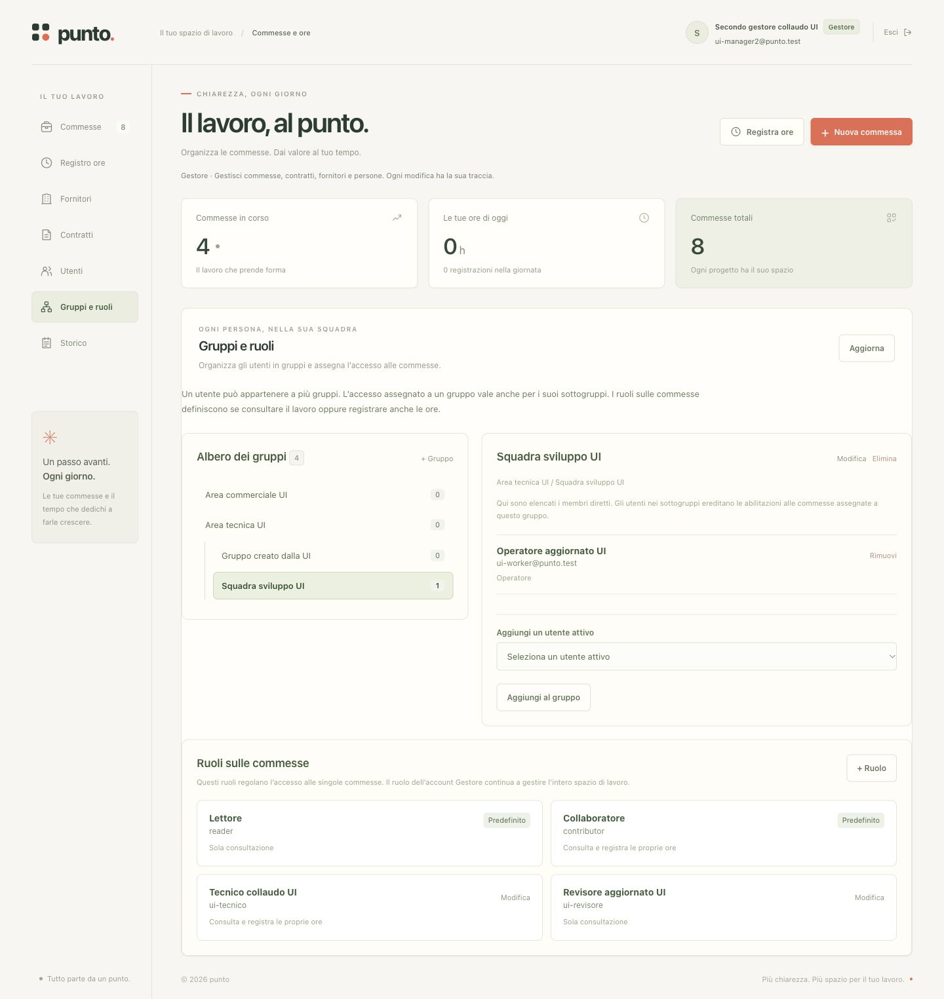
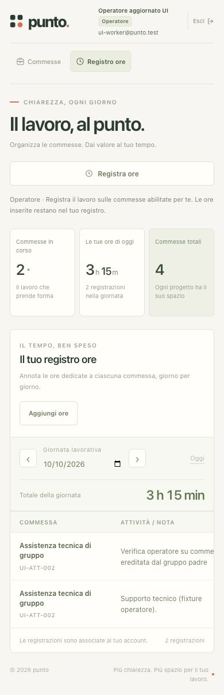

# Verifica UI e funzionalità di punto — 10 ottobre 2026

**Italiano** | [English](../en/tehnical/verifica-ui-2026-10-10.md)

> **Evidenza storica: collaudo dello schema 3.** Questo rapporto conserva i risultati e i limiti rilevati in quella fase del 10 ottobre 2026; numeri di servizi, test, sezioni e funzioni non descrivono il rilascio attuale. Per l’architettura corrente e il collaudo successivo consulta [architettura](architettura.md) e [sviluppo e test](sviluppo-test.md).

Il controllo ha riguardato le funzioni implementate nello schema 3, con prove nel browser da gestore, operatore e lettore. La suite nativa comprende 128 test: 114 superati e 14 facoltativi saltati. Lo stack Docker è disponibile, con sette servizi sani e tre membri MySQL ONLINE e PRIMARY.

Le prove di inserimento e modifica nel browser usano un server C separato, SQLite e documenti temporanei, con sole persone e commesse sintetiche. Sullo stack Docker esistente sono state eseguite navigazione e verifiche di sola lettura. I risultati del collaudo nativo non sostituiscono una nuova integrazione completa con MySQL/GridFS.

## Copertura funzionale

| Area | Verifica nel browser | Ulteriore copertura automatica |
| --- | --- | --- |
| Login e sessione | Campi obbligatori, credenziali errate, mostra/nascondi password, accesso, logout e utente disattivato | Cookie, durata delle sessioni, revoca, protezioni HTTP e origine |
| Commesse | Creazione, contratto collegato, modifica attraverso tutti i cinque stati, ricerca, filtro e nessun risultato | Validazione, unicità, persistenza e autorizzazioni |
| Registro ore | Inserimento del gestore e dell'operatore, modifica delle proprie ore, formati decimali e HH:MM, rifiuto di frazioni di minuto, limite giornaliero, totale e cambio giornata | Limiti, date, proprietà, aggiornamento e cancellazione; il dialogo di cancellazione è stato aperto e annullato nel browser |
| Fornitori | Creazione, modifica dei contatti e ricerca | Validazione, disattivazione e riferimenti |
| Contratti | Creazione, fornitore, date, importo EUR, rifiuto del terzo decimale, modifica dello stato e ricerca | Relazioni, validazioni e conservazione dei dati |
| PDF | Caricamento di un PDF sintetico, elenco aggiornato e download; byte scaricati identici all'originale | Firma, limiti, hash, metadati e permessi; integrazione live GridFS non rieseguita |
| Utenti | Modifica del nome, aggiornamento dei gruppi, declassamento del proprio gestore con un secondo gestore attivo e blocco del login disattivato | Creazione, ruoli, disattivazione, protezione dell'ultimo gestore e permessi |
| Gruppi e ruoli | Creazione di un sottogruppo, aggiunta/rimozione di un membro, creazione/modifica di un ruolo personalizzato | Gerarchie, cicli, ereditarietà, ruoli predefiniti e isolamento |
| Abilitazioni | Grant diretto e per gruppo, validità, modifica, revoca, ereditarietà e selettore limitato alle commesse utilizzabili | Intervalli, percorsi alternativi e controllo di uno stesso grant sulla data odierna e lavorata |
| Revoca durante la compilazione | Salvataggio negato; scelta revocata rimossa; data, ore e nota conservate; storico personale ancora disponibile | Controlli server dopo revoca, senza accesso implicito da una registrazione storica |
| Sola lettura | Commessa consultabile, nessun pulsante per registrare ore o amministrare; ore altrui non mostrate | Rifiuto delle API non autorizzate |
| Storico | Caricamento, filtro per entità, dettagli prima/dopo e paginazione sullo stack Docker | Eventi, immutabilità e permessi |
| Responsive e tastiera | Desktop 1440 px, tablet 768 px, telefoni 390 e 320 px; dialogo, Escape e navigazione delle schede con frecce | Verifica statica dei controlli e delle etichette; nessuna certificazione completa di accessibilità |

Le sette sezioni sono raggiungibili da gestore. L'operatore vede Commesse e Registro ore. A 320 px tutte le sezioni hanno larghezza del documento uguale al viewport; le tabelle più larghe scorrono nel proprio riquadro.

## Correzioni applicate e verificate

1. **Dati rimasti visibili dopo il declassamento.** Il cambio delle autorizzazioni invalida le richieste precedenti, svuota dati e metriche, chiude i dialoghi e ricarica le risorse autorizzate. La prova passa da otto commesse a una senza ricaricamento manuale e rimuove le azioni di gestione delle ore.
2. **Commessa revocata rimasta nel selettore aperto.** Il ricaricamento aggiorna anche le opzioni del dialogo ore. La selezione revocata diventa vuota e un messaggio invita a scegliere una commessa abilitata, conservando la bozza. Il tentativo rifiutato non aggiunge ore.
3. **Membri dei gruppi non aggiornati dopo una modifica utente.** Il salvataggio invalida organizzazione e membri. Rientrando nella scheda viene mostrato il nuovo nome senza dover premere Aggiorna.
4. **Stati dei contratti etichettati come stati delle commesse nello storico.** La formattazione usa il tipo dell'entità e riconosce gli snapshot annidati. Il passaggio del contratto da Bozza ad Attivo è mostrato correttamente.
5. **Header fuori schermo a 320 px.** Nome ed email possono restringersi senza spingere il pulsante Esci oltre il bordo. L'overflow di 13 px rilevato con un nome lungo è eliminato su tutte le sette sezioni.

Le modifiche interessano `public/app.js` e `public/workspace.css`. Sono state verificate nell'ambiente temporaneo. Il container applicativo esistente non è stato ricostruito o riavviato: queste correzioni richiedono un successivo rilascio per essere disponibili nello stack Docker.

## Controlli live di infrastruttura

- Sette servizi Docker healthy.
- `/healthz` risponde HTTP 200 tramite Nginx su loopback e sul nome `progetti.tuaazienda.it` risolto localmente; questo non verifica DNS pubblico o accessibilità da Internet.
- Tutti i nodi vedono gli stessi tre membri ONLINE e PRIMARY, con scritture abilitate e modalità multi-primary.
- Confermati consistenza `BEFORE_AND_AFTER`, controlli di aggiornamento e TLS MySQL obbligatorio.
- Presenti intestazioni `no-store`, CSP, protezione dai frame e `nosniff`.

I 14 test facoltativi saltati sono: tre HA, sette rete Docker, uno TLS Connector/C e tre integrazioni live MySQL/GridFS. Non sono state ripetute prove di guasto, riavvii o scritture applicative sullo stack esistente.

## Aspetti ancora da migliorare

- **Fuso orario:** la UI determina oggi e alcuni badge di validità con il fuso del browser, mentre il backend autorizza con il fuso del server. Vicino alla mezzanotte possono divergere le indicazioni per utenti in altri fusi. La roadmap R0 prevede una data aziendale fornita dal server.
- **Contrasto:** il testo bianco sul pulsante corallo `#e96850` ha rapporto 3,20:1; due combinazioni di testo secondario esaminate sono circa 3,46–3,47:1. Questi elementi richiedono una revisione del contrasto. Non è stata eseguita una verifica completa WCAG, con screen reader o su tutti i browser.
- **Funzioni future:** finanza, più società/valute, Google Calendar, bozze offline e le altre aggiunte della roadmap non sono ancora interfacce implementate. Non possono essere considerate collaudate. Cifratura di campi/PDF, vault delle chiavi e calcoli cifrati restano anch'essi non implementati, come dichiarato nel README.

## Evidenze visive

Le schermate contengono esclusivamente i dati sintetici del collaudo.

